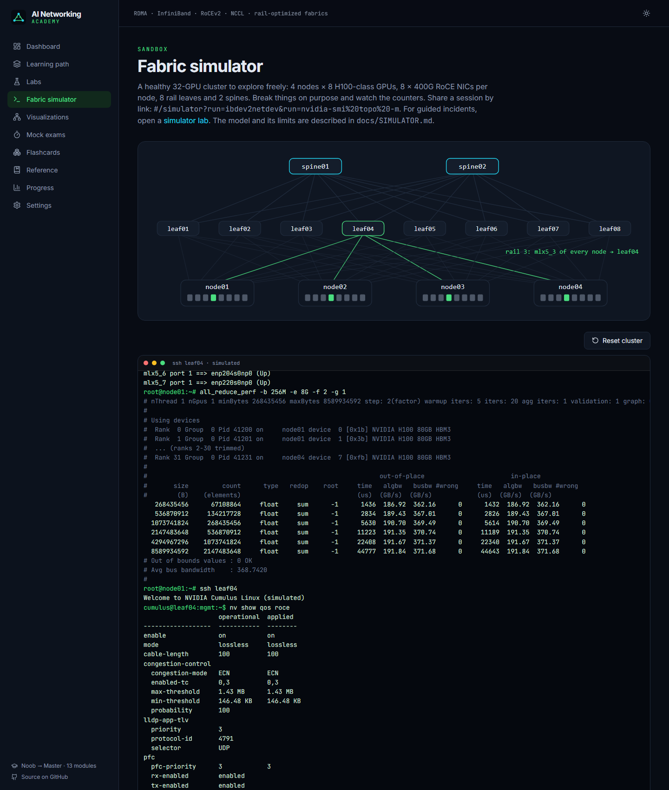
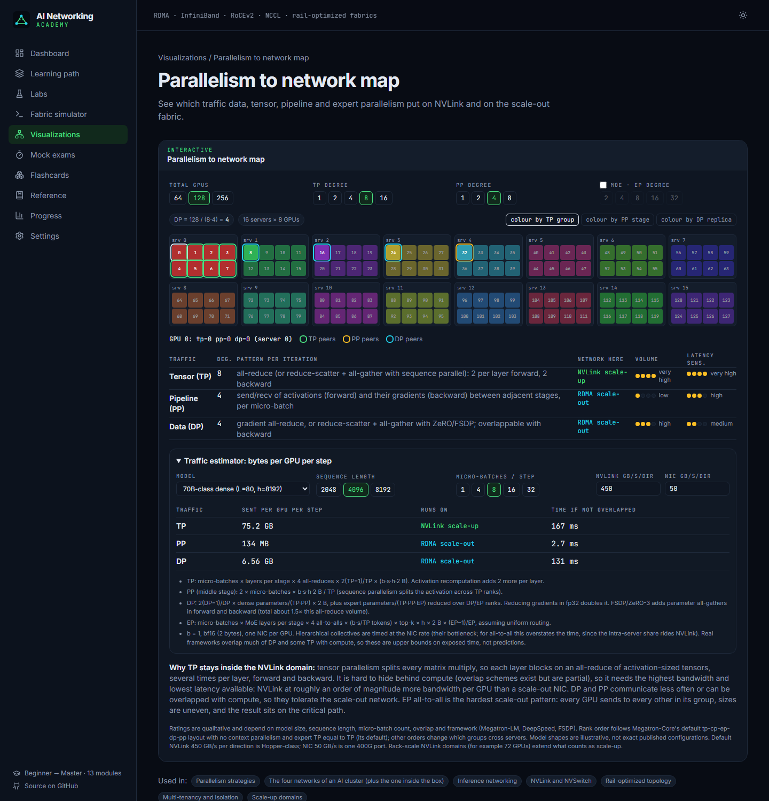
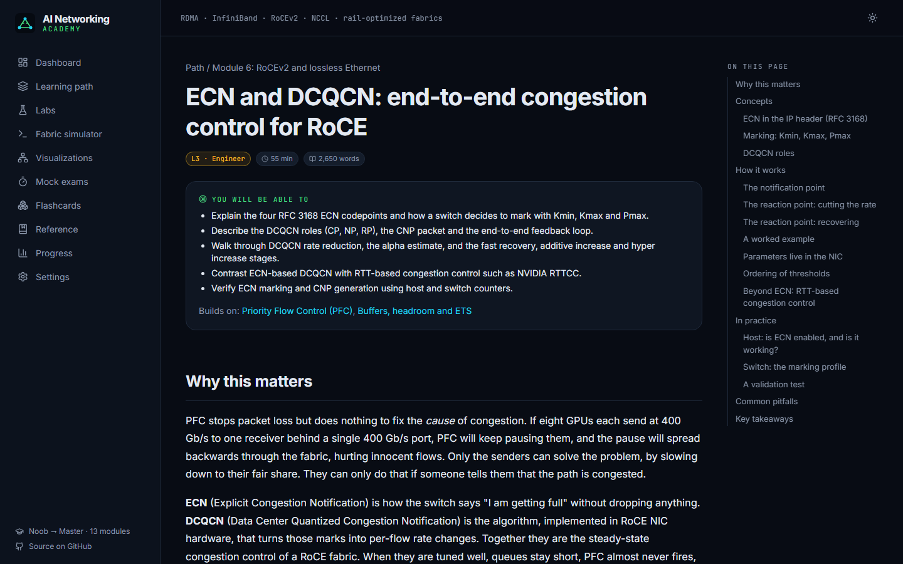
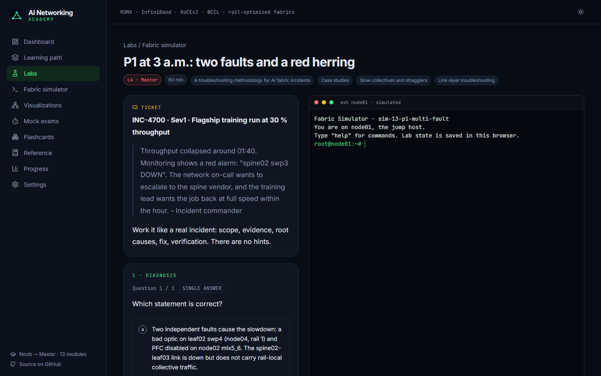
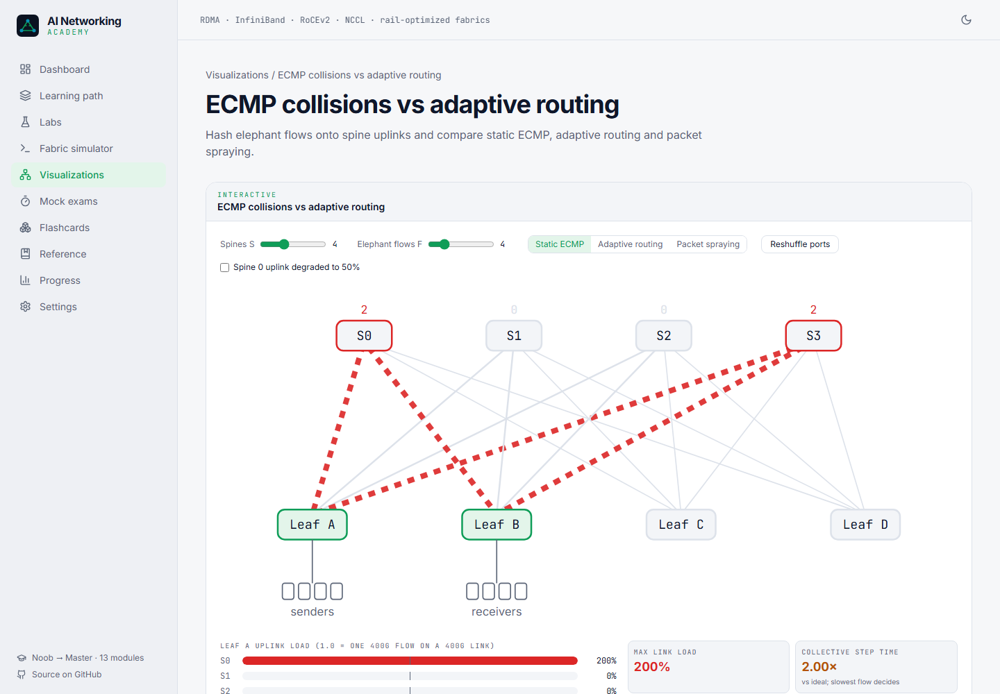

<div align="center">

# AI Networking Academy

**From beginner to master in AI cluster networking.**
RDMA · InfiniBand · RoCEv2 · lossless Ethernet · NCCL · rail-optimized fabrics · troubleshooting

[](https://github.com/jurajliskalc/ai-networking-academy/actions/workflows/ci.yml)
[](https://jurajliskalc.github.io/ai-networking-academy/)


 

**[▶ Open the academy](https://jurajliskalc.github.io/ai-networking-academy/)** · runs entirely in your browser, no account, no backend


</div>

## Why this exists

Training a frontier model is a distributed systems problem in which the network decides how fast
thousands of GPUs can work together. One mis-set PFC priority, a marginal optic or a stale NCCL variable
can cost a third of a cluster's throughput while every dashboard stays green.

The knowledge needed to prevent that is scattered across IEEE standards, InfiniBand specifications,
vendor manuals, SIGCOMM papers and tribal knowledge. This academy puts it in one place as a structured,
hands-on curriculum. It starts at "what is an Ethernet frame" and ends at designing and debugging a
1,024-GPU fabric.

## What's inside

| | |
|---|---|
| **76 lessons** in 13 modules, ~187,000 words | Four levels: Beginner → Practitioner → Engineer → Master. Every lesson follows the same structure: *Why this matters → Concepts → How it works → In practice → Common pitfalls → Key takeaways*. Lessons include callouts for network engineers (ANALOGY) and interview prep (INTERVIEW). |
| **567 quiz questions** | Each lesson ends with a quiz, mostly scenario questions ("given these counters, what is wrong?"). **Every option is explained**, including the wrong ones. |
| **19 Fabric Simulator labs** | Break/fix incident tickets in a browser-simulated 32-GPU rail-optimized RoCE cluster, plus an InfiniBand variant (`ibstat`, `iblinkinfo`, `perfquery`, `sminfo`). You investigate with real tool syntax (`ethtool -S`, `mlnx_qos`, `show_gids`, `ib_write_bw`, `all_reduce_perf`, NVUE), commit a diagnosis, apply a fix, and the lab grades the fabric state. |
| **16 Real HW labs** in four tiers | Bring your own gear. **Tier 0** (one VM): Soft-RoCE, RoCEv2 captures, containerlab BGP-unnumbered Clos, ECMP entropy, ECN/DCTCP, EVPN-VXLAN. **Tier 1** (two RDMA hosts): inventory, first RoCEv2 traffic, host PFC/DSCP/ECN, link health and optics, break/fix with fault injection, InfiniBand bring-up. **Tier 2** (lossless switch): incast, PFC and ECN on real counters. **Tier 3** (GPU nodes): GPUDirect RDMA and multi-node NCCL. Every lab is personalised with your lab profile and graded by a `check.sh`. |
| **Real HW toolkit** | A Connect page that builds your lab profile and generates `lab.env`, netplan/nmcli, `/etc/hosts` and switch snippets; `aina-hw`, a dependency-free Python tool that inventories hosts over SSH, runs lab checks and serves results through a read-only local agent; and a fabric health review (MTU, PCIe, GIDs, QoS, firmware, counters) in the browser. Guides for requirements, host and network setup, safety and troubleshooting. |
| **33 interactive visualizations** | Embedded in the lessons and runnable on their own. Examples: a parallelism-to-network map with a per-step traffic estimator, the life of an RDMA WRITE, Ethernet/RoCE frame and MTU builders, subnet and rail addressing, PFC headroom and DSCP mapping, PFC deadlock builder, ECMP collisions vs adaptive routing, ring vs tree all-reduce, nccl-tests reader, NCCL environment explorer, PCIe/NVLink/InfiniBand speed tables, BER/FEC calculator, optics planner, counter decoder, a slow-job triage tree and telemetry sampling. Every widget's math is unit-tested. |
| **3 timed mock exams** (156 questions) | Fundamentals, engineer and master level, scored by domain. Original practice material, not real certification questions. |
| **Reference** | 158 annotated commands (Linux, rdma-core, perftest, InfiniBand, NVIDIA tools, NCCL, Cumulus NVUE, SONiC) and a 241-term glossary that also drives **SM-2 spaced-repetition flashcards**. |
| **Search and accessibility** | Site-wide search (`/` or Ctrl+K) across lesson sections, labs, guides, commands and the glossary, with deep links to the matching section. Built to WCAG 2.2 AA: keyboard-operable everywhere, including quizzes, the simulator shell and all widgets; axe-clean in light and dark themes. |
| **Progress tracking** | A lesson counts as mastered only when it is read *and* its quiz is passed. Streaks, an activity heatmap, weak-spot review, and exam domain profiles. Everything stays in your browser, with export and import. |

### The curriculum

| # | Module | Level |
|---|---|---|
| 0 | Networking foundations for AI engineers | Beginner |
| 1 | Why AI needs a different network | Beginner |
| 2 | Inside the GPU server: PCIe, NUMA, NICs/DPUs, GPUDirect, NVLink | Practitioner |
| 3 | Data center fabric fundamentals: Clos, ECMP, BGP, EVPN-VXLAN | Practitioner |
| 4 | RDMA fundamentals: verbs, QPs, transports, perftest | Practitioner |
| 5 | InfiniBand: SM, routing, credits and VLs, SHARP, diagnostics | Engineer |
| 6 | RoCEv2 and lossless Ethernet: PFC, headroom, ECN/DCQCN, QoS, storms | Engineer |
| 7 | Load balancing and congestion: entropy, adaptive routing, Spectrum-X, Ultra Ethernet | Engineer |
| 8 | Collective communication and NCCL | Engineer |
| 9 | AI cluster design: rail-optimized topologies, SuperPOD, sizing, optics, NVL72 | Master |
| 10 | Operations: telemetry, gNMI, burn-in, automation, UFM/NetQ | Master |
| 11 | Troubleshooting mastery: methodology, BER/FEC, lossless misconfigs, stragglers, case studies | Master |
| 12 | Capstone (a 1,024-GPU fabric design), interview prep, exam strategy | Master |

The full lesson map is in [docs/CURRICULUM_PLAN.md](docs/CURRICULUM_PLAN.md).

## The Fabric Simulator



A deterministic model of 4 nodes × 8 GPUs, 8 × 400G RoCE NICs per node, 8 rail leaves and 2 spines. It
reproduces the symptoms that real faults produce: which counters move, which tests fail and roughly how
much bandwidth is lost. One example is a PFC priority mismatch, where `ib_write_bw` runs at line rate
while the collective runs at a third of normal speed. Faults include MTU black holes, PFC and trust
misconfigurations, lost switch QoS, marginal optics, PCIe downtraining, GID index errors and NCCL
configuration drift.

Every lab is checked by the test suite: it must fail its checks before the documented fix and pass all
of them after the fix is replayed. The model and its limits are documented in
[docs/SIMULATOR.md](docs/SIMULATOR.md).

## Real hardware labs

The **Real HW labs** section is for people who want to study on their own gear, from one VM up to GPU
nodes behind a lossless switch. It has guides for requirements, host setup, network setup, safety and
troubleshooting, plus a **Connect** page:

1. Describe your lab once (hosts, data IPs, RDMA devices, MTU, lossless priority and DSCP, switch).
   Every lab and guide command is filled in with your values, and the page generates `lab.env`,
   netplan/nmcli snippets, `/etc/hosts` lines and a switch baseline.
2. On host A, `labs/hw-toolkit/aina-hw collect-all` inventories every host over SSH, and
   `aina-hw check <lab>` runs a lab's `check.sh`.
3. `aina-hw serve` exposes the results read-only on `127.0.0.1:8765`. Reach it through an SSH tunnel,
   or import the JSON files instead. The academy reviews the fabric's health in the browser (MTU, PCIe,
   GIDs, QoS, firmware, counters) and marks labs whose check passed as verified. Nothing leaves your
   browser.

Labs that change NIC or kernel settings save the original state and ship restore scripts. The labs are
written for NVIDIA ConnectX NICs, with notes on the generic Linux equivalents.



<table><tr>
<td></td>
<td></td>
</tr><tr>
<td></td>
<td></td>
</tr></table>

## Run it locally

**Windows:** double-click **`start-academy.bat`**. On first run it fetches a portable, checksum-verified
Node.js into `.tools/`, builds the site, and opens http://127.0.0.1:8740. Nothing is installed system-wide.

**Linux / macOS** (Node.js 20+):

```bash
./scripts/start.sh            # build if needed, serve on http://127.0.0.1:8740
```

**Development:**

```bash
cd frontend
npm ci
npm run dev        # hot reload
npm run validate   # content rules: IDs, structure, quiz rules, cross-references, tables
npm test           # unit tests + every simulator lab replayed
npm run build      # type check + production build into frontend/dist
npm run e2e        # Playwright browser tests against the build (uses your installed Google Chrome)
```

Tier 0 labs need an Ubuntu 24.04 VM; Tier 1-3 labs need your own RDMA hosts (see the Real HW labs section in the app, and [labs/README.md](labs/README.md)). Toolkit tests: `python3 -m unittest discover -s labs/hw-toolkit/tests` (Linux).

## How it is built

A static single-page app (React 19, TypeScript, Vite, Tailwind CSS v4) with no backend. All learning
content is plain Markdown and YAML under [`content/`](content), validated and compiled to JSON at build
time. GitHub Actions validates, tests and builds every push, and deploys `main` to GitHub Pages. See
[docs/ARCHITECTURE.md](docs/ARCHITECTURE.md).

```
content/      lessons, quizzes, labs, exams, commands, glossary (Markdown + YAML)
frontend/     React app, content compiler, Fabric Simulator, tests
labs/         lab files (topologies, scripts, check.sh) and hw-toolkit/ (aina-hw, lib.sh, setup-rdma-host.sh)
docs/         architecture, authoring guide, simulator, curriculum plan
```

## Accuracy policy

Content is written for engineers who will act on it, so accuracy comes first:

* No invented CLI flags, counters, environment variables or APIs.
* Vendor- and generation-specific facts are hedged and point to the authoritative documentation.
* Sample command output is labelled illustrative unless it is a real capture.
* Every lesson, quiz and exam was reviewed twice after it was written: once by expert read-through and once by a source-based fact-check of about 2,400 claims, plus a blind re-answering of all 674 questions with shuffled options. The hands-on and hardware labs are
  syntax-checked (`bash -n`; the original Tier 0 labs also with ShellCheck) and are marked `verified: false`
  until they have been run end to end on a reference VM or reference hardware. Five Tier 0 labs have been
  run end to end and are marked verified (see `labs/README.md`).

Found an error? Please [open an issue](https://github.com/jurajliskalc/ai-networking-academy/issues/new?template=content-error.md)
with a source. See [CONTRIBUTING.md](CONTRIBUTING.md).

## License

Code: MIT. Learning content: CC BY-SA 4.0. See [LICENSE](LICENSE). This is an independent, unofficial
study resource. Product names belong to their owners, and nothing here is endorsed by any vendor or
certification body.
