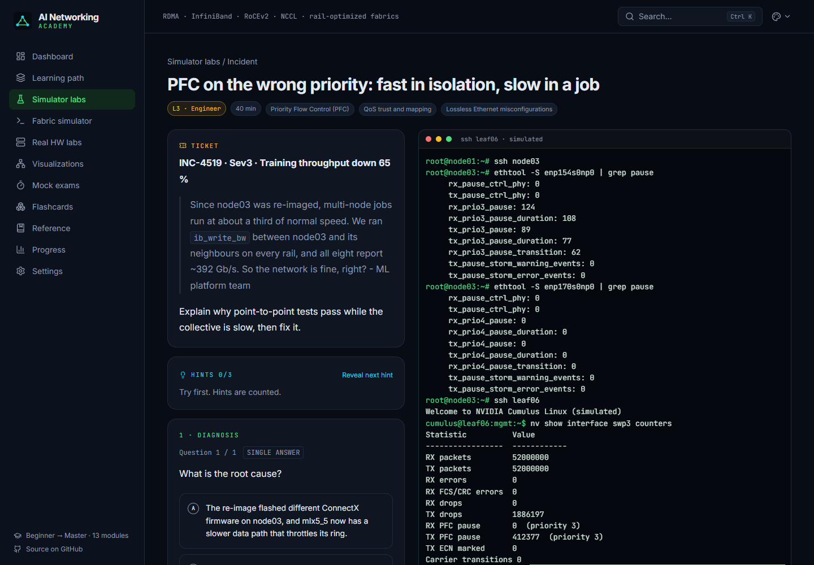
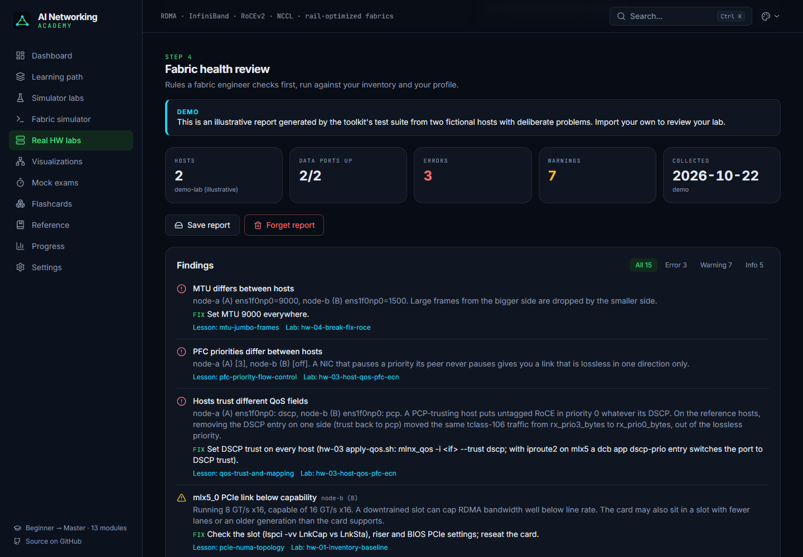
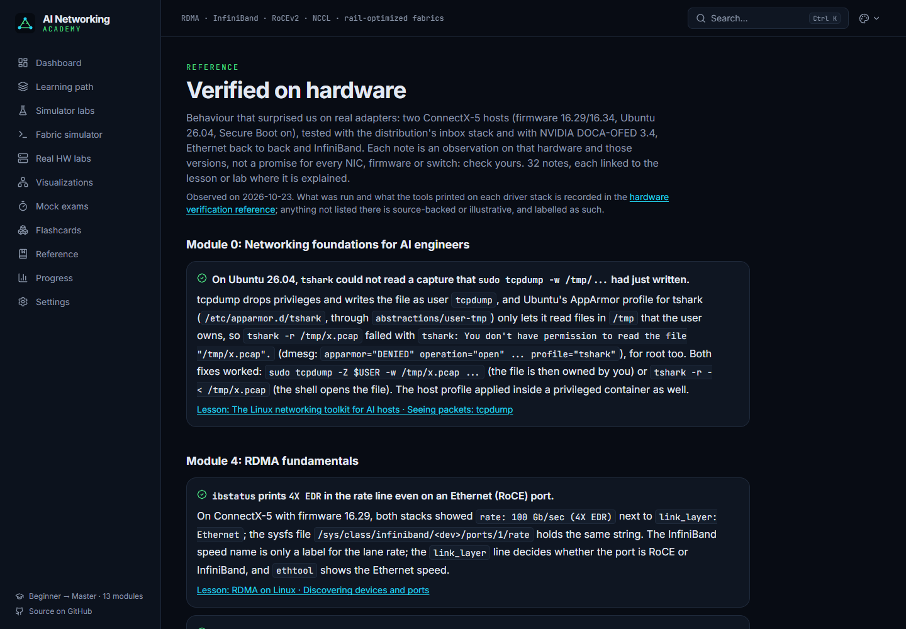
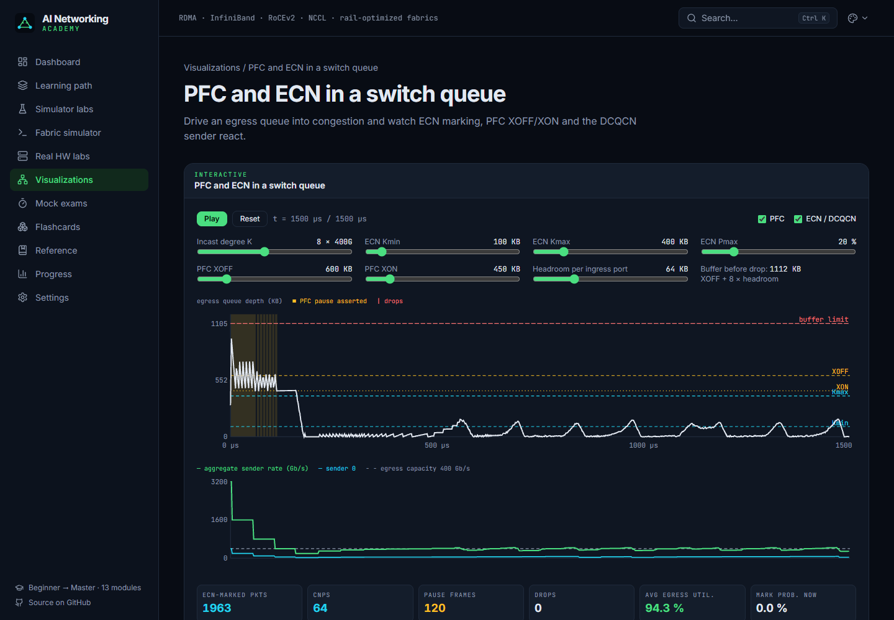

<div align="center">

# AI Networking Academy

**A hands-on training and validation platform for AI cluster networking.**
RDMA · RoCEv2 · InfiniBand · NCCL · lossless Ethernet · AI-fabric design · troubleshooting

[](https://github.com/jurajliskalc/ai-networking-academy/actions/workflows/ci.yml)
[](https://jurajliskalc.github.io/ai-networking-academy/)


 

**[Live Academy](https://jurajliskalc.github.io/ai-networking-academy/)** ·
**[Try the 5-minute PFC incident](https://jurajliskalc.github.io/ai-networking-academy/#/labs/sim-03-pfc-priority-mismatch)** ·
**[Real hardware labs](https://jurajliskalc.github.io/ai-networking-academy/#/hw/labs)** ·
**[Hardware verification](docs/HARDWARE_VERIFICATION.md)** ·
**[Architecture](docs/ARCHITECTURE.md)** ·
**[Portfolio tour](docs/PORTFOLIO_TOUR.md)**

<a href="https://jurajliskalc.github.io/ai-networking-academy/#/labs/sim-03-pfc-priority-mismatch"></a>

*A fault-injection lab: the ticket on the left, real tool syntax on the right. Here the NIC only has pause
counters for priority 4 while its leaf pauses priority 3 and drops. The
[portfolio tour](docs/PORTFOLIO_TOUR.md#the-five-minute-demo-a-pfc-incident) solves it in ten commands.*

</div>

## What this is

A course and lab platform that teaches how the network of a GPU cluster works and how to debug it when it
does not. It runs entirely in the browser (no account, no backend), and it is built to be checked: every
lab is graded by code, and what the content says about host tools was compared with real adapters.

- **76 structured lessons** in 13 modules, from the Ethernet frame to a 1,024-GPU fabric design, with
  568 quiz questions and 3 mock exams
- **22 Fabric Simulator labs**: break/fix incidents in a browser-simulated 32-GPU rail-optimized cluster,
  investigated with real tool syntax and graded on the state of the fabric
- **22 hands-on labs** for your own VM, RDMA hosts, switch or GPU nodes, each graded by a `check.sh`
- **Verified on real hardware**: ConnectX-5 adapters, RoCE on both the inbox RDMA stack and NVIDIA
  DOCA-OFED, InfiniBand on DOCA-OFED; 19 of the 22 labs have been run end to end
- **A hardware toolkit** (`aina-hw`) that inventories RDMA hosts, runs the lab checks and reviews fabric
  health
- **CI on every push**: content validation, unit tests that replay every simulator lab, browser tests,
  shell checks and toolkit tests

New here? The [portfolio tour](docs/PORTFOLIO_TOUR.md) is the five-minute route: one incident solved end to
end, then where the evidence lives.

## Why this is different

**Real verification.** Every statement about tool output is in one of four states, and the content says
which: *verified on real hardware* (tagged captures and `[!VERIFIED]` notes, traceable to
[docs/HARDWARE_VERIFICATION.md](docs/HARDWARE_VERIFICATION.md)), *simulated* (the Fabric Simulator, a
documented teaching model), *illustrative* (sample output, labelled as such) or *source-backed but not
hardware-verified* (hedged, with the reference).

**Failure-first learning.** Learners get an incident ticket and a broken fabric, not a configuration
recipe. They form a hypothesis, read counters, commit a diagnosis, apply a fix and prove it.

**The whole stack.** Collective behaviour and NCCL, RDMA verbs and transports, host networking and NIC
behaviour, lossless Ethernet (PFC, ECN, DCQCN), fabric routing and load balancing, telemetry and
counters, and validation methodology.

**Engineering rigor.** Content is validated by a compiler, every simulator lab is replayed by tests, and
a hands-on lab is marked verified only after its own check passed on a real run.

## Verified on real hardware

Host tooling, RDMA behaviour, counter formats, PFC behaviour, RoCE and InfiniBand workflows and the
differences between driver stacks were checked on two Dell PowerEdge R640 systems with NVIDIA/Mellanox
ConnectX-5 VPI adapters (100GbE and EDR InfiniBand, cabled back to back), on Ubuntu 26.04 with both the
distribution's inbox stack and NVIDIA DOCA-OFED 3.4 (InfiniBand with DOCA-OFED only). Verified observations
are tagged in the content and traceable to
**[docs/HARDWARE_VERIFICATION.md](docs/HARDWARE_VERIFICATION.md)**; the per-lab run record is in
[labs/README.md](labs/README.md).

Things the documentation rarely mentions are taught where they matter: RDMA device names differ per driver
stack, enabling PFC turns 802.3x pause off and re-enabling pause silently clears PFC, some tools exist only
with NVIDIA's stack, Secure Boot lockdown blocks some diagnostics, and offloaded RoCE needs a different
capture method.

What that does **not** cover: this is a lab-scale setup with one NIC model, no switch and no GPUs, inside
VMs with PCI passthrough. Three labs (`hw-06`, `hw-07`, `hw-08`) need a lossless switch or GPU nodes and
stay `verified: false`. Switch CLIs, switched-fabric behaviour, 400G-specific and optical-module output and
GPU/NCCL output follow primary sources and are labelled illustrative. An observation on this hardware is
stated as an observation, not as general vendor behaviour.

## AI-assisted engineering workflow

AI coding and review agents (Anthropic's Claude Code) are used to accelerate implementation, content
drafting, review, gap analysis and repetitive engineering work; every commit carries a `Co-Authored-By`
trailer. Generated output is treated as untrusted until it has been validated:

| Kind of claim | What it must survive |
|---|---|
| A CLI flag, counter, environment variable or spec fact | A check against the primary source: the RFC or specification, the tool's source code, or vendor documentation |
| A number in a lesson, quiz or lab | Recomputation in a separate pass |
| A quiz or exam answer key | Blind re-answering with shuffled options by an AI solver that cannot see the key |
| Host-tool output and behaviour | Comparison with captures from the reference hardware, then pinned by tests |
| A simulator lab | Tests: broken before the documented fix, clean after it |
| A hands-on lab | An end-to-end run, graded by its own `check.sh`; `verified: false` until then |

The review passes described in [IMPLEMENTATION_STATUS.md](IMPLEMENTATION_STATUS.md) were run by AI agents
that had not written the material under review. They are not human peer review. The working rules the
agents follow are in [CLAUDE.md](CLAUDE.md).

## What's inside

| | |
|---|---|
| **76 lessons** in 13 modules, about 198,000 words | Four levels: Beginner → Practitioner → Engineer → Master. Every lesson follows the same structure: *Why this matters → Concepts → How it works → In practice → Common pitfalls → Key takeaways*, with callouts for network engineers (ANALOGY) and interview prep (INTERVIEW). |
| **568 quiz questions** | Each lesson ends with a quiz, mostly scenario questions ("given these counters, what is wrong?"). **Every option is explained**, including the wrong ones. |
| **22 Fabric Simulator labs** | Incident tickets in a simulated rail-optimized RoCE cluster, plus an InfiniBand variant. You investigate with real tool syntax (`ethtool -S`, `mlnx_qos`, `show_gids`, `ib_write_bw`, `all_reduce_perf`, `ibstat`, `iblinkinfo`, `perfquery`, NVUE), commit a diagnosis, apply a fix, and the lab grades the fabric state. |
| **22 hands-on labs** in four tiers | Tier 0 on one VM, Tier 1 on two RDMA hosts, Tier 2 with a lossless switch, Tier 3 with GPU nodes (see [Real hardware labs](#real-hardware-labs)). Every lab is personalised with your lab profile and graded by a `check.sh`. |
| **Hardware toolkit** | A Connect page that builds your lab profile and generates `lab.env`, netplan/nmcli, `/etc/hosts` and switch snippets; `aina-hw`, a dependency-free Python tool that inventories hosts over SSH, runs lab checks (resumable per task) and serves results and live port counters through a read-only local agent; and a fabric health review (MTU, PCIe, GIDs, QoS, firmware, counters) in the browser. |
| **45 interactive visualizations** | Embedded 131 times in 74 of the 76 lessons and runnable on their own: RDMA WRITE step by step, PFC and ECN in a switch queue, PFC headroom and deadlocks, ECMP collisions and packet spraying, ring and in-network all-reduce, a rail-optimized path explorer, a fabric sizer, BER/FEC, a counter decoder and more (the full list is in [docs/CURRICULUM_PLAN.md](docs/CURRICULUM_PLAN.md)). The math of every widget with pure logic is unit-tested. |
| **3 timed mock exams** (156 questions) | Fundamentals, engineer and master level, scored by domain. Original practice material, not real certification questions. |
| **Reference** | 165 annotated commands (Linux, rdma-core, perftest, InfiniBand, NVIDIA tools, NCCL, Cumulus NVUE, SONiC) with the inbox and DOCA-OFED forms where they differ, and a 241-term glossary that also drives SM-2 spaced-repetition flashcards. |
| **Search, accessibility, progress** | Site-wide search with deep links to sections. Built to WCAG 2.2 AA: keyboard-operable everywhere, including quizzes, the simulator shell and all widgets; axe-clean in light and dark themes. A lesson counts as mastered only when it is read *and* its quiz is passed; progress stays in your browser, with export and import. |

### The curriculum

| # | Module | Level |
|---|---|---|
| 0 | Networking foundations for AI engineers | Beginner |
| 1 | Why AI needs a different network | Beginner |
| 2 | Inside the GPU server: PCIe, NUMA, NICs/DPUs, GPUDirect, NVLink | Practitioner |
| 3 | Data center fabric fundamentals: Clos, ECMP, BGP, EVPN-VXLAN | Practitioner |
| 4 | RDMA fundamentals: verbs, QPs, transports, perftest | Practitioner |
| 5 | InfiniBand: SM, routing, credits and VLs, SHARP, diagnostics | Engineer |
| 6 | RoCEv2 and lossless Ethernet: PFC, headroom, ECN/DCQCN, QoS, storms | Engineer |
| 7 | Load balancing and congestion: entropy, adaptive routing, Spectrum-X, Ultra Ethernet | Engineer |
| 8 | Collective communication and NCCL | Engineer |
| 9 | AI cluster design: rail-optimized topologies, SuperPOD, sizing, optics, NVL72 | Master |
| 10 | Operations: telemetry, gNMI, burn-in, automation, UFM/NetQ | Master |
| 11 | Troubleshooting mastery: methodology, BER/FEC, lossless misconfigs, stragglers, case studies | Master |
| 12 | Capstone (a 1,024-GPU fabric design), interview prep, exam strategy | Master |

The full lesson map is in [docs/CURRICULUM_PLAN.md](docs/CURRICULUM_PLAN.md).

## The Fabric Simulator

A deterministic model of 4 nodes × 8 GPUs, 8 × 400G RoCE NICs per node, 8 rail leaves and 2 spines. It
reproduces the symptoms that real faults produce: which counters move, which tests fail and roughly how
much bandwidth is lost. Faults include MTU black holes, PFC and trust misconfigurations, lost switch QoS,
marginal optics, PCIe downtraining, GID index errors, NCCL configuration drift, low ECMP entropy and
subnet manager failures.

Start with **[the PFC incident](https://jurajliskalc.github.io/ai-networking-academy/#/labs/sim-03-pfc-priority-mismatch)**:
`ib_write_bw` runs at line rate on every rail while the collective runs at a third of normal speed. The
[portfolio tour](docs/PORTFOLIO_TOUR.md#the-five-minute-demo-a-pfc-incident) walks through it in ten
commands.

Every lab is checked by the test suite: it must fail its checks before the documented fix and pass all of
them after the fix is replayed. It is a teaching model, not an emulator or a performance predictor; what
it models and where it stops is documented in [docs/SIMULATOR.md](docs/SIMULATOR.md).

## Real hardware labs

For people who want to study on their own gear, from one VM up to GPU nodes behind a lossless switch.

| Tier | You need | Labs |
|---|---|---|
| 0 | One Ubuntu VM | Linux networking, Soft-RoCE and perftest, RoCEv2 captures, a containerlab BGP-unnumbered Clos, ECMP entropy, ECN/DCTCP, EVPN-VXLAN |
| 1 | Two RDMA hosts | Inventory, first RoCEv2 traffic, host PFC/DSCP/ECN, link health and optics, break/fix with fault injection, InfiniBand bring-up, subnet manager failover, IPoIB, P_Key partitions, ibdiagnet triage, MPI over UCX, CPU allreduce bus bandwidth |
| 2 | A lossless switch and a third host | Incast, PFC and ECN on real switch counters (not yet verified) |
| 3 | GPU nodes | GPUDirect RDMA and two-node NCCL (not yet verified) |

1. Describe your lab once on the **Connect** page (hosts, data IPs, RDMA devices, MTU, lossless priority
   and DSCP, switch). Every lab and guide command is filled in with your values, and the page generates
   `lab.env`, netplan/nmcli snippets, `/etc/hosts` lines and a switch baseline.
2. On host A, `labs/hw-toolkit/aina-hw collect-all` inventories every host over SSH, and
   `aina-hw check <lab>` runs a lab's `check.sh`.
3. `aina-hw serve` exposes the results read-only on `127.0.0.1:8765`. Reach it through an SSH tunnel, or
   import the JSON files instead. The academy reviews the fabric's health in the browser and marks labs
   whose check passed as verified. Nothing leaves your browser.

Labs that change NIC or kernel settings save the original state and ship restore scripts. The labs are
written for NVIDIA ConnectX NICs, with notes on the generic Linux equivalents.

## Screens

<table>
<tr>
<td width="50%"><br /><sub><b>Fabric health review.</b> <code>aina-hw</code> inventories the hosts; the browser applies the checks a fabric engineer makes first (MTU, PFC and trust mismatches, PCIe, GIDs, firmware). Shown with the bundled demo report.</sub></td>
<td width="50%"><br /><sub><b>Verified on hardware.</b> Every observation made on the reference adapters, with its scope stated and a link to the lesson or lab that explains it.</sub></td>
</tr>
<tr>
<td><br /><sub><b>PFC and ECN in a switch queue.</b> One of 45 interactive visualizations: drive an egress queue into congestion and watch ECN marking, XOFF/XON and the DCQCN sender react.</sub></td>
<td><br /><sub><b>Dashboard.</b> A learning path from Beginner to Master; a lesson counts as mastered only when it is read and its quiz is passed.</sub></td>
</tr>
</table>

## Run it locally

**Windows:** double-click **`start-academy.bat`**. On first run it fetches a portable, checksum-verified
Node.js into `.tools/`, builds the site, and opens http://127.0.0.1:8740. Nothing is installed system-wide.

**Linux / macOS** (Node.js 20+):

```bash
./scripts/start.sh            # build if needed, serve on http://127.0.0.1:8740
```

**Development:**

```bash
cd frontend
npm ci
npm run dev        # hot reload
npm run validate   # content rules: IDs, structure, quiz rules, cross-references, tables
npm test           # unit tests + every simulator lab replayed + doc counts
npm run build      # type check + production build into frontend/dist
npm run e2e        # Playwright browser tests against the build (uses your installed Google Chrome)
npm run stats      # the counts in this README, derived from the source tree
```

Tier 0 labs need an Ubuntu 24.04 VM; Tier 1-3 labs need your own RDMA hosts (see the Real HW labs section in the app, and [labs/README.md](labs/README.md)). Toolkit tests: `python3 -m unittest discover -s labs/hw-toolkit/tests` (Linux).

## How it is built

A static single-page app (React 19, TypeScript, Vite, Tailwind CSS v4) with no backend. All learning
content is plain Markdown and YAML under [`content/`](content), validated and compiled to JSON at build
time. GitHub Actions validates, tests, builds and browser-tests every push, and deploys `main` to GitHub
Pages. See [docs/ARCHITECTURE.md](docs/ARCHITECTURE.md).

```
content/      lessons, quizzes, labs, exams, commands, glossary (Markdown + YAML)
frontend/     React app, content compiler, Fabric Simulator, tests
labs/         lab files (topologies, scripts, check.sh) and hw-toolkit/ (aina-hw, lib.sh, setup-rdma-host.sh)
docs/         architecture, authoring guide, simulator, curriculum plan, hardware verification, portfolio tour
```

The numbers on this page are derived from the source tree: `npm run stats` prints them, and a test fails
the build when a count advertised here no longer matches.

## Engineering areas demonstrated

- **AI networking:** RDMA, RoCEv2, InfiniBand, lossless Ethernet (PFC, ECN, DCQCN), collectives and NCCL
  configuration (NCCL is taught and simulated; it has not yet been run on GPU hardware here)
- **Data center networking:** Clos fabrics, BGP unnumbered, EVPN-VXLAN and ECMP, built as containerlab labs
- **Linux and RDMA tooling:** rdma-core, perftest, iproute2 `dcb`, ethtool, NVIDIA `mlnx_qos` and MFT,
  OpenSM, UCX and Open MPI, on two driver stacks
- **Hardware integration:** ConnectX-5 bring-up for RoCE and InfiniBand, QoS, subnet manager failover,
  partitions, fault injection and restore on real hosts
- **Troubleshooting and validation:** fault injection, counter correlation, deterministic grading, lab
  checks that fail when a required measurement is missing
- **Automation:** Python (inventory and check toolkit, read-only agent) and shell (lab scripts, ShellCheck
  clean)
- **Application engineering:** React and TypeScript, a content compiler, unit and browser tests, CI,
  accessibility
- **Technical curriculum development**, and **AI-assisted engineering with verification**

## Accuracy policy

Content is written for engineers who will act on it, so accuracy comes first:

* No invented CLI flags, counters, environment variables or APIs.
* Vendor- and generation-specific facts are hedged and point to the authoritative documentation.
* Sample command output is labelled illustrative unless it is a real capture.
* Every lesson, quiz and exam went through an AI review pass after it was written, then through a
  source-based fact-check (about 2,800 claims checked against RFCs, specifications, tool source code and
  vendor documentation, over 200 corrections), a blind re-answering of the questions with shuffled
  options, and a recomputation of every number in the newer material. Details, pass by pass, in
  [IMPLEMENTATION_STATUS.md](IMPLEMENTATION_STATUS.md).
* The hands-on and hardware labs are syntax-checked (`bash -n`, ShellCheck) and are marked
  `verified: false` until they have been run end to end on a reference VM or reference hardware. 19 of the
  22 labs are verified: all seven Tier 0 labs and 12 of the 15 real-hardware labs (`hw-01` to `hw-05` and
  `hw-09` to `hw-15`); the remaining three need a lossless switch or GPU nodes.
* **Checked on real hardware.** Every host command and sample output in the lessons, labs, guides,
  command reference, quizzes, exams and the Fabric Simulator was compared with what the tools print on the
  reference ConnectX-5 hosts, on both driver stacks ([scope and limits above](#verified-on-real-hardware)).
  The verified formats and behaviours are recorded in
  [docs/HARDWARE_VERIFICATION.md](docs/HARDWARE_VERIFICATION.md) and pinned by tests.

Found an error? Please [open an issue](https://github.com/jurajliskalc/ai-networking-academy/issues/new?template=content-error.md)
with a source. See [CONTRIBUTING.md](CONTRIBUTING.md), [ROADMAP.md](ROADMAP.md) for what is open and
[CHANGELOG.md](CHANGELOG.md) for what has shipped.

## License

Free for noncommercial use: personal study, teaching, research, and use by educational and other
noncommercial organisations. Code: PolyForm Noncommercial 1.0.0. Learning content: CC BY-NC-SA 4.0.
Commercial use (for example company training, hosting it as a service, or including it in a paid
product or course) needs a separate license from the copyright holder. See [LICENSE](LICENSE).

This is an independent educational project. It is not an official NVIDIA training product and is not
endorsed by any vendor or certification body. Product and company names are trademarks of their
respective owners.
