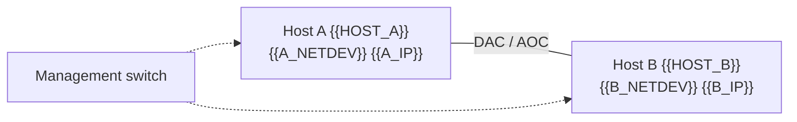
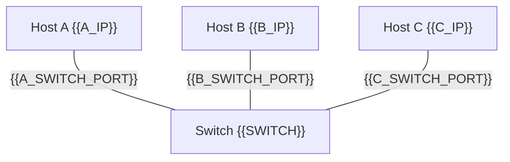

## Topologies

Pick the smallest topology that runs the labs you want. All of them keep the **management
network** (SSH, BMC, the switch's management port) separate from the **data network** (the RDMA
ports).

### Tier 1: back to back



One cable, no switch configuration. RoCEv2 works without any QoS on an uncongested link, and PFC
can even be exercised between the two NICs (hw-03). This is also the standard InfiniBand starter
topology, with OpenSM on one host.

### Tier 2: one switch, three hosts



Two senders and one receiver create real incast on the switch port facing the receiver: the
situation PFC and ECN exist for (hw-06).

### Optional: a mini leaf-spine

With two or three spare switches you can build two leaves and a spine and run the routed design of
the [Clos lessons](#/lesson/clos-leaf-spine) on real gear. The labs in this course do not require
it; if you build one, configure the lossless policy on every hop, not just the leaves. The
containerlab lab [hol-clos-bgp-unnumbered](#/hw/labs/hol-clos-bgp-unnumbered) gives you the routing
configuration to start from.

## Addressing plan

| Option | How | When |
|---|---|---|
| One L2 segment (recommended) | All data ports in one subnet, for example {{A_IP}}, {{B_IP}}, {{C_IP}} /{{PREFIX_LEN}}; switch ports in one VLAN | Back to back and single-switch labs. Simple, and RoCEv2 still uses routable UDP/IP packets. |
| Routed /31 per link | Each host port in its own /31 with the switch port as the gateway; the switch routes | Closer to production AI back-end fabrics; needs routes on the hosts. Worth doing once you have the basics working. |

The labs assume the first option: every host can reach every other host's data IP directly.

## Cabling and port map

Write the map down and keep it with the lab:

| Host | Netdev | Data IP | Switch port |
|---|---|---|---|
| {{HOST_A}} | {{A_NETDEV}} | {{A_IP}} | {{SWITCH}} {{A_SWITCH_PORT}} |
| {{HOST_B}} | {{B_NETDEV}} | {{B_IP}} | {{SWITCH}} {{B_SWITCH_PORT}} |
| {{HOST_C}} | {{C_NETDEV}} | {{C_IP}} | {{SWITCH}} {{C_SWITCH_PORT}} |

Cumulus Linux names switch ports `swpN`; SONiC names them `EthernetN` (where N is often a lane
index, so the numbers step by 4 or 8 on many platforms).

### Verify cabling with LLDP

`setup-rdma-host.sh` installs and starts `lldpd`. On each host:

```bash
sudo lldpcli show neighbors
```

The neighbour on {{A_NETDEV}} should be {{SWITCH}} port {{A_SWITCH_PORT}} (or the peer host when
back to back). `aina-hw collect` records these neighbours and the Connect page compares them with
your port map.

> [!NOTE]
> NVIDIA ConnectX NICs can run an LLDP/DCBX agent in firmware, which may consume LLDP frames before
> the host's `lldpd` sees them, or exchange DCBX settings with the switch on its own. If the host
> shows no neighbour although the link is up, check your NIC documentation for its firmware
> LLDP/DCBX behaviour. On the switch side, `nv show interface` (Cumulus) or `show lldp table`
> (SONiC) show what the switch sees.

## MTU end to end

The rule: **every hop must carry the largest frame any host sends.**

- Hosts: netdev MTU {{MTU}}. With 9000, RDMA uses a 4096-byte path MTU plus headers.
- Switch ports: at least the host MTU plus the Ethernet header, usually the platform maximum
  (9216 is common). A switch MTU larger than the hosts' is harmless; smaller is the classic black
  hole.
- Verify from every host with a full-size, don't-fragment ping:
  `ping -M do -s $(({{MTU}} - 28)) -c 3 {{B_IP}}`.

## Lossless RoCE: what hosts and switch must agree on

Lossless RoCE is a contract between the NICs and every switch hop. If one side disagrees, traffic
still flows, but drops (or never-ending pauses) appear under load.

| Item | Hosts (hw-03 configures them) | Switch | Your profile |
|---|---|---|---|
| Classification | Trust DSCP | Trust DSCP on host-facing ports | |
| RoCE data DSCP | NIC/application stamps it (perftest `--tclass`, `NCCL_IB_TC`, the RDMA CM default via `cma_roce_tos` or configfs `default_roce_tos`) | Maps it to the lossless priority/queue | DSCP {{ROCE_DSCP}}, traffic class byte {{TCLASS}} |
| Lossless priority | PFC enabled on this priority only | PFC enabled on the same priority, buffers with headroom | priority {{ROCE_PRIO}} |
| CNPs | NIC sends CNPs with this DSCP (mlx5 with NVIDIA's stack defaults to 48) | Maps CNPs to a high-priority (often strict) queue | DSCP {{CNP_DSCP}} |
| ECN | Congestion control (DCQCN on NVIDIA NICs) reacts to marks | ECN marking on the lossless queue | |
| MTU | {{MTU}} | 9216 (or at least {{MTU}} + headers) | MTU {{MTU}} |

> [!WARNING]
> Never enable PFC on a priority the other side does not treat as lossless. A NIC that pauses a
> switch that never pauses back (or the reverse) gives you drops on one side and needless pauses on
> the other. See [lossless misconfigurations](#/lesson/lossless-misconfigurations).

## Switch baseline: NVIDIA Cumulus Linux (NVUE)

These are the NVUE commands this course uses. NVUE syntax and defaults change between Cumulus
Linux releases: verify each command against the NVUE command reference for your release.

**Back up first:**

```bash
nv config history                   # note the current revision so you can roll back
```

**Put the host-facing ports in the default bridge and set the MTU** (staged until `apply`):

```bash
nv set interface {{A_SWITCH_PORT}},{{B_SWITCH_PORT}},{{C_SWITCH_PORT}} bridge domain br_default
nv set interface {{A_SWITCH_PORT}},{{B_SWITCH_PORT}},{{C_SWITCH_PORT}} link mtu 9216
```

**Enable the RoCE QoS profile** (lossless mode: trust, PFC, ECN and buffers in one step):

```bash
nv set qos roce
nv set qos roce mode lossless
nv config diff                      # review what will change
nv config apply
nv config save                      # some releases save on apply; saving again is harmless
```

**Verify and compare with your profile:**

```bash
nv show interface                   # state, speed, MTU, LLDP neighbours
nv show qos roce                    # lossless priority, trust, DSCP mappings, ECN thresholds
nv show interface {{A_SWITCH_PORT}} qos roce counters    # PFC and ECN counters per port
```

`nv show qos roce` tells you which priority and DSCP values the release uses by default. If they
differ from your profile (priority {{ROCE_PRIO}}, DSCP {{ROCE_DSCP}}, CNP DSCP {{CNP_DSCP}}), the
easy path is to change your **profile** to match the switch defaults, then regenerate `lab.env`.

> [!NOTE]
> Applying QoS buffer changes can briefly disrupt traffic on the switch. On a lab switch that is
> fine; it is a reminder of why production changes go through a maintenance window.

## Switch baseline: SONiC

On many SONiC platforms the default QoS templates already make priorities 3 and 4 lossless with DSCP
mapping and ECN, but this depends on the platform (HwSKU), the release and whether dynamic buffer
calculation is enabled. Do not assume: verify.

```bash
show version                         # release and platform
show interfaces status               # ports, speed, MTU, oper state
show lldp table                      # cabling
show runningconfiguration all        # look at PORT_QOS_MAP, DSCP_TO_TC_MAP, BUFFER_PG, BUFFER_QUEUE
show pfc counters                    # PFC frames per priority, per port
show queue counters Ethernet0        # per-queue packets and drops (use your port)
show pfcwd config                    # PFC watchdog
```

If the QoS configuration was edited by hand and you want the platform defaults back,
`sudo config qos reload` regenerates them (it overwrites manual QoS edits and can disrupt
traffic), followed by `sudo config save -y`. How to change the lossless priorities or DSCP map
depends on the release; use the SONiC documentation for your version rather than editing CONFIG_DB
tables from memory.

## Switch baseline: any other NOS

Follow your vendor's RoCE (or "AI fabric") deployment guide and tick off this checklist:

- [ ] Configuration backed up (and you know the rollback command).
- [ ] Host-facing ports in one VLAN (or routed, if you chose /31s), MTU 9216.
- [ ] Trust DSCP on host-facing ports.
- [ ] DSCP {{ROCE_DSCP}} mapped to priority/traffic class {{ROCE_PRIO}}; that class is lossless.
- [ ] PFC enabled on priority {{ROCE_PRIO}} only, on every port that carries RoCE.
- [ ] Buffer headroom for the lossless priority sized for your cable length and speed (most vendors
  calculate it for you; see the [buffers and headroom lesson](#/lesson/buffers-headroom-ets)).
- [ ] ECN marking enabled on the lossless queue.
- [ ] DSCP {{CNP_DSCP}} (CNPs) mapped to a high-priority queue.
- [ ] PFC watchdog enabled, if available.
- [ ] You can read per-port PFC sent/received counters and ECN-marked packet counts.

## InfiniBand fabric setup

InfiniBand needs a **subnet manager** (SM) before any port leaves the `INIT` state: it assigns LIDs
and programs the forwarding tables.

| Situation | Where to run the SM |
|---|---|
| Back to back, or an unmanaged IB switch | OpenSM on one host (`setup-rdma-host.sh --opensm` installs it) |
| Managed IB switch with an embedded SM | The switch's SM, enabled per the switch documentation |
| Both available | Either, but make sure exactly **one** is master: set priorities deliberately |

On the host that runs OpenSM, the distribution package normally provides a system service; check
`systemctl status opensm`, or start it in the background with `sudo opensm -B`. Then, from any host:

```bash
ibstat                 # port State: Active, Physical state: LinkUp, a non-zero Base lid
sminfo                 # which SM is master, and its priority
```

[hw-09](#/hw/labs/hw-09-infiniband-bringup) walks through the bring-up in detail.

## Management network separation

- SSH, BMC and switch management use the **management** network only.
- The data network carries only lab traffic and has no default gateway on the hosts.
- Several labs break the data path on purpose (MTU mismatches, PFC changes, port shutdowns). If your
  SSH session ran over it, you would lock yourself out.
- When you use the `aina-hw` agent, reach it through an SSH port forward over the management
  network (see the [Toolkit guide](#/hw/toolkit)).

## Backups and rollback before every lab

| Device | Before | Rollback |
|---|---|---|
| Cumulus | `nv config history` (note the revision); keep a copy of `/etc/nvue.d/startup.yaml` | Re-apply the previous revision as described in the NVUE documentation for your release |
| SONiC | `sudo config save -y`, then copy `/etc/sonic/config_db.json` off the switch | Restore the file and reload per the SONiC documentation for your release |
| Other NOS | Save the running configuration to a file off the switch | Vendor's restore procedure |
| Hosts | Labs that change settings ship save/restore scripts | Each lab's **Restore** section |

Next: [the toolkit](#/hw/toolkit), then [the labs](#/hw/labs).
