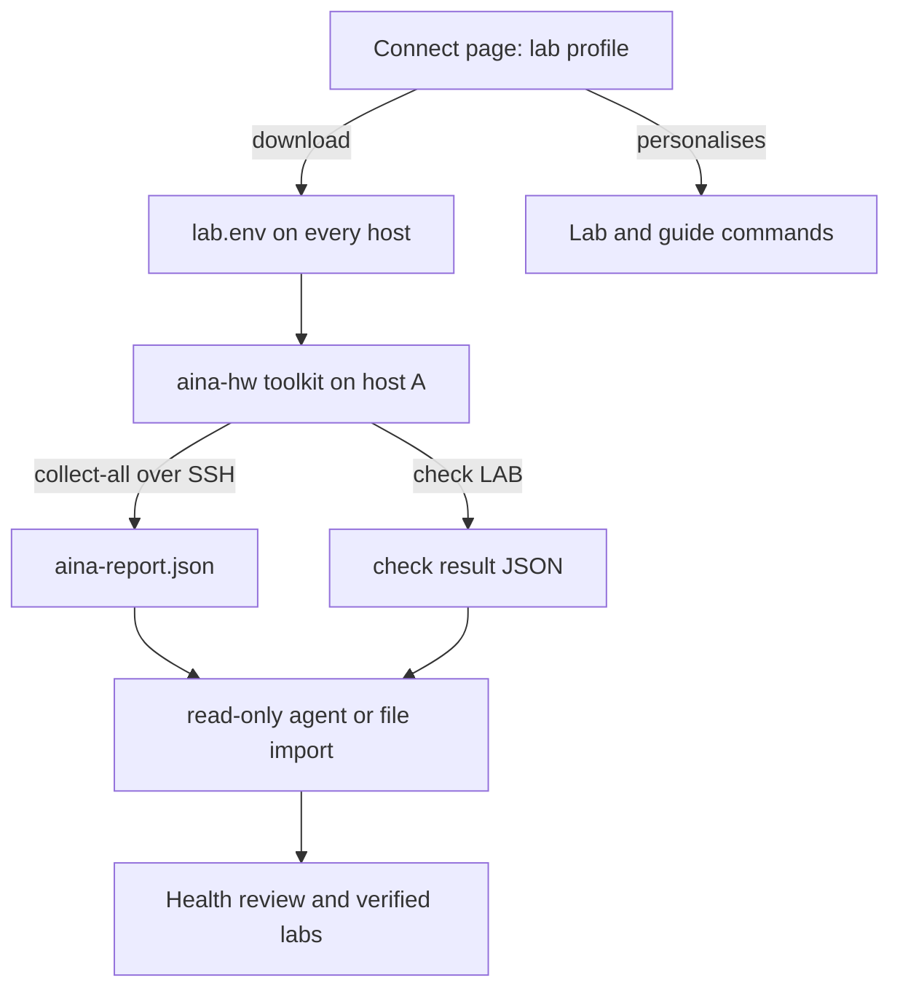

## Simulator labs or real hardware?

Both tracks teach the same skills, and they complement each other.

| | Simulator labs | Real hardware labs |
|---|---|---|
| Runs on | Your browser | Your VM, servers, NICs, switch, GPUs |
| Set-up time | None | An afternoon for Tier 1, more for a switched fabric |
| What it trains | Reasoning: which counter, which command, which root cause | Hands: cabling, drivers, firmware, real counters, real numbers |
| Output | Modelled on real tools, not captures | Whatever your gear says, including surprises |
| Grading | The simulated fabric state | `check.sh` scripts that test the real state of your gear |
| Risk | None | Low, if you follow the [safety rules](#/hw/safety); labs that change settings ship restore scripts |

A good rhythm: solve the simulator incident on a topic, then reproduce it on your own gear. For
example, the [GID index incident](#/labs/sim-08-gid-index) pairs with
[First RoCEv2 traffic](#/hw/labs/hw-02-roce-first-traffic), and the
[MTU black hole](#/labs/sim-01-mtu-blackhole) pairs with the [break/fix lab](#/hw/labs/hw-04-break-fix-roce).

## How the pieces fit



1. **Lab profile.** You describe your lab once on the [Connect page](#/hw/connect): host names,
   data IPs, RDMA devices, MTU, the lossless priority and DSCP, the switch. Every hardware lab and
   guide replaces its placeholders with your values, so commands are ready to copy. The same page
   generates `lab.env`, netplan or nmcli snippets, `/etc/hosts` lines and a switch baseline.
2. **Toolkit.** `labs/hw-toolkit/` in the repository holds `setup-rdma-host.sh` (installs and
   audits a host), `aina-hw` (a dependency-free Python tool that inventories hosts, runs lab checks
   and serves results) and `lib.sh` (shared helpers every check script uses). See
   [Toolkit](#/hw/toolkit).
3. **Connection.** Either run `aina-hw serve` on host A and reach it through an SSH tunnel (the
   academy pulls the report and check results live), or copy the JSON files and import them.
   Nothing is ever sent anywhere else: the academy is a static site and keeps everything in your
   browser.
4. **Evidence.** A lab whose `check.sh` passes, imported through either route, is marked
   **verified** with the host and time. That is stronger than "I clicked done", and it is what you
   show when someone asks how you know your fabric works.

## The tiers

Start at the tier your gear allows; every tier builds on the one below.

- **Tier 0, virtual.** One Ubuntu VM. Soft-RoCE, containerlab, FRR and kernel tooling: BGP
  unnumbered, EVPN-VXLAN, ECMP entropy, ECN and DCTCP, and RoCEv2 packet captures. No RDMA hardware.
- **Tier 1, two RDMA hosts.** Two servers with RDMA NICs, cabled back to back or through any
  switch. Inventory, first RoCEv2 traffic, host QoS (PFC, DSCP, ECN), link health and optics,
  break/fix, and InfiniBand bring-up if your NICs speak InfiniBand.
- **Tier 2, lossless switched fabric.** A third host and a switch you can configure. Real incast,
  pause frames, ECN marking and congestion notification, with switch and host counters side by side.
- **Tier 3, GPU nodes.** GPUs in the RDMA hosts. PCIe and NUMA affinity, GPUDirect RDMA, and
  multi-node NCCL tests.

The [Requirements](#/hw/requirements) page lists what each tier needs, what to buy if you are
building a lab, and which labs each piece of gear unlocks.

## A typical first session (Tier 1)

1. Check [Requirements](#/hw/requirements), then work through [Host setup](#/hw/host-setup) on
   both hosts: OS, drivers, `setup-rdma-host.sh`, data IPs and MTU, SSH keys from host A.
2. Fill in your profile on the [Connect page](#/hw/connect) and copy `lab.env` to
   `{{AINA_DIR}}/labs/hw-toolkit/` on both hosts.
3. On host A ({{HOST_A}}):

   ```bash
   cd {{AINA_DIR}}/labs/hw-toolkit
   ./aina-hw env            # validates lab.env
   ./aina-hw collect-all    # inventories {{HOST_A}} and {{HOST_B}}
   ./aina-hw serve          # read-only agent on 127.0.0.1:8765
   ```

4. On your laptop, open the tunnel `ssh -L 8765:127.0.0.1:8765 {{SSH_USER}}@{{HOST_A}}`, then
   press **Connect** on the Connect page. Fix what the health review flags.
5. Work through [the Tier 1 labs](#/hw/labs?tier=1), starting with
   [Inventory and baseline](#/hw/labs/hw-01-inventory-baseline). Finish each with
   `./hw-toolkit/aina-hw check <lab>`; with the agent running, results appear in the academy within
   seconds when auto-refresh is on.

## Honesty about these labs

- Every hardware lab is marked **not yet verified** until it has been run end to end on reference
  hardware. The scripts are syntax-checked and the commands come from the same fact-checked
  reference as the rest of the course, but your NIC generation, firmware, driver stack and switch OS
  will produce different output. All sample output is illustrative.
- Counter names, sysfs paths and QoS tools differ between vendors and driver stacks. The labs are
  written for NVIDIA ConnectX NICs (the most common RDMA NICs in AI clusters and on the used market)
  with notes on the generic Linux equivalents. Other vendors' NICs work for most tasks; the labs say
  where they will not.
- If a step behaves differently on your gear, that is useful information: report it, with a
  redacted report (`aina-hw collect-all --redact`) if you can.
