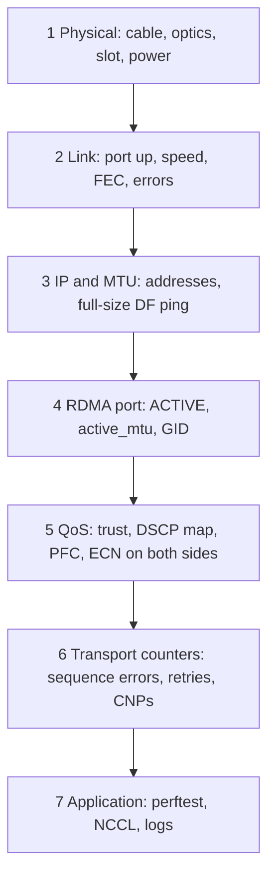

## Work bottom up

Most wasted hours in RDMA labs come from debugging the top of the stack when the problem is at the
bottom. Go up one layer at a time and do not move on until the layer below is proven.

| Layer | Prove it with |
|---|---|
| 1 Physical | `lspci -vv -s <pci address>` (LnkSta), `sudo ethtool -m {{A_NETDEV}}` (module present, temperature, optical power on optics) |
| 2 Link | `ethtool {{A_NETDEV}}` (Speed, Link detected), `ethtool --show-fec {{A_NETDEV}}`, `ethtool -S {{A_NETDEV}}` error counters |
| 3 IP/MTU | `ip -br addr`, `ping -M do -s $(({{MTU}} - 28)) -c 3 {{B_IP}}` |
| 4 RDMA port | `rdma link show`, `ibv_devinfo -d {{A_RDMA_DEV}} -i {{RDMA_PORT}}`, the GID table (hw-02 Task 2) |
| 5 QoS | `dcb pfc show dev {{A_NETDEV}}` and `dcb app show dev {{A_NETDEV}}` (or `mlnx_qos -i {{A_NETDEV}}` with NVIDIA's stack), `ethtool -a {{A_NETDEV}}`, and the switch's view (`nv show qos roce`, `show pfc counters`) |
| 6 Transport | `rdma statistic show link {{A_RDMA_DEV}}/{{RDMA_PORT}}`, `/sys/class/infiniband/{{A_RDMA_DEV}}/ports/{{RDMA_PORT}}/hw_counters/` |
| 7 Application | perftest output, `NCCL_DEBUG=INFO` logs |

The fastest way through layers 1 to 5 on all hosts at once is
`./hw-toolkit/aina-hw collect-all` and the health review on the [Connect page](#/hw/connect).

## Symptom, cause, fix

### Link and physical

| Symptom | Likely cause | Fix |
|---|---|---|
| `rdma link show` says `state DOWN`, `physical_state POLLING` | No signal: cable not seated, wrong cable type/speed, peer port disabled, or switch port down | Reseat both ends; check `ethtool {{A_NETDEV}}` on both hosts and the switch port state; try a known-good cable |
| Link comes up at a lower speed than expected | Cable or optic rated lower, auto-negotiation result, or switch port speed setting | `ethtool {{A_NETDEV}}` (Speed), `ethtool -m` (module type); set the switch port speed explicitly if your NOS needs it |
| Link flaps (up/down) | Marginal cable or optic, dirty fibre, FEC mismatch, overheating module | `ethtool -S` for link-down and symbol/FEC counters, `ethtool -m` for temperature and optical power, `ethtool --show-fec` on both sides; see [hw-05](#/hw/labs/hw-05-link-health-optics) |
| `ethtool -m` prints only `netlink error: Operation not permitted` | Reading the module EEPROM needs root | Run it with `sudo` |
| `ethtool -m` fails as root | No module EEPROM access for this cable/driver, or no module inserted | Not always an error with some DACs; check the module is detected at all |
| `ethtool -m` shows no optical power and a temperature of 0.00 degrees C | Passive DAC: copper cables have no lasers and often no sensors | Normal; use `ethtool -S` error counters for link health |

### PCIe and host

| Symptom | Likely cause | Fix |
|---|---|---|
| PCIe running below max (health review warning; `lspci -vv` shows `LnkSta` lower than `LnkCap`, often marked `(downgraded)`) | Slot is electrically narrower than it looks, lanes shared with another device, riser, BIOS slot setting, or a card not fully seated | Move the card to a full-width slot connected to the CPU, check the motherboard manual and BIOS slot settings, reseat. Inside a VM with PCI passthrough, `lspci` shows the hypervisor's virtual root port (for example `5GT/s, Width x32` under ESXi) and the check means nothing; check on the hypervisor host |
| Bandwidth stuck around half of line rate | PCIe Gen3 x8 feeding a 100G NIC, or one QP on a very fast link | Check PCIe first; then retry with `-q 4` (hw-02 Task 5) |
| perftest prints a warning about conflicting CPU frequency values | CPU frequency scaling active | Harmless for function; use `-F` to suppress, and the `performance` governor for steadier numbers |
| perftest or NCCL fails to allocate or register a memory region (`Couldn't allocate MR`, `Failed to create MR`, often only with `-a`) | Locked-memory limit too low | `ulimit -l` should say `unlimited`; `setup-rdma-host.sh --set-memlock`, then log in again (systemd services need `LimitMEMLOCK=infinity`) |
| Latency noisy and higher than expected | Process on the wrong NUMA node, power-saving states | Pin with `numactl --cpunodebind/--membind` to the NIC's node (hw-02 Task 6); check the BIOS power profile |

### RDMA port, GID and connection setup

| Symptom | Likely cause | Fix |
|---|---|---|
| InfiniBand port stuck in `INIT` | No subnet manager, or the SM cannot reach the port | Start OpenSM or enable the switch SM; `sminfo` should report a master ([hw-09](#/hw/labs/hw-09-infiniband-bringup)) |
| `active_mtu` is 1024 instead of 4096 | Netdev MTU 1500 (or below about 4200) | Set MTU {{MTU}} on the data interface (and the switch); the active MTU follows |
| No RoCE v2 IPv4 GID in the table | No IPv4 address on the netdev the RDMA port belongs to, or the address is on another interface (a bond/VLAN you did not expect) | `ip -br addr show dev {{A_NETDEV}}`; GIDs appear automatically when the address is added |
| `ibv_rc_pingpong` or perftest hangs, then times out | Firewall blocking the TCP exchange (18515 by default), wrong peer IP, or wrong GID index | Open TCP 18515/18600/18601; check the GID index on each side; check that the peer IP is the data IP |
| perftest prints `Couldn't connect to <ip>:18515` and `Unable to init the socket connection` | No server running on the peer (or it already exited), or a firewall rejecting the connection | Start the server side first, with the same flags |
| `ibv_rc_pingpong` prints `client read/write: No space left on device` and `Couldn't read/write remote address` | The two sides use different kinds of GID (for example `-g 0` on one, `-g 3` on the other) | Use the RoCE v2 IPv4 GID index on both sides |
| Connection exchange works but no data passes (`transport retry counter exceeded` type errors) | Wrong GID index (RoCE v1 or link-local entry), MTU mismatch, or a routing problem on the data network | Use the RoCE v2 IPv4 GID on both sides; full-size DF ping; `rping` to cross-check (it resolves GIDs itself) |
| `rping` works, explicit-GID tools do not | The GID index you typed is wrong for one of the hosts | Find the index per host (hw-02 Task 2); update `GID_INDEX` in your profile |
| Device names differ between hosts (`mlx5_0` vs `mlx5_1`) | Enumeration order, extra NICs | Set `A_RDMA_DEV`/`B_RDMA_DEV` per host in the profile; never assume they match |
| `IB device 'mlx5_0' wasn't found` (ibv_devinfo) or `IB device mlx5_0 not found` (perftest) | The device has another name: distribution rdma-core names devices from the PCI address (`rocep3s0f0`), NVIDIA's stack uses `mlx5_N` | Take the name from `rdma link show` and put it in the profile |

### QoS, lossless and congestion

| Symptom | Likely cause | Fix |
|---|---|---|
| `out_of_sequence` / `packet_seq_err` rising during tests | Packet loss on the path: RoCE traffic not in a lossless class, PFC off on one side, buffer drops | Compare trust, DSCP map and PFC priority on hosts and switch ([hw-03](#/hw/labs/hw-03-host-qos-pfc-ecn), [hw-06](#/hw/labs/hw-06-switch-lossless-incast)); check switch queue drops |
| PFC pause counters climb but no ECN marks / CNPs | ECN marking not enabled on the switch queue, or thresholds above the PFC trigger point, or congestion control disabled on the NIC | Enable ECN on the lossless queue (set its thresholds below the PFC trigger point); check `np_cnp_sent` on the receiver and `rp_cnp_handled` on senders. Back to back without a switch nothing marks ECN, so `np_ecn_marked_roce_packets` at 0 is expected (CNPs can still appear together with `out_of_sequence` when packets are dropped) |
| PFC turned itself off | On mlx5, `ethtool -A {{A_NETDEV}} rx on tx on` (re-enabling global pause) silently clears PFC on every priority | Leave global pause off; re-apply PFC (`dcb pfc set dev {{A_NETDEV}} prio-pfc {{ROCE_PRIO}}:on`) and check with `dcb pfc show` |
| `ethtool -S` shows no `prioN_pause` counters | On mlx5 they exist only for priorities with PFC enabled (the `global_pause` counters only while global pause is on) | Enable PFC on the priority first; their absence is itself a sign PFC is off |
| No PFC counters move at all under incast | Traffic is not in the lossless priority (wrong DSCP/trust), or PFC is disabled | Stamp the DSCP ({{ROCE_DSCP}}, traffic class byte {{TCLASS}}); check trust is DSCP on hosts and switch |
| Pauses in both directions, throughput collapses | PFC storm or a configuration loop; or a NIC stuck sending pauses | Check the PFC watchdog counters on the switch; see [PFC storms and deadlocks](#/lesson/pfc-storms-deadlocks) |
| Settings vanish after reboot | Runtime-only QoS changes (`mlnx_qos`, `dcb`, `ip link set mtu`) | Persist them through your network configuration or the vendor's recommended mechanism; the labs keep them runtime-only on purpose |

### GPU and NCCL

| Symptom | Likely cause | Fix |
|---|---|---|
| NCCL log shows `NET/Socket` instead of `NET/IB` | NCCL cannot use the RDMA device: wrong `NCCL_IB_HCA`, missing RDMA libraries/plugin, or no usable device | Run with `NCCL_DEBUG=INFO`, read the NET lines; set `NCCL_IB_HCA={{A_RDMA_DEV}}`; see [hw-08](#/hw/labs/hw-08-nccl-two-nodes) |
| NCCL bootstrap hangs or picks the wrong interface | Bootstrap using the management or a docker interface | Set `NCCL_SOCKET_IFNAME` to the intended interface |
| GPUDirect RDMA not used (`perftest --use_cuda` fails, or NCCL does not report GPU Direct RDMA) | `nvidia_peermem` not loaded (or no DMA-BUF support in the stack), GPU and NIC far apart, ACS redirecting peer traffic | `lsmod \| grep nvidia_peermem`; `nvidia-smi topo -m`; check ACS (see [Host setup](#/hw/host-setup)); [hw-07](#/hw/labs/hw-07-gpudirect-numa) |
| `nvidia_peermem` fails to load | Module built against a different driver/OFED combination, or not shipped with your driver packaging | Use the module that matches your NVIDIA driver, and check NVIDIA's GPUDirect documentation for your driver/OS combination |

### Software stack

| Symptom | Likely cause | Fix |
|---|---|---|
| `ibv_devices` empty although the NIC is visible in `lspci` | RDMA provider module not loaded (`mlx5_ib`), or user-space provider missing | `sudo modprobe mlx5_ib`; install `ibverbs-providers` (Ubuntu) or `libibverbs` (RHEL) |
| Odd library errors, tools crash, two versions of perftest | Inbox rdma-core mixed with DOCA/OFED packages | Pick one stack; remove the other completely per its documentation |
| `libibverbs: Warning: couldn't load driver 'libionic-rdmav59.so'` or `couldn't open config directory '/etc/libibverbs.d'` | Harmless warnings (an unused provider in NVIDIA's rdma-core, or a confined program such as tcpdump under AppArmor) | Ignore them if the tool works |
| `mlnx_qos`, `show_gids` or `ibdev2netdev`: command not found | They come only with NVIDIA's DOCA/MLNX_OFED tools | Use the inbox equivalents (`dcb`, the sysfs GID files, `rdma link show`; see [Host setup](#/hw/host-setup)) |
| `/sys/class/net/{{A_NETDEV}}/ecn/` does not exist | Those DCQCN switches exist only with NVIDIA's driver stack | With the inbox driver the parameters are in debugfs (`/sys/kernel/debug/mlx5/<pci>/cc_params/`), which Secure Boot lockdown blocks even for root |
| MFT tools (`mst`, `mlxconfig`, `flint`, `mlxfwmanager`) find no device, debugfs reads fail with `Operation not permitted` | UEFI Secure Boot kernel lockdown | Use `ethtool -i`, `devlink dev info` and the `/dev/fwctl` device for `mlxlink`; for firmware configuration changes, turn Secure Boot off temporarily ([Host setup](#/hw/host-setup)) |
| `tcpdump -i {{A_NETDEV}}` sees no RoCE packets | RoCE is offloaded and never passes the kernel stack | Expected. Capture on the RDMA device instead (`tcpdump -i {{A_RDMA_DEV}}`, libpcap's RDMA sniffer on mlx5) or mirror the switch port |
| Hosts behave differently with the same commands | Kernel, driver, firmware or rdma-core skew | Compare in the health review; align versions |

### Toolkit and check scripts

| Symptom | Likely cause | Fix |
|---|---|---|
| `FAIL: cannot SSH to host B ... non-interactively` | No key-based SSH from host A, host key not yet accepted, wrong `SSH_USER` | `ssh-copy-id {{SSH_USER}}@{{HOST_B}}`, then `ssh -o BatchMode=yes {{SSH_USER}}@{{HOST_B}} true` once by hand |
| `collect-all` fails for one host | Same SSH issue, or `python3` missing on that host | Fix SSH; install `python3`; rerun |
| Check uses wrong devices or IPs | `lab.env` missing or out of date (`INFO: no lab.env ...`) | Regenerate on the [Connect page](#/hw/connect), copy to `labs/hw-toolkit/lab.env`; `aina-hw env` validates it |
| Some QoS fields are empty in the report | `mlnx_qos`/`dcb` not installed, or the read needs root | Install the tool; use `aina-hw collect-all --sudo` only on dedicated lab hosts |
| Check passes but performance looks wrong | Checks verify function, not peak performance (bandwidth below the floor is a warning) | Use the lab tasks to investigate; compare with your NIC's published expectations |

### Connecting the academy to the agent

| Symptom | Likely cause | Fix |
|---|---|---|
| Connect page cannot reach `http://127.0.0.1:8765` | Agent not running, or running on host A while the browser is on a laptop | Start `aina-hw serve`; forward the port: `ssh -L 8765:127.0.0.1:8765 {{SSH_USER}}@{{HOST_A}}` |
| Browser console shows a CORS error | The page's origin is not in the agent's allow-list (for example a self-hosted copy) | `aina-hw serve --allow-origin https://your.host` |
| Browser asks for permission to access devices on your local network, or blocks the request | Browsers increasingly restrict public sites from calling local addresses (Chrome's Private Network Access / local network access protections; behaviour depends on browser and version) | Allow the prompt if you trust it, use the locally launched academy (`start-academy`), or import the JSON files instead |
| Safari (or another browser) refuses `http://127.0.0.1` from the https site | Mixed-content policy: some browsers do not treat loopback HTTP as secure | Use the file import on the Connect page, or the locally launched academy |

## Asking for help

A good help request is short and complete:

1. **What you ran**, exactly (the command, on which host).
2. **What you expected and what happened**, with the error text.
3. **A redacted report:** `./hw-toolkit/aina-hw collect-all --redact`, then read the JSON before
   sharing it (see [Safety](#/hw/safety) for what redaction keeps).
4. **The check output** of the lab you were on (`aina-hw check <lab>`; its result file is in
   `labs/hw-toolkit/results/`).
5. **Switch side**, if there is a switch: the relevant `nv show ...` or `show ...` output.

Often, writing these five things down finds the problem before anyone else has to.
