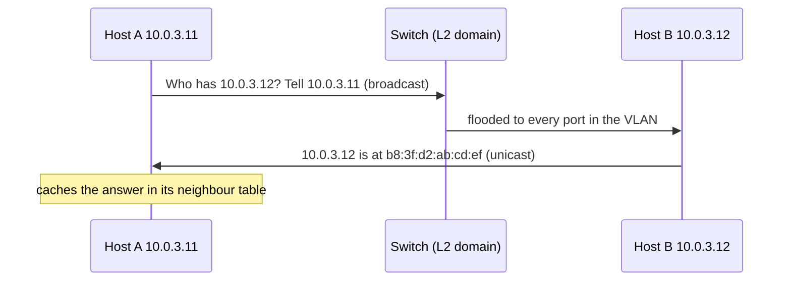

## Why this matters

Ethernet only gets a frame to the next box on the same link. To cross a fabric of hundreds of switches, packets need addresses that describe *where* a host is, and switches need tables that say *which way* to send each destination. That is the job of the Internet Protocol (IP) and of routing. Modern AI back-end fabrics are almost always **routed all the way to the top-of-rack (leaf) switch**: every link between switches is an IP link, and every GPU NIC has its own IP address. RoCEv2 was designed exactly so that RDMA could ride on this routed IP fabric.

AI clusters also stress IP in unusual ways. A single GPU server commonly has eight back-end NICs (one per GPU) plus front-end and management interfaces, all on the same host. Get the subnets, ARP behaviour or routing table wrong and traffic for NIC 5 leaves through NIC 0, RDMA connections fail to establish, or a whole rail of the cluster runs at half speed. This lesson gives you the addressing and routing model you need before tackling fabrics in `clos-leaf-spine` and `bgp-in-the-data-center`.

## Concepts

### IPv4 addresses and prefixes

An IPv4 address is 32 bits, written as four decimal octets: `10.0.3.11`. An address alone is not enough; you also need to know which part identifies the **network** and which part identifies the **host** on that network. This split is written in **CIDR notation** as a prefix length: `10.0.3.11/24` means "the first 24 bits are the network".

| Notation | Netmask | Addresses in block | Usable hosts | Typical use in an AI cluster |
|---|---|---|---|---|
| /32 | 255.255.255.255 | 1 | 1 (host route) | Loopback address of a switch or host |
| /31 | 255.255.255.254 | 2 | 2 (RFC 3021) | Point-to-point link: leaf-spine, or NIC-to-leaf |
| /30 | 255.255.255.252 | 4 | 2 | Older point-to-point convention |
| /24 | 255.255.255.0 | 256 | 254 | A rack or rail subnet |
| /16 | 255.255.0.0 | 65,536 | 65,534 | Summary of a whole pod |

In an ordinary subnet the first address is the **network address** and the last is the **broadcast address**, so a /24 has 254 usable hosts. RFC 3021 makes an exception for /31 on point-to-point links: both addresses are usable because a two-node link needs no broadcast. Data center fabrics with thousands of switch-to-switch links use /31s to avoid wasting half of every /30.

**Worked example**: `10.0.3.77/26`.
- /26 means 26 network bits and 6 host bits, so blocks of 2^6 = 64 addresses.
- Blocks in the last octet start at 0, 64, 128, 192. 77 falls in the block starting at 64.
- Network: `10.0.3.64`, broadcast: `10.0.3.127`, usable: `10.0.3.65` to `10.0.3.126` (62 hosts).

Private address space (RFC 1918: `10.0.0.0/8`, `172.16.0.0/12`, `192.168.0.0/16`) is used for almost all cluster-internal networks. A large cluster can easily consume tens of thousands of addresses on the back-end alone, so `10.0.0.0/8` is the usual choice.

### IPv6 in one minute

IPv6 addresses are 128 bits, written in hex groups (`fd00:0:3::b`). Subnets are normally /64, and link-local addresses (`fe80::/10`) exist on every interface automatically. Some routing designs, such as BGP unnumbered, use IPv6 link-local addresses to bring up sessions on links that have no configured IPv4 address. RoCEv2 works over both IPv4 and IPv6; IPv4 is still the most common choice on back-end fabrics, but you should be comfortable reading both.

### The IP header fields that matter to you

The IPv4 header is 20 bytes without options. You do not need to memorise all of it, but these fields will come up again and again:

| Field | Size | Why an AI network engineer cares |
|---|---|---|
| Version / IHL | 4 + 4 bits | IPv4, header length (5 x 4 bytes = 20 without options). |
| DSCP | 6 bits | Traffic class marking. RoCE fabrics commonly use DSCP to put RDMA in a lossless queue and congestion-notification packets in a high-priority queue. |
| ECN | 2 bits | Explicit Congestion Notification. Switches set it to "CE" (congestion experienced) instead of dropping; the receiver tells the sender to slow down. This is the basis of DCQCN (`ecn-and-dcqcn`). |
| Total length | 16 bits | Size of the IP packet; limited by the MTU. |
| DF flag | 1 bit | "Don't fragment". Relevant for MTU testing (`mtu-jumbo-frames`). |
| TTL | 8 bits | Decremented at every router; the packet is dropped at zero. Prevents loops forever; traceroute exploits it. |
| Protocol | 8 bits | What is inside: 6 = TCP, 17 = UDP (RoCEv2), 1 = ICMP. |
| Source / destination address | 32 + 32 bits | Who sent it, who receives it. |

DSCP and ECN together form the old "Type of Service" byte. In IPv6 the same 8 bits are called the **Traffic Class** field, with the same DSCP and ECN split, and the hop counter is called **Hop Limit**. The IPv6 base header is 40 bytes.

### Two ways to deliver: on-link or via a router

When a host wants to send an IP packet it asks one question: **is the destination in one of my directly connected subnets?**

- **Yes (on-link)**: find the destination's MAC address with ARP (IPv4) or Neighbor Discovery (IPv6), and send the frame directly.
- **No**: look up the routing table to find a **next hop** (a router on a connected subnet), find *the router's* MAC address, and send the frame to the router. The IP destination stays the final host; only the Ethernet destination is the router.

## How it works

### ARP: from IP address to MAC address

ARP (Address Resolution Protocol, EtherType `0x0806`) is a broadcast question and a unicast answer:



The answer is cached in the **neighbour table** (`ip neigh`) for a while, then refreshed. In a routed AI fabric where each NIC sits on a small subnet with its leaf, the only neighbour most NICs ever need is the leaf's gateway address.

### The routing table and longest-prefix match

Every router, and every host, has a routing table: a list of prefixes, each pointing to a next hop and an outgoing interface. When several prefixes contain the destination, the **most specific one (the longest prefix) wins**.

Example host routing table:

| Prefix | Next hop | Interface |
|---|---|---|
| 0.0.0.0/0 (default) | 192.168.10.1 | front-end NIC |
| 10.0.0.0/8 | 10.0.3.1 | rail-3 NIC |
| 10.0.3.0/24 | on-link | rail-3 NIC |
| 10.0.3.12/32 | 10.0.3.1 | rail-3 NIC |

A packet to `10.0.3.12` matches the default route, the /8, the /24 and the /32: the /32 wins. A packet to `10.5.0.9` matches only the default and the /8: the /8 wins and goes to `10.0.3.1`. A packet to `8.8.8.8` only matches the default route.

Routing tables in switches are filled by **routing protocols**. In AI and other large data center fabrics the dominant choice is **eBGP** (RFC 7938): every leaf and spine advertises the prefixes it can reach, and the tables converge automatically. You will configure this in `bgp-in-the-data-center`.

### ECMP: many equal paths

In a leaf-spine fabric, a leaf typically has one uplink to *every* spine, so it learns the same remote prefix from many spines at equal cost. Instead of picking one, it installs all of them as an **Equal-Cost Multi-Path (ECMP)** route and spreads traffic across them. To keep packets of the same flow in order, switches pick the path by **hashing** header fields, usually the 5-tuple (source IP, destination IP, protocol, source port, destination port). Every packet of a given flow follows the same path; different flows hopefully land on different paths.

For RoCEv2 the destination port is always 4791, so the **UDP source port** is the main source of variety; NICs choose it per queue pair. The weakness of hashing, when a few huge flows collide on one uplink, is one of the defining problems of AI networking and the subject of `ecmp-hashing` and `flow-collisions-entropy`.

### Hop by hop: what changes and what does not

When a packet crosses three routers, the IP source and destination addresses stay the same (no NAT inside a fabric), the TTL drops by one at each hop, and the DSCP and ECN bits travel along (unless a switch is configured to rewrite them, or marks ECN on congestion). The Ethernet header is replaced on every hop with that link's MAC addresses. This "IP is end to end, Ethernet is per hop" rule is worth internalising.

### Addressing a GPU server

A typical rail-optimized design (covered in `rail-optimized-topology`) connects NIC *n* of every server to a leaf switch dedicated to "rail *n*". Two addressing patterns are common, and both appear in vendor reference designs:

| Pattern | How it looks | Pros | Cons |
|---|---|---|---|
| Shared rail subnet | All rail-3 NICs under one leaf share e.g. `10.3.0.0/24`, gateway on the leaf | Simple, fewer addresses | Larger ARP/broadcast domain on the leaf |
| Per-NIC point-to-point | Each NIC gets a /31 with its leaf port (`10.3.0.0/31`, `10.3.0.2/31`, ...) | No shared L2 at all, every link is routed | More addresses and more config to automate |

Either way, one server ends up with eight interfaces on eight *different* subnets, all reaching the same remote `10.0.0.0/8` space. That creates two classic host-side problems:

1. **Which interface does a reply leave from?** With a plain routing table, the kernel picks one best route to `10.0.0.0/8`, so traffic sourced from NIC 5's address may leave via NIC 0. The fix is **source-based (policy) routing**: one routing table per NIC, selected by a rule such as "from 10.5.0.11 lookup table 105".
2. **Which interface answers ARP?** By default Linux answers an ARP request for *any* local address on *any* interface ("ARP flux"). With eight NICs on one host, a leaf may learn the wrong MAC for an address. The kernel sysctls `arp_ignore` and `arp_announce` (documented in the kernel's ip-sysctl reference) restrict this; vendor guides for multi-NIC RoCE hosts typically recommend setting them. Strict **reverse-path filtering** (`rp_filter`) can additionally drop legitimate asymmetric traffic and is often set to loose mode on such hosts.

RDMA adds one more layer: the NIC uses a **GID table** that maps IP addresses to RDMA identities. The GID for an address only exists if the address is configured on that NIC's netdev, so IP configuration mistakes surface as RDMA connection failures (`rdma-connection-failures`).

## In practice

Show addresses (brief format):

```
$ ip -br addr show
lo               UNKNOWN        127.0.0.1/8 ::1/128
eno1             UP             192.168.10.21/24
ens1f0np0        UP             10.0.0.11/31
ens2f0np0        UP             10.0.0.13/31
...
```
*(illustrative output: interface names and addresses depend on your platform and design)*

Show the routing table and ask the kernel which route it would actually use:

```
$ ip route show
default via 192.168.10.1 dev eno1
10.0.0.10/31 dev ens1f0np0 proto kernel scope link src 10.0.0.11
10.0.0.12/31 dev ens2f0np0 proto kernel scope link src 10.0.0.13

$ ip route get 10.4.7.25 from 10.0.0.13
10.4.7.25 from 10.0.0.13 via 10.0.0.12 dev ens2f0np0 table 102 uid 0
    cache
```
*(illustrative output)*

`ip route get` is the single most useful routing command: it performs the real lookup, including policy rules, and tells you the next hop and interface. Here the `from` address selected `table 102`, a per-NIC table, so the packet correctly leaves via the second NIC.

Inspect policy routing rules and a per-NIC table:

```
$ ip rule show
0:      from all lookup local
101:    from 10.0.0.11 lookup 101
102:    from 10.0.0.13 lookup 102
32766:  from all lookup main
32767:  from all lookup default

$ ip route show table 102
default via 10.0.0.12 dev ens2f0np0
```
*(illustrative output)*

Check ARP / neighbour entries:

```
$ ip neigh show dev ens2f0np0
10.0.0.12 lladdr 1c:34:da:00:11:22 REACHABLE
```
*(illustrative output)*

`REACHABLE` means a recent confirmation; `STALE` means the entry will be re-verified on next use; `FAILED` means ARP got no answer, a strong hint of a cabling, VLAN or addressing mismatch.

Trace the path hop by hop (each line before the last is a router whose TTL expired; the last line is the destination itself answering):

```
$ traceroute -n -s 10.0.0.13 10.4.7.25
 1  10.0.0.12   0.210 ms  0.180 ms  0.175 ms
 2  10.255.0.4  0.402 ms  0.390 ms  0.398 ms
 3  10.4.7.24   0.611 ms  0.598 ms  0.601 ms
 4  10.4.7.25   0.705 ms  0.690 ms  0.698 ms
```
*(illustrative output; ECMP may show different spines on different probes)*

> [!TIP]
> On a host with many NICs, always test with an explicit source: `ping -I 10.0.0.13 10.4.7.25`, `ip route get <dst> from <src>`. Tests without a source address use whatever the main table picks and can hide a broken per-NIC route.

> [!ANALOGY]
> A routing table is like the signposts at a motorway junction: the most specific sign ("City Centre, Exit 3") beats the generic one ("All other destinations: North"). ECMP is a junction where four lanes all go to the same city and drivers are assigned a lane by the last digit of their number plate. The analogy breaks down in one important way: real drivers change lanes when one is jammed, but static ECMP never does, which is exactly why AI fabrics invest in adaptive routing.

## Common pitfalls

- **Overlapping or mis-sized subnets.** Symptom: some hosts can reach each other and others cannot, seemingly at random. Cause: two interfaces configured with overlapping prefixes, or a netmask typo such as /23 on one end and /24 on the other. Fix: generate addressing from a single source of truth (IPAM or automation) and verify with `ip -br addr` across the fleet.
- **Asymmetric routing on multi-NIC hosts.** Symptom: pings to NIC 5 work from some peers but not others, or RDMA connections time out only on certain rails. Cause: replies leave from the wrong interface because only the main table is used, and `rp_filter` or the leaf drops them. Fix: per-NIC policy routing and appropriate `rp_filter` settings.
- **ARP flux.** Symptom: a leaf's ARP table shows the same MAC for several IP addresses, or traffic for one rail arrives on another NIC. Cause: Linux default ARP behaviour on multi-homed hosts. Fix: set `arp_ignore`/`arp_announce` as your NIC vendor's multi-NIC guide recommends, and verify the leaf's ARP table.
- **Forgetting that the MAC changes per hop.** Symptom: confusion when a capture on the far side shows a different source MAC than the sender's. Cause: routers rewrite Ethernet headers. Fix: remember the IP header is end to end; the Ethernet header is per hop.
- **Testing without specifying the source.** Symptom: "ping works" but the job fails. Cause: the test used the front-end or default route rather than the back-end NIC. Fix: always test from the specific back-end source address.

> [!INTERVIEW]
> "A server has eight 400G RoCE NICs, each on its own /31 to a rail leaf. Traffic from NIC 6 is arriving at peers via NIC 0. What happened and how do you fix it?" A strong answer: the main routing table has one best route to the remote space, so the kernel uses NIC 0 regardless of source; fix with per-NIC routing tables and `ip rule` entries keyed on source address, set ARP sysctls to avoid ARP flux, check `rp_filter`, and verify with `ip route get <dst> from <src>`. Mention that NCCL and RDMA bind to a specific device and GID, so the data path itself is pinned to the right NIC, but control traffic and anything using the kernel stack still follows the routing table.

## Key takeaways

- An IPv4 address plus a prefix length (CIDR) defines a network; /31 is valid for point-to-point links (RFC 3021) and is common in fabrics.
- IP is end to end, Ethernet is per hop: routers keep IP addresses, decrement TTL, and rewrite MAC addresses.
- The DSCP (6 bits) and ECN (2 bits) fields in the IP header are the markings that RoCE QoS and congestion control rely on.
- Hosts deliver on-link via ARP, and off-link via a next-hop router chosen by longest-prefix match.
- ECMP spreads flows across equal-cost paths by hashing header fields; for RoCEv2 the UDP source port provides most of the entropy.
- Multi-NIC GPU servers need per-NIC policy routing and sane ARP settings; test with an explicit source address.
