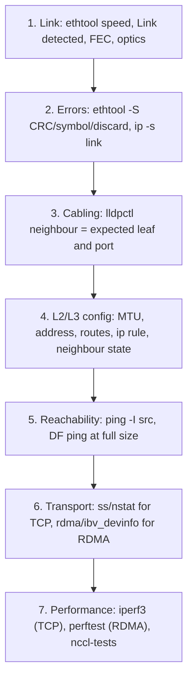

## Why this matters

GPU servers run Linux, and almost every network problem in an AI cluster is first seen from a host: a job that is slower than yesterday, a rank that cannot connect, a NIC that flaps. Before you can talk about NCCL tuning or PFC thresholds, you need to answer simple questions quickly and precisely: *Is the link up, at the right speed? Is it taking errors? Which switch port is it plugged into? Does the IP configuration look right? Can I reach the peer, with a full-size packet, from the right source address?*

The tools in this lesson answer those questions. They are not AI-specific, which is exactly their value: they work on every host, they are available before any vendor tooling is installed, and they let you separate a network problem from a GPU, driver or application problem. Later modules add RDMA tooling (`rdma-on-linux`, `perftest-benchmarking`) and NCCL tooling (`nccl-tests-interpretation`) on top of this foundation.

## Concepts

### The toolbox at a glance

| Layer | Question | Tool |
|---|---|---|
| L1 physical | Is the link up? Speed? FEC? Optics healthy? Errors? | `ethtool`, `ethtool -m`, `ethtool -S`, `ip -s link` |
| L1/L2 neighbour | Which switch and port am I cabled to? | `lldpctl` (lldpd), or the NIC/switch LLDP view |
| L2 | MAC, MTU, neighbour (ARP) entries | `ip link`, `ip neigh` |
| L3 | Addresses, routes, policy rules, path | `ip addr`, `ip route`, `ip rule`, `ip route get`, `ping`, `traceroute`, `mtr` |
| L4 | Sockets, TCP health, retransmissions | `ss`, `nstat` |
| Throughput | How fast can TCP go between two hosts? | `iperf3` |
| Packets | What is actually on the wire? | `tcpdump` (on the netdev: kernel path only) |
| RDMA | Which RDMA devices exist, which netdev, which state? | `rdma`, `ibv_devices`, `ibv_devinfo` |

Most of these ship in standard distribution packages: `iproute2` (provides `ip`, `ss`, `rdma`, `nstat`), `ethtool`, `tcpdump`, `iputils` (ping), `traceroute`, `mtr`, `iperf3`, `lldpd`, and `rdma-core` or `ibverbs-utils` (provides `ibv_devices`, `ibv_devinfo`). Vendor stacks such as NVIDIA's DOCA-OFED/MLNX_OFED add convenience scripts like `ibdev2netdev`.

### Netdevs and RDMA devices: two names for one port

A modern RDMA NIC port appears twice in Linux:

- As a **network device (netdev)** such as `ens1f0np0`, used by the kernel IP stack, `ip`, `ethtool`, `tcpdump`.
- As an **RDMA device**, used by the verbs API, NCCL, and the `ibv_*` tools. NVIDIA's DOCA-OFED/MLNX_OFED stack names these `mlx5_0`, `mlx5_1`, ...; distribution rdma-core (the inbox stack) names them after the PCI address, for example `rocep3s0f0`. This course uses `mlx5_0` in examples; on your own hosts take the name from `rdma link` or `ibv_devices`.

They are the same physical port. NCCL configuration usually names RDMA devices (`mlx5_0`), while IP and switch troubleshooting uses netdev names. Mapping one to the other is a routine first step, shown below.

### Interface naming

Linux "predictable" names encode the hardware location: `eno1` (onboard), `ens1f0` (PCIe slot 1, function 0), `enp26s0f0` (PCI bus 26, slot 0, function 0). The `np0` suffix you often see on NVIDIA/Mellanox ports (`ens1f0np0`) is the physical port name reported by the driver. Names differ by platform, so always map names to PCI addresses and RDMA devices rather than assuming.

## How it works

### `ip`: the swiss-army knife

`ip` replaces the old `ifconfig`, `route` and `arp` commands. The most useful forms:

| Command | Shows |
|---|---|
| `ip -br link` | One line per interface: name, state, MAC |
| `ip -br addr` | One line per interface with its addresses |
| `ip -s link show dev X` | Packet, byte, error and drop counters |
| `ip route show` / `ip route show table N` | Routing tables |
| `ip rule show` | Policy routing rules |
| `ip route get DST from SRC` | The exact route the kernel would use |
| `ip neigh show` | ARP / neighbour table |

```text real=inbox
$ ip -s -s link show dev ens64f0np0
4: ens64f0np0: <BROADCAST,MULTICAST,UP,LOWER_UP> mtu 9000 qdisc mq state UP mode DEFAULT group default qlen 1000
    link/ether 24:8a:07:00:11:ee brd ff:ff:ff:ff:ff:ff
    RX:  bytes packets errors dropped  missed   mcast           
         47520      86      0       0       0       0 
    RX errors:  length    crc   frame    fifo overrun
                     0      0       0       0       0 
    TX:  bytes packets errors dropped carrier collsns           
         44388      82      0       0       0       0 
    TX errors: aborted   fifo  window heartbt transns
                     0      0       0       0       1 
    altname enp3s0f0np0
    altname enx248a070011ee
```
*(Real capture from a 100G ConnectX-5 RoCE port; recent iproute2 sizes the columns to fit the largest value, and the doubled `-s` adds the `RX errors:` and `TX errors:` detail rows. The output is the same with NVIDIA's stack: `ip` is iproute2 either way.)*

These are **kernel-level** counters: on an RDMA NIC they usually do not include RDMA traffic handled entirely in hardware. For the full picture, use the NIC's own counters via `ethtool -S` or `rdma statistic`.

### `ethtool`: the physical layer and the NIC

```
$ ethtool ens1f0np0
Settings for ens1f0np0:
        Supported ports: [ FIBRE ]
        ...
        Speed: 400000Mb/s
        Duplex: Full
        Auto-negotiation: off
        Port: FIBRE
        Link detected: yes
```
*(illustrative output, trimmed)*

Run as a normal user, `ethtool <if>` first prints `netlink error: Operation not permitted` (the Wake-on-LAN query needs root) and then the settings; use `sudo` to get a clean output. On a copper DAC the `Port:` line reads `Direct Attach Copper`. A 100G ConnectX-5 port on a 1 m DAC, as a normal user:

```text real=inbox
$ ethtool ens64f0np0
netlink error: Operation not permitted
Settings for ens64f0np0:
	Supported ports: [ Backplane ]
...
	Supported FEC modes: None	 RS	 BASER
...
	Advertised FEC modes: RS
...
	Speed: 100000Mb/s
	Lanes: 4
	Duplex: Full
	Auto-negotiation: on
	Port: Direct Attach Copper
...
	Link detected: yes
```

Check `Speed` against what you expect (400000Mb/s = 400 Gb/s). A port that came up at a lower speed than its peers is a classic cause of one slow rank.

| Command | What it tells you |
|---|---|
| `ethtool -i X` | Driver name, driver version, firmware version, PCI bus address |
| `ethtool -S X` | Driver-specific statistics: per-queue, per-priority, physical-layer errors |
| `ethtool -m X` | Transceiver (module) EEPROM: type, vendor, and, where supported, temperatures and optical power per lane. Needs root (otherwise `netlink error: Operation not permitted`); a passive copper DAC reports no optical power at all |
| `ethtool --show-fec X` | Configured and active forward error correction mode |
| `ethtool -k X` | Offload features (checksum, segmentation, GRO) |
| `ethtool -g X` / `-l X` | Ring sizes / number of queues (channels) |

`ethtool -S` is where the interesting counters live, but **their names are chosen by each driver**. On the NVIDIA mlx5 driver, for example, you will find counters such as physical-port packet and byte counts, CRC/symbol error counters, discard counters, and per-priority pause counters (named along the lines of `rx_prio3_pause`). Other drivers use different names. Check your driver's documentation before building alerts on a counter name; module `m10-operations` (`telemetry-counters`) maps the important ones.

```
$ ethtool -S ens1f0np0 | grep -E 'crc_errors_phy|discards_phy|prio3_pause:'
     rx_crc_errors_phy: 0
     rx_discards_phy: 0
     tx_discards_phy: 0
     rx_prio3_pause: 18234
     tx_prio3_pause: 0
```
*(illustrative output, mlx5-style counter names)*

Reading it: no CRC errors and no discards at the physical port is good; the NIC has *received* pause frames on priority 3 (the switch asked it to slow down), but never *sent* any. Whether 18,234 pauses is a problem depends on rate and context, a question for `pfc-priority-flow-control`. Note that mlx5 only shows the `prioN_pause` counters (and their `_duration` and `_transition` companions) for priorities with PFC enabled on the NIC, so if `rx_prio3_pause` does not appear at all, PFC is not enabled on priority 3. RDMA traffic itself shows up in mlx5 counters such as `tx_vport_rdma_unicast_bytes` and the per-priority `tx_prioN_bytes`, not in the netdev packet counters. On a ConnectX-5 port with the default settings (global pause on, PFC off) that had carried some RDMA traffic:

```text real=inbox
$ ethtool -S ens64f0np0 | grep -E 'vport_rdma_unicast|discard|pause' | head -20
     rx_vport_rdma_unicast_packets: 5835
     rx_vport_rdma_unicast_bytes: 361770
     tx_vport_rdma_unicast_packets: 80000
     tx_vport_rdma_unicast_bytes: 332400000
     rx_pause_ctrl_phy: 0
     tx_pause_ctrl_phy: 0
     rx_discards_phy: 0
     tx_discards_phy: 0
...
     rx_global_pause: 0
     rx_global_pause_duration: 0
     tx_global_pause: 0
     tx_global_pause_duration: 0
```

The RDMA bytes are there, there are no `prioN_pause` counters (PFC is off), and the `rx_global_pause`/`tx_global_pause` counters exist because 802.3x global pause is on; they disappear once PFC is enabled.

### Finding your switch port with LLDP

LLDP (Link Layer Discovery Protocol, IEEE 802.1AB) lets each side of a link advertise its name and port. With the `lldpd` daemon running on the host:

```
$ sudo lldpctl ens1f0np0
-------------------------------------------------------------------------------
LLDP neighbors:
-------------------------------------------------------------------------------
Interface:    ens1f0np0, via: LLDP, RID: 1, Time: 2 days, 03:11:42
  Chassis:
    SysName:      leaf-r03-rail0
  Port:
    PortID:       ifname swp17
    PortDescr:    gpu-node-0123 nic0
-------------------------------------------------------------------------------
```
*(illustrative output)*

This is the fastest way to catch **miscabling**: in a rail-optimized cluster NIC 0 of every server must land on the rail-0 leaf. A single swapped cable silently turns rail traffic into cross-rail traffic. Some RDMA NICs process LLDP in firmware, in which case the host daemon may need extra configuration to see it; check your NIC vendor's documentation.

### Reachability and path: `ping`, `traceroute`, `mtr`

- `ping -I <src> <dst>`: basic reachability from a specific source address.
- `ping -M do -s 8972 -I <src> <dst>`: full-size, do-not-fragment test for a 9000 MTU (see `mtu-jumbo-frames`).
- `traceroute -n <dst>`: one line per routed hop.
- `mtr -n -r -c 100 <dst>`: repeated traceroute with per-hop loss and latency statistics, useful for intermittent loss.

> [!WARNING]
> Many switches rate-limit or deprioritise ICMP replies generated by their control-plane CPU. Loss or high latency shown at an *intermediate* hop of `mtr`, but not at the final destination, usually means the switch CPU is slow to answer, not that traffic is being dropped.

### Sockets and TCP: `ss` and `nstat`

`ss -tin` lists TCP sockets with internal details: congestion window, RTT, retransmissions. `nstat -az` prints kernel protocol counters such as `TcpRetransSegs`. These matter for the TCP parts of an AI cluster: NCCL's bootstrap and its socket transport, storage protocols, checkpoint uploads and inference front-ends.

```
$ ss -tin dst 10.4.7.25
State  Recv-Q Send-Q   Local Address:Port    Peer Address:Port
ESTAB  0      0           10.0.0.11:51544      10.4.7.25:5201
	 cubic wscale:7,7 rto:201 rtt:0.052/0.011 mss:8948 cwnd:412 ...
```
*(illustrative output, trimmed)*

`mss:8948` confirms jumbo frames are in use on this connection (9000 minus IP, TCP and TCP-option headers); no `retrans:` field appears, which means no retransmissions (ss prints `retrans:<current>/<total>` only once a connection has retransmitted).

### Throughput: `iperf3`

`iperf3 -s` on one host and `iperf3 -c <server> -B <src> -P 8 -t 20` on another runs a 20-second TCP test with 8 parallel streams bound to a source address. It is excellent for proving the IP path works at "hundreds of Gb/s" levels, but **a single host often cannot saturate a 400 Gb/s port with TCP** because of per-core CPU limits. Do not use iperf3 to judge an RDMA fabric; use the perftest tools (`ib_write_bw` and friends) from `perftest-benchmarking`, which drive the NIC directly.

### Seeing packets: `tcpdump`

`tcpdump -i X -e -n` prints frames with MAC addresses; filters such as `udp port 4791`, `arp`, or `icmp` narrow it down; `-w file.pcap` saves for Wireshark. As covered in `osi-ethernet-frames`, kernel-bypass RDMA traffic is invisible to a capture on the netdev: `tcpdump -i ens1f0np0 udp port 4791` reports 0 packets even while `ib_write_bw` runs at line rate. On mlx5 NICs, libpcap's RDMA sniffer can capture it if you name the **RDMA device** instead (`tcpdump -D` lists it as `mlx5_0 (RDMA sniffer)`; `sudo tcpdump -i mlx5_0 -w roce.pcap`). Distribution security profiles can block this (on Ubuntu the AppArmor profile for tcpdump does, and tcpdump then reports `No such device exists`), and at line rate the capture is huge, so keep it short.

Here is the netdev capture during an `ib_write_bw` run between two ConnectX-5 hosts:

```text real=inbox
$ sudo timeout 8 tcpdump -i ens64f0np0 -nn -c 20 udp port 4791
libibverbs: Warning: couldn't open config directory '/etc/libibverbs.d'.
tcpdump: verbose output suppressed, use -v[v]... for full protocol decode
listening on ens64f0np0, link-type EN10MB (Ethernet), snapshot length 262144 bytes

0 packets captured
0 packets received by filter
0 packets dropped by kernel
```

The first line is a harmless warning from libibverbs inside the confined tcpdump (AppArmor stops it from reading `/etc/libibverbs.d`); the result is zero RoCEv2 packets on the netdev.

> [!VERIFIED]
> **On Ubuntu 26.04, `tshark` could not read a capture that `sudo tcpdump -w /tmp/...` had just written.** tcpdump drops privileges and writes the file as user `tcpdump`, and Ubuntu's AppArmor profile for tshark (`/etc/apparmor.d/tshark`, through `abstractions/user-tmp`) only lets it read files in `/tmp` that the user owns, so `tshark -r /tmp/x.pcap` failed with `tshark: You don't have permission to read the file "/tmp/x.pcap".` (dmesg: `apparmor="DENIED" operation="open" ... profile="tshark"`), for root too. Both fixes worked: `sudo tcpdump -Z $USER -w /tmp/x.pcap ...` (the file is then owned by you) or `tshark -r - < /tmp/x.pcap` (the shell opens the file). The host profile applied inside a privileged container as well.

To see why, step through a send on the kernel TCP/IP path and on the RDMA path below, and use the tool lens to check which of this lesson's tools can observe RDMA traffic at all.

```widget
host-stack-paths
```

### RDMA devices: `rdma` and `ibv_devinfo`

```text stack=inbox real
$ rdma link show
link rocep3s0f0/1 state ACTIVE physical_state LINK_UP netdev ens64f0np0 
link rocep3s0f1/1 state ACTIVE physical_state LINK_UP netdev ens64f1np1 
```

```text stack=doca real
$ rdma link show
link mlx5_0/1 state ACTIVE physical_state LINK_UP netdev ens64f0np0 
link mlx5_1/1 state ACTIVE physical_state LINK_UP netdev ens64f1np1 

$ ibdev2netdev
mlx5_0 port 1 ==> ens64f0np0 (Up)
mlx5_1 port 1 ==> ens64f1np1 (Up)
```
*(The same dual-port ConnectX-5 under each driver stack: the netdev names are identical, the RDMA device names are not. `ibdev2netdev` is a script shipped with NVIDIA's OFED/DOCA stack, not part of upstream rdma-core or the distribution packages.)*

`rdma link show` (from iproute2) is available everywhere and maps RDMA device and port to netdev; it is the inbox replacement for `ibdev2netdev`. `ibv_devinfo -d mlx5_0` shows the port state, `link_layer` (`Ethernet` for RoCE, `InfiniBand` for IB) and the `active_mtu`.

### A bottom-up checklist



Working bottom-up stops you from tuning NCCL on a host whose cable is in the wrong switch. It is the same discipline you will formalise in `troubleshooting-methodology`.

> [!ANALOGY]
> This is the network equivalent of a doctor's routine checks: pulse and blood pressure (link, speed, errors) before the MRI (packet captures and NCCL traces). In enterprise networking you might start at the switch CLI; in AI clusters the host side is often more informative because each GPU server has many high-speed ports whose counters directly reflect what the job experiences. Where the analogy breaks down: the host cannot see the fabric's internal congestion, so you will still need switch telemetry later.

## In practice

A realistic "rank 37 is slow" first pass on the suspect host, in order:

```
# 1. Map RDMA devices to netdevs and check all are ACTIVE
rdma link show

# 2. Check each back-end port's speed and link
for i in ens1f0np0 ens2f0np0; do ethtool $i | grep -E 'Speed|Link detected'; done

# 3. Look for physical errors and drops (driver-specific names)
ethtool -S ens2f0np0 | grep -Ei 'err|discard|drop' | grep -v ': 0$'

# 4. Check optics health (if the module supports diagnostics; needs root)
sudo ethtool -m ens2f0np0

# 5. Confirm cabling
sudo lldpctl ens2f0np0

# 6. Confirm MTU end to end from the right source
ping -M do -s 8972 -c 5 -I 10.0.0.13 10.4.7.25
```

What you might find, and what it means:

| Observation | Likely meaning | Next step |
|---|---|---|
| One port at 200000Mb/s, others at 400000Mb/s | Link trained at lower speed (cable, optic, config) | Reseat or replace; compare with switch side |
| `rx_crc_errors`-type counter growing | Bit errors not corrected by FEC: dirty fibre, bad optic or cable | Clean and inspect optics, check `ethtool -m` power levels, see `link-layer-ber-fec` |
| LLDP neighbour is a rail-1 leaf on a rail-2 NIC | Miscabled | Fix cabling; re-run validation |
| DF ping fails, small ping works | MTU mismatch in the path | Audit MTU along the path |
| All clean | Problem is probably elsewhere (GPU, PCIe, congestion, software) | Move up the stack: perftest, NCCL logs |

> [!TIP]
> Counters are only meaningful as **rates**. Capture `ethtool -S` twice, a known interval apart, and compare. A counter of 5,000 CRC errors means nothing without knowing whether it grew by 5,000 in the last second or over the last six months.

## Common pitfalls

- **Trusting `ip -s link` for RDMA traffic.** Symptom: interface counters show almost no traffic during a training job. Cause: RDMA traffic bypasses the kernel, so kernel counters miss it. Fix: use `ethtool -S` physical-port counters or `rdma statistic`.
- **Reading counters as absolute values.** Symptom: panic over a large error count that has not changed in weeks. Cause: counters are cumulative since driver load or reset. Fix: compute deltas over a known interval.
- **Using iperf3 to judge a 400G RDMA link.** Symptom: "the network only does 150 Gb/s". Cause: TCP single-host CPU limits. Fix: use `ib_write_bw` / `ib_read_bw` and many queue pairs; reserve iperf3 for TCP path checks.
- **Assuming counter names are universal.** Symptom: an alert rule never fires on a new NIC model. Cause: `ethtool -S` names are driver-specific. Fix: validate counter names per driver and firmware version.
- **Mistaking ICMP rate limiting for packet loss.** Symptom: mtr shows 30 % loss at hop 2, 0 % at the destination. Cause: switch control plane deprioritises ICMP. Fix: judge loss by the final hop and by data-plane counters.
- **Forgetting the source address.** Symptom: tests pass, the job fails. Cause: tests left via the front-end or main routing table. Fix: always pass `-I`/`-B` with the back-end source address.

## Key takeaways

- `ip` covers links, addresses, routes, policy rules and neighbours; `ip route get DST from SRC` shows the real routing decision.
- `ethtool` shows speed and link; `-S` (driver-specific counters), `-m` (optics) and `--show-fec` reveal physical-layer health.
- LLDP (`lldpctl`) proves which switch port each NIC is cabled to, which is critical in rail-optimized designs.
- Each RDMA NIC port has a netdev name and an RDMA device name; `rdma link show` maps them.
- Kernel counters and tcpdump on the netdev miss kernel-bypass RDMA traffic; use NIC counters instead (or, on mlx5, the RDMA sniffer on the RDMA device).
- iperf3 validates TCP paths, not RDMA performance; use perftest for RDMA.
- Work bottom-up and treat counters as rates, not totals.
