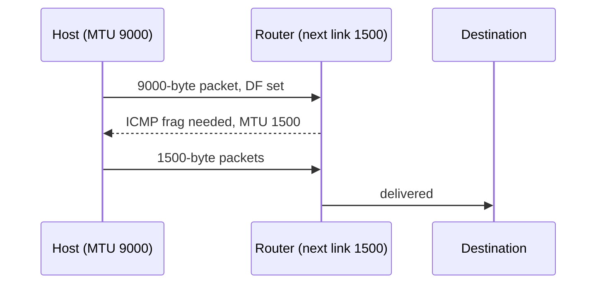

## Why this matters

Every packet carries a fixed cost: headers to parse, a lookup in every switch, an interrupt or completion in the NIC, a slot in a queue. The **MTU** (maximum transmission unit) decides how much useful data you get per unit of that cost. On a 400 Gb/s link, moving from 1500-byte to 9000-byte frames cuts the number of packets per second by roughly six, and raises the share of the link carrying real data. For RDMA it also decides the RDMA path MTU, which is capped at 4096 bytes and drops to 1024 if the Ethernet MTU is left at the default.

MTU is also one of the most common causes of mysterious failures. A single link left at 1500 in a 9000-byte fabric creates a **black hole**: small packets (pings, TCP handshakes, RDMA connection setup) work, large ones vanish. In an AI cluster that looks like "the job starts and then hangs", and it can cost a day of debugging. This lesson gives you the mental model and the tests to avoid that.

## Concepts

### Four sizes that people all call "MTU"

| Term | What it measures | Typical values | Who uses it |
|---|---|---|---|
| L2 frame size / "switch MTU" | Whole Ethernet frame, header (+ tag) + payload (+ FCS on some platforms) | 1518/1522 standard; 9100-9216 jumbo | Many switch operating systems |
| IP MTU (interface MTU) | Largest IP packet the interface sends, excluding the Ethernet header | 1500 standard; 9000 jumbo | Linux `ip link`, hosts, routers |
| TCP MSS | Largest TCP payload per segment = IP MTU - IP header - TCP header | 1460 at 1500 MTU; 8960 at 9000 | TCP stacks |
| RDMA path MTU | Largest RDMA payload per packet (InfiniBand-style values) | 256, 512, 1024, 2048, 4096 | RDMA NICs, `ibv_devinfo`, queue pair setup |

Getting these straight is half the battle:

- A Linux host with `mtu 9000` will send IP packets up to 9000 bytes, so Ethernet frames up to 9014 bytes (+4 with a VLAN tag, +4 FCS).
- A switch configured with "MTU 9216" on a platform that counts the L2 frame will happily carry those frames with room to spare. That headroom is why 9216 (or similar, depending on platform) is a common switch setting while hosts use 9000.
- On some platforms, the switch MTU setting is the IP MTU, not the frame size. Always check which convention your switch OS uses.

### What "jumbo frame" means

Any Ethernet frame with a payload larger than 1500 bytes is a **jumbo frame**. IEEE 802.3 does not standardise a jumbo size, so it is a vendor convention; 9000 bytes of IP MTU is the de facto value in data centers. Jumbo frames must be supported and enabled **on every device and link in the path**, because Ethernet has no way to fragment a frame that is too large: the receiver simply drops it as oversize.

### The RDMA MTU is a different animal

InfiniBand defines its MTU as one of five values: **256, 512, 1024, 2048 or 4096 bytes** of payload per packet. RoCE inherited this. A RoCE NIC chooses its active RDMA MTU as the **largest of those values that still fits inside the Ethernet interface MTU** after the RoCE headers are added. In practice:

| Ethernet interface MTU | Resulting RoCE active MTU (typical) |
|---|---|
| 1500 | 1024 |
| 2500 | 2048 |
| 4200 or 9000 | 4096 |

So a 9000-byte Ethernet MTU does not make RDMA packets 9000 bytes; it lets them reach the 4096 ceiling. The exact threshold depends on header options (IPv4 vs IPv6, VLAN tag), and the reported values come from your NIC driver; check `ibv_devinfo` on your system rather than relying on the table. The remaining room above 4096 is not wasted: TCP traffic on the same interface (for example storage or NCCL bootstrap) still uses the full 9000.

## How it works

### Efficiency: the fixed cost per packet

For RoCEv2 over IPv4 without a VLAN tag, every packet carries:

```
 Ethernet header 14 + IPv4 20 + UDP 8 + IB BTH 12 + ICRC 4 + FCS 4 = 62 bytes of headers/trailers
 + preamble/SFD 8 + inter-packet gap 12                          = 20 bytes of wire overhead
 -------------------------------------------------------------------------------------------
 fixed cost per packet                                            = 82 bytes
```

(Some packets carry extra headers, for example a 16-byte RETH on the first packet of an RDMA WRITE, or an 8-byte DETH on unreliable-datagram traffic; ignore them for this estimate.)

| RDMA MTU (payload) | Wire bytes per packet | Payload efficiency | Packets/s at 400 Gb/s |
|---|---|---|---|
| 256 | 338 | 75.7 % | about 148 million |
| 1024 | 1106 | 92.6 % | about 45 million |
| 2048 | 2130 | 96.2 % | about 23 million |
| 4096 | 4178 | 98.0 % | about 12 million |

Packets per second = 400 x 10^9 / 8 / wire bytes. Two things improve with bigger packets:

1. **Goodput**: 4096-byte packets deliver about 6 % more application data than 1024-byte packets (98.0 / 92.6) at the same line rate.
2. **Packet rate**: the NIC, the switch pipeline and the receiver all do per-packet work. Pushing 45 million packets per second per port is much harder than 12 million, and as port speeds move to 800 Gb/s and beyond the packet rate doubles again. Jumbo MTUs keep the per-packet budget manageable.

```widget
rocev2-packet
```

Use the widget to try MTUs from 256 to 4096 and with or without a VLAN tag or IPv6, and watch the efficiency curve flatten above about 2048.

### Why not even bigger?

If bigger is better, why stop at 4096 for RDMA, or 9000 for IP? Several reasons:

- **Latency of a single packet.** A switch that stores a whole packet before forwarding (store-and-forward) adds one serialisation time per hop: 4178 bytes at 400 Gb/s take about 84 ns; a 9000-byte frame about 180 ns. Small in isolation, but it adds up across hops and queues.
- **Buffer and lossless headroom.** A switch running Priority Flow Control must reserve headroom for data still in flight after it sends a pause; larger maximum frames increase that reservation (see `buffers-headroom-ets`).
- **Error cost.** A corrupted packet is discarded whole; larger packets mean more data to retransmit per error.
- **Specification limits.** The IB transport tops out at 4096; the Ethernet ecosystem settled on about 9000.

### Fragmentation and Path MTU Discovery

IPv4 was designed to let routers **fragment** packets that are too big for the next link. In practice, high-speed data center switches do not fragment in hardware, and most traffic sets the **DF (don't fragment)** bit. Instead, hosts rely on **Path MTU Discovery** (RFC 1191 for IPv4, RFC 8201 for IPv6): when a router cannot forward a DF packet because it is too big, it should return an ICMP "fragmentation needed" (IPv4 type 3, code 4) or ICMPv6 "Packet Too Big" message carrying the smaller MTU, and the sender lowers its packet size.



PMTUD fails silently when the ICMP message is never generated (some platforms do not generate it for frames dropped as oversize at L2), is rate-limited, or is filtered by a firewall. The result is the **MTU black hole**. RDMA makes this worse: RoCE does not perform PMTUD at all. The RDMA path MTU is set when a queue pair is configured, so if any link in the path cannot carry it, packets are dropped, the transport retransmits, and eventually the connection errors out. **For RDMA, the MTU must simply be consistent everywhere.**

Check a path yourself: set the host MTU, add a VXLAN overlay or lower one switch hop, and see which hop drops RoCE packets and which only black-holes full-size TCP and pings.

```widget
mtu-calculator
```

### Where MTU matters in each AI cluster network

| Network | Typical choice | Reason |
|---|---|---|
| Back-end compute fabric (RoCE) | Jumbo everywhere (hosts 9000 or more, switches with headroom) | Reach RDMA MTU 4096, minimise packet rate |
| InfiniBand compute fabric | IB MTU 4096 (set on the fabric and HCAs) | Same goal; IB has its own MTU configuration |
| Storage network | Usually jumbo | Large sequential reads and writes of datasets and checkpoints |
| Front-end / user access | Often 1500 at the edge | Traffic to the Internet and corporate networks expects 1500 |
| Out-of-band management | 1500 | Low volume, compatibility first |

The networks themselves are introduced in `four-networks-of-an-ai-cluster`.

## In practice

Check the interface MTU on Linux and set it (temporarily, until reboot; persistent configuration belongs in your network configuration system such as netplan, NetworkManager or systemd-networkd):

```
$ ip link show dev ens1f0np0
2: ens1f0np0: <BROADCAST,MULTICAST,UP,LOWER_UP> mtu 9000 qdisc mq state UP mode DEFAULT group default qlen 1000
    link/ether b8:3f:d2:12:34:56 brd ff:ff:ff:ff:ff:ff

$ sudo ip link set dev ens1f0np0 mtu 9000
```
*(illustrative output)*

Check what RDMA MTU the NIC derived from it:

```
$ ibv_devinfo -d mlx5_0
hca_id: mlx5_0
        transport:                      InfiniBand (0)
        ...
        port:   1
                state:                  PORT_ACTIVE (4)
                max_mtu:                4096 (5)
                active_mtu:             4096 (5)
                link_layer:             Ethernet
```
*(illustrative output, trimmed)*

`max_mtu` is what the hardware supports; `active_mtu` is what is in use now. If `active_mtu` shows `1024 (3)` on a RoCE port, the Ethernet MTU on the corresponding netdev is still around 1500.

Test the end-to-end path MTU with a ping that forbids fragmentation. For IPv4 with a 9000-byte MTU, the ICMP payload is 9000 - 20 (IP) - 8 (ICMP) = 8972 bytes:

```
$ ping -M do -s 8972 -c 3 -I 10.0.0.11 10.4.7.25
PING 10.4.7.25 (10.4.7.25) from 10.0.0.11 : 8972(9000) bytes of data.
8980 bytes from 10.4.7.25: icmp_seq=1 ttl=62 time=0.041 ms
...

$ ping -M do -s 8973 -c 1 -I 10.0.0.11 10.4.7.25
ping: local error: message too long, mtu=9000
```
*(illustrative output, Linux iputils ping)*

- `-M do` sets the DF bit and prohibits local fragmentation.
- `-s 8972` sets the ICMP payload size; the tool prints the resulting IP size in parentheses.
- One byte more fails locally, confirming the host's own limit. If the 8972-byte ping gets **no reply at all** while small pings work, something in the path has a smaller MTU: you have found a black hole.

For IPv6 the header is 40 bytes, so the equivalent payload is 9000 - 40 - 8 = 8952.

> [!TIP]
> Run the DF ping between every pair of rails you care about, from the specific back-end source address, as part of cluster bring-up. MTU mistakes are cheap to find before the first job and expensive after. Fabric validation is covered in `fabric-validation-burn-in`.

> [!ANALOGY]
> MTU is like the height limit of bridges on a lorry route. If one bridge on the route is lower than the others, a tall lorry is not cut in half to fit: on Ethernet it is simply turned away at that bridge. PMTUD is the road sign that is supposed to warn the driver in advance; RDMA traffic does not read road signs, so every bridge on the route must be tall enough.

## Common pitfalls

- **Jumbo on hosts, not on one switch link.** Symptom: pings and connection setup succeed; large transfers stall or RDMA queue pairs go to an error state after retries. Cause: one inter-switch link or one port still at the default MTU. Fix: audit MTU on every interface in the path; test with DF pings at full size.
- **Mixing up L2 and L3 MTU conventions.** Symptom: a switch "set to 9000" drops 9000-byte packets from hosts. Cause: the switch counts the Ethernet header in its MTU, so it accepts only about 8982-byte IP packets. Fix: give switches headroom (for example 9216 where supported) and know your platform's convention.
- **Assuming 9000 MTU means 9000-byte RDMA packets.** Symptom: confusion when `ibv_devinfo` shows 4096. Cause: RDMA MTU is capped at 4096 by the IB transport. Fix: this is expected; 4096 is the target.
- **Leaving RoCE at the default 1500.** Symptom: RDMA bandwidth a few percent below expectation and much higher packet rates on switches. Cause: active RDMA MTU of 1024. Fix: raise the interface MTU so `active_mtu` becomes 4096, consistently across the fabric.
- **Inconsistent MTU between peers.** Symptom: one direction works better than the other, or some host pairs fail. Cause: hosts with different MTUs negotiating different RDMA MTUs; the queue pair uses a path MTU that one side cannot carry. Fix: one MTU policy for the whole back-end, enforced by automation.
- **Testing with the wrong source interface.** Symptom: "the DF ping passed" but the rail is broken. Cause: the ping left via the front-end network. Fix: use `-I <back-end address>`.

> [!INTERVIEW]
> "Your RoCE fabric is configured for jumbo frames, yet `ibv_devinfo` on one host shows `active_mtu 1024`. What do you check?" A strong answer: the RoCE active MTU follows the netdev MTU, so check that host's interface MTU (it was probably reset to 1500 by a configuration that did not persist); confirm the switch port MTU; then verify end to end with `ping -M do -s 8972 -I <src>`. Explain the impact: about 5 % lower goodput and roughly four times the packet rate, and the risk that peers with 4096 queue pairs cannot talk to this host correctly.

## Key takeaways

- Distinguish frame size, IP MTU, TCP MSS and RDMA MTU; each layer subtracts its own headers.
- Jumbo frames (IP MTU about 9000) must be enabled on every device in the path; Ethernet does not fragment, it drops.
- RoCE uses InfiniBand MTU values (256-4096) and picks the largest that fits the Ethernet MTU: 1500 gives 1024, jumbo gives 4096.
- Larger packets raise payload efficiency (about 92.6 % at 1024 vs 98 % at 4096 for RoCEv2) and cut packet rate by about 4x.
- PMTUD relies on ICMP and often fails silently; RDMA does not use it at all, so MTU must be consistent everywhere.
- Verify with `ping -M do -s 8972 -I <src> <dst>` (IPv4, 9000 MTU) and `ibv_devinfo` `active_mtu`.
