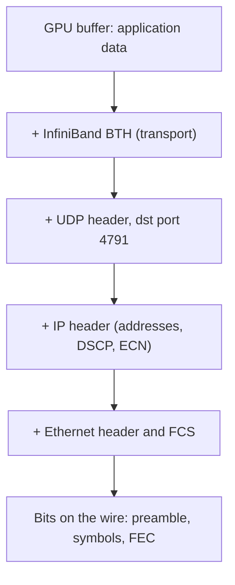

## Why this matters

Every byte that moves between two GPUs in an AI cluster is wrapped in a stack of headers before it touches a cable. On a RoCEv2 fabric that stack is Ethernet, IP, UDP and the InfiniBand transport header; on an InfiniBand fabric it is the InfiniBand link, network and transport headers. When an engineer says "the frame was dropped", "the VLAN tag is missing", "the priority bits are wrong" or "we are losing 6 % to header overhead", they are talking about specific fields in that stack. If you cannot picture the frame, you cannot read a packet capture, you cannot understand why lossless Ethernet keys on a 3-bit field, and you cannot reason about why jumbo frames make training faster.

This lesson builds the vocabulary that every later module assumes. We start with the layered model as a mental map, then dissect the Ethernet frame byte by byte, and finish by following one RDMA message from a GPU's memory down to the wire.

## Concepts

### Why networks are layered

A network has to solve many unrelated problems at once: turning bits into light or voltage, deciding which machine on a cable a message is for, finding a path across many switches, recovering lost data, and finally handing data to the right application. Layering splits these problems so that each layer only talks to the layer directly above and below it. The layer below offers a **service** ("I will deliver this blob to that neighbour"); the layer above uses it without caring how it works.

Two models are in common use:

| OSI layer | Name | TCP/IP model | Job | Examples in an AI cluster |
|---|---|---|---|---|
| 7 | Application | Application | What the program wants to do | PyTorch, NCCL, an inference HTTP API |
| 6 | Presentation | Application | Encoding, encryption | TLS on the front-end network |
| 5 | Session | Application | Dialogue between endpoints | Rarely discussed separately |
| 4 | Transport | Transport | End-to-end delivery between processes | TCP, UDP, InfiniBand transport (BTH) |
| 3 | Network | Internet | Addressing and routing across many links | IPv4, IPv6, InfiniBand GRH/LID routing |
| 2 | Data link | Link | Delivery to a neighbour on one link | Ethernet MAC, InfiniBand link layer |
| 1 | Physical | Link | Bits on copper, fibre or radio | 400GBASE-DR4 optics, DAC cables, SerDes |

The OSI model has seven layers and is mainly a teaching and vocabulary tool; the TCP/IP model (RFC 1122) collapses it to four and matches how the Internet is actually built. Engineers mix them freely: "L2" means Ethernet switching, "L3" means IP routing, "L4" means TCP/UDP ports, and "L7 load balancer" means something that looks at HTTP.

> [!ANALOGY]
> Layering is like the postal system. You write a letter (application data), put it in an envelope with a person's name (transport), the post office adds a postcode and routes it between cities (network), and a local van delivers it to the right door on one street (data link) over actual roads (physical). The analogy breaks down for RDMA: in an RDMA NIC the "envelope stuffing" for transport is done by the hardware, not by the operating system, which is precisely why RDMA is fast.

### Encapsulation

As data moves down the stack, each layer adds its own header (and sometimes a trailer) in front of what it received. The unit at each layer has a conventional name:

| Layer | Unit name | Header added |
|---|---|---|
| 4 | Segment (TCP) or datagram (UDP) | TCP or UDP header |
| 3 | Packet | IP header |
| 2 | Frame | Ethernet header + FCS trailer |
| 1 | Bits / symbols | Preamble, line coding, FEC |

On the receiving side the process runs in reverse: each layer strips its header, checks it, and hands the rest upward. A switch only needs to look as deep as the layer it works at: an Ethernet (L2) switch reads the frame header, a router (L3) reads the IP header too, and a NIC that terminates RDMA reads all the way into the transport header.



This is the RoCEv2 stack, which we return to in `rocev2-encapsulation`. Notice how ordinary it looks: from the switch's point of view a RoCEv2 packet is just a UDP/IP packet in an Ethernet frame, which is why it can be routed across a normal IP fabric.

### Ethernet in one paragraph

Ethernet (IEEE 802.3 for the physical and MAC layers, IEEE 802.1 for bridging and VLANs) is the dominant link layer in data centers. Each interface has a 48-bit **MAC address**, written as six hex bytes (for example `b8:3f:d2:12:34:56`). The first three bytes usually identify the vendor (the OUI). A frame carries a destination MAC, a source MAC, a type field that says what is inside, the payload, and a checksum. Ethernet itself does not guarantee delivery: if a frame is corrupted or a queue is full, the frame is simply dropped. Making Ethernet "lossless" for RDMA is an add-on (Priority Flow Control) that you will study in `pfc-priority-flow-control`.

## How it works

### The Ethernet II frame, field by field

Almost all traffic you will meet uses the "Ethernet II" (DIX) framing. Here it is with an optional 802.1Q VLAN tag:

```
 bytes:   7        1      6         6        4 (optional)   2          46-1500         4
       +--------+-----+---------+---------+-------------+-----------+---------------+-----+
       |Preamble| SFD | Dst MAC | Src MAC | 802.1Q tag  | EtherType |   Payload     | FCS |
       +--------+-----+---------+---------+-------------+-----------+---------------+-----+
       |<-- PHY -->|  |<------------------- the "frame" (64 to 1518/1522 bytes) ------------>|
```

| Field | Size | Purpose |
|---|---|---|
| Preamble | 7 bytes | Alternating 1/0 pattern that historically let receivers lock their clock. Not counted in the frame size. |
| SFD (start frame delimiter) | 1 byte | Marks where the frame begins. Not counted in the frame size. |
| Destination MAC | 6 bytes | Who should receive it. All-ones (`ff:ff:ff:ff:ff:ff`) is broadcast. |
| Source MAC | 6 bytes | Who sent it. Switches learn from this field. |
| 802.1Q tag | 4 bytes, optional | VLAN ID and priority (details below). |
| EtherType | 2 bytes | What the payload is: `0x0800` IPv4, `0x86DD` IPv6, `0x0806` ARP. |
| Payload | 46-1500 bytes (standard) | The IP packet. Padded up to 46 bytes if shorter. Larger with jumbo frames. |
| FCS (frame check sequence) | 4 bytes | CRC-32 over the frame. A receiver drops any frame whose CRC does not match. |

Key consequences:

- **Minimum frame size is 64 bytes** (dst + src + type + 46-byte payload + FCS = 6+6+2+46+4). Smaller payloads are padded.
- **Maximum standard frame size is 1518 bytes** (1500-byte payload + 18 bytes of header and FCS), or 1522 with a VLAN tag. The 1500-byte payload limit is the classic **MTU**; jumbo frames raise it, which is the subject of `mtu-jumbo-frames`.
- **The FCS only detects errors; it does not correct them.** A frame with a bad CRC is discarded and counted (on Linux, typically in an `rx_crc_errors`-style counter; exact names depend on the driver). Recovering the data is somebody else's job: TCP retransmits, and the RDMA transport in the NIC retransmits. On modern high-speed links, forward error correction (FEC) at the physical layer corrects most bit errors before the CRC check ever sees them; you will meet FEC again in `link-layer-ber-fec`.

Build a few frames yourself: toggle the VLAN tag, switch between IPv4, IPv6 and RoCEv1, shrink the payload until padding appears, and click each segment to see its fields and bit widths.

```widget
ethernet-frame
```

### Inter-packet gap: the bytes you never see

Between frames, the sender must also leave an **inter-packet gap** (IPG) of at least 12 byte-times of idle. Together with the 8 bytes of preamble and SFD, every frame costs **20 extra bytes of wire time** that never appear in a packet capture. This matters for throughput math:

| Payload (IP packet) | Frame size | Bytes on the wire (+20) | Payload efficiency |
|---|---|---|---|
| 64 bytes (tiny) | 82 | 102 | 63 % |
| 1500 bytes | 1518 | 1538 | 97.5 % |
| 9000 bytes (jumbo) | 9018 | 9038 | 99.6 % |

These are Ethernet-only numbers; the real efficiency for RoCEv2 is lower because the IP, UDP and InfiniBand transport headers also live inside the payload. The `rocev2-packet` widget below lets you compute the full picture.

> [!NOTE]
> Speeds such as "400 Gb/s" are line rates of the MAC layer. A packet capture shows frames without preamble and IPG, and many tools report throughput as bytes of frames or even bytes of payload. When two tools disagree by a few percent at line rate, overhead accounting is usually the reason.

### The 802.1Q VLAN tag and the priority bits

A VLAN tag is inserted between the source MAC and the EtherType. It consists of a 2-byte TPID (`0x8100`, which tells the receiver "a tag follows") and a 2-byte TCI:

```
 TPID 0x8100 (16 bits) | PCP (3 bits) | DEI (1 bit) | VLAN ID (12 bits)
```

- **VLAN ID (VID)**: 12 bits, so 4094 usable VLANs (0 and 4095 are reserved). VLANs split one physical switch into several isolated L2 broadcast domains.
- **PCP (Priority Code Point)**: 3 bits, values 0-7. This is the "802.1p priority" of the frame. Switches can map it to one of up to eight traffic classes (queues).
- **DEI (Drop Eligible Indicator)**: 1 bit hinting that this frame may be dropped first under congestion.

The PCP field is the historical reason Ethernet QoS has **eight priorities**, and Priority Flow Control pauses traffic per priority. Modern routed AI fabrics usually classify traffic by the **DSCP** field in the IP header instead (you will meet it in `ip-addressing-routing` and `qos-trust-and-mapping`), because a routed (L3) hop rebuilds the Ethernet header and an untagged routed port has no PCP field at all.

### What a switch does with a frame

An Ethernet switch receives the frame, checks the FCS, reads the destination MAC, looks it up in its MAC address table, and forwards the frame out of the matching port (or floods it to all ports in the VLAN if the address is unknown). It also records "source MAC X lives behind port Y". The details, plus queues and buffers, are in `switching-and-queues`.

A router (or a switch port running in L3 mode, which is the norm in AI fabrics) instead strips the Ethernet header, routes on the IP destination, decrements the IP TTL, and builds a brand-new Ethernet header for the next hop with new source and destination MACs. The IP packet inside travels end to end; Ethernet headers only live for one hop.

### Where InfiniBand fits

InfiniBand (IB) is a different link and network technology, not a flavour of Ethernet. An IB packet starts with a Local Route Header (LRH) addressed by 16-bit LIDs assigned by a Subnet Manager, may carry a Global Route Header (GRH) for routing between subnets, then the Base Transport Header (BTH) and payload, and ends with two CRCs (ICRC and VCRC). There is no MAC address, no EtherType and no preamble in the Ethernet sense. RoCE ("RDMA over Converged Ethernet") borrows the IB transport layer (BTH and above) and carries it over Ethernet: RoCEv1 directly in an Ethernet frame with EtherType `0x8915`, RoCEv2 inside UDP/IP with UDP destination port **4791**. Module `m05-infiniband` covers native IB in depth.

| Stack | L2 | L3 | L4 / transport | Routable across IP subnets? |
|---|---|---|---|---|
| InfiniBand | IB link (LRH) | IB GRH (optional) | IB BTH | Within IB subnets / via IB routers |
| RoCEv1 | Ethernet, EtherType 0x8915 | IB GRH | IB BTH | No, single L2 domain |
| RoCEv2 | Ethernet, EtherType 0x0800/0x86DD | IPv4 / IPv6 | UDP 4791 + IB BTH | Yes |
| TCP | Ethernet | IPv4 / IPv6 | TCP | Yes |

### Following one RDMA write to the wire

Suppose NCCL on GPU 3 of server A wants to write 1 MiB into GPU 3 of server B over RoCEv2:

1. NCCL posts a work request to the NIC. The NIC reads the GPU buffer directly over PCIe (GPUDirect RDMA, see `gpudirect-rdma-storage`).
2. The NIC splits 1 MiB into packets no larger than the RDMA path MTU (commonly 4096 bytes on a fabric configured for jumbo frames), so 256 packets.
3. To each chunk it prepends a BTH (12 bytes; the first packet of a write also carries a 16-byte RETH with the remote address and key), a UDP header (8 bytes), an IPv4 header (20 bytes) and an Ethernet header (14 bytes), and appends an ICRC (4 bytes) and FCS (4 bytes).
4. The PHY adds the preamble, SFD and IPG, encodes the bits, applies FEC, and drives the optics.

The CPU of server A never touched the payload. Every switch in the path only parsed Ethernet and IP. Server B's NIC checks the CRCs, matches the BTH to a queue pair, and writes the payload straight into GPU memory.

```widget
rocev2-packet
```

Use the widget to change the MTU and watch the payload efficiency move. Notice that the fixed header cost (roughly 60-80 bytes per packet depending on options) is negligible at 4096-byte payloads and significant at 256-byte payloads.

## In practice

You do not need a switch to see frames. Any Linux host can show you its MAC addresses and capture frames with headers decoded.

Show interfaces and their MAC addresses:

```
$ ip link show
1: lo: <LOOPBACK,UP,LOWER_UP> mtu 65536 qdisc noqueue state UNKNOWN mode DEFAULT group default qlen 1000
    link/loopback 00:00:00:00:00:00 brd 00:00:00:00:00:00
2: ens1f0np0: <BROADCAST,MULTICAST,UP,LOWER_UP> mtu 9000 qdisc mq state UP mode DEFAULT group default qlen 1000
    link/ether b8:3f:d2:12:34:56 brd ff:ff:ff:ff:ff:ff
```
*(illustrative output)*

- `link/ether b8:3f:d2:12:34:56` is the interface's MAC address; `brd ff:ff:ff:ff:ff:ff` is the broadcast address.
- `mtu 9000` is the largest IP packet this interface will send, not the frame size: add 14 bytes of Ethernet header (18 with a VLAN tag) and 4 bytes of FCS to get the frame.

Capture a few frames and print their Ethernet headers (`-e`) without resolving names (`-n`). For ordinary kernel traffic you capture on the netdev (`-i ens1f0np0`); RoCE traffic is offloaded, so this example captures on the RDMA device instead (see the warning below):

```
$ sudo tcpdump -i mlx5_0 -e -n -c 3
10:02:11.120391 b8:3f:d2:12:34:56 > b8:3f:d2:ab:cd:ef, ethertype IPv4 (0x0800), length 4154: 10.0.3.11.49152 > 10.0.3.12.4791: UDP, length 4112
10:02:11.120393 b8:3f:d2:12:34:56 > b8:3f:d2:ab:cd:ef, ethertype IPv4 (0x0800), length 4154: 10.0.3.11.49152 > 10.0.3.12.4791: UDP, length 4112
10:02:11.120410 b8:3f:d2:ab:cd:ef > b8:3f:d2:12:34:56, ethertype IPv4 (0x0800), length 62: 10.0.3.12.49152 > 10.0.3.11.4791: UDP, length 20
```
*(illustrative output)*

Reading line one: source MAC, then destination MAC, then the EtherType, then `length 4154` (the frame length as captured, without FCS on most NICs: 14 Ethernet + 20 IP + 8 UDP + 12 BTH + 4096 payload + 4 ICRC), then the IP and UDP details. Destination port 4791 tells you this is RoCEv2. The short 62-byte frame (BTH + 4-byte AETH + ICRC, no payload) in the other direction is typical of an RDMA acknowledgement.

> [!WARNING]
> On RDMA NICs, RoCE traffic is generated and consumed by the NIC hardware and bypasses the kernel network stack, so `tcpdump` on the netdev shows **nothing** of the RDMA data path (a `udp port 4791` capture on `ens1f0np0` reports 0 packets while `ib_write_bw` runs). Capturing it needs NIC support or a port mirror on the switch. On NVIDIA mlx5 NICs, libpcap includes an **RDMA sniffer**: `tcpdump -D` lists the RDMA device (for example `mlx5_0 (RDMA sniffer)`, or `rocep3s0f0` with distribution rdma-core), and capturing on that name, as above, records the offloaded RoCE packets. Security profiles can block it (Ubuntu's AppArmor profile for tcpdump does; tcpdump then says `No such device exists`), and NVIDIA's stack also ships `ibdump` for the same job. Check your NIC's and distribution's documentation.

To see only VLAN-tagged frames and their priority, `tcpdump -e -n vlan` prints the VLAN ID and the `p` (PCP) value for each tagged frame. If the capture shows no `vlan` keyword on traffic you expected to be tagged, the tag was either never added or stripped by NIC offload before capture, which is itself a common source of confusion.

## Common pitfalls

- **Confusing MTU with frame size.** Symptom: a switch configured with "MTU 9000" drops 9000-byte IP packets from hosts. Cause: many switch platforms specify MTU as the L2 frame size (including Ethernet header), while Linux specifies the L3 packet size. Fix: know which convention each device uses; switches are commonly set to 9216 to leave headroom. Details in `mtu-jumbo-frames`.
- **Assuming tcpdump sees RDMA traffic.** Symptom: "there is no traffic on the interface" while a job is clearly transmitting at hundreds of Gb/s. Cause: RDMA kernel bypass. Fix: use NIC port counters (`ethtool -S`, `rdma statistic`), the NIC's RDMA sniffer where available (on mlx5, `tcpdump -i <rdma device>`), or switch-side mirroring instead.
- **Expecting PCP to survive routing.** Symptom: priority-based QoS works within a rack but traffic lands in the wrong queue after the first routed hop. Cause: PCP lives in the Ethernet header, which a router rebuilds; untagged routed links carry no PCP at all. Fix: classify on DSCP in the IP header for routed fabrics.
- **Forgetting the 20 hidden bytes.** Symptom: a benchmark tops out "below line rate" and someone opens a ticket. Cause: preamble, SFD and IPG consume wire time but are invisible in captures. Fix: compute expected goodput including all overheads before declaring a problem.
- **Treating InfiniBand as "fast Ethernet".** Symptom: trying to use Ethernet tools (MAC tables, VLANs, `tcpdump` on IB ports) to debug an IB fabric. Cause: IB has its own addressing (LIDs, GUIDs) and management (Subnet Manager). Fix: use the IB toolset introduced in `ib-tools-diagnostics`.

> [!INTERVIEW]
> "Walk me through the headers of a RoCEv2 packet and tell me which ones a spine switch looks at." A strong answer lists Ethernet (MACs, optional VLAN tag, EtherType 0x0800/0x86DD), IP (addresses, DSCP, ECN, TTL), UDP (source port used for ECMP entropy, destination 4791), the IB BTH (opcode, destination QP, packet sequence number), payload, ICRC and FCS. Then it says that a spine routes on IP, hashes on the 5-tuple including the UDP source port, classifies on DSCP and may mark ECN, but does not interpret the BTH. Bonus points for mentioning the 20 bytes of preamble and IPG when computing efficiency.

## Key takeaways

- Networks are layered so that each layer solves one problem; "L2" is Ethernet, "L3" is IP, "L4" is TCP/UDP or the IB transport.
- An Ethernet II frame is dst MAC (6) + src MAC (6) + optional 802.1Q tag (4) + EtherType (2) + payload + FCS (4), framed on the wire by 8 bytes of preamble/SFD and at least 12 bytes of inter-packet gap.
- Standard frames are 64-1518 bytes (1522 tagged); the 1500-byte payload limit is the classic MTU.
- The 802.1Q tag carries a 12-bit VLAN ID and a 3-bit PCP priority, the origin of Ethernet's eight priorities.
- RoCEv2 is IB transport inside UDP (port 4791) inside IP inside Ethernet; InfiniBand is a separate link and network technology.
- Ethernet detects errors with CRC and drops bad or excess frames; losslessness and retransmission are added by other mechanisms.
- Header overhead is per packet, so larger packets mean higher efficiency, the core argument for jumbo frames in AI fabrics.
