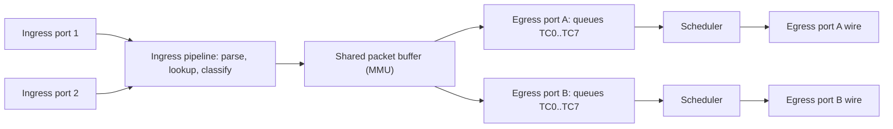

## Why this matters

A network link is never "slow" in the way people say it is. A 400 Gb/s link always transmits at 400 Gb/s when it has something to send. What makes traffic slow is **waiting**: packets sitting in a switch queue because more traffic arrived for an output port than that port can send. In AI clusters, where thousands of GPUs exchange data in synchronised bursts, queues are where performance is won and lost. A queue that fills up either drops packets (disastrous for RDMA), marks them with ECN (asking senders to slow down), or pauses the upstream link (PFC), and each choice has consequences for the whole fabric.

This lesson explains what a switch actually does with a packet, where the buffers are, how queues and schedulers decide who goes next, and how to reason about queueing delay with simple arithmetic. It is the foundation for the lossless Ethernet module (`pfc-priority-flow-control`, `buffers-headroom-ets`, `ecn-and-dcqcn`) and for congestion at scale (`incast-and-congestion-hotspots`).

## Concepts

### Bridging: learn, flood, forward

An Ethernet switch (a "bridge" in IEEE terms) keeps a **MAC address table** mapping MAC addresses to ports, per VLAN. For every frame:

1. **Learn**: record "source MAC is reachable via the port this frame came in on".
2. **Look up** the destination MAC.
3. **Forward** out of the matching port if known; **flood** out of every other port in the VLAN if unknown, broadcast or (by default) multicast.
4. **Filter**: never send a frame back out of the port it arrived on.

Entries age out after a few minutes of silence. Because flooding can loop forever in a network with redundant paths, classic L2 networks run a **Spanning Tree Protocol** that blocks redundant links. That throws away bandwidth, which is one reason AI and other large data center fabrics are built as **routed** leaf-spine networks instead of large L2 domains: every link is active and ECMP spreads load across them (`clos-leaf-spine`).

### L3 switching

A modern data center "switch" is usually also a router: its ASIC (the forwarding chip) can do IP longest-prefix lookups at line rate. For a routed packet, the ASIC looks up the destination IP, picks a next hop (possibly one of many ECMP members), rewrites the MAC addresses, decrements the TTL, and forwards, all in hardware within a few hundred nanoseconds to a few microseconds depending on the platform. The switch CPU only runs the control plane (BGP, LLDP, management); it never touches data-plane packets in a healthy fabric.

### Inside a switch



- The **ingress pipeline** parses headers, does the lookups, and **classifies** the packet into a traffic class (TC) based on markings such as DSCP or PCP.
- The packet is stored in a **shared buffer**, managed by the memory management unit (MMU). Most data center ASICs share one on-chip buffer across all ports, with per-port and per-queue limits.
- Each egress port has several **queues**, typically eight, one per traffic class.
- A **scheduler** on each egress port decides which queue sends next.

Typical on-chip buffers on current-generation (2024-2026) 51.2 Tb/s data center switch ASICs are in the range of tens of megabytes up to a couple of hundred megabytes, shared across all 64 x 800G (or 128 x 400G) ports; check the vendor data sheet for your platform. Some switch families designed for deep buffering add gigabytes of off-chip memory, with different trade-offs. Either way, per port the buffer is small relative to the link speed, as the arithmetic below will show.

### Store-and-forward vs cut-through

| Mode | Behaviour | Latency added per hop | Notes |
|---|---|---|---|
| Store-and-forward | Receive the whole frame, check FCS, then forward | At least one serialisation time of the frame | Corrupt frames are dropped at the first switch |
| Cut-through | Start forwarding once the header has been read | Mostly fixed pipeline latency | Corrupt frames may propagate (marked/stomped); only possible when the egress port is idle and at a compatible speed |

**Serialisation time** = frame size / link rate. A RoCEv2 packet with a 4096-byte payload occupies 4178 bytes of wire time (a 4158-byte frame plus 20 bytes of preamble, SFD and gap); at 400 Gb/s that takes 4178 x 8 / 400e9 = about 84 ns, at 100 Gb/s about 334 ns. A switch's own pipeline latency is in the same order of magnitude (hundreds of nanoseconds to around a microsecond for typical data center ASICs, depending on platform and features). Cut-through only helps when there is no queue: if the egress port is busy, the packet waits in the buffer anyway.

## How it works

### Why queues form: rate mismatch

A queue forms whenever, for a while, more bits arrive for an egress port than it can send. Common causes in an AI fabric:

- **Fan-in / incast**: many senders target one receiver at once. Eight 400G flows converging on one 400G port deliver 3.2 Tb/s into a 400 Gb/s pipe: the queue grows at 2.8 Tb/s.
- **Speed mismatch**: an 800G uplink feeding a 400G downlink.
- **Flow collisions**: ECMP hashes two elephant flows onto the same uplink while others sit idle (`flow-collisions-entropy`).
- **Pause back-pressure**: a downstream device pauses this port, so it cannot drain (`pfc-priority-flow-control`).

### Queueing delay arithmetic

The time a newly arrived packet waits is simply the bytes ahead of it divided by the drain rate:

```
queueing delay = queue depth (bits) / egress link rate (bits per second)
```

| Queue depth | At 100 Gb/s | At 400 Gb/s | At 800 Gb/s |
|---|---|---|---|
| 100 KB | 8 us | 2 us | 1 us |
| 1 MB | 80 us | 20 us | 10 us |
| 10 MB | 800 us | 200 us | 100 us |

Compare that with the propagation delay inside a data center (about 5 ns per metre of fibre, so a 100 m run is about 0.5 us) and the switch pipeline (sub-microsecond). **In a loaded fabric, queueing dominates latency.** Every microsecond of queueing on the critical path of a collective operation is time GPUs spend waiting.

How fast can a queue fill? With 8-to-1 incast at 400G, excess arrival is 2.8 Tb/s, which is 350 MB per millisecond. A port allowed to use, say, 2 MB of buffer is full in about 6 us. Buffers do not "absorb" sustained incast; they only buy microseconds for something else (a congestion signal, a pause, or the end of the burst) to happen.

Reproduce these numbers in the calculator: pick a link speed and buffer, raise the incast degree, and watch how quickly the queue reaches the buffer limit and how much is dropped.

```widget
queue-latency
```

### Traffic classes and schedulers

A switch can only treat traffic differently if it can tell the kinds apart. **Classification** at ingress maps a marking (DSCP in the IP header, or PCP in a VLAN tag) to an internal traffic class, which selects the egress queue. A typical RoCE design (detailed in `qos-trust-and-mapping`) has at least three classes: RDMA data in a lossless class, congestion notification packets in a high-priority class, and everything else in a default class.

The **scheduler** decides which non-empty queue transmits next:

| Scheduler | Rule | Good for | Risk |
|---|---|---|---|
| Strict priority (SP) | Always serve the highest-priority non-empty queue | Tiny, latency-critical control traffic (for example CNPs) | Starves lower queues if the high queue is busy |
| Weighted round robin (WRR) / deficit WRR (DWRR) | Serve queues in turn, in proportion to configured weights (DWRR counts bytes) | Sharing bandwidth between classes | Weights must reflect real needs |
| ETS (802.1Qaz) | The standardised combination: some classes SP, the rest share bandwidth by percentage | Data center bridging, RoCE fabrics | Misconfigured percentages starve RDMA or storage |

Example ETS policy: CNP class strict priority; RDMA class 60 %; storage/TCP class 30 %; other 10 %. Percentages are a **minimum guarantee under contention**: if a class has nothing to send, others may use its share.

### What happens when a queue is full: drop, mark, or pause

When a queue reaches its limit, the switch has three fundamentally different options:

1. **Drop (tail drop)**: discard the arriving packet. TCP notices the loss and slows down. RDMA transports recover from loss far more expensively than TCP (classic RoCE NICs use go-back-N, resending everything after the lost packet; newer NIC generations add selective retransmission, but a loss still stalls the queue pair for a timeout or NAK round trip), so drops are very damaging to RDMA throughput.
2. **Mark (ECN)**: before the queue is full, once it passes a threshold, set the IP header's ECN field to "Congestion Experienced" on some packets (probabilistically, as in RED/WRED-style marking). The receiver echoes the signal to the sender, which reduces its rate. This is how DCTCP (for TCP) and DCQCN (for RoCE) work, without losing a packet.
3. **Pause (PFC)**: when the ingress buffer used by one priority passes a threshold (XOFF), send a pause frame upstream asking the neighbour to stop sending that priority. Resume (XON) when it drains. Nothing is dropped, but the congestion spreads backwards through the fabric.

```widget
pfc-ecn-sim
```

The widget shows an egress queue filling from incast. Watch the order of events: ECN marking should start first and slow senders down; PFC is the safety net that prevents drops if marking was not enough. Configured the other way round (PFC firing before ECN), pauses spread through the fabric and hurt innocent flows, which you will study in `pfc-storms-deadlocks`.

### Head-of-line blocking

If one queue holds packets for several destinations and the packet at the head cannot be sent (for example because the downstream device paused it), everything behind it waits too, even packets for uncongested destinations. Switches avoid this internally with per-egress queues (virtual output queues in some architectures), but PFC re-creates it across links: pausing a priority on a link stops *all* flows of that priority on that link, not just the ones causing congestion. This collateral damage is the central weakness of PFC.

> [!ANALOGY]
> A switch port is a motorway toll plaza with eight lanes (queues) feeding one exit road (the egress link). The scheduler is the attendant deciding which lane goes next: an ambulance lane always first (strict priority), the others in proportion to their size (DWRR). When cars arrive faster than the exit can take them, the lanes back up (queueing delay). Tail drop is turning cars away; ECN is handing drivers a leaflet saying "please come later"; PFC is closing the on-ramp upstream, which also blocks drivers headed somewhere else. The analogy breaks down on time scales: a "traffic jam" in a 400G switch builds and clears in microseconds.

## In practice

You cannot see switch queues from a host directly, but you can see their effects, and on the switch you can read counters. Switch CLI syntax depends entirely on the network OS (NVIDIA Cumulus/NVUE, SONiC, Arista EOS, Cisco NX-OS, Juniper Junos and others), so consult your platform's QoS documentation for exact commands. Conceptually, the counters you look for per port and per queue are:

| Counter (conceptual) | What it tells you |
|---|---|
| Transmitted packets/bytes per queue | Which classes are using the port |
| Dropped packets per queue (tail drop / discard) | Queue overflowed; for an RDMA class this should be zero |
| ECN-marked packets per queue | Congestion was signalled; some marking is healthy under load |
| PFC pause frames sent / received per priority | This port asked its neighbour to pause, or was paused |
| Current / peak buffer occupancy (watermark) | How close the queue came to its limit |

On the host side, NIC counters reveal the same story from the edges: per-priority pause frames received from the switch, ECN-related counters, and RDMA retransmission counters. For example, an illustrative delta over 10 seconds on an mlx5-based host:

```
rx_prio3_pause:      +54,000     # the switch paused our transmit on priority 3 often
tx_prio3_pause:      +0          # we never paused the switch
rx_discards_phy:     +0          # no drops at our port
```
*(illustrative output; counter names are driver-specific)*

Interpretation: the switch egress queue towards the destination is congested and is pushing back via PFC. The next questions, for later modules, are *why* (incast? flow collision? a slow receiver?) and *whether ECN marking is configured to act before PFC*.

Quick estimate you should be able to do in your head: "a 3 MB queue on a 400G port" is 3e6 x 8 / 400e9 = 60 us of delay for the last packet in it. If a collective step is supposed to take 100 us, that queue alone is a 60 % slowdown for the flows behind it.

## Common pitfalls

- **"Bigger buffers solve congestion."** Symptom: deep-buffer switches deployed, yet tail latency and job time get worse. Cause: sustained incast still fills any buffer, and a fuller buffer means more queueing delay for everyone. Fix: fix the cause (congestion control, load balancing, topology), use buffers to absorb short bursts only.
- **Strict priority for bulk traffic.** Symptom: some traffic class starves completely under load. Cause: a busy class placed in strict priority. Fix: reserve strict priority for small control traffic such as CNPs; use ETS/DWRR weights for bulk classes.
- **Wrong classification.** Symptom: RDMA drops on a "lossless" fabric. Cause: RDMA packets carry a DSCP the switch does not map to the lossless class, so they land in a lossy default queue. Fix: verify end-to-end marking and trust settings (`qos-trust-and-mapping`).
- **Reading peak occupancy as average.** Symptom: alarm over a watermark at 90 % of buffer. Cause: watermarks record the peak since last clear, perhaps a single microburst. Fix: clear and resample, correlate with drops and pauses.
- **Blaming the link when it is the queue.** Symptom: "the link is slow". Cause: links always run at line rate; latency comes from waiting. Fix: look at queue, ECN and pause counters, not just utilisation averages, which hide microsecond-scale bursts.

> [!INTERVIEW]
> "Eight GPUs each send 400 Gb/s to one GPU behind a single 400G leaf port. What happens in the switch, and what are the three possible outcomes for the excess traffic?" A strong answer: the egress queue grows at 2.8 Tb/s (350 MB/ms), so a few MB of buffer fills in microseconds; the switch can tail-drop (catastrophic for RDMA), ECN-mark so senders reduce rate (preferred first line of defence), or send PFC pauses upstream (lossless safety net with head-of-line blocking and congestion spreading as side effects). Good candidates add that the senders' combined rate must ultimately drop to 400 Gb/s, which is the job of end-to-end congestion control, and that in all-to-all collectives this pattern is normal, not exceptional.

## Key takeaways

- L2 switches learn source MACs, forward known destinations, and flood unknown ones; AI fabrics are routed so that every link is active.
- Switch ASICs classify packets into traffic classes (usually eight) and queue them per egress port in a shared buffer.
- Queueing delay = queue depth / link rate; at 400 Gb/s, 1 MB is 20 us, and queueing dominates latency in a loaded fabric.
- Incast fills buffers in microseconds; buffers only buy time for congestion control to react.
- Schedulers: strict priority for small control traffic, DWRR/ETS weights for bulk classes.
- A full queue can drop, ECN-mark, or PFC-pause; RDMA fabrics aim for ECN first and PFC as a safety net, never drops.
