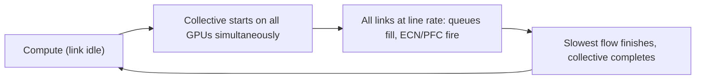

## Why this matters

Data center networks of the 2010s were tuned for cloud traffic: millions of mostly small, independent flows from many tenants, where statistical multiplexing smooths everything out and TCP recovers from the occasional drop. Standard designs (oversubscribed leaf-spine, static ECMP hashing, modest buffers, lossy queues) work beautifully for that traffic. AI training traffic breaks nearly every one of the assumptions behind them. It has few flows, each huge; it arrives in synchronised bursts at line rate; it is all-or-nothing, because the job waits for the slowest transfer; and RDMA reacts badly to loss.

If you bring a cloud-network mental model to an AI fabric, you will make predictable mistakes: trusting average utilisation, assuming ECMP spreads load evenly, oversubscribing uplinks, and treating a 0.01 % drop rate as harmless. This lesson describes the traffic precisely so the design choices in later modules (rail-optimized topologies, lossless Ethernet, adaptive routing, packet spraying, congestion control) make sense as answers to specific problems.

## Concepts

### Cloud traffic vs AI training traffic

| Property | Classic cloud / enterprise | AI training back-end |
|---|---|---|
| Number of flows | Very many (millions per fabric) | Few per GPU (a handful of connections per peer, per collective) |
| Flow size | Mostly small ("mice"), a few large | Mostly huge ("elephants"), MB to GB per transfer |
| Entropy for hashing | High: many addresses and ports | Low: the same GPU pairs, same destination port 4791 |
| Timing | Independent, statistically smooth | Synchronised: thousands of GPUs start a collective at the same moment |
| Burstiness | Moderate | Extreme: idle during compute, line rate during communication |
| Success metric | Average throughput, per-request latency | Job completion time: the slowest flow of each collective |
| Loss tolerance | TCP recovers; small loss is acceptable | RDMA retransmission is expensive; loss is very damaging |
| Pattern stability | Changes constantly | Repeats every training step, for weeks |

### Elephant flows and low entropy

An **elephant flow** is a long-lived flow carrying a large amount of data; a **mouse flow** is a short one. In a data-parallel all-reduce, each GPU streams gigabytes to a small number of ring or tree neighbours. Each such transfer is carried over a small number of RDMA queue pairs, and each queue pair is one 5-tuple on the wire (source IP, destination IP, UDP, source port, destination port 4791). So the fabric sees **a few very large flows** rather than many small ones.

**Entropy** here means "how much variety the hash function has to work with". ECMP hashing (`ip-addressing-routing`) assigns each flow to one path based on its header fields. With millions of flows, the law of large numbers gives even load. With a few dozen elephants, it does not.

### Synchrony and bursts

A training step alternates between compute phases (network nearly idle) and communication phases (every GPU sending at the same time, at line rate). Because all GPUs run the same program in lock-step, their bursts **align**. The result is an on/off pattern on every link with microsecond-to-millisecond structure, repeating every step.



Averaged over a second, a link might show 40 % utilisation and look comfortable. Over 10 microseconds, it is either at 0 % or at 100 % with a queue building. **Averages hide the problem.**

### Incast

**Incast** is many senders transmitting to one receiver at the same time, so their combined rate exceeds the receiver's link. You met the arithmetic in `switching-and-queues`: eight senders at 400 Gb/s into one 400 Gb/s port fill a few MB of buffer in microseconds. In AI workloads incast appears in:

- **All-to-all** (MoE expert parallelism): every GPU receives pieces from every other GPU simultaneously.
- **Tree and hierarchical reductions**: several children sending to one parent.
- **Many-to-one storage reads/writes**: checkpoint writes converging on a few storage targets.
- **Parameter-server-style or gather patterns**, less common in modern training.

## How it works

### ECMP collisions: why hashing fails with few flows

Consider a leaf with 8 uplinks to 8 spines and 8 elephant flows leaving it, each needing a full uplink. If hashing placed them perfectly, each uplink would carry one flow. With random hashing:

- Probability that all 8 flows land on 8 different uplinks: 8! / 8^8 = 40,320 / 16,777,216, about **0.24 %**.
- Expected number of uplinks carrying **no** flow: 8 x (7/8)^8, about **2.75**.
- So typically 2-3 uplinks sit idle while others carry 2 or even 3 elephants.

An uplink carrying two elephants gives each about half its bandwidth. In a synchronous collective, those two flows become the stragglers, and **the whole collective runs at roughly half speed**, even though the fabric as a whole has plenty of spare capacity.

| Flows / uplinks | P(no collision) | Expected idle uplinks | Typical worst uplink load |
|---|---|---|---|
| 4 flows / 8 uplinks | about 41 % | about 4.7 | 1 or 2 flows |
| 8 flows / 8 uplinks | about 0.24 % | about 2.75 | 2-3 flows |
| 64 flows / 64 uplinks | effectively 0 | about 23.4 | typically 3-4 flows, sometimes 5-6 |

(Figures assume ideal random hashing; real hash functions on real headers can be better or worse.)

```widget
ecmp-collision
```

Use the widget to hash elephant flows onto spine uplinks. Compare static ECMP with adaptive routing (switches steer traffic to less-loaded paths) and packet spraying (each packet may take a different path, with reordering handled at the receiver). These remedies are the subject of `adaptive-routing-packet-spraying` and `flow-collisions-entropy`; NICs can also add entropy by spreading a connection across several queue pairs with different UDP source ports.

### The tail decides: job completion time

For a collective, what matters is when the **last** byte arrives:

```
collective time = max over all flows (flow completion time)
step time       = compute + exposed collective time
```

If 999 of 1,000 flows finish in 10 ms and one takes 20 ms because of a collision or a congested queue, the collective takes 20 ms. Doubling the time of one flow in a thousand doubles the step's communication time. This is why AI networking cares about **tail** metrics (p99, p99.9, max) and why techniques that improve the worst case at a small cost to the average, such as adaptive routing, are worth it.

### Loss and RDMA

Classic RoCE NICs use a **go-back-N** style recovery: when a packet is lost, the receiver discards later packets of that queue pair and the sender retransmits from the lost packet onwards, after a timeout or a negative acknowledgement. One drop can cost many packets of retransmission and, with timeouts, long stalls. Studies and operator reports over the years have shown RDMA throughput collapsing at loss rates that TCP would barely notice. Newer NICs implement more selective recovery, and new transports (for example the Ultra Ethernet transport, `ultra-ethernet`) are designed to tolerate loss better, but on today's mainstream RoCE fabrics the design goal remains: **do not drop RDMA packets** (`pfc-priority-flow-control`, `ecn-and-dcqcn`).

### Rail locality: most traffic stays on its rail

Frameworks assign ranks so that the heavy cross-node groups (DP, PP) connect GPUs with the **same local index** on different servers: GPU 0 talks to GPU 0s, GPU 3 to GPU 3s. In a **rail-optimized** fabric, NIC *n* of every server plugs into the rail-*n* leaf, so this traffic often stays within one rail and needs only one switch hop when the group fits under one leaf. Traffic that must change rails can first move over NVLink inside the server to the GPU whose NIC sits on the right rail (NCCL calls this PXN). The topology is designed around the traffic, not the other way round (`rail-optimized-topology`).

### Bandwidth per GPU keeps rising

| GPU era (approximate) | Typical scale-out NIC per GPU |
|---|---|
| A100 generation (2020-2022) | 200 Gb/s (InfiniBand HDR or 200GbE) |
| H100/H200 generation (2022-2024) | 400 Gb/s (NDR InfiniBand or 400GbE) |
| Blackwell generation (2025-2026) | 400-800 Gb/s (for example ConnectX-8-class 800G NICs on some systems) |

(Exact configurations vary by system vendor and design; check the specific platform.) Each generation the GPUs compute faster, so the communication share of the step becomes more exposed (`ai-training-101`), and the fabric has to keep up.

### The pattern repeats: a gift for diagnosis

Unlike cloud traffic, a training job's traffic is nearly identical every step for weeks. That makes AI fabrics **predictable**: you can benchmark the exact collectives a job uses, compare step times over days, and spot a degradation the moment it appears. It also means a problem is never "transient" in the cloud sense: a hash collision between two specific flows can repeat every single step until something changes the flow's header fields.

> [!ANALOGY]
> Cloud traffic is like the cars on a city's road network on a normal day: many independent trips, spread across all routes, and a jammed street just delays a few people. AI training traffic is like the end of a stadium concert: everyone leaves at the same moment, heading to the same few car parks, and the event is only "over" when the last car is out. Assigning each car to an exit by the last digit of its number plate (static ECMP) works for the city but leaves some stadium exits jammed and others empty. The analogy breaks down in repetition: the concert ends every second, for weeks.

## In practice

Seeing AI traffic patterns requires the right resolution. Switch counters polled every 30 or 60 seconds show smooth, moderate utilisation; you need finer-grained telemetry (streaming telemetry at sub-second intervals, buffer watermarks, ECN-mark and PFC counters, see `streaming-telemetry-gnmi`) to see bursts.

Illustrative view of the same leaf uplink at two resolutions during training:

```
60-second average:   tx utilisation 38 %

100 ms samples:      0 %  0 %  97 %  99 %  4 %  0 %  0 %  98 %  99 %  6 %  0 % ...
peak queue watermark (same interval): 3.1 MB
ECN marked packets (delta):           +182,400
```
*(illustrative)*

The 60-second average suggests a quiet link. The fine-grained samples show the step rhythm: idle compute phases and saturated communication phases. The watermark and ECN deltas confirm that queues build during every burst.

You can reproduce the collision arithmetic yourself:

```python
import random

def worst_uplink_load(flows=8, uplinks=8, trials=100_000):
    worst = []
    for _ in range(trials):
        load = [0] * uplinks
        for _ in range(flows):
            load[random.randrange(uplinks)] += 1
        worst.append(max(load))
    return sum(w >= 2 for w in worst) / trials, sum(worst) / trials

p_collision, mean_worst = worst_uplink_load()
print(f"P(at least one shared uplink) = {p_collision:.4f}, mean worst-case load = {mean_worst:.2f} flows")
```

With 8 flows on 8 uplinks this prints a collision probability above 99 % and a mean worst-case load of roughly 2.6 flows (exact values vary run to run), meaning the slowest flows typically get half of an uplink or less.

> [!TIP]
> When a training job is slow but average utilisation looks fine, ask for buffer watermarks, ECN-mark counts and PFC pause counts on the uplinks during the job, and compare per-uplink transmit counters. A very uneven spread of bytes across ECMP members is the fingerprint of flow collisions.

## Common pitfalls

- **Trusting averages.** Symptom: "the network is only 30 % utilised, it can't be the bottleneck". Cause: averaging over seconds hides line-rate bursts and queueing. Fix: use fine-grained telemetry and per-step timing.
- **Assuming ECMP balances AI traffic.** Symptom: some spine uplinks saturated while others idle; collectives at half speed. Cause: few elephant flows with low entropy. Fix: add entropy (more queue pairs or source-port variation), adaptive routing or packet spraying, and rail-aligned placement.
- **Designing for the average flow.** Symptom: good median transfer times but poor job performance. Cause: the slowest flow determines collective time. Fix: measure and optimise p99 and max flow completion times.
- **Treating rare drops as harmless.** Symptom: throughput falls sharply under load while drop counters show a tiny percentage. Cause: RDMA recovery multiplies the cost of each loss. Fix: make the RDMA class lossless or use a loss-tolerant transport; alert on any RDMA-class drops.
- **Oversubscribing the back-end.** Symptom: fine in small tests, poor at full job size. Cause: synchronised bursts use all GPUs' bandwidth at once, so there is no statistical multiplexing to rely on. Fix: back-end fabrics are generally built non-blocking (`oversubscription-and-blocking`).

## Key takeaways

- AI training traffic: few elephant flows, low entropy, synchronised line-rate bursts, and a job that waits for the slowest flow.
- Static ECMP hashing balances many small flows, but with a few elephants collisions are almost certain and halve the throughput of the unlucky flows.
- Incast (many senders to one receiver) is built into all-to-all and reduction patterns and fills buffers in microseconds.
- Job completion time is governed by the tail: optimise the worst flow, not the average.
- RDMA recovery makes loss very expensive, so mainstream RoCE fabrics aim to be lossless.
- Coarse averages hide bursts; use fine-grained telemetry (watermarks, ECN, PFC, per-member counters).
- The pattern repeats every step, which makes AI fabrics predictable and benchmarkable.
