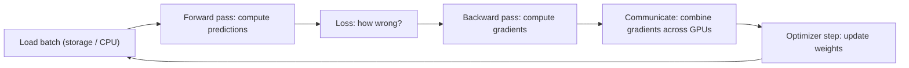

## Why this matters

Most network engineers learned their craft on traffic generated by people: web requests, video streams, database queries, file transfers. That traffic is the sum of many independent users, so it is smooth, statistically predictable and tolerant of a dropped packet here and there. AI training is the opposite. It is **one program**, spread across thousands of GPUs, that stops and waits for the network many times per second. If one link is slow, every GPU in the job waits for it. A network that is "99 % fine" can make a cluster worth hundreds of millions of dollars run noticeably slower.

To design or troubleshoot an AI fabric you do not need to be a machine learning researcher, but you do need a precise picture of what the GPUs are doing and when they talk to each other. This lesson builds that picture from scratch: what a model is, what a training step does, why models must be split across many GPUs, and why the network sits on the critical path. The next lessons (`parallelism-strategies`, `collective-operations`, `ai-traffic-patterns`) build directly on it.

## Concepts

### A model is a giant function with adjustable numbers

A neural network is a mathematical function that turns an input (for a language model, a sequence of **tokens**, which are word pieces) into an output (a prediction of the next token). The function is built from layers of matrix multiplications and simple non-linear operations. The numbers inside those matrices are the **parameters** (or **weights**). A "70B model" has about 70 billion of them.

Training means adjusting the parameters so the model's predictions get better. It works by trial and correction, billions of times:

1. Show the model some examples and let it predict.
2. Measure how wrong it was (the **loss**).
3. Work out, for every parameter, in which direction a tiny change would reduce the loss (the **gradient**).
4. Nudge every parameter a little in that direction (the **optimizer step**).

### Vocabulary you will hear in every AI infrastructure meeting

| Term | Meaning | Why the network cares |
|---|---|---|
| Parameter / weight | A learned number in the model | Sizes of weights and gradients set the volume of many collectives |
| Token | A word piece; training data is measured in tokens | Dataset size drives total compute and duration |
| Batch / global batch | The examples processed together in one step, across all GPUs | Larger batches mean more compute per communication |
| Micro-batch | The share of the batch one GPU (or one pipeline stage) processes at a time | Sets message sizes in pipeline parallelism |
| Step / iteration | One forward + backward + update cycle | The network is used inside every step |
| Gradient | Per-parameter direction of improvement | Must be combined (summed or averaged) across GPUs every step |
| Optimizer state | Extra per-parameter numbers kept by the optimizer (for Adam, two moving averages) | Increases memory, motivating sharding (and more communication) |
| Checkpoint | A saved copy of the model and optimizer state | Large bursts of storage traffic |
| MFU | Model FLOPs Utilisation: useful compute achieved / theoretical peak | Network stalls lower MFU directly |

### The training step



On a single GPU, there is no "communicate" box. The moment you use more than one GPU, some form of communication is needed in every step. With the simplest strategy, **data parallelism**, each GPU holds a full copy of the model, processes a different slice of the batch, and the GPUs then **average their gradients** so that every copy applies the same update. That averaging is an **all-reduce** collective operation, the most important network operation in AI (`collective-operations`).

## How it works

### Why one GPU is not enough: memory

Training needs to keep much more than the weights in GPU memory. With the common mixed-precision setup using the Adam optimizer, a widely used estimate (from the ZeRO paper) is **about 16 bytes per parameter** before counting activations:

| Item | Bytes per parameter | Notes |
|---|---|---|
| Weights in BF16/FP16 | 2 | Used for the forward and backward pass |
| Gradients in BF16/FP16 | 2 | Produced by the backward pass |
| FP32 master copy of weights | 4 | Kept for numerically stable updates |
| Adam first moment (FP32) | 4 | Moving average of gradients |
| Adam second moment (FP32) | 4 | Moving average of squared gradients |
| **Total** | **about 16** | Plus activations, buffers, fragmentation |

For a 70B-parameter model: 70e9 x 16 bytes = about **1.1 TB**, before activations (the intermediate results of the forward pass kept for the backward pass, which can be just as large). A single data center GPU has on the order of 80-200 GB of high-bandwidth memory depending on generation (for example 80 GB on H100 SXM, 141 GB on H200, around 180-192 GB on B200-class parts; check the data sheet for your SKU). So the model, its gradients and its optimizer state **must be split across many GPUs**. How they are split decides which traffic appears on which network: that is `parallelism-strategies`.

### Why one GPU is not enough: compute

A useful rule of thumb for dense transformer models is that training costs about **6 x N x D floating-point operations**, where N is the number of parameters and D the number of training tokens (about 2ND for the forward pass and 4ND for the backward pass).

Worked example: a 70B model trained on 15 trillion tokens.

- Compute: 6 x 70e9 x 15e12 = 6.3e24 FLOPs.
- A current GPU might sustain around 400 TFLOP/s of useful BF16 compute in practice (peak dense BF16 is higher, around 1 PFLOP/s for H100-class parts, but real jobs achieve a fraction of peak; 35-50 % MFU is commonly reported for large dense training).
- One GPU: 6.3e24 / 4e14 = 1.6e10 seconds, about **500 years**.
- 16,384 GPUs: about 9.6e5 seconds, about **11 days**, *if* they scale perfectly.

For a real data point, Meta's Llama 3 paper reports training the 405B model with about 3.8e25 FLOPs on up to 16K H100 GPUs, with BF16 MFU around 38-43 %. That "if they scale perfectly" is where the network comes in.

### Synchronous training: everyone waits for the slowest

Large-scale training is almost always **synchronous**: every GPU must finish its part of step *k* and the gradient exchange must complete before anyone starts step *k+1*. This keeps all model copies identical and the mathematics simple, but it has a brutal consequence:

> Step time = time of the **slowest** participant, plus any communication that is not hidden behind compute.

```
One training step on 4 GPUs (illustrative; 1 character = 5 ms, AR = all-reduce, dots = idle waiting)

time (ms)   0               80  100   130
            |               |   |     |
GPU 0       [compute.......][AR]......|
GPU 1       [compute.......][AR]......|
GPU 2       [compute.......][AR]......|
GPU 3       [compute.......][AR, slow]|
                                      ^ step k+1 starts for everyone
```

In the illustration, three GPUs finish their communication at 100 ms but cannot start the next step until GPU 3's slow transfer completes at 130 ms. Because the collective involves everyone, the whole job runs at the slow GPU's pace: a 30 % slowdown caused by **one** link. At scale, the probability that *some* link, NIC, optic or switch queue is misbehaving at any moment is high, which is why AI networks are engineered for tail performance rather than averages.

### Overlap: hiding communication behind compute

Frameworks try to hide communication. In data-parallel training, the backward pass computes gradients from the last layer to the first; as soon as the gradients of a group of layers (a **bucket**) are ready, their all-reduce can start while the GPU keeps computing gradients for earlier layers. Only the part of communication that cannot be overlapped, the **exposed communication**, adds to step time.

| Step time component | What drives it |
|---|---|
| Compute | GPU speed, model size per GPU, batch size |
| Exposed communication | Bytes to move, network bandwidth and latency, how well it overlaps |
| Stalls and stragglers | The slowest GPU, link or rank in each collective |
| Data loading | Storage and CPU pipeline (usually hidden by prefetching) |

As GPUs get faster each generation, compute per step shrinks while the bytes to communicate do not, so more communication becomes exposed. **Faster GPUs make the network matter more, not less.**

### Failures and checkpoints

With tens of thousands of GPUs, hardware failures are routine. The Llama 3 paper, for example, reports several hundred job interruptions over a roughly 54-day pre-training period, most attributed to hardware (GPUs, HBM memory, and also network components). A synchronous job usually cannot continue when one participant dies, so it restarts from the last **checkpoint**: a snapshot of all weights and optimizer states, written to storage periodically.

Checkpoints matter to network engineers because they create big, bursty traffic on the **storage network**: the full training state (on the order of a terabyte or more for a 70B model, more for larger ones) written as fast as possible so GPUs can resume computing. Restarting means every GPU reading its shard back. The trade-off between checkpoint frequency and lost work is covered with storage design in `storage-and-frontend-networks`.

> [!ANALOGY]
> Synchronous training is like a rowing eight: the boat only moves well if every rower catches the water at the same moment, and one rower who is late slows the whole boat, no matter how strong the others are. Classic enterprise traffic is more like a marathon: thousands of runners each finishing at their own pace, where one slow runner affects nobody else. The analogy breaks down in scale: an AI "boat" can have tens of thousands of rowers, and they synchronise many times per second.

## In practice

You can see the shape of a training job from the host without any special tools. On a GPU node during a data-parallel job, `nvidia-smi dmon` prints per-GPU metrics once a second, including streaming multiprocessor (SM) utilisation and, on supported GPUs, PCIe throughput:

```
$ nvidia-smi dmon -s u
# gpu    sm   mem   enc   dec
# Idx     %     %     %     %
    0    98    61     0     0
    1    97    60     0     0
    ...
    7    45    30     0     0
```
*(illustrative output; columns vary by driver version and options, see `nvidia-smi dmon -h`)*

In a healthy synchronous job, all GPUs show similar patterns, so a GPU whose numbers differ markedly from its peers deserves a closer look. Interpreting it needs care: NCCL's communication kernels also occupy the SMs, so "busy" can mean computing or communicating, and in a synchronous job it is the straggler's *peers* that sit waiting for it. Per-second sampling hides the millisecond structure of a step; profilers such as PyTorch Profiler or NVIDIA Nsight Systems show compute and communication kernels on a timeline.

A useful back-of-the-envelope for engineers: **how many bytes must each GPU send per step for gradient all-reduce in pure data parallelism?**

```
gradient bytes   = parameters x 2 bytes (BF16)
ring all-reduce  ~ 2 x gradient bytes sent per GPU (for large GPU counts)

7B model:  7e9 x 2 = 14 GB of gradients  ->  ~28 GB sent per GPU per step
at 400 Gb/s (50 GB/s) per GPU           ->  ~0.56 s of pure transfer time per step
```
*(a simplified flat-ring estimate over the network; real libraries also use NVLink inside the server, which changes how the bytes split between NVLink and NICs, but the order of magnitude holds)*

If the compute part of the step takes about one second, more than half of it would be needed just to move gradients unless it overlaps. This is why real jobs combine overlap, larger batches and other parallelism strategies, and why each GPU gets its own 400-800 Gb/s NIC in modern designs (`nics-dpus-supernics`).

> [!TIP]
> When someone reports "training is slow", ask three questions first: *Is it slow on every step or only some?* (periodic slowness suggests checkpoints or evaluation), *Did it get slower when the job grew?* (scaling problems point to the network), and *Is one rank always last?* (a straggler points to one node, NIC or link).

## Common pitfalls

- **Thinking in averages.** Symptom: link utilisation graphs show 30 % average and the network is declared "not the problem". Cause: training traffic arrives in bursts at line rate, separated by compute phases; averages over seconds hide them. Fix: look at per-step timing, burst behaviour and tail latency, not one-minute averages.
- **Ignoring the straggler effect.** Symptom: a 1,000-GPU job runs 20 % slower after "minor" maintenance. Cause: one NIC renegotiated to a lower speed or one optic is taking errors, and every collective waits for it. Fix: per-port health checks across the whole fleet, not samples.
- **Assuming faster GPUs reduce network pressure.** Symptom: an upgrade to a new GPU generation delivers far less speedup than expected. Cause: compute shrank, communication did not, so more is exposed. Fix: scale network bandwidth per GPU with each generation.
- **Forgetting the storage burst.** Symptom: training periodically stalls for minutes. Cause: synchronous checkpoint writes saturating storage or the storage network. Fix: size the storage network for checkpoints, use asynchronous or sharded checkpointing.
- **Confusing training and inference needs.** Symptom: an inference cluster is designed like a training cluster, or vice versa. Cause: they have very different traffic patterns (`inference-networking`). Fix: start design from the workload.

> [!INTERVIEW]
> "Why is the network on the critical path of distributed training?" A strong answer: training is synchronous, so each step ends with a collective (for example gradient all-reduce) that every GPU must finish before the next step; step time is set by the slowest participant; communication that cannot be overlapped with compute adds directly to step time; and as GPUs get faster, the exposed share grows. Add numbers: a 7B model in pure data parallelism moves roughly 28 GB per GPU per step, about half a second at 400 Gb/s. Mention MFU as the metric that captures the loss.

## Key takeaways

- Training repeats a step: forward pass, loss, backward pass (gradients), gradient exchange, optimizer update.
- Mixed-precision Adam needs about 16 bytes per parameter before activations, so large models must be split across many GPUs.
- Training compute is roughly 6 x parameters x tokens; frontier models need thousands to tens of thousands of GPUs for weeks.
- Synchronous training means the slowest GPU, NIC or link sets the pace for the entire job.
- Only exposed (non-overlapped) communication adds to step time, and faster GPUs expose more of it.
- Failures are routine at scale; checkpoints create large bursts on the storage network.
