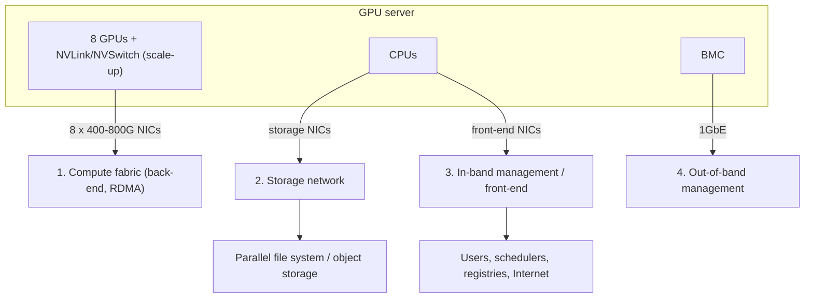

## Why this matters

Walk into an AI data hall and count the cables on one GPU server: often a dozen or more. They do not all go to the same place. A typical large training cluster is built from **several physically separate networks**, each with its own switches, technology, design rules and failure modes. The GPU-to-GPU fabric is the most famous and the most expensive, but a cluster with a perfect compute fabric and an undersized storage network still stalls at every checkpoint, and a cluster whose out-of-band network fails cannot even be rebooted remotely.

Knowing the four networks, plus the scale-up network inside each server or rack, is the map you will use for every later design and troubleshooting discussion. When someone says "front-end", "back-end", "east-west", "north-south", "OOB" or "NVLink domain", you should know exactly which cables, which switches and which traffic they mean. This lesson draws that map, using the separation found in reference architectures such as NVIDIA's DGX SuperPOD, and explains why designers keep the networks apart.

## Concepts

### The map



| # | Network | Also called | Carries | Typical technology | Bandwidth per server (order of magnitude) |
|---|---|---|---|---|---|
| 0 | Scale-up domain | NVLink domain, "the network inside the box/rack" | TP/EP/CP collectives between GPUs of one server or rack | NVLink + NVSwitch | Several TB/s per server (about 900 GB/s per GPU on Hopper) |
| 1 | Compute fabric | Back-end, scale-out, east-west, GPU fabric | GPU-to-GPU RDMA: DP, PP, cross-node EP collectives | InfiniBand or RoCEv2 Ethernet | 8 x 400 Gb/s (3.2 Tb/s), moving to 8 x 800 Gb/s |
| 2 | Storage network | Storage fabric | Dataset reads, checkpoint writes and restores | Ethernet (often RoCE or TCP) or InfiniBand | Hundreds of Gb/s (for example 2 x 200-400 Gb/s) |
| 3 | In-band management / front-end | North-south, converged front-end | SSH, schedulers (Slurm, Kubernetes), container images, monitoring, user and Internet access | Standard data center Ethernet, often EVPN-VXLAN | 1-2 x 100-400 Gb/s |
| 4 | Out-of-band management | OOB, management network | BMC (IPMI/Redfish), switch management ports, PDUs, console | 1 GbE (sometimes 10 GbE) Ethernet | 1 Gb/s |

Exact port counts and speeds depend on the system and the design. For example, NVIDIA's DGX H100 documentation describes eight 400 Gb/s ConnectX-7 ports for the compute fabric, additional dual-port ConnectX-7 adapters used for storage and in-band management, and a dedicated BMC port; check the user guide of your specific system rather than assuming this layout.

### Scale-up vs scale-out

Two words you will hear constantly:

- **Scale-up**: making one "node" bigger. The GPUs inside an 8-GPU server, or inside a rack-scale system such as a 72-GPU NVL72 rack, are joined by NVLink switches into one high-bandwidth, memory-semantic domain. Communication there is load/store or copy at hundreds of GB/s per GPU (`nvlink-nvswitch`, `scale-up-domains-nvl72`).
- **Scale-out**: connecting many such nodes with a network, the compute fabric. Communication there is RDMA over NICs at 400-800 Gb/s per GPU, roughly an order of magnitude less bandwidth than NVLink per GPU.

The parallelism mapping from `parallelism-strategies` follows directly: the most communication-intensive groups (TP, often EP) go into the scale-up domain, the rest (PP, DP) onto the scale-out fabric.

```widget
parallelism-map
```

Use the widget to see which parallelism dimension lands on NVLink and which on the compute fabric for a given configuration.

## How it works

### 1. The compute fabric (back-end)

This is the network the rest of this course is mostly about.

- **Endpoints**: one NIC per GPU, typically, each on its own rail (`rail-optimized-topology`). The NIC is connected to the GPU through a PCIe switch and moves data straight from GPU memory (GPUDirect RDMA, `gpudirect-rdma-storage`).
- **Technology**: InfiniBand (NDR 400 Gb/s, XDR 800 Gb/s generations) or Ethernet with RoCEv2 (400GbE/800GbE), the latter usually with lossless configuration or advanced congestion control, sometimes in vendor-integrated systems such as Spectrum-X (`spectrum-x-architecture`).
- **Design rules**: non-blocking or nearly so (no oversubscription), rail-optimized, multi-tier Clos for large clusters, consistent jumbo MTU, tight congestion management, and extremely strict physical-layer quality because one bad link slows a synchronous job.
- **Isolation**: usually no route to the Internet or to the front-end at all. Often there is no IP gateway out of the fabric; it is a closed world for RDMA.
- **Cost**: the dominant network cost (switches, and above all optics), sized for peak, synchronised bandwidth (`fabric-sizing-math`, `optics-cabling-power`).

### 2. The storage network

Training reads datasets (often streaming, sometimes small random reads) and periodically writes and restores **checkpoints**, which are large, bursty and on the critical path when synchronous (`ai-training-101`).

- **Endpoints**: storage NICs on GPU servers, and the storage system's NICs. Clients may use RDMA (for example NFS over RDMA, NVMe over Fabrics, or vendor parallel-file-system clients) or TCP. GPUDirect Storage lets data move between storage and GPU memory without staging in CPU memory, where the stack supports it (`gpudirect-rdma-storage`).
- **Systems**: parallel file systems and high-performance NAS or object stores from various vendors and open-source projects; the network sees many-to-few traffic (many clients, fewer storage nodes), so **incast at the storage servers** is the classic problem.
- **Design rules**: less bandwidth per server than the compute fabric, but enough to write a checkpoint quickly; often moderately oversubscribed; jumbo MTU; lossless or not, depending on the protocol.

Some designs run storage traffic **over the compute fabric** instead (saving a network but mixing traffic classes), and some converge storage with the front-end. Each is a valid trade-off, discussed in `storage-and-frontend-networks`.

### 3. In-band management and front-end

Everything that makes the cluster a usable computer rather than a pile of GPUs: users logging in, the scheduler (Slurm or Kubernetes) launching jobs, nodes pulling container images and models, telemetry flowing to monitoring, NCCL's TCP bootstrap in some setups, and, for inference, user requests arriving (`inference-networking`).

- **Technology**: a conventional data center Ethernet fabric, frequently with EVPN-VXLAN overlays for multi-tenancy (`evpn-vxlan-frontend`), connected to the rest of the data center and the Internet.
- **Design rules**: classic enterprise/cloud practice: oversubscription is fine, standard 1500 MTU at the edge is common (jumbo inside), firewalls and security policies, DNS, DHCP/PXE for provisioning.
- **Why separate from compute**: different traffic, different security posture (it is reachable by users; the compute fabric should not be), and different failure tolerance.

Terminology varies: some vendors split this into "in-band management" (cluster services) and "front-end" (user and north-south access), others merge them. What matters is the role, not the label.

### 4. Out-of-band management (OOB)

The network of last resort. Each server's **BMC** (baseboard management controller) offers remote power control, console, sensor readings and firmware updates through protocols such as IPMI and the DMTF **Redfish** REST API. Each switch has a management port; PDUs, cooling controllers and console servers connect here too.

- **Technology**: simple 1 GbE switches, separate cabling, separate addressing.
- **Design rules**: independent of the other networks so that it still works when they do not; low bandwidth, high reliability, tight access control (BMCs are sensitive attack surfaces).
- **Why it matters for AI**: with thousands of servers, remote power cycling, firmware upgrades of GPUs/NICs, and sensor monitoring are daily operations. Losing OOB turns a five-minute remote fix into a walk to the data hall.

### Why keep them separate?

| Reason | Example |
|---|---|
| Failure isolation | A PFC storm on the compute fabric must not take down SSH, the scheduler or BMC access. |
| Traffic isolation | A checkpoint burst must not compete with gradient all-reduce for the same queues. |
| Different design rules | Lossless, non-blocking, jumbo, closed (compute) vs routed to the Internet, oversubscribed, firewalled (front-end). |
| Security | User-reachable networks are kept away from the high-performance RDMA fabric and from BMCs. |
| Cost optimisation | Only the compute fabric needs the most expensive non-blocking 400-800G design. |

Converging networks saves cost and cabling but couples failure domains and requires careful QoS. Large cloud providers and operators make different choices here; vendor reference architectures typically keep at least compute and OOB separate.

> [!ANALOGY]
> A large hospital has separate systems for separate jobs: the operating theatre's own oxygen supply (compute fabric: critical, high capacity, closed), the goods lifts and loading docks (storage: bulk delivery in bursts), the public entrance and corridors (front-end: busy, open to visitors, security desk), and the emergency power and alarm wiring (OOB: rarely used, must work when everything else has failed). You would not route oxygen through the public corridors. The analogy breaks down in one place: in an AI cluster, the "operating theatre" itself has an even faster internal system, NVLink, that the hospital analogy has no equivalent for.

## In practice

On a GPU server, part of bring-up is identifying which interface belongs to which network. A combination of tools from `linux-networking-toolkit` does it:

```
$ ip -br link
lo               UNKNOWN        00:00:00:00:00:00
eno1             UP             3c:ec:ef:00:00:01      # onboard 1/10G: in-band or provisioning
enp170s0f0np0    UP             b8:3f:d2:aa:00:10      # dual-port NIC: storage
enp170s0f1np1    UP             b8:3f:d2:aa:00:11      # dual-port NIC: front-end / in-band
ens1f0np0        UP             b8:3f:d2:12:34:50      # compute rail 0
ens2f0np0        UP             b8:3f:d2:12:34:51      # compute rail 1
...                                                    # compute rails 2-7
```
*(illustrative output; names, counts and roles depend entirely on the platform and design, and comments are added for explanation)*

The BMC does not appear here at all: it is a separate computer on the motherboard with its own network port, reachable over the OOB network.

How to confirm each role:

| Check | Tells you |
|---|---|
| `rdma link show` | Which netdevs are RDMA-capable and which RDMA device names they have |
| `lldpctl` | Which switch each port connects to: a rail leaf, a storage leaf, a front-end leaf |
| `ip -br addr` and `ip route` | Which address plan each interface is in (back-end space, storage space, front-end space with default route) |
| `ethtool <if>` | Speed: compute ports at 400000Mb/s or more, OOB at 1000Mb/s |
| NCCL settings | Which devices NCCL is allowed to use (it should be the compute rails only) |

> [!WARNING]
> A frequent and costly mistake is letting the collective library use the wrong network. If NCCL is not restricted to the compute-fabric devices, it may select a storage or front-end interface for some traffic, or fall back to TCP sockets over the front-end when RDMA initialisation fails. Jobs then run, slowly, over the wrong network. NCCL's device-selection settings are covered in `nccl-configuration`; always confirm what NCCL selected in its `NCCL_DEBUG=INFO` log.

A simple capacity sanity check you can do for any design:

```
compute fabric per server : 8 x 400 Gb/s = 3.2 Tb/s
storage per server        : 2 x 200 Gb/s = 0.4 Tb/s
front-end per server      : 1 x 100 Gb/s = 0.1 Tb/s
OOB per server            : 1 x 1 Gb/s
```
*(an illustrative design, not a specific product)*

The ratio (roughly 32:4:1 here) shows where the money and the optics go, and also how long a checkpoint takes: writing 1 TB of training state from 64 servers sharing the load at 0.4 Tb/s each (25.6 Tb/s, 3.2 TB/s aggregate in theory) takes well under a second at the network (about 0.3 s), so in practice the storage system's write speed, not the network, is usually the limit. Reverse the calculation for your own designs.

## Common pitfalls

- **Collectives on the wrong network.** Symptom: a job runs, but at a fraction of expected speed; NIC counters on compute rails are quiet. Cause: NCCL picked a storage/front-end interface or fell back to TCP sockets. Fix: restrict NCCL to compute devices and verify in the debug log.
- **Undersized storage network.** Symptom: periodic cluster-wide stalls at every checkpoint. Cause: storage bandwidth or the storage network sized as an afterthought. Fix: size storage for checkpoint write and restore time targets.
- **OOB sharing fate with in-band.** Symptom: when the front-end fails, nobody can reach the BMCs to fix it. Cause: OOB cabled through, or dependent on, front-end switches or services. Fix: keep OOB physically and logically independent.
- **Mixing up "front-end" and "back-end".** Symptom: confused tickets and misrouted changes. Cause: different teams use different labels. Fix: agree on names per role (compute, storage, in-band, OOB) and label ports and cables accordingly.
- **Routing the compute fabric to the outside.** Symptom: security findings, or unexpected traffic on the back-end. Cause: a default route or gateway that connects the RDMA fabric to other networks. Fix: keep the compute fabric closed unless there is a deliberate, controlled design reason.

> [!INTERVIEW]
> "Describe the networks in a large GPU training cluster and why they are separate." A strong answer lists the scale-up NVLink domain inside servers or racks; the compute fabric (one 400-800G NIC per GPU, InfiniBand or RoCEv2, rail-optimized, non-blocking, closed); the storage network (dataset reads, checkpoint bursts, many-to-few incast); in-band management/front-end (schedulers, images, users, conventional EVPN-VXLAN Ethernet); and OOB (BMCs via Redfish/IPMI, switch management, independent 1GbE). Then justify separation with failure isolation, traffic isolation, different design rules, security and cost, and acknowledge that converged designs exist with QoS trade-offs.

## Key takeaways

- An AI cluster usually has four networks (compute, storage, in-band/front-end, out-of-band) plus the NVLink scale-up domain inside servers or racks.
- The compute fabric is the expensive, non-blocking, rail-optimized RDMA network with one 400-800G NIC per GPU.
- Scale-up (NVLink) carries the heaviest parallelism (TP, often EP); scale-out (compute fabric) carries DP and PP.
- Storage traffic is bursty (checkpoints) and many-to-few, prone to incast at storage nodes.
- Front-end and OOB follow conventional data center practice, but OOB must stay independent so it works when everything else fails.
- Keep the networks separate for failure isolation, traffic isolation, security and cost; verify NCCL uses only the compute fabric.
