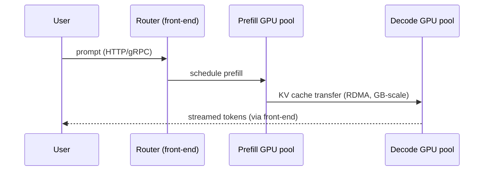

## Why this matters

Training builds a model once; **inference** runs it for every user request, for as long as the model is in service. In 2025-2026, inference has become a large and fast-growing share of AI compute, and it has its own networking problems. A large language model (LLM) serving system must answer quickly (users notice delays of a few hundred milliseconds), stream tokens smoothly, and serve as many requests per GPU as possible. Models that are too large for one GPU, mixture-of-experts models that spread experts across many GPUs, and serving architectures that split the work between GPU pools all depend on the network.

The traffic is different from training. There is no backward pass and no gradient all-reduce, but there are latency-bound collectives on every generated token, all-to-all exchanges for MoE experts, multi-gigabyte **KV cache** transfers between machines, and front-end request routing that has to know where cached data lives. If you size an inference cluster with training intuitions, or treat it as "just web serving", you will get either poor latency or wasted GPUs. This lesson builds the model of inference you need for `storage-and-frontend-networks` and `multi-tenancy-isolation`.

## Concepts

### Two phases: prefill and decode

An LLM generates text one token at a time. Serving a request has two very different phases:

| Phase | What happens | Bottleneck | Analogy for network engineers |
|---|---|---|---|
| **Prefill** | The whole prompt (hundreds to hundreds of thousands of tokens) is processed in parallel; the model produces the first output token and the **KV cache** for the prompt | Compute (large matrix multiplications) | Bulk transfer: big, efficient batches |
| **Decode** | Tokens are generated one at a time; each step reads all the model weights and the KV cache to produce one more token per sequence | Memory bandwidth, and latency of each step | Interactive traffic: many small, latency-sensitive steps |

The **KV cache** stores the attention "keys" and "values" computed for every previous token, so the model does not recompute them at each decode step. It grows with every token of context and lives in GPU memory.

### The metrics

| Metric | Meaning | Typical concern |
|---|---|---|
| TTFT (time to first token) | From request arrival to the first output token: queueing + prefill | Interactive responsiveness |
| ITL / TPOT (inter-token latency / time per output token) | Time between consecutive output tokens during decode | Smooth streaming; agentic and reasoning workloads generate many tokens |
| Throughput | Tokens per second per GPU (or per cluster) | Cost per token |
| Goodput | Throughput achieved while meeting latency targets (SLOs) | The real optimisation target |

### How big is a KV cache?

For a transformer with grouped-query attention, the KV cache per token is:

```
KV bytes per token = 2 (K and V) x layers x KV heads x head dimension x bytes per value
```

Worked example with Llama-3-70B-like dimensions (80 layers, 8 KV heads, head dimension 128, BF16 = 2 bytes):

```
2 x 80 x 8 x 128 x 2 = 327,680 bytes, about 320 KiB per token

8,192-token prompt   ->  about 2.7 GB of KV cache
128,000-token prompt ->  about 42 GB of KV cache
```

That is per sequence. A decode GPU serving dozens of concurrent long conversations holds tens to hundreds of GB of KV cache, which is why KV cache capacity, not just compute, limits how many users a GPU can serve, and why moving or reusing KV caches is a networking topic. (Architectures differ: some models compress the KV cache, for example with multi-head latent attention; always compute from the actual model configuration.)

## How it works

### Parallelism in inference

The strategies from `parallelism-strategies` reappear, with different emphasis:

| Strategy | Used for | Traffic | Where it runs |
|---|---|---|---|
| Data parallel (replicas) | More throughput: independent copies of the model, each serving its own requests | None between replicas (only the front-end spreads requests) | Anywhere |
| Tensor parallel | A model too large or too slow for one GPU | All-reduce per layer, on every decode step | NVLink domain |
| Pipeline parallel | Very large models across nodes | Point-to-point activations per stage | Scale-out fabric |
| Expert parallel | MoE models, often spread over many GPUs ("wide EP") | All-to-all dispatch and combine per MoE layer, every step | NVLink domain and/or scale-out fabric |

**Decode makes collectives latency-bound.** During decode, each step processes only one new token per sequence, so a TP all-reduce carries `batch x hidden size x 2 bytes`. With a batch of 64 sequences and hidden size 8192, that is about 1 MB, twice per layer, for 80 layers, for every single generated token. Using the alpha-beta model from `collective-operations`, a 1 MB all-reduce is dominated by latency, not bandwidth. If each of those 160 all-reduces per token cost even 10 us extra, inter-token latency rises by 1.6 ms. This is why tensor parallelism in inference stays inside NVLink domains, and why rack-scale NVLink systems are attractive for serving very large models.

**MoE inference stresses all-to-all.** Large MoE models are often served with experts spread over tens of GPUs or more. Every decode step then performs all-to-all exchanges of small, uneven messages, the hardest pattern from `ai-traffic-patterns`, but now with a latency budget measured in milliseconds per token. Specialised libraries (for example DeepEP, open-sourced by DeepSeek) implement low-latency all-to-all kernels that use RDMA and NVLink directly; their performance depends heavily on fabric latency and congestion behaviour.

```widget
parallelism-map
```

The widget is framed around training, but the same placement logic applies to a serving replica: TP and EP groups on NVLink, PP and cross-node EP on the scale-out fabric, and independent DP replicas with no traffic between them.

### Disaggregated serving: splitting prefill and decode

Prefill and decode compete when they share a GPU: a long prefill stalls the decode steps of other users, hurting inter-token latency, while optimising for decode leaves prefill compute underused. **Disaggregated serving** (described in research such as DistServe and Splitwise, and implemented in serving stacks such as NVIDIA Dynamo, vLLM, SGLang and llm-d, with varying maturity) runs prefill and decode on **separate GPU pools**:



The network cost is the **KV cache transfer** from the prefill GPU to the decode GPU. Using the 8,192-token example:

```
2.7 GB at 400 Gb/s (50 GB/s)   ->  about 54 ms
2.7 GB at 800 Gb/s (100 GB/s)  ->  about 27 ms
```

That transfer adds directly to time to first token unless it is overlapped, for example by streaming each layer's KV cache as soon as prefill finishes that layer. It is large, bursty, point-to-point RDMA traffic, GPU memory to GPU memory, often between nodes, so it usually rides the compute fabric (or, within a rack-scale system, NVLink). Transfer libraries such as NVIDIA's NIXL abstract the transport (RDMA, NVLink, storage) for this purpose.

### KV cache reuse, offload and KV-aware routing

Many requests share a prefix: the same system prompt, the same document, the previous turns of a conversation. Recomputing the KV cache for that prefix wastes prefill compute. Serving systems therefore:

- **Cache** prefix KV blocks in GPU memory (prefix caching, as popularised by vLLM's PagedAttention memory management).
- **Offload** KV blocks to slower, larger tiers when GPU memory is full: CPU memory, local NVMe, and networked storage, then bring them back when needed.
- **Route requests KV-aware**: the front-end router sends a request to the worker that already holds its prefix in cache, instead of blindly round-robin.

Each tier adds network traffic of a different kind: CPU memory over PCIe (inside the server), local NVMe over PCIe, remote storage over the storage or compute network. The faster a remote tier can return KV blocks, the more recomputation it saves. This makes storage networks part of the inference latency path, not just a place to keep model files.

### The front-end matters more than in training

For training, the front-end mainly carries scheduler and image traffic. For inference it is the product:

- **Requests and streaming responses** arrive over HTTP/gRPC (often OpenAI-compatible APIs), each small in bytes but numerous, latency-sensitive and long-lived (tokens are streamed for seconds to minutes).
- **Load balancing** must be aware of model, KV cache location, and current load per worker, which classic L4 load balancers do not see.
- **Model loading and autoscaling**: a 70B model in BF16 is about 140 GB of weights. Loading it from storage at 100 Gb/s takes at least 11 seconds of pure transfer, and more in practice. Fast cold starts when scaling up need high-bandwidth access to model storage (or peer-to-peer weight transfer from GPUs that already hold the model).

### Training vs inference, side by side

| Aspect | Training | Inference |
|---|---|---|
| Goal | Throughput: finish the job sooner | Latency SLOs and cost per token |
| Synchrony | All GPUs in one job, lock-step | Many independent requests; lock-step only within a model replica |
| Dominant collectives | All-reduce, reduce-scatter/all-gather, all-to-all (MoE) | Latency-bound small all-reduces (TP decode), all-to-all (MoE), KV transfers |
| Message sizes | MB to GB | KB to MB per collective, GB per KV transfer |
| Scale of one "job" | Up to tens of thousands of GPUs | One replica: one GPU to a few racks; many replicas |
| Front-end importance | Low | High: requests, routing, streaming |
| Storage role | Datasets and checkpoints | Model loading, KV cache offload and reuse |

> [!ANALOGY]
> Prefill is like a restaurant kitchen preparing the full mise en place for a table's order: a big burst of work. Decode is like plating and serving dish after dish, one at a time, where the diner notices every gap. Disaggregated serving puts prep and service in separate kitchens, which helps both, but now the prepared ingredients (the KV cache) must be carried quickly from one kitchen to the other: a service corridor (the network) that must be short and wide. The analogy breaks down in scale: the "ingredients" for one long conversation can be tens of gigabytes.

## In practice

Inference engines typically expose an HTTP API; many are OpenAI-compatible. A streaming request lets you observe TTFT and inter-token latency directly:

```
$ curl -s -N http://inference.example.internal:8000/v1/completions \
    -H 'Content-Type: application/json' \
    -d '{"model": "my-70b-model", "prompt": "Explain ECMP in one paragraph.", "max_tokens": 64, "stream": true}'
data: {"choices":[{"text":" ECMP"...}]}
data: {"choices":[{"text":" (Equal"...}]}
...
data: [DONE]
```
*(illustrative; host, model name and response fields depend on the serving engine)*

The time until the first `data:` line is the TTFT seen by this client (including network and queueing); the spacing between lines is the inter-token latency. Serving engines ship benchmark tools that measure these at scale; use them rather than ad-hoc scripts for capacity planning.

Back-of-the-envelope questions a network engineer should be able to answer for an inference design:

| Question | Calculation | Example answer |
|---|---|---|
| KV cache per request | 2 x layers x KV heads x head dim x bytes x tokens | 320 KiB/token x 8k = 2.7 GB |
| KV transfer time (disaggregated) | KV bytes / per-GPU NIC bandwidth | 2.7 GB / 50 GB/s = 54 ms |
| TP decode all-reduce size | batch x hidden x 2 bytes | 64 x 8192 x 2 = 1 MB (latency-bound) |
| Cold-start model load | weight bytes / storage bandwidth per node | 140 GB / 12.5 GB/s = 11 s minimum |

> [!TIP]
> When an inference team reports "TTFT went up", ask whether serving is disaggregated. If it is, check the KV transfer path (compute-fabric NIC counters, RDMA errors, congestion on the rails between prefill and decode pools) before blaming the GPUs.

## Common pitfalls

- **Sizing for bandwidth, ignoring latency.** Symptom: plenty of bandwidth headroom, but inter-token latency is poor on multi-node models. Cause: decode collectives are small and latency-bound. Fix: keep TP inside NVLink domains, minimise hops for cross-node EP, and measure small-message latency, not just throughput.
- **Treating inference traffic as web traffic.** Symptom: a classic round-robin load balancer causes low cache hit rates and high TTFT. Cause: requests are not interchangeable; KV cache locality matters. Fix: KV-aware, model-aware routing.
- **Forgetting the KV transfer in disaggregated designs.** Symptom: disaggregation makes TTFT worse. Cause: KV transfer over a slow or congested path, not overlapped with prefill. Fix: RDMA on a fast fabric, layer-wise streaming, and placement of prefill and decode pools close together.
- **Undersized storage for model loading.** Symptom: autoscaling takes minutes; capacity arrives too late for traffic spikes. Cause: hundreds of GB of weights over a thin storage path. Fix: size storage bandwidth for cold starts, cache weights locally, or transfer from peers.
- **Assuming inference needs no back-end fabric.** Symptom: a large MoE model cannot meet latency targets on servers connected only by a front-end network. Cause: wide expert parallelism needs low-latency RDMA all-to-all. Fix: provide a proper scale-out (or rack-scale scale-up) fabric for multi-node model replicas.

> [!INTERVIEW]
> "How do the network requirements of LLM inference differ from training?" A strong answer: inference splits into compute-bound prefill and latency-bound decode; decode turns TP all-reduces into small, latency-bound messages on every token, so TP stays on NVLink; MoE serving adds latency-critical all-to-all; disaggregated serving adds GB-scale KV cache transfers between prefill and decode pools over RDMA (quantify: about 320 KiB per token for a 70B-class GQA model, so 2.7 GB for an 8k prompt, about 54 ms at 400 Gb/s); the front-end becomes critical, needing KV-aware routing; and storage matters for model loading and KV offload. Close with the metrics: TTFT, inter-token latency, and goodput under SLOs.

## Key takeaways

- LLM inference has a compute-bound prefill phase and a memory- and latency-bound decode phase; judge them by TTFT, inter-token latency and goodput.
- The KV cache grows with context (about 320 KiB per token for a 70B-class GQA model in BF16) and is a first-class networking object.
- Decode makes TP all-reduces small and latency-bound on every token, so TP stays inside the NVLink domain.
- MoE serving relies on low-latency all-to-all across many GPUs.
- Disaggregated serving moves GB-scale KV caches from prefill to decode GPUs over RDMA, adding to TTFT unless overlapped.
- The front-end (KV-aware routing, streaming) and storage (model loading, KV offload) are on the inference critical path.
