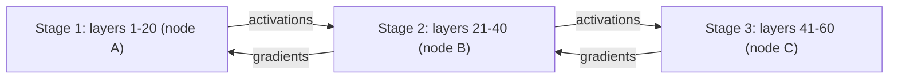

## Why this matters

In `ai-training-101` you saw that a large model needs more memory and compute than any single GPU has. The way the work is split across GPUs, the **parallelism strategy**, is not just a machine learning detail: it decides **what traffic appears on which network, how big the messages are, and how often they are sent**. A tensor-parallel group exchanges hundreds of megabytes per layer and needs the hundreds-of-GB/s bandwidth of NVLink; a data-parallel group exchanges gradients once per step and can live on the 400-800 Gb/s scale-out fabric; a mixture-of-experts model generates all-to-all traffic that stresses the fabric in a completely different way.

When an ML engineer says "we run TP 8, PP 16, DP 128", a network engineer should immediately be able to say which GPUs talk to which, over what links, with what collective. That translation is the skill this lesson builds. It is the foundation of `ai-traffic-patterns`, `rail-optimized-topology` and `scale-up-domains-nvl72`.

## Concepts

### Six ways to split the work

| Strategy | What is split | What each GPU holds | Main communication | Typical frequency |
|---|---|---|---|---|
| Data parallel (DP) | The batch | A full model replica | All-reduce of gradients | Once per step (bucketed) |
| Sharded DP (ZeRO / FSDP) | The batch, plus model state sharded across the DP group | A shard of weights, gradients, optimizer state | All-gather of weights, reduce-scatter of gradients | Per layer group, per step |
| Tensor parallel (TP) | Each layer's matrices | A slice of every layer | All-reduce (or all-gather + reduce-scatter) of activations | Several times per layer, per micro-batch |
| Pipeline parallel (PP) | The layers, into stages | A contiguous group of layers | Point-to-point send/recv of activations and gradients | Per micro-batch, between adjacent stages |
| Expert parallel (EP) | The experts of a mixture-of-experts (MoE) layer | A subset of experts | All-to-all token dispatch and combine | Twice per MoE layer, forward and backward |
| Context / sequence parallel (CP) | The input sequence (tokens) | A chunk of each sequence | Exchange of attention keys/values (ring or all-gather) | Per attention layer |

Real jobs combine several of these; this is called **3D, 4D or 5D parallelism**. The total number of GPUs is the product of the group sizes, for example `TP x CP x PP x DP`. Meta's Llama 3 paper, for instance, describes 405B training on 16,384 GPUs with TP 8, PP 16 and DP 128 (with context parallelism added for long-context stages).

```widget
parallelism-map
```

Use the widget to switch strategies on and off and see which GPU pairs talk and whether that traffic lands on NVLink (inside a server or rack) or on the scale-out network.

## How it works

### Data parallelism (DP)

Every GPU holds the whole model and processes a different slice of the global batch. After the backward pass, gradients are averaged with an **all-reduce** so that every replica applies the identical update.

- **Volume**: with a ring algorithm, each GPU sends and receives about `2 x (N-1)/N x G` bytes per step, where G is the gradient size. For a 7B model in BF16, G = 14 GB, so about 28 GB per GPU per step.
- **Overlap**: gradients are grouped into buckets (PyTorch DDP defaults to buckets of about 25 MB) and all-reduced while the backward pass continues.
- **Limit**: every GPU must hold the full model and optimizer state, impossible for large models (`ai-training-101`).

### Sharded data parallelism (ZeRO, FSDP)

ZeRO (Zero Redundancy Optimizer) and PyTorch FSDP remove the redundancy of DP by sharding model state across the DP group:

| ZeRO stage | What is sharded | Communication vs plain DP |
|---|---|---|
| Stage 1 | Optimizer states | About the same |
| Stage 2 | + gradients | About the same (reduce-scatter instead of all-reduce, then all-gather of updated weights) |
| Stage 3 / FSDP full sharding | + weights | About 1.5x: weights are all-gathered before each layer's forward and backward, gradients reduce-scattered |

Full sharding turns one big all-reduce per step into a stream of **all-gather** and **reduce-scatter** operations throughout the step, one or more per layer group. More messages, finer-grained, and more sensitive to latency, but memory per GPU drops roughly in proportion to the DP group size.

### Tensor parallelism (TP)

Tensor parallelism, popularised by Megatron-LM, splits the big matrix multiplications inside each layer across GPUs. In a transformer layer, the attention block and the MLP block are each split so that GPUs compute partial results on their slice, then combine them:

- With the Megatron scheme, each transformer layer needs **two all-reduces in the forward pass** (one after attention, one after the MLP) and **two in the backward pass**.
- Each all-reduce carries the full activation tensor: `micro-batch x sequence length x hidden size x 2 bytes` (BF16).

Worked example: hidden size 8192, sequence length 8192, micro-batch 1:

```
activation tensor = 1 x 8192 x 8192 x 2 bytes = 134 MB
per layer         = 4 all-reduces (2 forward + 2 backward) = ~537 MB
80 layers         = ~43 GB of all-reduce data per micro-batch, per TP group
```

This traffic sits **directly on the critical path**: the next operation needs the result of the all-reduce, so overlap is limited. TP therefore needs the highest bandwidth and lowest latency available, which is the **NVLink scale-up domain**: inside an 8-GPU server, NVLink provides about 900 GB/s per GPU on the Hopper generation (and about 1.8 TB/s on Blackwell), counted as a bidirectional total; per direction that is about 450 GB/s on Hopper, roughly nine times a 400 Gb/s (50 GB/s) NIC, and the gap is larger still on Blackwell (see `nvlink-nvswitch`). This is why TP size is usually chosen to match the NVLink domain: TP 8 on 8-GPU servers, and larger TP or EP groups become possible on rack-scale NVLink domains such as NVL72 systems (`scale-up-domains-nvl72`).

Sequence parallelism, used together with TP, replaces each all-reduce with a reduce-scatter plus an all-gather (the same total volume) and shards the activations of non-matrix operations, saving memory.

### Pipeline parallelism (PP)

Pipeline parallelism splits the model by layers: stage 1 holds layers 1-10, stage 2 layers 11-20, and so on. Each stage sends its output activations to the next stage (**forward**) and receives gradients back (**backward**). This is **point-to-point** traffic between neighbouring stages, not a collective.

- **Message size**: one activation tensor per micro-batch per stage boundary, the same `micro-batch x sequence x hidden x 2 bytes` as above (134 MB in the example).
- **Bubbles**: the first stage is idle while it waits for the last stage to finish the first micro-batch's backward pass. Splitting the batch into many micro-batches shrinks the idle fraction; the bubble is roughly `(p-1)/m` of the ideal time for p stages and m micro-batches. The common 1F1B schedule has the same bubble as GPipe; its gain is memory, since each stage holds at most p micro-batches of activations instead of m. Interleaved schedules reduce it further at the cost of more communication.
- **Network**: PP traffic is modest in volume compared with TP and runs between nodes, so it crosses the scale-out fabric. It is latency-sensitive because stages wait on each other.



Run GPipe and 1F1B with 4 stages, then raise the number of micro-batches: watch the idle bubble shrink, see that both schedules share it while 1F1B holds far fewer activations, and read off the traffic each stage boundary sends.

```widget
pipeline-schedule
```

### Expert parallelism (EP) and mixture-of-experts

A **mixture-of-experts (MoE)** layer contains many independent "expert" MLPs, and a small router sends each token to only the top-k experts (often k = 1, 2 or 8 depending on the model). This makes models with huge parameter counts affordable to run, because each token only uses a fraction of the parameters.

With expert parallelism, different experts live on different GPUs. For every MoE layer:

1. **Dispatch**: each GPU sends each of its tokens to the GPUs that host the chosen experts: an **all-to-all**.
2. Experts compute.
3. **Combine**: results are sent back to the tokens' original GPUs: another **all-to-all**.

The same happens in reverse in the backward pass. All-to-all is the hardest pattern for a network: every GPU talks to every other GPU in the group simultaneously, message sizes per destination are small and **uneven** (they depend on which experts tokens chose), and the slowest pair sets the pace. MoE models have become mainstream for frontier models, which is a big reason why fabric designers care about all-to-all performance and larger NVLink domains.

### Context parallelism (CP)

For very long sequences (hundreds of thousands of tokens), even one sequence's activations do not fit. Context parallelism splits the sequence across GPUs. Attention needs every token to see every other (earlier) token, so GPUs exchange keys and values, for example passing blocks around a ring (ring attention) or all-gathering them. Traffic per attention layer is significant, so CP groups are usually placed on fast links.

### Putting it together: which traffic goes where

The guiding principle: **put the most communication-intensive groups on the fastest links**.

| Group | Communication intensity | Typical placement |
|---|---|---|
| TP (and often EP, CP) | Highest, on the critical path, every layer | Inside the NVLink domain |
| PP | Moderate, point-to-point, latency-sensitive | Across nodes on the scale-out fabric |
| DP / FSDP | Large volume but once per step (or per layer group) and overlappable | Across nodes, outermost dimension |

Frameworks assign ranks so that, for example, GPU 3 in every node belongs to the same DP and PP groups. In a **rail-optimized** fabric (`rail-optimized-topology`), GPU 3 of every server connects to the "rail 3" leaf switch, so most DP and PP traffic stays on one rail, crossing only one switch hop when the rail group fits under one leaf.

> [!ANALOGY]
> Think of building a house with a big crew. Data parallelism is building many identical houses at once and having all foremen meet daily to agree on design improvements. Pipeline parallelism is an assembly line: one team pours foundations, the next builds walls, the next roofs. Tensor parallelism is four bricklayers on one wall who must hand each other bricks every few seconds, so they must stand right next to each other (NVLink). Expert parallelism is a hospital triage desk sending each patient to the right specialist and back. The analogy breaks down because all of these happen at once, many times per second, and the slowest crew member stalls everyone.

## In practice

You will not configure parallelism yourself, but you should be able to read a job configuration and predict its network load. Frameworks such as Megatron-LM, NeMo, DeepSpeed, PyTorch (FSDP, DTensor) and TorchTitan express parallelism as group sizes. A launch command for Megatron-LM, for example, uses options of this form:

```
torchrun --nnodes 128 --nproc-per-node 8 pretrain_gpt.py \
    --tensor-model-parallel-size 8 \
    --pipeline-model-parallel-size 4 \
    ...
```
*(illustrative; option names and defaults differ between frameworks and releases, check the framework documentation)*

Reading it: 128 nodes x 8 GPUs = 1,024 GPUs. TP 8 = one full node per TP group (all on NVLink). PP 4 = each model replica spans 4 nodes. DP = 1024 / (8 x 4) = 32 replicas. So:

| Traffic | Between | Network | Pattern |
|---|---|---|---|
| TP all-reduces | 8 GPUs of a node | NVLink | Several per layer, hundreds of MB |
| PP send/recv | Same GPU index on 4 consecutive nodes | Scale-out, same rail | Per micro-batch |
| DP all-reduce | Same GPU index and same stage across 32 replicas | Scale-out, same rail | Once per step, gradient shard of one stage |

Notice the DP all-reduce only covers the gradients of one pipeline stage's slice of one TP shard: `parameters / (TP x PP)` per GPU. For a 70B model that is 70e9 / 32 = about 2.2 billion parameters, about 4.4 GB of BF16 gradients per GPU per step, instead of 140 GB.

> [!TIP]
> When you get a ticket about slow training, ask for the parallelism configuration and the cluster's rank-to-node mapping first. Knowing that a job runs EP across nodes, for example, immediately tells you to look at all-to-all performance rather than all-reduce.

## Common pitfalls

- **TP across the scale-out network.** Symptom: adding nodes makes the job slower, and NCCL shows heavy all-reduce traffic on NICs. Cause: a TP group larger than the NVLink domain, forcing per-layer all-reduces over 400-800 Gb/s NICs. Fix: keep TP within the scale-up domain; scale with PP and DP instead.
- **Rank placement that ignores topology.** Symptom: DP traffic crosses spines unnecessarily, or rails are unevenly loaded. Cause: ranks assigned without regard to which GPU index and node they map to. Fix: use topology-aware rank mapping so groups align with rails and NVLink domains.
- **Assuming all traffic is all-reduce.** Symptom: a fabric validated with all-reduce benchmarks performs poorly on an MoE model. Cause: all-to-all has very different behaviour (many small, uneven flows, incast). Fix: validate with all-to-all tests too (`nccl-tests-interpretation`).
- **Ignoring FSDP's latency sensitivity.** Symptom: FSDP job scales poorly despite plenty of bandwidth. Cause: many smaller all-gathers and reduce-scatters per step expose latency. Fix: tune sharding granularity, prefetching and group sizes (often hybrid sharding: shard within a node or group, replicate across).
- **Forgetting pipeline bubbles.** Symptom: GPUs show idle gaps at the start and end of every step. Cause: too few micro-batches for the number of stages. Fix: an ML-side tuning issue; recognise it so the network is not blamed.

> [!INTERVIEW]
> "A team runs a 1,024-GPU job with TP 8, PP 8, DP 16 on 8-GPU servers. Which traffic goes over NVLink and which over the back-end fabric, and with what pattern?" A strong answer: TP 8 maps to one server, so per-layer all-reduces (or reduce-scatter/all-gather with sequence parallelism) stay on NVLink. PP 8 spans eight servers; activations and gradients flow point-to-point between neighbouring stages over the scale-out fabric, usually on the same rail. DP 16 all-reduces (or reduce-scatters) gradients of each GPU's shard across 16 replicas, again rail-aligned, overlapped with the backward pass. Bonus: if the model is MoE with EP across nodes, add all-to-all on the fabric, the most demanding pattern.

## Key takeaways

- DP replicates the model and all-reduces gradients; ZeRO/FSDP shard model state and use all-gather plus reduce-scatter.
- TP splits each layer and needs several large all-reduces per layer on the critical path, so it lives in the NVLink domain.
- PP splits layers into stages with point-to-point transfers between neighbours and suffers pipeline bubbles.
- EP (MoE) generates all-to-all dispatch and combine per MoE layer, the most demanding pattern for a fabric.
- CP splits long sequences and exchanges attention keys and values.
- Total GPUs = product of group sizes; place the most communication-intensive groups on the fastest links.
- Rank-to-hardware mapping, aligned with rails and NVLink domains, determines which network carries each pattern.
