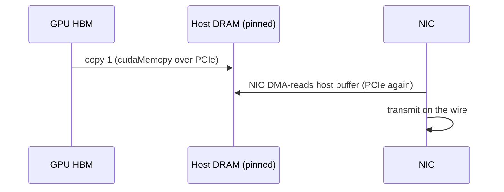
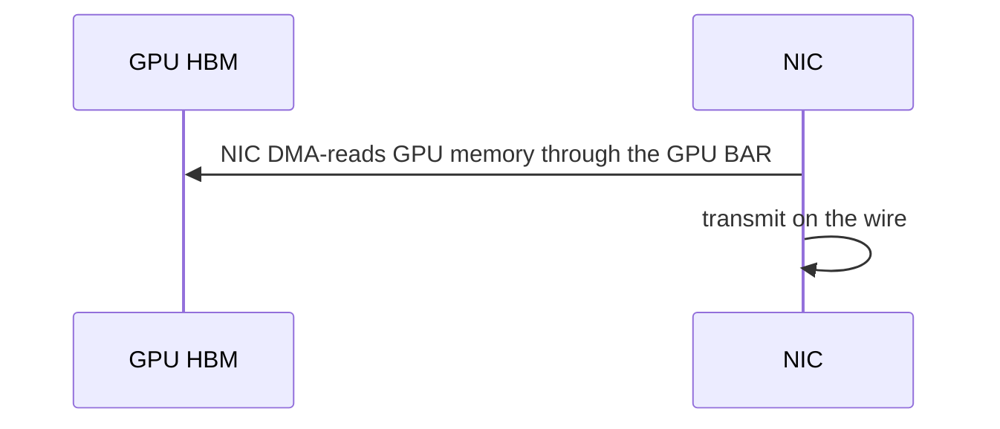
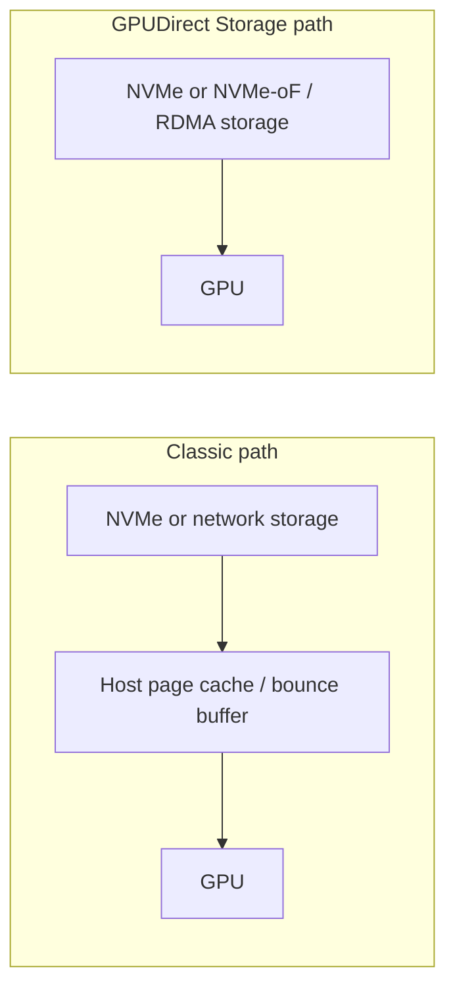

## Why this matters

A GPU's working data lives in its HBM. The network, the storage system and the CPU all live somewhere
else. Before GPUDirect, every byte a GPU sent to the network was first copied to host DRAM, and every
byte read from storage landed in host DRAM before being copied up to the GPU. Those copies cost PCIe
bandwidth twice, consume CPU memory bandwidth, add latency and make the CPU's memory system a shared
bottleneck for all eight GPUs at once.

GPUDirect RDMA and GPUDirect Storage remove those copies by letting the NIC or the storage controller
DMA straight into GPU memory. In a training cluster, whether GPUDirect RDMA is actually working is one
of the first things to check when collective bandwidth is low: a missing kernel module or a wrong
topology setting silently falls back to a host-staged path that can cost a large fraction of
throughput. The fallback is silent because everything still *works*.

## Concepts

### The GPUDirect family

"GPUDirect" is an umbrella brand. The members are different mechanisms:

| Name | What moves | Between | Purpose |
|---|---|---|---|
| **GPUDirect P2P** | Memory reads/writes | GPU ↔ GPU in the same server, over PCIe or NVLink | Intra-node collectives, `cudaMemcpyPeer` |
| **GPUDirect RDMA (GDR)** | RDMA reads/writes | Third-party PCIe device (an RDMA NIC) ↔ GPU memory | Inter-node GPU communication |
| **GPUDirect Storage (GDS)** | File/block data | Storage (local NVMe, NVMe-oF, supported parallel file systems) ↔ GPU memory | Data loading, checkpointing |
| **GPUDirect Async** (including GPU-initiated InfiniBand/RDMA, often called IBGDA) | Control: the GPU itself posts work to the NIC | GPU ↔ NIC | Removes CPU from the control path too (used by NVSHMEM and some MoE communication libraries) |

This lesson focuses on GDR and GDS. NVLink-based P2P is covered in `nvlink-nvswitch`.

### Without GPUDirect RDMA: the bounce buffer



The data crosses PCIe twice on the sender and twice on the receiver, and it passes through the CPU's
memory controllers both times. Eight GPUs doing this at 400 Gb/s each would push hundreds of GB/s
through host memory, which a CPU socket cannot sustain alongside everything else.

### With GPUDirect RDMA: one hop



The NIC reads directly from GPU memory. If the GPU and NIC share a PCIe switch (`pcie-numa-topology`),
the data never touches the CPU at all. The CPU still runs the control path (posting work requests),
unless GPUDirect Async is used.

> [!ANALOGY]
> Without GDR, the GPU and NIC are two departments that can only exchange documents by dropping them
> in a central mailroom (host DRAM). With GDR, they share a direct internal courier. It is like
> moving from hairpinning all traffic through a central firewall to allowing a direct, pre-authorized
> east-west path. The analogy breaks in one place: the direct path is only "direct" if the two
> devices are physically close on PCIe. A GPU and NIC on different sockets still detour through the
> CPU complex even with GDR enabled.

## How it works

### Exposing GPU memory on PCIe: the BAR

Every PCIe device exposes memory windows called **Base Address Registers (BARs)**. NVIDIA GPUs expose
a window (BAR1) through which other PCIe devices can address GPU memory. Data center GPUs have large
BAR1 apertures so that big buffers can be mapped. When an RDMA NIC targets a GPU buffer, its DMA
requests carry PCIe addresses inside that BAR, and the GPU serves them from HBM.

`nvidia-smi -q -d MEMORY` reports BAR1 size and usage. If an application registers more GPU memory
for RDMA than BAR1 can map, registrations fail; on data center parts this is uncommon, but it does
appear on some workstation GPUs and in some virtualized setups.

### Registering GPU memory with the NIC

An RDMA NIC can only DMA into **registered** memory regions (see `verbs-qps-mrs`): the driver pins the
pages and gives the NIC a translation table. For host memory, the kernel's RDMA core does this
directly. For GPU memory, the RDMA stack needs the GPU driver's help to pin GPU pages and get their
PCIe bus addresses. There are two mechanisms:

| Mechanism | How it works | Notes |
|---|---|---|
| **Peer memory client (`nvidia-peermem`)** | A kernel module shipped with the NVIDIA GPU driver plugs into the RDMA stack's peer-memory interface. When `ibv_reg_mr()` is called on a GPU virtual address, the RDMA core asks the peer client to pin and translate it. | The long-standing approach (it replaced the older out-of-tree `nv_peer_mem`). Requires a compatible RDMA stack; check the NVIDIA driver and DOCA/OFED release notes. |
| **DMA-BUF** | The GPU driver exports GPU memory as a Linux DMA-BUF file descriptor; the application registers it with `ibv_reg_dmabuf_mr()`. Uses upstream kernel interfaces (Linux 5.12 and later). | Preferred direction on newer stacks. Requirements (kernel version, open GPU kernel modules, driver and CUDA versions) are listed in the NCCL and CUDA documentation. NCCL can use it automatically, controlled by `NCCL_DMABUF_ENABLE`. |

Either way the outcome is the same: an RDMA memory region whose pages are GPU memory. From that moment
the NIC can RDMA-write into the GPU (on the receiver) and RDMA-read from it (on the sender).

### Read path versus write path

GPU-to-NIC traffic is not symmetric on PCIe:

- **Receive side (network → GPU):** the NIC issues **posted writes** into the GPU BAR. Posted writes are
  fire-and-forget on PCIe and are usually efficient even across longer paths.
- **Send side (GPU → network):** the NIC issues **reads** to the GPU and waits for completions. Reads
  are round trips, so they are more sensitive to path length, PCIe switch behaviour and the number of
  outstanding requests.

This is why NCCL has separate knobs for using GDR on the send path (`NCCL_NET_GDR_READ`) and why some
platforms historically used GDR for receives but staged sends through host memory. On modern
platforms with a GPU and NIC under the same PCIe switch, NCCL normally uses GDR in both directions.

### How NCCL decides whether to use GDR

NCCL inspects the topology (similar to what `nvidia-smi topo -m` shows) and, for each GPU-NIC pair,
compares their PCIe distance with a threshold. If the pair is "close enough", NCCL uses GDR; otherwise
it stages through host memory. The threshold is set by `NCCL_NET_GDR_LEVEL`, whose values reuse the
topology legend:

| Value | Use GDR when the GPU and NIC are... |
|---|---|
| `LOC` | Never (GDR disabled) |
| `PIX` | Behind at most one PCIe bridge (same switch) |
| `PXB` | Behind multiple PCIe bridges, without crossing the CPU host bridge |
| `PHB` | On the same CPU, crossing the PCIe host bridge |
| `SYS` | Anywhere, even across the socket interconnect |

The default is chosen by NCCL for the platform; you should rarely need to override it. Forcing `SYS`
on a box where the NIC is on the far socket usually makes things worse, not better.

```widget
pcie-topo
```

Use the widget to see which GPU-NIC pairs would qualify for GDR at each `NCCL_NET_GDR_LEVEL`.

### GPUDirect Storage

GDS applies the same idea to storage I/O. Instead of the file system reading into a host page-cache
buffer and the application copying it to the GPU, the **cuFile** API (`cuFileRead`, `cuFileWrite`)
asks the storage path to DMA directly into GPU memory.



Key points:

- **Local NVMe:** the NVMe controller DMAs directly into GPU memory. Best when the NVMe drives and the GPU
  share a PCIe switch.
- **Remote storage over RDMA:** NVMe-oF or a parallel file system client with GDS support uses the
  storage NIC to RDMA data directly into GPU memory. Support depends on the file system and vendor
  (several parallel file systems and NAS products advertise GDS support; check the GDS compatibility
  documentation).
- **Kernel support:** GDS historically relies on the `nvidia-fs` kernel module. Newer releases also
  support upstream Linux PCI peer-to-peer DMA in some configurations; check the GDS release notes for
  your CUDA version.
- **Compatibility mode:** if GDS is not available for a file (unsupported file system, missing module,
  misaligned I/O), cuFile can fall back to a POSIX path through host memory. The application still
  works, only slower. Like GDR, the fallback is silent unless you look.
- **Configuration:** cuFile behaviour is configured in a JSON file (`cufile.json`, typically under
  `/etc`), including whether compatibility mode is allowed and which NICs and file systems to use.

For AI clusters, GDS matters most for checkpointing (writing hundreds of GB from GPU memory to storage
as fast as possible) and for data-hungry input pipelines. The storage network design is in
`storage-and-frontend-networks`.

> [!NOTE]
> GDR and GDS are about the **data** path. The CPU still handles control (posting work requests,
> file metadata) unless GPU-initiated communication is used. That is enough: control traffic is tiny,
> data traffic is huge.

## In practice

All output is **illustrative** and trimmed.

### Is the peer-memory module loaded?

```bash
lsmod | grep -E 'nvidia_peermem|nvidia_fs'
```

```text
nvidia_peermem         16384  0
nvidia_fs             262144  0
ib_core               446464  9 rdma_cm,ib_ipoib,nvidia_peermem,...
```

If you rely on the peer-memory path and `nvidia_peermem` is absent, load it (`sudo modprobe
nvidia-peermem`) and make it persistent through your OS's module configuration. If you rely on
DMA-BUF instead, the module may legitimately be absent; confirm with the NCCL log (next step).

### Did NCCL use GDR?

Run any NCCL job (for example `nccl-tests`, see `nccl-tests-interpretation`) with `NCCL_DEBUG=INFO`,
and look for the network transport lines:

```text
NCCL INFO NET/IB : Using [0]mlx5_0:1/RoCE [1]mlx5_1:1/RoCE ... ; OOB eth0:10.0.0.11<0>
NCCL INFO NET/IB : GPU Direct RDMA Enabled for HCA 0 'mlx5_0'
NCCL INFO Channel 00/0 : 0[0] -> 8[0] [send] via NET/IB/0/GDRDMA
```

- `GDRDMA` at the end of a channel line means that channel uses GPUDirect RDMA.
- A channel line ending in `NET/IB/0` with no `GDRDMA` means data is staged through host memory. That
  is the silent fallback you are hunting for.
- Exact wording varies across NCCL versions; the presence or absence of the GDR marker is what matters.

### Measure GDR directly with perftest

When built with CUDA support, the perftest tools (`perftest-benchmarking`) can register GPU memory
instead of host memory, for example:

```bash
ib_write_bw -d mlx5_0 --use_cuda=0 --report_gbits            # server side
ib_write_bw -d mlx5_0 --use_cuda=0 --report_gbits <server>   # client side
```

Compare against the same test with host memory. On a healthy platform with GPU and NIC under one
switch, GPU-memory bandwidth should be close to host-memory bandwidth. A large gap points at PCIe
topology, ACS, or IOMMU settings (`pcie-numa-topology`). Check `ib_write_bw --help` for the CUDA and
DMA-BUF options supported by your build.

### Check GDS

The GDS package ships tools for this:

```bash
/usr/local/cuda/gds/tools/gdscheck -p      # platform check: driver, file systems, NVMe/NIC support
/usr/local/cuda/gds/tools/gdsio ...         # I/O benchmark, with GPU-direct and compatibility modes
```

Paths depend on the CUDA installation. In `gdscheck -p` output, look for whether the `nvidia-fs`
driver (or the alternative P2P mechanism) is reported as available, and which file systems and NVMe
devices are listed as supported. Benchmark both the GDS and the compatibility path with `gdsio` to
see what you are gaining.

> [!INTERVIEW]
> **"How would you prove that GPUDirect RDMA is working on a cluster, and what happens if it is
> not?"** A strong answer: check that the registration mechanism is present (`nvidia-peermem` loaded
> or DMA-BUF prerequisites met), run an NCCL test with `NCCL_DEBUG=INFO` and confirm `GDRDMA` on the
> network channels, and compare perftest bandwidth with `--use_cuda` against host memory. Without GDR,
> NCCL stages data through pinned host buffers: the job still runs, but every byte crosses PCIe twice
> and host memory becomes a shared bottleneck, so bus bandwidth drops and CPU memory pressure rises.

## Common pitfalls

- **Silent fallback to host staging.** Symptom: all-reduce bus bandwidth well below expectations, no
  errors. Cause: `nvidia-peermem` not loaded (or DMA-BUF prerequisites unmet), so NCCL cannot register
  GPU memory. Fix: load the module or satisfy DMA-BUF requirements; confirm `GDRDMA` in NCCL logs.
- **GDR forced across sockets.** Symptom: setting `NCCL_NET_GDR_LEVEL=SYS` makes things slower. Cause:
  GPU-NIC pairs on different sockets read GPU memory across the socket interconnect, which performs
  poorly. Fix: leave the default, fix the NIC-to-GPU mapping instead.
- **ACS or IOMMU in the way.** Symptom: GDR is "enabled" but GPU-memory perftest numbers are far below
  host-memory numbers. Cause: P2P requests redirected through the root complex or translated by the
  IOMMU. Fix: review ACS and IOMMU settings for bare-metal use.
- **GDS in compatibility mode without anyone noticing.** Symptom: checkpoint writes are much slower than
  the storage system's rated throughput. Cause: unsupported file system, missing kernel module, or
  unaligned I/O causing cuFile to fall back to POSIX. Fix: run `gdscheck -p`, check cuFile logs, and
  confirm the file system's GDS support.
- **Driver and RDMA stack mismatch.** Symptom: `nvidia-peermem` fails to load after an upgrade. Cause:
  GPU driver and RDMA stack (inbox or DOCA-OFED) versions not built against each other. Fix: upgrade
  them together following the vendors' compatibility matrices.
- **Confusing GDR with NVLink P2P.** Symptom: "GDR is on, so why is intra-node traffic not using it?"
  Cause: intra-node GPU traffic uses P2P over NVLink or PCIe, not RDMA. Fix: troubleshoot NVLink
  separately (`nvlink-nvswitch`).

## Key takeaways

- GPUDirect RDMA lets the NIC DMA directly to and from GPU memory, removing the host bounce buffer and
  halving PCIe crossings.
- GPU memory is exposed on PCIe through the GPU's BAR and registered with the NIC via the peer-memory
  module (`nvidia-peermem`) or DMA-BUF.
- Sends (NIC reads from the GPU) are more path-sensitive than receives (posted writes), so GDR works
  best when GPU and NIC share a PCIe switch.
- NCCL chooses GDR per GPU-NIC pair using a topology threshold (`NCCL_NET_GDR_LEVEL`); confirm it with
  `GDRDMA` in `NCCL_DEBUG=INFO` output.
- GPUDirect Storage uses the cuFile API to DMA between storage and GPU memory, and silently falls back
  to a host path when unsupported, so verify it with `gdscheck` and `gdsio`.
- Both GDR and GDS fail "soft": the job runs, just slower. Measure, do not assume.
