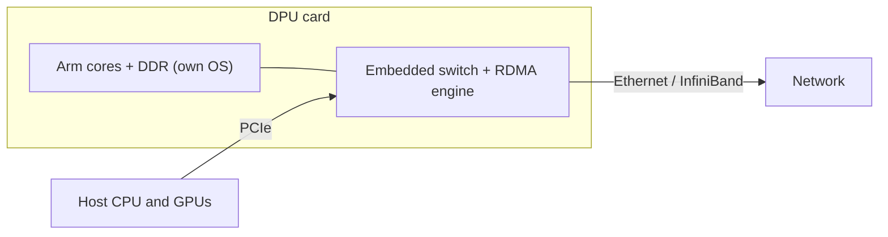

## Why this matters

In an enterprise network the NIC is an afterthought: a commodity port that the server team buys and the
network team never sees. In an AI cluster the NIC is a first-class fabric component. It runs the RDMA
transport, it implements congestion control, it decides how packets are spread across paths, and on
some fabrics it reorders packets that the switches sprayed across many links. Many behaviours that
look like "switch problems" are decided by NIC firmware and NIC configuration.

The vocabulary has also exploded. Vendors now sell NICs, SmartNICs, DPUs, IPUs and SuperNICs, sometimes
built on the same silicon. If you design or operate AI fabrics you need to know which device belongs on
which network, what it offloads, and which knobs live on the host rather than on the switch.

## Concepts

### Four kinds of adapter

| Kind | What it is | Typical role in an AI cluster |
|---|---|---|
| **Classic NIC** | Sends and receives Ethernet frames; offloads checksums, segmentation and receive coalescing (TSO, LRO/GRO), receive-side scaling (RSS). The kernel TCP/IP stack does the rest. | Management (out-of-band, BMC), sometimes front-end |
| **RDMA NIC (RNIC / HCA)** | Adds a hardware transport: queue pairs, memory registration, reliable delivery, all without the kernel in the data path. InfiniBand calls it an HCA (Host Channel Adapter). | Compute (back-end) and storage networks |
| **DPU** (Data Processing Unit) | An RDMA NIC plus a general-purpose Arm CPU complex, memory and accelerators on the card, running its own OS. It can run infrastructure services (virtual switching, storage virtualization, firewalling, telemetry) isolated from the host. | Front-end and storage networks in multi-tenant or cloud clusters; north-south traffic |
| **SuperNIC** | NVIDIA's term for an RDMA NIC optimized for east-west GPU traffic at very high rates: high bandwidth per GPU, hardware congestion control tuned for AI, support for adaptive routing and out-of-order packet placement. Sold on the same silicon families: the ConnectX-8 SuperNIC, and the BlueField-3 SuperNIC, a power- and feature-trimmed BlueField-3 profile. | Compute (back-end) network, one per GPU |

Other vendors use different words for similar ideas: Intel calls its DPU-like devices IPUs
(Infrastructure Processing Units), AMD sells Pensando DPUs and an "AI NIC" line, Broadcom sells
high-speed RDMA NICs, and hyperscalers build custom adapters (AWS Nitro with EFA is the best-known
example). The categories matter more than the brand names.

> [!ANALOGY]
> A classic NIC is like a line card that forwards frames and lets the route processor (the host CPU)
> do everything else. An RDMA NIC is like a line card with a hardware forwarding plane that never
> punts to the CPU. A DPU is a line card with its own route processor bolted on, so you can run
> control-plane services on the card itself. The analogy breaks because a DPU's Arm cores are a
> separate security domain from the host: they can enforce policy *on* the host, not just *for* it.

### Which adapter goes on which network

Recall the four networks of an AI cluster from `four-networks-of-an-ai-cluster`. A typical 8-GPU
training server in the H100/B200 generation looks like this (counts vary by vendor and design):

| Network | Adapters per server (typical) | Speed (typical, 2024-2026) | Device type |
|---|---|---|---|
| Compute / back-end (GPU-to-GPU) | 8, one per GPU | 400G (ConnectX-7 class), 800G (ConnectX-8 class) | RDMA NIC / SuperNIC |
| Storage | 1-2 | 100-400G | RDMA NIC or DPU |
| Front-end / in-band | 1-2 (sometimes shared with storage) | 100-400G | DPU or NIC |
| Out-of-band management | 1 | 1-10G | Classic NIC / BMC port |

The one-NIC-per-GPU pattern is the heart of AI server design: each GPU gets its own dedicated slice of
network bandwidth, and its own NIC sits as close to it on PCIe as possible (see `pcie-numa-topology`).

### The NVIDIA lineup, briefly

Because NVIDIA (formerly Mellanox) adapters dominate AI back-end networks today, you will meet these
names constantly. Treat the numbers as headline capabilities; exact port configurations, lane counts
and features depend on the SKU and firmware.

| Family | Headline capability | Host interface | Notes |
|---|---|---|---|
| ConnectX-6 / 6 Dx | Up to 200G | PCIe Gen4 | A100-era; still common in front-end and storage |
| ConnectX-7 | Up to 400G (InfiniBand NDR or 400GbE) | PCIe Gen5 x16 | H100/H200/B200-era compute NIC |
| ConnectX-8 SuperNIC | Up to 800G (InfiniBand XDR; NVIDIA's card documentation lists Ethernet at up to 400GbE per port) | PCIe Gen6, with an integrated PCIe switch | Blackwell Ultra-era (for example HGX B300, GB300 NVL72), check platform docs |
| BlueField-3 DPU | Up to 400G, 16 Arm cores, on-card DDR | PCIe Gen5 | Front-end/storage DPU; a SuperNIC variant is used in Spectrum-X designs |
| Next generations | ConnectX-9 class (1.6T) and BlueField-4 have been announced for the Rubin generation | | Hedge: check current NVIDIA announcements for availability and specs |

Many ConnectX and BlueField SKUs are **VPI** (Virtual Protocol Interconnect) capable: the same port
can run as InfiniBand or Ethernet depending on firmware configuration. Others are Ethernet-only (the
ConnectX-6 Dx family, for example, and the "EN" SKUs of other generations), so check the exact SKU. The cable, transceiver and the
switch on the other end must agree.

## How it works

### What the NIC does in hardware

An RDMA NIC on the compute network carries several jobs that a classic network would place elsewhere:

1. **Transport.** Reliable Connected (RC) queue pairs, sequence numbers, acknowledgements and
   retransmission all run in NIC hardware (see `verbs-qps-mrs` and `transport-types-operations`).
2. **Memory access.** The NIC translates virtual addresses of registered memory regions, including GPU
   memory with GPUDirect RDMA (see `gpudirect-rdma-storage`), and DMAs directly into them.
3. **Congestion control.** On RoCEv2 the NIC reacts to ECN marks with a rate-control algorithm such as
   DCQCN (see `ecn-and-dcqcn`); on InfiniBand it participates in the fabric's congestion control.
   Newer NICs expose programmable congestion control.
4. **Path entropy and multipath.** The NIC chooses the UDP source port of RoCEv2 packets, which ECMP
   switches hash on (see `ecmp-hashing`). Some designs (Spectrum-X, Ultra Ethernet) go further: the
   switches spray packets across paths and the NIC places out-of-order packets correctly in memory
   (see `adaptive-routing-packet-spraying`).
5. **Classification and QoS.** The NIC marks DSCP or PCP on egress and honours PFC pause from the
   switch (see `qos-trust-and-mapping`).
6. **Timestamps and telemetry.** Hardware timestamping for PTP and per-queue counters that are often
   the only place a problem is visible.

### What a DPU adds

A DPU contains a full NIC plus an Arm SoC. Traffic can be steered through an embedded switch
(eswitch) whose rules are programmed from the DPU's own OS. Common uses:

- **Virtual switching offload:** OVS or similar datapaths run in the eswitch hardware, so tenant VMs or
  containers get VXLAN/EVPN overlays (see `evpn-vxlan-frontend`) without burning host cores.
- **Storage virtualization:** the DPU presents a virtual NVMe device to the host and implements it over
  the network (NVMe-oF), so the host sees "local disks".
- **Isolation and security:** firewalling, encryption and policy enforced on the card, outside the
  host's trust domain. This is why cloud providers like DPUs for bare-metal GPU instances: the tenant
  owns the host, the provider owns the DPU.



A DPU can typically run in a mode where the Arm side owns and controls the embedded switch, or in a
plain NIC mode where it behaves like a ConnectX adapter. Mode names and how to switch between them are
product- and firmware-specific; follow the BlueField/DOCA documentation.

### Why "SuperNIC" exists

For back-end GPU traffic, the DPU's Arm complex is mostly unused weight: east-west collectives do not
need a virtual switch or storage emulation, but they do need maximum bandwidth per watt and tight
integration with the switch fabric. The SuperNIC idea is to keep the RDMA engine, congestion control,
adaptive-routing support and high port speed, and drop or shrink the general-purpose parts. In
NVIDIA's Spectrum-X design, the SuperNIC and the Spectrum-4 switches cooperate: switches spray packets
adaptively, the SuperNIC reorders them and runs congestion control using telemetry from the fabric
(details in `spectrum-x-architecture`).

### Integrated PCIe switching

On H100-generation servers each GPU-NIC pair typically shares a discrete PCIe switch on the board. A
ConnectX-8 class SuperNIC integrates a PCIe Gen6 switch, so the GPU (and optionally NVMe drives) can
attach directly to the NIC. Fewer chips, shorter paths, and the GPU-NIC affinity is guaranteed by
construction. When you read `nvidia-smi topo -m` on such systems, expect the GPU-NIC relationship to
look different from older boards (`reading-server-topology`).

### Port speed versus lanes

A "400G port" is built from SerDes lanes: for example 4 lanes of 100G (PAM4) per port in the 400G
generation, and 4 lanes of 200G or 8 lanes of 100G for 800G. Optics, cables and switch port
breakouts must match this lane structure; `ib-speeds-cables` and `optics-cabling-power` cover the
physical layer.

> [!NOTE]
> Port speed on the network side and PCIe bandwidth on the host side must match. A 2x400G dual-port
> NIC on a single PCIe Gen5 x16 link cannot run both ports at line rate simultaneously. That is fine
> for a front-end NIC used for redundancy, but wrong for a compute NIC.

Check the note with the calculator: choose Gen5 x16, a 400G NIC and two ports at line rate, then try Gen6.

```widget
pcie-bandwidth
```

## In practice

Output below is **illustrative** and trimmed. Interface and device names vary by system.

### Map RDMA devices to network interfaces

```bash
rdma link show
```

```text
link mlx5_0/1 state ACTIVE physical_state LINK_UP netdev ens1np0
link mlx5_1/1 state ACTIVE physical_state LINK_UP netdev ens2np0
```

`rdma` is part of iproute2. NVIDIA's driver package also ships `ibdev2netdev`, which prints the same
mapping (`mlx5_0 port 1 ==> ens1np0 (Up)`); it is not in distribution packages, where `rdma link show`
is the equivalent. The RDMA device names also depend on the stack: NVIDIA's DOCA-OFED/MLNX_OFED uses
`mlx5_0`, `mlx5_1`, ..., while distribution rdma-core names devices after their PCI address (for
example `rocep3s0f0`), so take the name from `rdma link show` rather than assuming `mlx5_0`. On
InfiniBand ports there is no netdev unless IPoIB is configured.

### Check device capabilities and link layer

```bash
ibv_devinfo -d mlx5_0
```

```text
hca_id: mlx5_0
        transport:                      InfiniBand (0)
        fw_ver:                         28.xx.xxxx
        ...
        port:   1
                state:                  PORT_ACTIVE (4)
                max_mtu:                4096 (5)
                active_mtu:             4096 (5)
                ...
                link_layer:             Ethernet
```

`transport: InfiniBand` appears even for RoCE devices, because the verbs transport is the InfiniBand
transport. `link_layer` tells you whether the port is running Ethernet (RoCE) or InfiniBand.

### Driver and firmware

```bash
ethtool -i ens1np0          # driver (mlx5_core), driver version, firmware-version, bus-info
devlink dev info            # firmware versions per device, if supported by the driver
```

Firmware matters enormously for RDMA NICs: congestion control behaviour, adaptive-routing support and
bug fixes all live there. Fleets should run a single validated firmware version, checked at burn-in.

### Install the host software stack (DOCA-Host profiles)

On NVIDIA adapters the host drivers and tools come either from the distribution ("inbox", see
`rdma-on-linux`) or from NVIDIA's **DOCA-Host** packages, which replaced the standalone MLNX_OFED
distribution. DOCA-Host is installed by adding NVIDIA's package repository for your OS and
installing a **profile**. The DOCA 3.0 documentation describes four:

| Profile | Contents (per NVIDIA's description) | Typical use |
|---|---|---|
| `doca-ofed` | Driver-only installation, equivalent to MLNX_OFED | Hosts that only need the RDMA drivers and tools |
| `doca-roce` | Lightweight RoCE functionality | RoCE-only hosts |
| `doca-networking` | Networking-specific installation without the full DOCA library set | NVIDIA's recommendation for ConnectX hosts |
| `doca-all` | The full DOCA suite: libraries, drivers and tools | BlueField development, mixed BlueField and ConnectX fleets |

Profile names and contents change between DOCA releases (older releases had fewer profiles), and
the installer needs kernel headers that match the running kernel, so follow the installation guide
for your DOCA version and OS. Installing `doca-all` on a ConnectX-only host does not enable
DPU-only features: the libraries need hardware the adapter does not have. Whatever you install, pin
the version fleet-wide together with the NIC firmware, and verify afterwards with `ibv_devinfo`
(firmware version, port state) and `rdma link show`. On Kubernetes the same driver can be delivered
as a container by the NVIDIA Network Operator (`kubernetes-network-operator`).

### Configure the port protocol (VPI adapters)

On NVIDIA adapters, the NVIDIA Firmware Tools (MFT) package provides `mlxconfig` to query and set
non-volatile firmware parameters. For example, the port protocol on VPI adapters is controlled by the
`LINK_TYPE_P1` / `LINK_TYPE_P2` parameters (InfiniBand or Ethernet). Changes take effect after a
firmware reset or reboot. Always query first and follow the adapter's MFT documentation before
setting anything:

```bash
sudo mst start
sudo mlxconfig -d <device> query      # next-boot value of each parameter; add --enable_verbosity for default and current
```

On a host with UEFI Secure Boot enabled, the kernel's lockdown mode can stop this: `mst start` creates no usable PCI devices and `mlxconfig`
fails with `-E- Failed to open the device` (recent kernels and MFT releases offer a `fwctl` device
path, but reading and writing the firmware configuration through it may still be refused). Plan
port-protocol changes for a maintenance window with Secure Boot temporarily disabled or with signed
MFT kernel modules, and check the MFT release notes for your version.

### Look at hardware counters

```bash
ethtool -S ens1np0 | grep -E 'discard|pause|ecn|out_of_buffer'
```

Counter names are driver-specific (for mlx5 the kernel documentation lists them). Examples you will
use in later lessons include physical-port discard counters, per-priority pause counters and RDMA
counters under `/sys/class/infiniband/<dev>/ports/<n>/hw_counters/`. Lesson `telemetry-counters`
covers what each means.

> [!INTERVIEW]
> **"What is the difference between a DPU and a SuperNIC, and where would you put each in an AI
> cluster?"** A strong answer: both are RDMA-capable adapters, often on related silicon. A DPU adds a
> general-purpose Arm complex that runs infrastructure services (virtual switching, storage
> virtualization, security) in a separate trust domain, which suits the front-end and storage
> networks, especially in multi-tenant clouds. A SuperNIC is optimized for east-west GPU traffic:
> one per GPU, highest bandwidth per watt, AI-tuned congestion control and adaptive-routing support,
> deployed on the compute (back-end) network.

## Common pitfalls

- **Wrong port protocol.** Symptom: the port never comes up, or comes up as Ethernet when the switch is
  InfiniBand. Cause: VPI port configured for the other link layer. Fix: query `LINK_TYPE_P*` with
  `mlxconfig`, set it to match the fabric, reset the adapter.
- **Firmware drift.** Symptom: a few nodes behave differently under congestion or fail to use adaptive
  routing. Cause: mixed firmware versions across the fleet. Fix: inventory with `ethtool -i` or
  `devlink dev info` and enforce one validated version.
- **Dual-port NIC assumed to give 2x bandwidth.** Symptom: aggregate throughput tops out near the PCIe
  limit. Cause: both ports share one PCIe link. Fix: do the PCIe math (`pcie-numa-topology`); use one
  NIC per GPU for compute.
- **Treating the DPU as "just a NIC".** Symptom: traffic is dropped or rewritten in surprising ways,
  host tools show nothing. Cause: eswitch rules programmed on the DPU's Arm side. Fix: check the DPU's
  own OS and its offload configuration; include it in your troubleshooting map.
- **Mismatched lane structure.** Symptom: link flaps or trains at a lower speed. Cause: a cable or
  transceiver with a different lane count or modulation than the port expects. Fix: verify the
  optic/cable is on the adapter's and switch's qualified lists.
- **Ignoring NIC counters.** Symptom: switches show no drops, yet RDMA is slow. Cause: the NIC itself
  runs out of receive buffers or is rate-limited by congestion control. Fix: read the NIC's hardware
  counters, not only the switch's.

## Key takeaways

- AI clusters use four kinds of adapter: classic NICs (management), RDMA NICs (compute and storage),
  DPUs (front-end and storage, especially multi-tenant) and SuperNICs (compute, one per GPU).
- The RDMA NIC runs the transport, congestion control and path entropy in hardware, so it is part of
  the fabric, not just a host component.
- A DPU is a NIC plus an Arm SoC running its own OS, used to offload and isolate infrastructure services.
- Port speed and PCIe bandwidth move together: ConnectX-7 class (400G, Gen5) and ConnectX-8 class (800G,
  Gen6 with an integrated PCIe switch).
- `rdma link show`, `ibv_devinfo`, `ethtool -i` and `mlxconfig query` tell you device mapping, link layer,
  firmware and port protocol.
- Keep firmware consistent across the fleet; many fabric behaviours are NIC-firmware features.
