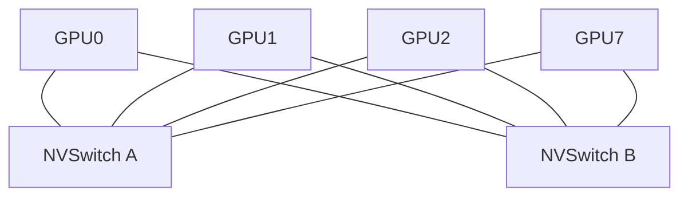

## Why this matters

Some parallelism strategies need far more bandwidth than any NIC can provide. Tensor parallelism
(see `parallelism-strategies`) splits individual matrix multiplications across GPUs and exchanges
activations inside every layer, many times per training step. Expert parallelism in mixture-of-experts
models does heavy all-to-all exchanges. If that traffic went over PCIe and the scale-out network, the
GPUs would spend most of their time waiting.

NVLink is NVIDIA's answer: a GPU-to-GPU interconnect with roughly an order of magnitude more bandwidth
per GPU than PCIe or the scale-out NIC. NVSwitch turns NVLink into a switched fabric, first inside an
8-GPU server and now across a whole rack. For a network engineer, NVLink matters for two reasons: it
defines which traffic never reaches your fabric, and the size of the NVLink domain shapes the design
of the scale-out network around it.

## Concepts

### Three networks touch every GPU

| Interconnect | Typical per-GPU bandwidth (order of magnitude, Hopper/Blackwell era) | Scope | Semantics |
|---|---|---|---|
| PCIe Gen5 x16 | ~64 GB/s per direction | GPU ↔ CPU, NIC, NVMe | Load/store and DMA, but limited |
| Scale-out NIC | 400-800 Gb/s = 50-100 GB/s per direction | GPU ↔ GPUs in other servers | RDMA messages |
| NVLink | Hundreds of GB/s to ~1 TB/s per direction | GPU ↔ GPUs in the NVLink domain | Memory semantics: load, store, atomics |

The NVLink domain is the **scale-up** network; the InfiniBand or Ethernet fabric is the **scale-out**
network. The rule of thumb in AI cluster design: put the most communication-intensive parallelism
(tensor and often expert parallelism) inside the scale-up domain, and the more tolerant kinds
(data and pipeline parallelism) across the scale-out fabric.

```widget
parallelism-map
```

### NVLink generations

NVIDIA quotes NVLink bandwidth as the **total bidirectional bandwidth per GPU**, summed over all of a
GPU's links. The commonly published figures are below; treat them as headline numbers from NVIDIA
material and check the datasheet of the exact product (some SKUs ship with fewer active links).

| Generation | First GPU | Links per GPU | Approx. total bidirectional per GPU |
|---|---|---|---|
| NVLink 1 | P100 | 4 | ~160 GB/s |
| NVLink 2 | V100 | 6 | ~300 GB/s |
| NVLink 3 | A100 | 12 | ~600 GB/s |
| NVLink 4 | H100 / H200 | 18 | ~900 GB/s |
| NVLink 5 | Blackwell (B200, GB200, B300) | 18 | ~1.8 TB/s |
| NVLink 6 | Rubin (announced) | | ~3.6 TB/s announced |

Compare H100: ~900 GB/s bidirectional NVLink versus ~128 GB/s bidirectional for PCIe Gen5 x16 and ~100
GB/s bidirectional for a 400G NIC. That is the roughly 7-9x gap that makes tensor parallelism across
the scale-out fabric impractical.

> [!WARNING]
> Bidirectional versus unidirectional is the most common source of confusion with NVLink numbers.
> "900 GB/s" for H100 is the sum of both directions over 18 links, about 450 GB/s each way. NIC
> speeds are usually quoted per direction. Always normalize before comparing.

### From links to a switched fabric

Early NVLink systems wired GPUs directly to each other in a "hybrid cube-mesh": not every pair of GPUs
had a direct link, so some traffic needed two hops, and bandwidth between pairs was uneven. **NVSwitch**
fixes this. Each GPU spreads its NVLinks across a set of NVSwitch chips, and every GPU can talk to every
other GPU at full NVLink bandwidth at the same time.



The diagram is simplified: in a real HGX board each GPU has several links to each NVSwitch chip. The
number of NVSwitch chips per board has changed across generations (for example six on HGX A100, four
on HGX H100, and two larger NVLink 5 switch chips on HGX B200, per NVIDIA's published descriptions).
What stays constant is the outcome: **a non-blocking all-to-all fabric among the GPUs of the domain**.

> [!ANALOGY]
> An HGX board is a tiny, perfectly non-blocking single-switch fabric (or a few parallel switch planes)
> with eight ports, much like a chassis switch whose line cards are the GPUs. The analogy breaks
> because NVLink is not a packet network you configure with VLANs and routes: it carries memory
> transactions, the GPU driver and Fabric Manager program it, and a GPU can directly load and store
> another GPU's memory.

### Beyond the server: NVL72 and the NVLink Switch System

With Blackwell, NVIDIA moved the NVSwitch chips out of the server into dedicated **NVLink switch trays**
and connected them to compute trays with a copper cable backplane at the back of the rack. In a GB200
NVL72 rack, 72 Blackwell GPUs (and 36 Grace CPUs) form one NVLink domain; NVIDIA describes 18 compute trays and
9 NVLink switch trays (18 NVSwitch chips in total) providing about 130 TB/s of aggregate NVLink bandwidth. Larger multi-rack NVLink domains
have been announced; check current NVIDIA documentation for what is generally available.

What changes for the network engineer:

- A 72-GPU NVLink domain can hold tensor and expert parallelism groups that would never fit in an
  8-GPU box, so less of the most demanding traffic hits the scale-out fabric.
- Each GPU still has its own scale-out NIC (for example ConnectX-7 or ConnectX-8 class), and the
  scale-out fabric connects many racks.
- Rack design, power, cooling and failure domains change: an NVLink switch tray failure affects a
  whole rack-scale domain. Lesson `scale-up-domains-nvl72` covers the architecture.

### Other scale-up interconnects

NVLink is not the only scale-up approach. AMD's Instinct platforms connect GPUs with Infinity Fabric
links in a fully connected mesh within a node; the UALink consortium published an open scale-up
specification in 2025; and several vendors are pushing Ethernet-based scale-up designs. NVIDIA also
announced NVLink Fusion to let third-party CPUs and accelerators attach to NVLink. The principles in
this lesson (a high-bandwidth, memory-semantic domain sized to hold the chattiest parallelism) apply
to all of them.

## How it works

### Memory semantics

Inside an NVLink domain, GPU memory forms a shared address space for peer access. A kernel running on
GPU0 can directly load from or store to a buffer on GPU5, or run atomics on it, over NVLink. CUDA calls
this **peer access**. NCCL's intra-node transport uses it: instead of building RDMA messages, NCCL
copies data with GPU kernels writing into peer buffers (the `P2P` transport), which is why intra-node
collectives can reach a large fraction of NVLink bandwidth.

### NVLink SHARP (NVLS)

Third-generation and later NVSwitch chips can do arithmetic on data passing through them. With
**NVLink SHARP**, GPUs send their contributions to an all-reduce into the switch, the switch reduces
them, and multicasts the result back. This roughly halves the data each GPU must send for an
all-reduce compared to a ring (`collective-algorithms`). NCCL uses it automatically on supported
systems (the `NVLS` algorithm), and `NCCL_NVLS_ENABLE` can turn it off for troubleshooting. The same
idea exists in InfiniBand switches as SHARP (`sharp-in-network-computing`).

### Fabric Manager and the NVLink control plane

On NVSwitch-based systems, NVLink connectivity must be configured before CUDA applications can use
the GPUs. On HGX servers this is the job of the **NVIDIA Fabric Manager** service, which initializes
the NVSwitches, programs routing between GPUs and monitors link errors. If Fabric Manager is not
running, or its version does not match the GPU driver, CUDA applications on those GPUs typically fail
to initialize (a "system not yet initialized" style error) rather than running slowly.

On rack-scale systems such as NVL72, the NVLink domain spans many trays and adds an NVLink subnet
management function and rack-level management software. The exact components and how they are
deployed differ by platform generation; follow NVIDIA's documentation for your system.

### Link training, errors and degradation

NVLink links train at boot like PCIe links. A link can be down, or accumulate errors (CRC, replay,
recovery). On NVSwitch systems, Fabric Manager's behaviour on a failed link depends on configuration
and platform: it may degrade bandwidth or take a GPU out of the usable set. Either way, the effect is
a GPU whose intra-node collective bandwidth is lower than its peers, which then drags the whole job
(`slow-collectives-stragglers`).

## In practice

Output below is **illustrative** and trimmed; numbers depend on GPU generation and driver.

### See NVLink in the topology matrix

```bash
nvidia-smi topo -m
```

```text
        GPU0    GPU1    GPU2  ...  GPU7    NIC0  ...
GPU0     X      NV18    NV18  ...  NV18    PIX   ...
GPU1    NV18     X      NV18  ...  NV18    SYS   ...
```

`NV18` means the pair is connected through a bonded set of 18 NVLinks (here through NVSwitch). On an
HGX H100 or B200 system every GPU pair typically shows the same `NV#` value; on older cube-mesh
systems the numbers differ between pairs, or some pairs show a PCIe path. Use the widget to explore
how `NV#` sits alongside the PCIe legend.

```widget
pcie-topo
```

### Per-link status

```bash
nvidia-smi nvlink --status -i 0
```

```text
GPU 0: NVIDIA H100 80GB HBM3 (UUID: GPU-...)
         Link 0: 26.562 GB/s
         Link 1: 26.562 GB/s
         ...
         Link 17: 26.562 GB/s
```

Every link should report the same speed. A link reported as inactive, or a GPU with fewer active
links than its peers, is a hardware ticket. `nvidia-smi nvlink -h` lists the further options your
driver version supports, including capability and error-counter queries.

### Fabric Manager

```bash
systemctl status nvidia-fabricmanager
nvidia-smi -q | grep -i -A 3 fabric
```

On NVSwitch systems the service must be active, and its version must match the installed driver. On
recent GPU generations `nvidia-smi -q` includes a fabric section reporting whether the GPU's fabric
registration completed successfully; check what your driver version shows.

### Measure it

```bash
./nvbandwidth                                     # NVIDIA's interconnect bandwidth tool
./all_reduce_perf -b 8 -e 8G -f 2 -g 8            # nccl-tests, single node, 8 GPUs
```

`nvbandwidth` measures copy bandwidth between GPU pairs and between GPU and host. A single-node
`nccl-tests` all-reduce shows whether intra-node collectives reach the expected bus bandwidth for
your platform (`nccl-tests-interpretation`). Always test a single node first: if intra-node is broken,
multi-node results are meaningless.

> [!INTERVIEW]
> **"Why not just run tensor parallelism across the InfiniBand or Ethernet fabric?"** A strong answer
> quantifies it: on H100 a GPU has about 450 GB/s of NVLink bandwidth each way versus about 50 GB/s on
> a 400G NIC, roughly 9x less, plus higher latency and RDMA protocol overhead. Tensor parallelism
> exchanges activations inside every layer, so it would be network-bound. Hence TP groups are sized to
> fit the NVLink domain (8 GPUs on HGX, up to 72 on NVL72), and the scale-out fabric carries data and
> pipeline parallelism, whose traffic is larger-grained and more overlap-friendly.

## Common pitfalls

- **Comparing bidirectional NVLink to unidirectional NIC numbers.** Symptom: wrong design conclusions
  by a factor of two. Cause: NVIDIA quotes NVLink as bidirectional totals. Fix: normalize all numbers
  to per-direction GB/s.
- **Fabric Manager not running.** Symptom: CUDA fails to initialize on an HGX node after a driver
  update, while `nvidia-smi` lists all GPUs. Cause: Fabric Manager stopped or version-mismatched with
  the driver. Fix: install the matching Fabric Manager version and enable the service.
- **A degraded NVLink hiding in a big job.** Symptom: a multi-node job is slow, the network is clean.
  Cause: one GPU has inactive or erroring NVLinks, lowering intra-node bandwidth on its node. Fix:
  check `nvidia-smi nvlink --status` on all nodes, run single-node `nccl-tests` per node at burn-in.
- **Assuming NVLink means "no network needed".** Symptom: under-provisioned scale-out fabric for a
  large job. Cause: NVLink covers only the scale-up domain; data-parallel gradients and pipeline traffic
  still cross the scale-out network. Fix: size the scale-out fabric for the traffic outside the domain
  (`fabric-sizing-math`).
- **Mixing up NVLink and NVLink-C2C.** Symptom: confusion about Grace Hopper or Grace Blackwell
  numbers. Cause: NVLink-C2C is the chip-to-chip link between a Grace CPU and a GPU in the same
  module, not the GPU-to-GPU fabric. Fix: keep the two separate in diagrams.

## Key takeaways

- NVLink is the scale-up network: memory-semantic GPU-to-GPU links with roughly an order of magnitude
  more bandwidth per GPU than PCIe or the scale-out NIC.
- NVIDIA's NVLink numbers are bidirectional totals per GPU (about 900 GB/s on H100, 1.8 TB/s on
  Blackwell); divide by two before comparing to NIC speeds.
- NVSwitch turns NVLink into a non-blocking all-to-all fabric: 8 GPUs per HGX board, 72 GPUs in an
  NVL72 rack.
- Put tensor and expert parallelism inside the NVLink domain; the scale-out fabric carries what is left.
- NVSwitch systems need Fabric Manager (and on rack-scale systems additional NVLink management) before
  CUDA can use the GPUs.
- Verify with `nvidia-smi topo -m` (NV#), `nvidia-smi nvlink --status`, `nvbandwidth` and single-node
  `nccl-tests`.
