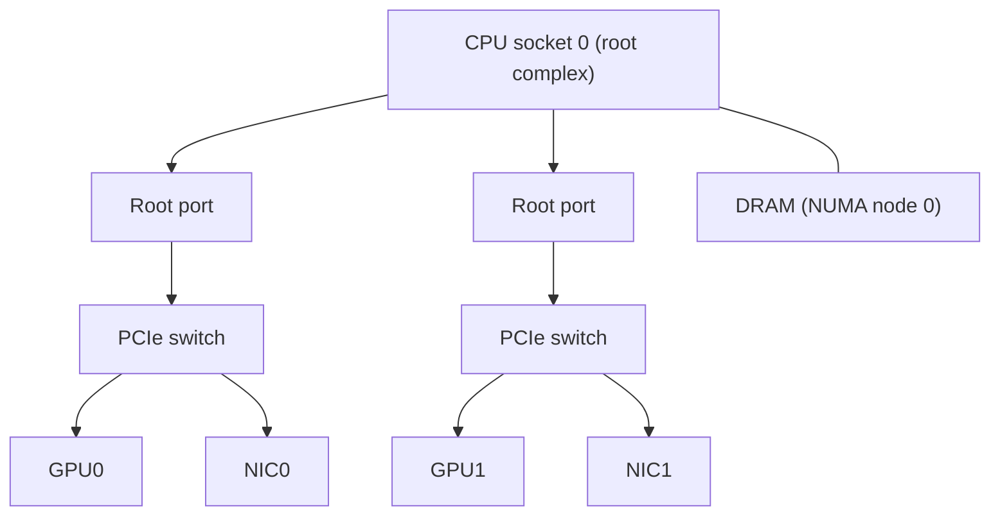
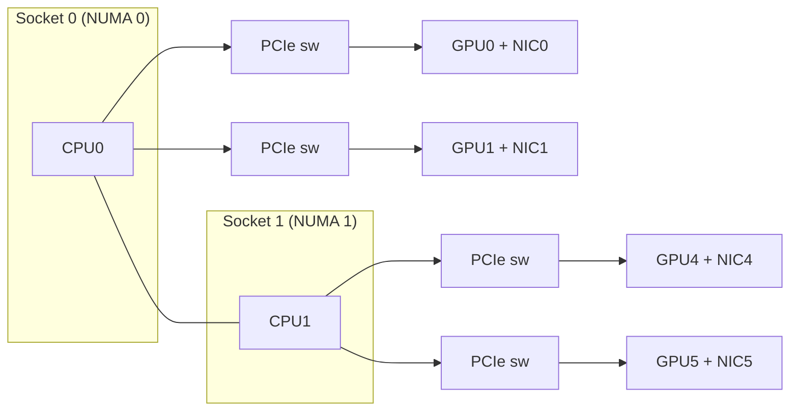

## Why this matters

When people say "the AI network" they usually mean the switches and optics between servers. But every
byte that crosses that fabric starts and ends inside a server, and inside the server it travels on a
second network: PCI Express. A GPU sending a gradient to another node pushes data from its HBM across a
PCIe link to a NIC, and the NIC on the far side pushes it across PCIe into the remote GPU. If that path
inside the box is too narrow, too long, or detours through the wrong CPU socket, the most expensive
switch fabric in the world will sit half-idle.

This is not a theoretical concern. Some of the most common "the network is slow" tickets in AI clusters
turn out to be in-server problems: a NIC that trained at a lower PCIe generation or width, a GPU paired
with a NIC on the other CPU socket, or a PCIe setting that forces peer-to-peer traffic up through the CPU.
A network engineer who can read PCIe and NUMA topology can close those tickets in minutes instead of
spending days chasing switch counters that are perfectly clean.

## Concepts

### PCIe in one paragraph

PCI Express is a packet-switched, point-to-point serial interconnect. A **link** is made of one or more
**lanes** (x1, x4, x8, x16); each lane is a pair of differential pairs, one per direction, so a link is
full duplex. Data travels in **Transaction Layer Packets (TLPs)**: memory reads, memory writes,
completions. A NIC doing DMA is simply issuing memory-write TLPs (to deliver received data) and
memory-read TLPs (to fetch data it must transmit). PCIe has its own layered protocol, its own flow
control (credit-based, much like InfiniBand), its own error counters and its own routing by address.
In other words, it is a network, and you should think of it as one.

### Generations and bandwidth

Each PCIe generation roughly doubles the per-lane signalling rate. The table gives the approximate
usable bandwidth **per direction** for an x16 link, which is the width used by GPUs and high-end NICs.

| Generation | Raw rate per lane | Encoding | Approx. x16 per direction | Typical AI-era use |
|---|---|---|---|---|
| PCIe 3.0 | 8 GT/s | 128b/130b | ~16 GB/s (~126 Gb/s) | Older 100G NICs, V100-era servers |
| PCIe 4.0 | 16 GT/s | 128b/130b | ~32 GB/s (~252 Gb/s) | A100-era servers, 200G NICs |
| PCIe 5.0 | 32 GT/s | 128b/130b | ~63 GB/s (~504 Gb/s) | H100/H200/B200-era servers, 400G NICs |
| PCIe 6.0 | 64 GT/s (PAM4) | FLIT mode with FEC | ~121-128 GB/s (~1 Tb/s) | 800G NICs such as ConnectX-8 class devices |
| PCIe 7.0 | 128 GT/s (PAM4) | FLIT mode | ~242-256 GB/s | Specification released 2025; products later |

These are link-level numbers. Real DMA throughput is lower because every TLP carries header overhead
(a 256-byte or 512-byte maximum payload size with ~20-30 bytes of header and framing), and read requests
need completions. A practical rule of thumb is that you get 80-90 % of the link rate for large transfers.

Now the key calculation every AI network engineer should be able to do in their head:

- A **400 Gb/s** NIC moves 50 GB/s per direction. PCIe 4.0 x16 (~32 GB/s) **cannot** feed it. PCIe 5.0 x16
  (~63 GB/s raw, ~50-55 GB/s achievable) **just** can.
- An **800 Gb/s** NIC moves 100 GB/s per direction. That needs PCIe 6.0 x16, or two PCIe 5.0 x16 links
  (a multi-host or "socket direct" style arrangement, check your NIC's documentation).

This is why NIC generations and PCIe generations move in lockstep: 200G arrived with Gen4, 400G with
Gen5, 800G with Gen6.

> [!ANALOGY]
> Think of PCIe lanes like the member links of a LAG between two switches. More lanes means more
> bandwidth, and if one end negotiates fewer members than you cabled, the bundle still comes up, just
> slower. Where the analogy breaks: a PCIe link stripes every packet across all lanes byte by byte,
> so there is no per-flow hashing and no single-flow limit. A x16 link that trained as x8 halves the
> throughput of every single transfer.

### The PCIe tree

PCIe is a tree rooted in the CPU.



| Element | Role |
|---|---|
| **Root complex** | The PCIe controller inside the CPU. Connects PCIe to the CPU cores and DRAM. Modern server CPUs have several **host bridges / root ports**, each owning a group of lanes. |
| **Root port** | The CPU end of one PCIe link (for example one x16 slot). |
| **PCIe switch** | A fan-out device with one upstream port and several downstream ports. Lets one x16 root port serve several x16 devices, and lets those devices talk to each other without going through the CPU. |
| **Endpoint** | A device: GPU, NIC, NVMe drive, DPU. |
| **BDF** | Bus:Device.Function, the address of a PCIe function, for example `0000:1b:00.0`. |

The crucial property: **traffic between two endpoints under the same PCIe switch can turn around inside
the switch**. Traffic between endpoints on different root ports has to climb to the root complex and
come back down, and traffic between endpoints on different CPU sockets also has to cross the socket
interconnect.

### NUMA

A modern two-socket server is really two computers glued together. Each CPU socket has its own memory
controllers and its own DRAM, and the sockets are joined by a coherent interconnect (Intel UPI, AMD
Infinity Fabric / xGMI). This is **Non-Uniform Memory Access (NUMA)**: a core reaching its own socket's
memory is fast; reaching the other socket's memory crosses the interconnect, which adds latency and has
less bandwidth than local memory.

PCIe devices belong to NUMA nodes too, because their lanes come out of one specific socket. A NIC in a
slot wired to socket 1 is "local" to socket 1. If the process driving it runs on socket 0 and its
buffers live in socket 0's DRAM, every DMA crosses the socket link. Some CPUs can also be split into
several NUMA nodes per socket (for example AMD "NPS" settings or Intel sub-NUMA clustering, check your
BIOS documentation), which makes the picture finer-grained.

| Path | What it crosses | Relative cost |
|---|---|---|
| GPU ↔ NIC under the same PCIe switch | One switch | Best: no CPU involvement |
| GPU ↔ NIC on different switches, same root port group | Root complex | Worse: CPU PCIe bandwidth shared |
| GPU ↔ NIC on different sockets | Root complex + socket interconnect | Worst: often cannot sustain line rate |

> [!NOTE]
> For GPU-to-NIC traffic, the **CPU cores are not involved in the data path** at all when GPUDirect RDMA
> is in use (see `gpudirect-rdma-storage`). NUMA still matters because the data physically flows through
> the CPU's root complex and socket interconnect if the devices are not under a common switch.

## How it works

### What happens when a NIC sends a GPU buffer

Follow one RDMA write from GPU0 on host A, with GPUDirect RDMA:

1. Software posts a work request to the NIC (a doorbell write, itself a small PCIe write from the CPU).
2. The NIC issues **memory-read TLPs** addressed to GPU0's BAR (the window through which GPU memory is
   exposed on PCIe).
3. Those reads travel up from the NIC to the nearest common point with GPU0. Under one PCIe switch, that
   is the switch; otherwise it is the root complex, or the far socket.
4. GPU0 returns **completion TLPs** carrying the data, back down the same path.
5. The NIC packetizes the data and puts it on the wire.

Steps 2-4 are a read round trip over PCIe. The longer that path, the longer each round trip and the
more outstanding reads the NIC needs to keep the pipe full. If the path crosses a socket interconnect
that is also busy with CPU memory traffic, throughput drops and becomes jittery.

### Peer-to-peer and the "turn" point

Endpoint-to-endpoint traffic is called **peer-to-peer (P2P)**. Whether it can turn around in a switch
depends on two things:

- **Topology:** both devices must sit below the same switch.
- **Access Control Services (ACS):** a PCIe feature that, when enabled on a switch port, forces P2P
  requests upward to the root complex so that the IOMMU can check them (useful for VM isolation). On
  bare-metal AI servers ACS redirection is a classic cause of poor GPU-NIC throughput, and NCCL's
  troubleshooting guide recommends disabling it where isolation is not needed. With virtualization the
  trade-off is different; check your platform's guidance.

The IOMMU has a related effect: when it translates every DMA address, throughput can suffer. Many
bare-metal AI deployments boot with the IOMMU in pass-through mode (for example `iommu=pt` on the kernel
command line). Treat this as a platform decision, not a universal rule.

### Link training: how links end up slower than you bought

At boot, each PCIe link negotiates its speed (generation) and width. A link can come up degraded:

- **Downtrained width:** a x16 card trains as x8 because of a dirty or poorly seated connector, a riser
  problem, or a BIOS slot bifurcation setting.
- **Downtrained speed:** a Gen5 device trains at Gen4 or Gen3 due to signal integrity, a retimer issue,
  or a BIOS setting that caps the slot.

Linux reports both the capability and the negotiated status for every device, which is how you catch
this (see In practice). A downtrained NIC produces the exact same symptom as a congested fabric: lower
bandwidth on that one node, so check it early.

### Max payload size and read request size

Two PCIe parameters influence DMA efficiency:

| Parameter | Meaning | Effect |
|---|---|---|
| **MPS** (Max Payload Size) | Largest data payload in one TLP, negotiated per hierarchy (128-4096 B; servers commonly 256 or 512 B) | Larger MPS means less header overhead per byte |
| **MRRS** (Max Read Request Size) | Largest amount a device may ask for in one read request | Larger MRRS means fewer requests in flight for the same throughput |

You rarely tune these by hand on a modern server; firmware and the kernel set them. But they show up in
`lspci -vvv` output, and a hierarchy stuck at 128 bytes MPS is worth questioning with the platform vendor.

### How a typical 8-GPU server is wired

An HGX-style 8-GPU board (H100/H200/B200 generation) usually pairs each GPU with one dedicated
compute-network NIC and puts each pair behind a PCIe switch, so that GPU-NIC traffic stays local. The
switches then connect upward to the two CPU sockets: half of the GPU-NIC pairs on socket 0, half on
socket 1. Storage and front-end NICs hang off the CPUs as well.



The exact count of switches, and whether one switch serves one or two GPU-NIC pairs, varies by vendor
and generation. Newer designs move the switch into the NIC itself: ConnectX-8 class SuperNICs integrate
a PCIe Gen6 switch, so the GPU can attach to the NIC directly (see `nics-dpus-supernics`). The
principle stays the same: **one GPU, one NIC, shortest possible PCIe path**. This 1:1 pairing is also
the server-side foundation of the rail-optimized topology you will meet in `rail-optimized-topology`.

```widget
pcie-topo
```

Use the widget to explore how the `nvidia-smi topo -m` legend (PIX, PXB, PHB, NODE, SYS) maps onto the
tree above. You will study that matrix in depth in `reading-server-topology`.

## In practice

All output below is **illustrative**: trimmed and anonymized to show the shape of real output. Device
addresses, names and counts on your server will differ.

### See the PCIe tree

```bash
lspci -tv
```

```text
-+-[0000:15]-+-00.0  Intel Corporation ... Root Port
 |           \-01.0-[16-1d]----00.0-[17-1d]--+-00.0-[18]----00.0  NVIDIA Corporation ... [H100 SXM5]
 |                                           \-01.0-[19]----00.0  Mellanox Technologies MT2910 Family [ConnectX-7]
```

Read it as a tree: a root port, then a switch (the bridge with several children), then a GPU and a NIC
as siblings. Siblings under one switch can do P2P without touching the CPU.

### Check negotiated speed and width

```bash
sudo lspci -s 19:00.0 -vvv | grep -E 'LnkCap:|LnkSta:'
```

```text
LnkCap: Port #0, Speed 32GT/s, Width x16, ASPM not supported
LnkSta: Speed 32GT/s, Width x16
```

- `LnkCap` is what the device can do; `LnkSta` is what it negotiated.
- `lspci` annotates mismatches: pciutils 3.8 and later append `(downgraded)` when the negotiated value is
  below the capability and print nothing extra when they match (pciutils 3.6-3.7 printed `(ok)` instead).
  The annotation is suppressed on root ports and switch downstream ports, so read it on the endpoint.
  A NIC showing `Speed 16GT/s (downgraded)` or `Width x8 (downgraded)` is usually a hardware or BIOS
  problem, not a network problem. Two caveats: GPUs commonly lower their link speed when idle to save
  power (check under load), and some platforms downgrade certain functions by design, so compare against
  a known-good node of the same model before opening a ticket.
- Run it for every GPU and every NIC during node acceptance (see `fabric-validation-burn-in`).

### Find the NUMA node of a device

```bash
cat /sys/bus/pci/devices/0000:19:00.0/numa_node
cat /sys/class/net/ens1np0/device/numa_node     # same thing, via the netdev name
numactl --hardware                              # how many NUMA nodes, CPUs and memory per node
```

A value of `-1` means the platform did not report affinity (common in some VMs, or with NUMA disabled
in firmware). That is worth fixing before you trust any performance number.

### See the whole machine at once

```bash
lstopo --of console          # hwloc: sockets, NUMA nodes, caches, PCIe devices in one picture
nvidia-smi topo -m           # GPU-centric view of GPU-GPU and GPU-NIC paths
```

`lstopo` (from hwloc) can also render a graphic (`lstopo server.png`), which is a great artifact to
attach to a ticket. NCCL itself uses hwloc-style topology detection to choose which NIC each GPU uses.

### Check ACS

```bash
sudo lspci -vvv | grep -i acsctl
```

```text
ACSCtl: SrcValid+ TransBlk- ReqRedir+ CmpltRedir+ UpstreamFwd+ EgressCtrl- DirectTrans-
```

`ReqRedir+` and `CmpltRedir+` on switch downstream ports mean P2P requests are redirected to the root
complex. Whether to disable ACS (in BIOS, or at boot with platform-specific tooling) is a security and
virtualization decision; on dedicated bare-metal training nodes it is commonly disabled per NCCL's
guidance.

### Pin processes to the right node

```bash
numactl --cpunodebind=1 --membind=1 ./my_benchmark
```

For one-off tests such as `ib_write_bw` (see `perftest-benchmarking`), bind the process to the NUMA node
of the NIC under test. Launchers like Slurm and container runtimes have their own CPU and GPU binding
options; the goal is the same.

> [!INTERVIEW]
> **"A single node in the cluster shows 40 % lower all-reduce bandwidth than its peers. Switch counters
> are clean. Where do you look?"** A strong answer works inside-out: check `LnkSta` of every GPU and
> NIC for downgraded speed or width, compare `nvidia-smi topo -m` against a known-good node, verify ACS
> and IOMMU settings match the fleet baseline, confirm the NIC's port speed and firmware, and only then
> move to cables and switch ports. Mention that a Gen5 x16 link that trained as x8 caps a 400G NIC to
> roughly half rate, which matches the symptom.

## Common pitfalls

- **Ignoring a downgraded link.** Symptom: one node is consistently slow in `nccl-tests`, nothing on
  the switch. Cause: a NIC or GPU trained at lower width or generation (riser, seating, BIOS
  bifurcation). Fix: check `LnkSta` on every device as part of burn-in; reseat or RMA; compare BIOS
  settings with a golden node.
- **Treating `-1` NUMA node as harmless.** Symptom: random, run-to-run variability. Cause: firmware does
  not expose affinity, so schedulers and NCCL cannot place work correctly. Fix: enable NUMA reporting in
  BIOS (check vendor docs), update firmware.
- **Cross-socket GPU-NIC pairing.** Symptom: GPU-NIC throughput well below line rate, high variance.
  Cause: the application or NCCL picked a NIC on the other socket, often because of a misconfigured
  NIC allow-list. Fix: let NCCL auto-select based on topology, or set the NIC list in the correct order
  (see `nccl-configuration`).
- **ACS left on in bare-metal training.** Symptom: P2P traffic is slow and loads the CPU root complex.
  Cause: ACS redirection sends every peer request through the root complex. Fix: disable ACS where your
  security model allows it, and verify with `lspci`.
- **Doing the bandwidth math in the wrong unit.** Symptom: "PCIe Gen4 x16 is 256 Gb/s, so it can carry
  a 200G NIC with headroom, and a 400G NIC almost." Cause: forgetting overheads and mixing GB/s with
  Gb/s. Fix: always convert to the same unit and apply roughly 80-90 % efficiency.
- **Assuming every 8-GPU server is wired the same.** Symptom: a tuning recipe from one vendor's box
  hurts on another. Cause: different switch counts and NIC placement. Fix: read the topology of the
  actual hardware before applying any recipe.

## Key takeaways

- PCIe is a packet-switched network inside the server, with links, lanes, switches, flow control and
  error counters.
- Per direction, x16 is roughly 32 GB/s at Gen4, 63 GB/s at Gen5, and about 128 GB/s at Gen6: 400G NICs
  need Gen5 x16, 800G NICs need Gen6 x16 or two Gen5 x16 links.
- Traffic between devices under the same PCIe switch stays local; anything else climbs to the root
  complex and possibly across the socket interconnect.
- NUMA means a device belongs to one socket; crossing sockets costs bandwidth and adds latency and
  jitter.
- AI servers pair each GPU with its own NIC behind a common PCIe switch (or inside the NIC) to keep the
  path short, and this pairing underpins rail-optimized fabrics.
- `lspci -vvv` (LnkSta), `numa_node` in sysfs, `lstopo` and `nvidia-smi topo -m` are the first tools to
  run when one node is slower than its peers.
