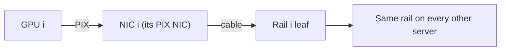

## Why this matters

You now know the pieces inside a GPU server: PCIe switches and NUMA nodes (`pcie-numa-topology`), NICs
(`nics-dpus-supernics`), GPUDirect paths (`gpudirect-rdma-storage`) and NVLink (`nvlink-nvswitch`).
This lesson is about reading the map that ties them together. `nvidia-smi topo -m` prints a matrix
that tells you, for every GPU-GPU and GPU-NIC pair, what kind of path connects them. NCCL makes its
own decisions from the same information: which NIC each GPU uses, whether GPUDirect RDMA is allowed,
and how to build rings and trees.

Reading this matrix fluently is a core skill for AI network engineers. It is how you confirm that a
new server model is wired the way the design assumed, catch a node whose BIOS or firmware differs from
the fleet, and verify that GPU *i* really reaches the network through the NIC that is cabled to rail
*i*. A single mismatched pair can make one node a straggler and slow down a job spanning thousands of
GPUs.

## Concepts

### The legend

`nvidia-smi topo -m` prints this legend under the matrix (wording from the tool; it may vary
slightly between driver versions):

| Code | nvidia-smi definition | What it means physically | GPU ↔ NIC quality |
|---|---|---|---|
| `X` | Self | The diagonal | n/a |
| `PIX` | Connection traversing at most a single PCIe bridge | Both devices below the same PCIe switch | Best: ideal GPU-NIC pair |
| `PXB` | Connection traversing multiple PCIe bridges (without traversing the PCIe Host Bridge) | Below a common switch hierarchy, but several switch levels apart | Good; stays off the CPU |
| `PHB` | Connection traversing PCIe as well as a PCIe Host Bridge (typically the CPU) | Path turns around in the CPU's root complex | Fair: uses CPU PCIe resources |
| `NODE` | Connection traversing PCIe as well as the interconnect between PCIe Host Bridges within a NUMA node | Different root complexes / host bridges of the same socket | Worse |
| `SYS` | Connection traversing PCIe as well as the SMP interconnect between NUMA nodes (e.g., QPI/UPI) | Different CPU sockets | Worst: avoid for GPU-NIC traffic |
| `NV#` | Connection traversing a bonded set of # NVLinks | GPU-GPU over NVLink (direct or via NVSwitch) | n/a for NICs; the GPU-GPU fast path |

Read the PCIe codes as a **distance scale**, from closest to farthest:

```text
PIX  <  PXB  <  PHB  <  NODE  <  SYS
```

NCCL's distance thresholds such as `NCCL_NET_GDR_LEVEL` and `NCCL_P2P_LEVEL` use the same names and
ordering, which is why it is worth memorizing, with one wrinkle: NCCL has no separate `NODE` value, and
its `PHB` means "same NUMA node, through the CPU", so it covers both nvidia-smi's `PHB` and `NODE`.

```widget
pcie-topo
```

Try the widget: click a GPU-NIC pair and watch which part of the PCIe tree its path crosses.

> [!ANALOGY]
> The legend is like the hop count and administrative-distance view of a routing table, but for the
> inside of one server: PIX is "directly connected", SYS is "via the WAN". As with routing, the closest
> path is preferred. Where it breaks down: there is no dynamic routing on PCIe. If the closest NIC is
> on the wrong socket because of how the board is wired, no protocol will fix it; only hardware
> placement and software selection can.

### The affinity columns

To the right of the matrix, current drivers print extra columns:

| Column | Meaning | Use it for |
|---|---|---|
| `CPU Affinity` | The CPU cores local to that GPU | Binding the process that drives this GPU |
| `NUMA Affinity` | The NUMA node the GPU is attached to | Memory binding, sanity check against the NIC's NUMA node |
| `GPU NUMA ID` | On systems where GPU memory is itself exposed as a NUMA node (for example Grace-based systems), that node's ID; otherwise N/A | Grace Hopper / Grace Blackwell memory placement |

Newer versions also print a **NIC Legend** that maps `NIC0`, `NIC1`, ... to RDMA device names such as
`mlx5_0`. That mapping is essential: the `NIC#` index is nvidia-smi's own numbering, and neither it nor
the RDMA device names have to follow GPU order.

## How it works

### A healthy 8-GPU server, read row by row

Below is an **illustrative** matrix for a two-socket, 8-GPU, NVSwitch-based server with eight compute
NICs (one per GPU) and two storage/front-end NICs. It is modelled on common HGX-style designs, but it
is not a capture from a specific product.

```text
        GPU0 GPU1 GPU2 GPU3 GPU4 GPU5 GPU6 GPU7 NIC0 NIC1 NIC2 NIC3 NIC4 NIC5 NIC6 NIC7 NIC8 NIC9 CPU Affinity NUMA Affinity
GPU0     X   NV18 NV18 NV18 NV18 NV18 NV18 NV18 PIX  NODE NODE NODE SYS  SYS  SYS  SYS  NODE SYS  0-55         0
GPU1    NV18  X   NV18 NV18 NV18 NV18 NV18 NV18 NODE PIX  NODE NODE SYS  SYS  SYS  SYS  NODE SYS  0-55         0
GPU2    NV18 NV18  X   NV18 NV18 NV18 NV18 NV18 NODE NODE PIX  NODE SYS  SYS  SYS  SYS  NODE SYS  0-55         0
GPU3    NV18 NV18 NV18  X   NV18 NV18 NV18 NV18 NODE NODE NODE PIX  SYS  SYS  SYS  SYS  NODE SYS  0-55         0
GPU4    NV18 NV18 NV18 NV18  X   NV18 NV18 NV18 SYS  SYS  SYS  SYS  PIX  NODE NODE NODE SYS  NODE 56-111       1
GPU5    NV18 NV18 NV18 NV18 NV18  X   NV18 NV18 SYS  SYS  SYS  SYS  NODE PIX  NODE NODE SYS  NODE 56-111       1
GPU6    NV18 NV18 NV18 NV18 NV18 NV18  X   NV18 SYS  SYS  SYS  SYS  NODE NODE PIX  NODE SYS  NODE 56-111       1
GPU7    NV18 NV18 NV18 NV18 NV18 NV18 NV18  X   SYS  SYS  SYS  SYS  NODE NODE NODE PIX  SYS  NODE 56-111       1

NIC Legend:
  NIC0: mlx5_0   NIC1: mlx5_1   NIC2: mlx5_2   NIC3: mlx5_3
  NIC4: mlx5_4   NIC5: mlx5_5   NIC6: mlx5_6   NIC7: mlx5_7
  NIC8: mlx5_8   NIC9: mlx5_9
```

How to read it, step by step:

1. **GPU-GPU block (top left).** Every off-diagonal entry is `NV18`: all GPUs are connected through
   NVSwitch with the full set of links. Any `PIX`, `SYS` or a lower `NV#` here on an NVSwitch system
   means missing NVLink connectivity.
2. **GPU-NIC block.** Each GPU row has exactly one `PIX`, on the diagonal of the GPU-NIC block: GPU0
   with NIC0, GPU1 with NIC1, and so on. That is the ideal 1:1 pairing.
3. **Same-socket neighbours** show `NODE`: GPU0 can reach NIC1-NIC3 without crossing sockets, but
   through the CPU's host bridges.
4. **Other-socket NICs** show `SYS`: GPU0 should never use NIC4-NIC7 for bulk traffic.
5. **NIC8 and NIC9** are the storage/front-end NICs: NIC8 is attached to socket 0 (NODE for GPU0-3) and
   NIC9 to socket 1. Storage traffic for GPU0-3 should go out NIC8.
6. **Affinity columns** split cleanly: GPU0-3 on NUMA node 0 (cores 0-55), GPU4-7 on node 1.

From this, NCCL will pair GPU *i* with NIC *i* for the compute network, and allow GPUDirect RDMA on
those pairs because PIX is within its default threshold.

### Where PXB and PHB show up

Not every design gives a clean PIX per GPU:

- **PXB** appears when a board has two levels of PCIe switch (for example a large switch fanning out to
  smaller ones), and the GPU and NIC hang under different second-level switches. GPUDirect RDMA still
  stays off the CPU, so this is usually acceptable.
- **PHB** appears when a NIC is plugged directly into a CPU root port (no switch) and the GPU is on
  another port of the same host bridge. Common on servers that were not designed around 1:1 GPU-NIC
  pairing, such as general-purpose PCIe GPU servers. Expect lower GDR send performance.
- **Integrated-switch NICs:** on designs where the GPU attaches through a switch built into the NIC
  (ConnectX-8 class, see `nics-dpus-supernics`), the GPU-NIC relationship should still show as the
  closest category. Check your platform documentation for what the matrix looks like.

### How NCCL uses this

NCCL builds its own topology graph at startup (from sysfs, PCIe and NVLink information) and you can
dump it:

```bash
NCCL_TOPO_DUMP_FILE=/tmp/nccl_topo.xml NCCL_DEBUG=INFO NCCL_DEBUG_SUBSYS=INIT,GRAPH ./all_reduce_perf -b 8 -e 1G -g 8
```

The XML shows CPUs, PCIe switches, GPUs, NICs and NVLinks with their bandwidths, and the `GRAPH` debug
output shows the rings and trees NCCL built and which NIC each channel uses. When `nvidia-smi topo -m`
and NCCL's topology disagree with your expectations, you have found the problem.

### From server topology to fabric cabling

In a rail-optimized fabric (`rail-optimized-topology`), NIC *i* of every server connects to the leaf
switch(es) of rail *i*. The chain of correctness is:



Two independent mappings must both be right: GPU *i* to NIC *i* inside the server (this lesson), and
NIC *i* to rail *i* in the cabling. If either is wrong, traffic that should stay on one rail-leaf takes
extra hops through the spine. LLDP is the standard way to check the second mapping from the host.

## In practice

All output is **illustrative**.

### Capture and diff against a golden node

```bash
nvidia-smi topo -m > /tmp/topo-$(hostname).txt
diff /tmp/topo-golden.txt /tmp/topo-$(hostname).txt
```

Strip the CPU Affinity column first if CPU numbering differs legitimately between BIOS versions. Any
other difference on supposedly identical hardware is a finding: different BIOS settings, a card in the
wrong slot, a disabled device or a failed NVLink.

### Example anomaly 1: a NIC in the wrong place

```text
        ... NIC0 NIC1 NIC2 NIC3 ...
GPU2    ... NODE NODE NODE NODE ...
GPU3    ... NODE NODE PIX  PIX  ...
```

GPU2 has no `PIX` NIC, and GPU3 has two. A NIC has been installed in (or enumerated under) the wrong
slot, or a riser is cabled to the wrong switch. Result: NCCL will route GPU2's traffic through a
`NODE` path, and the NIC under GPU3 that should belong to GPU2 is cabled to rail 2 but now sits next
to GPU3. Fix the hardware; do not paper over it with environment variables.

### Example anomaly 2: RDMA device names do not follow GPU numbering

```text
NIC Legend:
  NIC0: mlx5_0   NIC1: mlx5_1   NIC2: mlx5_3   NIC3: mlx5_2 ...
```

Here the PIX pairing is fine (GPU2-NIC2, GPU3-NIC3), but NIC2 is `mlx5_3`. NCCL selects NICs by
topology and is unaffected. But anything static that assumes "GPU *i* uses `mlx5_i`" is now wrong for
GPUs 2 and 3: a launch wrapper that pins each local rank to `mlx5_<local rank>` (for example with a
per-rank `NCCL_IB_HCA`), a cabling sheet, monitoring dashboards, or per-rail IP addressing. (The order
of devices in a single shared `NCCL_IB_HCA` list does not assign NICs to GPUs; NCCL still pairs them by
topology.) Device naming can change with firmware, PCIe enumeration order
or OS upgrades; always derive the mapping from topology, not from names.

### Example anomaly 3: missing NVLinks

```text
        GPU0 GPU1 GPU2 ...
GPU5    NV18 NV18 NV12 ...
```

On an NVSwitch system all pairs should be equal. A lower `NV#` means some of the GPU's links are down.
Confirm with `nvidia-smi nvlink --status -i 5`, then raise a hardware ticket (`nvlink-nvswitch`).

### Confirm NIC NUMA nodes and cabling

```bash
for d in /sys/class/infiniband/*; do echo "$(basename $d) numa=$(cat $d/device/numa_node)"; done
sudo lldpcli show neighbors      # lldpd: which switch and port each Ethernet interface connects to
```

The NUMA node of each compute NIC should equal the NUMA affinity of its PIX GPU. LLDP neighbour
output tells you which switch and port each Ethernet interface connects to, so you can verify that
NIC *i* lands on a rail *i* leaf. On InfiniBand, the subnet manager's tools give the equivalent view
(`ib-tools-diagnostics`).

### Other useful views

```bash
lstopo --of console --no-caches     # full hwloc picture: sockets, NUMA nodes, PCIe tree, devices
lspci -tv                           # raw PCIe tree
nvidia-smi topo -p2p n              # peer-to-peer NVLink capability matrix (see nvidia-smi topo -h)
```

> [!INTERVIEW]
> **"You receive a new server model for an AI cluster. Before it joins the fleet, what do you check in
> its topology?"** A strong answer: in `nvidia-smi topo -m`, every GPU pair should show the expected
> `NV#`; every GPU should have exactly one `PIX` (or at worst `PXB`) compute NIC, and the pairing should
> be one-to-one; no GPU's best NIC should be `SYS`; affinity columns should split GPUs evenly across
> NUMA nodes; storage NICs should be reachable from each socket. Then check `LnkSta` on every device,
> NIC NUMA nodes, NCCL's topology dump and LLDP-based cabling, and save the result as the golden
> reference for future nodes.

## Common pitfalls

- **Reading the codes as bandwidth.** Symptom: "PIX is faster than NV18". Cause: the codes describe
  path type, not throughput. Fix: remember that NV# is GPU-GPU over NVLink, while PCIe codes are a
  distance scale; compare bandwidth with measurements.
- **Assuming `mlx5_i` belongs to `GPUi`.** Symptom: one rail carries unexpected cross-traffic, or a
  hand-tuned NIC list hurts performance. Cause: RDMA device order differs from GPU order. Fix: derive
  pairing from PIX entries and the NIC Legend; avoid static name-based lists.
- **Ignoring a `SYS`-only GPU.** Symptom: one GPU per node is slow at inter-node traffic. Cause: its
  only compute NIC is on the other socket, because of slot placement or a disabled NIC. Fix: correct
  the hardware layout; confirm with a golden diff.
- **Comparing topology across different hardware revisions.** Symptom: false alarms. Cause: board
  revisions legitimately differ. Fix: keep one golden file per hardware model and BIOS baseline.
- **Running topology checks inside a container that hides devices.** Symptom: missing NICs or GPUs in
  the matrix. Cause: the container only sees a subset of devices. Fix: run validation on the host, or
  make sure the container exposes all devices you intend to check.
- **Fixing topology with environment variables.** Symptom: a growing list of per-node NCCL overrides.
  Cause: hardware or BIOS drift handled in software. Fix: treat topology differences as hardware
  defects and fix them at the source.

## Key takeaways

- The PCIe legend is a distance scale: PIX < PXB < PHB < NODE < SYS; NV# counts bonded NVLinks between
  GPUs.
- A healthy AI server shows one PIX compute NIC per GPU, uniform NV# between all GPU pairs on NVSwitch
  systems, and GPUs split evenly across NUMA nodes.
- The NIC Legend maps NIC indices to RDMA device names, and those names need not follow GPU order.
- NCCL builds the same topology internally; `NCCL_TOPO_DUMP_FILE` and `NCCL_DEBUG_SUBSYS=GRAPH` show
  what it decided.
- Diffing every node against a golden topology file catches slot, BIOS and NVLink problems before they
  become stragglers.
- Server topology and fabric cabling must agree: GPU *i* → NIC *i* (PIX) → rail *i* leaf, checked with
  LLDP or subnet manager tools.
