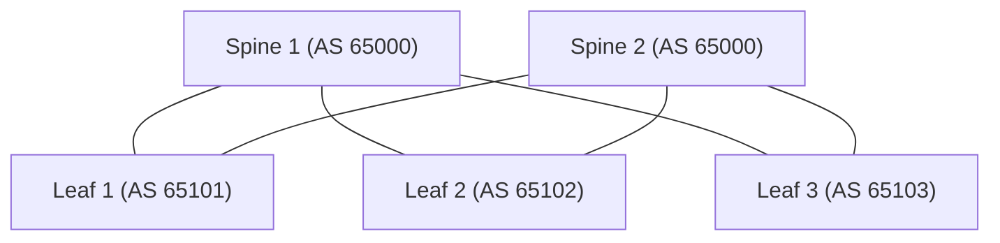

## Why this matters

A leaf-spine fabric (`clos-leaf-spine`) is only as good as the routing that fills its ECMP groups
(`ecmp-hashing`). When a link or a switch fails, routing decides how fast traffic moves off it, and
whether it moves onto all remaining paths or just some of them. In an AI cluster, a routing problem
rarely shows up as an outage. It shows up as missing ECMP members, slow convergence after a flap, or a
leaf that briefly attracts traffic it cannot deliver, all of which surface as collectives that are a
little slower or that stall for seconds and trigger timeouts.

Most large Ethernet fabrics, including many AI back-end and front-end fabrics, use eBGP as their only
routing protocol. That choice, documented by operators in RFC 7938, comes with specific design rules
around AS numbering, multipath and timers that differ from how BGP is used on the internet. A network
engineer moving into AI fabrics needs to know those rules and why they exist.

## Concepts

### Why BGP and not OSPF or IS-IS?

RFC 7938 explains the reasoning of large operators. In short:

| Consideration | eBGP in a Clos | Link-state IGP (OSPF/IS-IS) |
|---|---|---|
| State propagation | Each router sends only best paths to neighbours | Every router floods every link state to every router |
| Failure blast radius | A link failure is a few withdrawals | A link failure is flooded fabric-wide and triggers SPF everywhere |
| Policy and filtering | Rich, per neighbour | Limited |
| Operational familiarity | One protocol for underlay, overlay (EVPN) and edge | Usually still needs BGP for EVPN and edge |
| Implementations | Mature, widely available in open-source stacks | Equally mature |

Link-state protocols work fine at moderate scale, and some large operators use them. But a single
eBGP-only design is simple to reason about, scales to very large fabrics and reuses the same protocol
for EVPN (`evpn-vxlan-frontend`). That is why it became the default.

### The RFC 7938 design in one picture



The rules:

1. **eBGP on every link.** Each leaf-spine link is a single-hop eBGP session. No iBGP, no route
   reflectors, no IGP underneath.
2. **Spines of one tier share an ASN.** All spines in a two-tier fabric get the same ASN (65000 here).
3. **Every leaf has its own ASN.** 65101, 65102, ...
4. **Private ASNs.** 16-bit private range 64512-65534, or the 32-bit private range
   4200000000-4294967294 (RFC 6996). The 32-bit range is preferred for large fabrics because it avoids
   running out.
5. **Advertise only what is needed:** loopbacks, server subnets (or host routes) and, where used, VTEP
   addresses. Point-to-point link subnets need not be advertised at all, especially with BGP
   unnumbered.

> [!ANALOGY]
> This is the internet's AS model shrunk to a building: each leaf is a tiny "autonomous system" and
> the spines are a shared transit provider. The AS_PATH loop check that stops routing loops between ISPs
> also stops bad paths inside the fabric. Where it breaks: on the internet you want path diversity
> chosen by policy; in the fabric you want every equal path used at once, so you tell BGP to treat
> paths through different ASNs as equal (multipath-relax) and you tune timers far below internet
> defaults.

### Why spines share an ASN: no path hunting

Consider a leaf's prefix that is withdrawn (the leaf fails). If every spine had its own ASN, a spine
that just lost the route could hear it again from another leaf that learned it from another spine: the
AS_PATH would be `leaf-X spine-2 leaf-1`, which does not contain spine 1's ASN, so spine 1 would accept
it. Spines would briefly bounce stale paths between each other through the leaves, a slow process
called **path hunting**, before the route finally disappears.

With all spines in one ASN, any path that has passed through a spine already contains AS 65000, so
another spine rejects it by the standard AS_PATH loop check. A withdrawal is final immediately. That
single rule makes convergence fast and predictable.

The same logic explains why leaves need **unique** ASNs: if two leaves shared an ASN, each would reject
routes originated by the other as loops. (If you deliberately reuse leaf ASNs, for example across
pods, you need `allowas-in` or ASN rewriting, at the cost of weakening loop protection.)

### Three-tier ASN plan

RFC 7938's three-tier scheme:

| Tier | ASN rule |
|---|---|
| Tier 1 (super-spines) | One ASN shared by all super-spines |
| Tier 2 (pod spines) | One ASN per pod, shared by all spines of that pod |
| Tier 3 (leaves) | Unique ASN per leaf (may be reused across pods with care) |

Same principle at each tier: switches that are interchangeable "middle stages" share an ASN, so paths
can never bounce between them.

## How it works

### ECMP with BGP: three settings

Out of the box, BGP chooses **one** best path. To install all spines as next hops, three things must be
true:

1. **Multipath enabled with enough width.** `maximum-paths` (per address family) must be at least the
   number of uplinks. If it is 4 and the leaf has 8 uplinks, 4 links carry no traffic to that prefix.
2. **Paths must be "equal".** BGP considers paths equal for multipath only if attributes up to and
   including AS_PATH length match, and by default only if the AS_PATH is *identical*. In the design
   above, paths from leaf 1 to leaf 3 via spine 1 and spine 2 both read `65000 65103`, so they are
   identical and multipath works.
3. **Multipath-relax where AS paths differ.** If the candidate paths have the same length but different
   ASNs, for example a server dual-homed to two leaves with different ASNs, or spines with different
   ASNs, you must relax the check (`bgp bestpath as-path multipath-relax` in FRR and several vendors) so
   that equal-length paths are used together.

### Timers and failure detection

Internet BGP is tuned for stability, and data center BGP for speed:

| Mechanism | Purpose | Data center practice |
|---|---|---|
| Link down | Immediate local detection on physical failure | The primary trigger; sessions on the failed link drop at once |
| Keepalive / hold timers | Detect a dead peer when the link stays up | Short values (for example 3 s / 9 s, the FRR data center profile) instead of internet-style 60 s / 180 s |
| BFD | Sub-second detection of forwarding failures with the link still up | Commonly enabled on fabric links |
| Advertisement interval (MRAI) | Batching of updates | 0 on fabric sessions, so new paths are not held back (RFC 4271 suggests 30 s for eBGP; current FRR documents 0 as its default) |

FRR ships a `datacenter` defaults profile that sets low timers and related options; check the FRR
documentation for exactly what it changes in your version.

When a leaf-spine link fails, the leaf removes that next hop from its ECMP groups locally (fast, often
in hardware next-hop groups), and the spine sends withdrawals to the other leaves, which remove that
spine as a next hop for the affected prefixes. Thanks to the shared spine ASN there is no path hunting.

Fail spine–leaf links below and watch which leaves lose which next hops; switch to unique spine ASNs and turn off multipath-relax to see the ECMP set collapse to one next hop (either change alone keeps full ECMP):

```widget
bgp-path-sim
```

### BGP unnumbered

A fabric with 64 leaves and 32 spines has 2,048 links. Numbering each with a /31 (and keeping DNS,
IPAM and configuration in sync) is tedious and error-prone. **BGP unnumbered** removes it:

1. Every fabric interface has an **IPv6 link-local address** automatically (fe80::/10). No IPv4 address is
   configured on the link.
2. Neighbours discover each other's link-local address through **IPv6 Router Advertisements**.
3. BGP peers over that link-local address, configured by **interface name** rather than by neighbour IP.
4. IPv4 prefixes are advertised with an **IPv6 next hop** using the **extended next hop** capability
   (RFC 5549, now obsoleted by RFC 8950).
5. To forward IPv4 packets to an IPv6 next hop, the router needs the neighbour's MAC address. Linux-based
   implementations such as FRR typically install the IPv4 route via a placeholder link-local IPv4 next
   hop with a static neighbour entry pointing at the peer's MAC; the details are implementation-specific.

```text
leaf01 swp51 (fe80::a) <---- eBGP over IPv6 link-local ----> spine01 swp1 (fe80::b)
  advertises 10.0.0.11/32 (IPv4 NLRI) with next hop fe80::a (extended next hop)
```

Benefits: no link addressing, configuration that is identical across leaves except for ASN and router-id
(ideal for automation), and cabling mistakes that show up as an unexpected neighbour instead of an
address mismatch. Combine it with `remote-as external` (accept any eBGP ASN) and a leaf configuration
becomes almost a template. On the downside, troubleshooting tools that expect IPv4 link addresses
(traceroute hops, some monitoring) show loopbacks or link-local addresses instead, and every device in the
path must support the extended next hop capability.

### What gets advertised in an AI fabric

| Network | Typical advertised prefixes |
|---|---|
| Back-end (RoCE) | Per-NIC /31 or small per-rail subnets on each leaf, plus switch loopbacks. Hosts usually do not run BGP; the NIC's link to the leaf is a routed point-to-point link. Exact addressing follows the reference design you adopt. |
| Front-end | Server subnets or host routes, VTEP loopbacks for EVPN-VXLAN, default route from the border |
| Storage | Storage server subnets, sometimes routed on the host for multihoming |

Advertise loopbacks and server subnets; filter everything else with route maps or prefix lists so that
a misconfigured device cannot inject a default route or a huge prefix into the fabric.

## In practice

The examples use FRRouting syntax (used by SONiC, Cumulus Linux and others). Commercial NOSes have
equivalent commands; check their documentation. Output is **illustrative**.

### A leaf configuration

```text
router bgp 65101
 bgp router-id 10.0.0.11
 bgp bestpath as-path multipath-relax
 neighbor FABRIC peer-group
 neighbor FABRIC remote-as external
 neighbor FABRIC bfd
 neighbor swp51 interface peer-group FABRIC
 neighbor swp52 interface peer-group FABRIC
 neighbor swp53 interface peer-group FABRIC
 neighbor swp54 interface peer-group FABRIC
 !
 address-family ipv4 unicast
  network 10.0.0.11/32
  redistribute connected route-map SERVER-SUBNETS
  maximum-paths 64
 exit-address-family
```

Line by line:

- `router bgp 65101`: this leaf's unique private ASN.
- `bgp bestpath as-path multipath-relax`: use equal-length paths even if their ASNs differ.
- `peer-group FABRIC` with `remote-as external`: every uplink uses the same settings, and any eBGP ASN
  is accepted (the spine ASN does not need to be typed per neighbour).
- `neighbor FABRIC bfd`: fast failure detection on all fabric sessions.
- `neighbor swp51 interface ...`: BGP unnumbered on that interface (link-local peering, extended next
  hop).
- `network 10.0.0.11/32`: advertise the loopback.
- `redistribute connected route-map SERVER-SUBNETS`: advertise server-facing subnets, filtered by a
  route map you define.
- `maximum-paths 64`: allow up to 64 ECMP paths for eBGP routes.

### Verify sessions

```text
leaf01# show bgp ipv4 unicast summary
BGP router identifier 10.0.0.11, local AS number 65101
Neighbor        V   AS   MsgRcvd MsgSent  Up/Down State/PfxRcd
spine01(swp51)  4 65000     8123    8120 3d02h11m           68
spine02(swp52)  4 65000     8119    8121 3d02h11m           68
spine03(swp53)  4 65000     8125    8118 3d02h10m           68
spine04(swp54)  4 65000       12      15 00:00:41       Active
```

Three healthy sessions receive the same number of prefixes (68). `spine04` is not established: the
state column shows `Active` (trying to connect) instead of a prefix count. Check the link, BFD state,
and whether the neighbour on that interface is configured. With unnumbered peering, also check that
IPv6 is enabled on the interface and Router Advertisements are being sent, because the session depends
on them.

### Verify ECMP

```text
leaf01# show ip bgp 10.0.0.23/32
BGP routing table entry for 10.0.0.23/32
Paths: (3 available, best #1, table default)
  65000 65123
    spine01(swp51) from spine01(swp51) (10.0.0.1)
  65000 65123
    spine02(swp52) from spine02(swp52) (10.0.0.2)
  65000 65123
    spine03(swp53) from spine03(swp53) (10.0.0.3)
```

```text
leaf01# show ip route 10.0.0.23/32
B>* 10.0.0.23/32 [20/0] via fe80::202:ff:fe00:11, swp51, weight 1, 3d02h
  *                     via fe80::202:ff:fe00:21, swp52, weight 1, 3d02h
  *                     via fe80::202:ff:fe00:31, swp53, weight 1, 3d02h
```

All three available paths are installed (`*` on each line). If the BGP table shows four paths but the
route shows fewer next hops, look at `maximum-paths` and multipath-relax. If the BGP table itself shows
fewer paths than spines, a session is down or a spine is filtering.

## Common pitfalls

- **`maximum-paths` too small.** Symptom: some uplinks carry no traffic for remote prefixes; BGP shows
  more paths than the route table. Cause: multipath width below the uplink count (some platforms default
  to 1). Fix: set it at least to the number of uplinks, per address family.
- **Missing multipath-relax.** Symptom: only one next hop for dual-homed server prefixes. Cause: paths via
  two leaves with different ASNs are not "identical". Fix: enable AS-path multipath-relax.
- **Unique ASNs on spines.** Symptom: slow convergence and transient loops after a leaf failure. Cause:
  path hunting between spines. Fix: one ASN per spine tier (per pod in three-tier designs).
- **Reused leaf ASNs without allowas-in.** Symptom: leaves with the same ASN cannot reach each other.
  Cause: AS_PATH loop prevention discards the routes. Fix: unique ASNs, or deliberate `allowas-in` with
  understood trade-offs.
- **Internet-default timers.** Symptom: a silent forwarding failure takes up to three minutes to resolve.
  Cause: 60 s / 180 s keepalive/hold timers and no BFD. Fix: short timers and BFD on fabric links.
- **Unnumbered without IPv6 RA.** Symptom: unnumbered sessions never establish. Cause: IPv6 disabled on the
  interface or Router Advertisements suppressed. Fix: enable IPv6 and RA on fabric interfaces as required
  by your NOS.
- **No inbound filtering.** Symptom: a test box advertises a default route and attracts traffic. Cause:
  fabric accepts any prefix. Fix: prefix lists / route maps on server-facing and fabric sessions.

## Key takeaways

- RFC 7938 fabrics run eBGP on every link with private ASNs, no IGP and no route reflectors.
- Spines of a tier share one ASN to stop path hunting; each leaf has its own ASN.
- ECMP needs multipath width at least equal to the uplink count, and multipath-relax when equal-length
  paths have different ASNs.
- Data center BGP uses short timers, zero advertisement interval and BFD for fast failure detection.
- BGP unnumbered peers over IPv6 link-local addresses and carries IPv4 routes with IPv6 next hops
  (RFC 5549 / RFC 8950), removing per-link addressing.
- Verify with the BGP summary (same prefix count from every spine) and route output (one next hop per
  spine).
