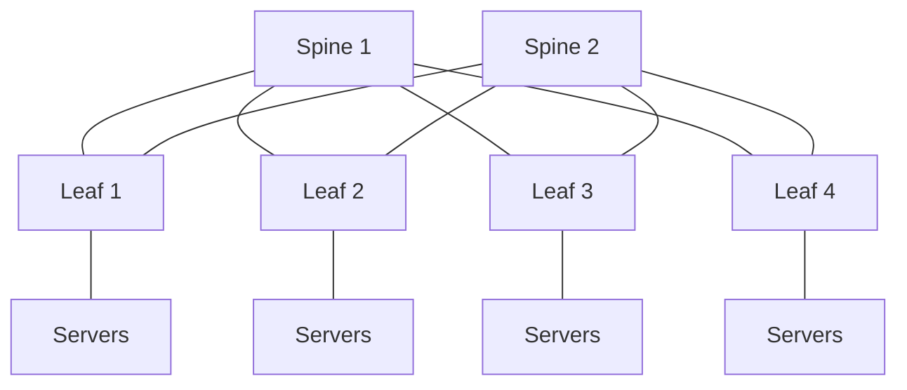
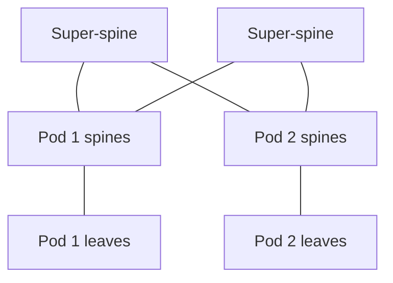

## Why this matters

Every serious data center network built in the last fifteen years, and every AI back-end fabric, is a
variant of one idea: a multi-stage Clos network. Whether a vendor calls it leaf-spine, fat-tree,
spine-and-superspine, rail-optimized or a "SuperPOD scalable unit", the underlying shape is the same.
If you understand that shape, you can reason about capacity, failure impact, path diversity and cost
for any of them.

AI training makes the stakes higher. A training job's collectives (see `collective-operations`) send
huge, synchronized flows between every GPU and many others. Any part of the network with less
bandwidth than the rest, or fewer paths, becomes the bottleneck for the whole job. The Clos topology is
how you build a network where, at least in principle, any GPU can talk to any other GPU at full rate.

## Concepts

### Where we came from: the three-tier design

Classic enterprise data centers used a **three-tier** design: access switches in the racks,
aggregation switches per row, and a pair of large core switches. Layer 2 domains spanned the access
and aggregation layers, protected by Spanning Tree Protocol (STP).

| Problem | Why it hurts |
|---|---|
| STP blocks redundant links | Half the installed bandwidth sits idle |
| Traffic between racks climbs to aggregation or core | Built for north-south (client-server) traffic, not east-west |
| Two big core boxes | Each failure halves capacity; scaling means buying bigger boxes (scale-up) |
| Oversubscription compounds per tier | 4:1 at access times 4:1 at aggregation means 16:1 end to end |

Modern applications (and above all AI training) are dominated by **east-west** traffic between
servers. The three-tier design was simply the wrong shape.

### Clos's idea

In 1953 Charles Clos, working on telephone exchanges, showed that you can build a large non-blocking
switch out of many small switches arranged in stages: ingress, middle and egress. With enough middle
switches, any free input can reach any free output. Data centers use the **folded** form: ingress and
egress stages are the same physical switches (the leaves), and the middle stage is the spine.



### The rules of a leaf-spine fabric

1. Every leaf connects to every spine (usually with one link, or the same number of links per spine).
2. Leaves do not connect to each other; spines do not connect to each other.
3. Servers (and everything else: storage, firewalls, border routers) connect only to leaves.

From those three rules follow the properties that make the design so useful:

| Property | Consequence |
|---|---|
| Any leaf reaches any other leaf in exactly 2 hops (leaf → spine → leaf) | Predictable, uniform latency |
| Number of equal-cost paths between two leaves = number of spines (times links per spine) | Bandwidth spread with ECMP (`ecmp-hashing`) |
| Losing one of *N* spines removes 1/*N* of inter-leaf capacity | Graceful degradation instead of halving |
| Add spines to add bandwidth, add leaves to add ports | Scale-out with identical small boxes |
| All links are routed point-to-point | No STP, no blocked links; failures handled by routing (`bgp-in-the-data-center`) |

> [!ANALOGY]
> A leaf-spine fabric is like an airline network with a set of identical hub airports where every
> regional airport has a direct flight to every hub. Any trip is "regional → hub → regional", and if
> one hub closes you reroute via the others with a little less capacity. Where the analogy breaks: in
> a Clos fabric the hubs are deliberately identical and interchangeable, and traffic is spread across
> all of them per flow (or per packet), not by booking a specific connection.

### Radix: the number that sizes everything

A switch's **radix** is its number of ports at a given speed. Radix, not raw throughput, decides how big
a fabric can get with a given number of tiers. A 51.2 Tb/s switch ASIC (the 2023-2025 generation, for
example NVIDIA Spectrum-4 or Broadcom Tomahawk 5) can be configured as 64 × 800G or 128 × 400G ports.
The 102.4 Tb/s generation announced in 2025 (for example Broadcom Tomahawk 6 and NVIDIA's Spectrum-X
roadmap parts) doubles that again; check vendor documentation for available port configurations.

## How it works

### Two-tier sizing

Take switches of radix *k*. To be **non-blocking** (no oversubscription at the leaf; see
`oversubscription-and-blocking`), each leaf uses half its ports for servers and half for spines:

- Each leaf: *k*/2 downlinks, *k*/2 uplinks, so it connects to *k*/2 spines.
- Each spine: *k* ports, one per leaf, so up to *k* leaves.
- Maximum endpoints: *k* leaves × *k*/2 downlinks = ***k*² / 2**.

| Radix *k* (ports at endpoint speed) | Spines | Leaves | Max non-blocking endpoints |
|---|---|---|---|
| 32 | 16 | 32 | 512 |
| 64 | 32 | 64 | 2,048 |
| 128 | 64 | 128 | 8,192 |

So a two-tier fabric of 51.2T switches running 128 × 400G ports can connect up to 8,192 400G NICs
non-blocking. If each GPU has one 400G NIC, that is an 8,192-GPU back-end fabric in two tiers, before
any cabling, power or optics constraints.

### Three-tier sizing

When two tiers are not enough, add a third. The common construction is the **k-ary fat-tree**
(Al-Fares et al., 2008): group leaves and spines into **pods** (each pod is a small two-tier Clos),
then connect the pods through a layer of **super-spines** (sometimes called core switches).

- Each pod: *k*/2 leaves and *k*/2 spines; each pod spine uses *k*/2 ports down to leaves and *k*/2 up to
  super-spines.
- Number of pods: *k* (each super-spine has *k* ports, one per pod).
- Maximum endpoints: ***k*³ / 4**.

| Radix *k* | Max non-blocking endpoints, 3-tier |
|---|---|
| 32 | 8,192 |
| 64 | 65,536 |
| 128 | 524,288 |



Each extra tier multiplies scale by roughly *k*/2 but adds two hops to the longest path, adds a layer
of optics (the most expensive and power-hungry part of the fabric; see `optics-cabling-power`) and adds
another set of ECMP hashing decisions where collisions can occur.

### Higher radix by splitting ports

A trick used heavily in AI fabrics: run the switch at a lower port speed to get a higher radix. A
64 × 800G switch configured as 128 × 400G has twice the radix, so a two-tier fabric holds four times as
many endpoints (*k*²/2 with *k* doubled). Many designs use 800G physical ports with breakout to 2 × 400G,
or connect each NIC with multiple lower-speed links that land on separate **planes**. The fabric then
consists of several parallel, independent Clos networks. More planes means more radix per plane and
fewer tiers, at the price of more NIC-side ports and more cables.

### Physical realities

- **Leaf placement.** A leaf can be a top-of-rack (ToR) switch, or sit at the end or middle of a row with
  longer cables. AI racks are so dense in power that a single rack may hold only a few GPU servers, so
  back-end leaves are often placed in network racks with servers cabled to them.
- **Cable reach.** Leaf-to-spine links are often tens of metres and need optics; server-to-leaf links can
  sometimes use copper (DAC) or active copper cables.
- **Failure domains.** Losing a leaf disconnects every NIC attached to it (unless servers dual-home);
  losing a spine only reduces capacity. This asymmetry drives where you spend on redundancy.

### Leaf-spine in AI back-end networks

The AI back-end fabric is a Clos with a twist. Instead of putting all eight NICs of a server on one
leaf, a **rail-optimized** design connects NIC *i* of every server to the leaf (or leaves) of rail *i*.
GPUs with the same index on different servers then talk through one leaf hop, and the spine handles
cross-rail traffic. It is still a leaf-spine Clos underneath; only the assignment of server ports to
leaves changes. Lesson `rail-optimized-topology` develops this, and `superpod-reference-architecture`
shows a full reference design. InfiniBand fabrics use the same fat-tree shapes; only the routing and
flow control differ (`ib-architecture`).

```widget
fabric-sizer
```

Use the sizer to see how radix, number of tiers and oversubscription change the number of switches,
links and optics for a given GPU count.

## In practice

### A sizing worksheet

Suppose you must connect 2,048 GPUs, one 400G NIC per GPU, non-blocking, using 51.2T switches.

| Step | Calculation | Result |
|---|---|---|
| Radix at 400G | 51.2T / 400G | *k* = 128 |
| Two-tier maximum | 128² / 2 | 8,192 endpoints: two tiers suffice |
| Leaves | 2,048 NICs / 64 downlinks per leaf | 32 leaves |
| Uplinks per leaf | 64 (non-blocking) | 32 × 64 = 2,048 leaf-spine links |
| Spines | 2,048 links / 128 ports per spine | 16 spines |
| Links to each spine from each leaf | 64 uplinks / 16 spines | 4 parallel links per leaf-spine pair |

Notice the last line: when the fabric is smaller than the maximum, each leaf has several links to each
spine. That is fine, and it is common. Alternatively you could build it with 64-radix logic (800G
ports) and more parallel links; the sizer widget lets you try both.

### Verifying the shape on a running fabric

On a routed leaf, a route to another leaf's prefix should have one next hop per spine link. With FRR
(as used by SONiC and Cumulus Linux), output is **illustrative**:

```text
leaf01# show ip route 10.1.4.0/24
Routing entry for 10.1.4.0/24
  Known via "bgp", distance 20, metric 0, best
  * fe80::202:ff:fe00:11, via swp51, weight 1
  * fe80::202:ff:fe00:21, via swp52, weight 1
  * fe80::202:ff:fe00:31, via swp53, weight 1
  * fe80::202:ff:fe00:41, via swp54, weight 1
```

Four uplinks, four spines, four equal-cost next hops (the `fe80::` next hops come from BGP unnumbered,
covered in `bgp-in-the-data-center`). Fewer next hops than uplinks means a link, a BGP session or a
multipath setting is missing.

To check the physical shape, LLDP on each switch should show every uplink landing on a different spine
(or the intended spine), and no leaf-to-leaf links:

```bash
lldpcli show neighbors summary      # lldpd; switch NOSes have their own LLDP show commands
```

> [!INTERVIEW]
> **"How many 400G GPUs can you connect non-blocking in two tiers with 64-port 800G switches, and how
> would you go bigger?"** A strong answer: at 800G the radix is 64, so 64²/2 = 2,048 endpoints; split
> each port into 2 × 400G and the radix becomes 128, giving 8,192 400G endpoints in two tiers. Beyond
> that: add a third tier (*k*³/4), use multiple parallel planes, or accept oversubscription where the
> traffic pattern allows (rarely on the back-end). Mention that each tier adds optics, power, latency
> and another ECMP stage.

## Common pitfalls

- **Unequal links per spine.** Symptom: some spines run hotter than others. Cause: a leaf has two links
  to spine 1 and one link to spine 2, but ECMP treats each next hop equally (or a missing cable
  removed one). Fix: keep the same number of links from every leaf to every spine; verify with LLDP.
- **Leaf-to-leaf "shortcut" links.** Symptom: odd paths and uneven load. Cause: someone cabled leaves
  together (often a leftover MLAG peer link), breaking the uniform two-hop property. Fix: keep peer links
  out of the routed fabric, or use EVPN multihoming instead of MLAG (`evpn-vxlan-frontend`).
- **Forgetting that the spine layer sets the ceiling.** Symptom: adding leaves does not add throughput
  between leaves. Cause: inter-leaf capacity is bounded by spine ports. Fix: size spines for the final
  leaf count from day one, or plan the third tier.
- **Treating "non-blocking topology" as "no congestion".** Symptom: a non-blocking fabric still shows
  hot links. Cause: flow hashing collisions and incast (`ecmp-hashing`, `incast-and-congestion-hotspots`).
  Fix: understand that topology gives capacity; load balancing must use it.
- **Ignoring physical constraints in sizing.** Symptom: a design that works on paper cannot be cabled.
  Cause: optic reach, rack power and cable bulk. Fix: include optics and floor layout in the sizing
  (`optics-cabling-power`).

## Key takeaways

- Modern data center and AI fabrics are folded Clos networks: leaves connect to every spine, servers
  connect only to leaves.
- Any leaf-to-leaf path is two hops, the number of equal-cost paths equals the number of spine links,
  and losing a spine costs only 1/*N* of capacity.
- With radix *k*, a non-blocking two-tier fabric supports *k*²/2 endpoints and a three-tier fat-tree
  *k*³/4.
- Radix, not raw switch throughput, sets scale: splitting ports into lower speeds or using multiple
  planes keeps big AI fabrics at two tiers.
- Each extra tier costs optics, power, latency and another hashing stage.
- AI back-end fabrics are leaf-spine Clos networks with rail-optimized port assignment.
