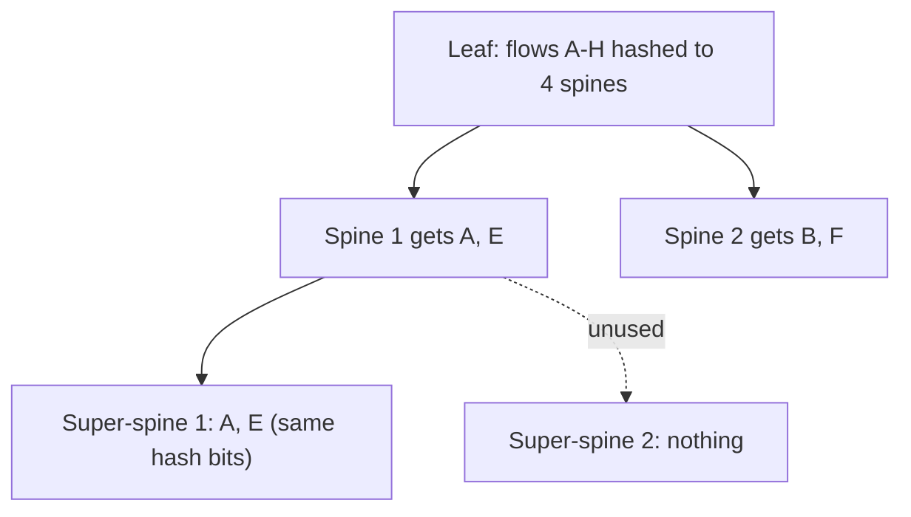

## Why this matters

A leaf-spine fabric gives you many equal paths (`clos-leaf-spine`), and a 1:1 design gives you enough
total capacity (`oversubscription-and-blocking`). Equal-Cost Multi-Path routing (ECMP) is what decides
which path each packet actually takes. In most Ethernet fabrics today that decision is made by hashing
packet headers, and it is made per **flow**, not per packet, to keep packets of a flow in order.

That works beautifully for traffic made of millions of small, independent flows. AI training traffic is
the opposite: a few hundred or few thousand long-lived, line-rate flows, all starting at once. With so
few flows, hashing is a lottery with bad odds. Two elephant flows hashed onto the same 400G uplink each
get 200G, the collective waits for them, and the whole job slows down, on a fabric that is officially
non-blocking. Understanding ECMP hashing is the starting point for every AI load-balancing technique
that follows in `flow-collisions-entropy` and `adaptive-routing-packet-spraying`.

## Concepts

### Equal-cost multipath

When the routing table has several best routes to a destination with the same cost, the switch installs
all of them as an **ECMP group**. In a leaf-spine fabric, the route from one leaf to another leaf's
prefix has one next hop per spine uplink. The switch must choose one member for each packet.

| Approach | How a member is chosen | Pros | Cons |
|---|---|---|---|
| Per-packet round robin | Next packet, next link | Perfect balance | Reorders packets within a flow |
| **Per-flow hashing** (the default almost everywhere) | Hash of header fields selects a member | No reordering, stateless, line rate | Imbalance when flows are few and large |
| Flowlet switching | Re-hash a flow only after an idle gap | Good balance with little reordering | Needs gaps; AI flows have few |
| Adaptive / packet spraying | Choose by current load, per packet or per flowlet | Best balance | Needs reordering tolerance at the NIC |

This lesson is about per-flow hashing; the others are developed in module m07.

### What gets hashed

The switch builds a **hash key** from header fields, typically the 5-tuple:

```text
source IP | destination IP | IP protocol | L4 source port | L4 destination port
```

Many switches can also add the ingress port, VLAN, IPv6 flow label, or inner headers of tunnelled
packets (VXLAN), depending on ASIC and configuration. The hash output (for example a CRC-based function)
is reduced to a member index of the ECMP group.

For **RoCEv2** (see `rocev2-encapsulation`), packets are UDP with destination port **4791**. The
destination port is constant, and between two NICs the IP addresses are constant too. The only field
that varies is the **UDP source port**, which the NIC sets per queue pair (QP). So the entropy of RoCEv2
traffic is essentially *the number of distinct QPs*, each of which is a separate flow to the fabric.

> [!ANALOGY]
> Per-flow ECMP is like a motorway toll plaza where each car is sent to a lane by the last digit of its
> licence plate. With thousands of cars, every lane gets about the same traffic. With eight enormous
> trucks and eight lanes, the odds are high that two trucks get the same digit and queue behind each
> other while another lane stays empty. The analogy breaks in one way that makes reality worse: the
> trucks never leave. AI flows last for the whole collective, so a bad assignment persists.

### Elephant flows and the birthday problem

Suppose a leaf has *n* uplinks and *n* equally sized flows hashed independently and uniformly. How
likely is a perfect spread?

```text
P(no collision) = n! / n^n
```

| Uplinks and flows (*n*) | P(no collision) | Expected idle uplinks | Expected idle share |
|---|---|---|---|
| 4 | ~9 % | ~1.3 | ~32 % |
| 8 | ~0.24 % | ~2.75 | ~34 % |
| 16 | ~0.0001 % | ~5.7 | ~36 % |
| large *n* | ~0 | ~*n*/*e* | ~37 % |

The expected number of idle links is *n* × (1 − 1/*n*)^*n*, which tends to *n*/*e*. In plain words: **with as
many flows as links, about a third of the links sit idle and the rest carry two or more flows**. The
worst-loaded link sets the completion time of a synchronized collective, and with eight flows on eight
links the busiest link typically carries two or three flows, so the collective runs at roughly a half to
a third of the rate it could.

More flows help. With *m* flows per link on average, the load evens out roughly as 1/√*m*. That is why
splitting each logical connection into more QPs (more source ports, more entropy) is a standard lever.

```widget
ecmp-collision
```

Run the widget with a handful of elephant flows on static ECMP, then increase the flow count, then
switch to adaptive routing and packet spraying to see the difference.

## How it works

### From hash to member: modulo and hash-threshold

Two common ways to turn a hash *h* into a member index for *N* next hops:

- **Modulo-N:** index = *h* mod *N*.
- **Hash-threshold** (RFC 2992): split the hash space into *N* equal regions; the region containing *h*
  is the member.

Both balance well on average. They differ in what happens when *N* changes. With modulo-N, removing
one member changes the index of most flows. With hash-threshold, fewer flows move, but still a substantial
share: RFC 2992 shows it is between roughly a quarter and a half, depending on which member changes. Either way, many flows that were not using the failed link get moved.

### Resilient hashing

Most data center ASICs support **resilient (consistent) hashing**. The switch keeps a table of many
buckets (far more than members) mapping hash values to members. When a member fails, only the buckets
that pointed at it are reassigned; when a member is added, some buckets are moved over gradually.
Flows that were on healthy links stay put.

Why AI fabrics care: moving a RoCE flow to a new path mid-transfer can deliver packets out of order
when the new path is faster than the old one. On RC queue pairs, a NIC that does not tolerate
out-of-order arrival treats a gap in packet sequence numbers as loss and triggers recovery
(`transport-types-operations`), which costs throughput. Resilient hashing limits that churn to the
flows that had to move anyway.

### Hash polarization

In a multi-tier fabric, a packet is hashed at every tier: at the leaf (choosing a spine), at the spine
in a three-tier design (choosing a super-spine), and so on. If every switch uses the **same hash
function with the same seed on the same fields**, the decisions correlate. Example: at the leaf, all
flows that land on uplink 1 share a property of their hash (say, low bits = 01). At the next tier, those
same flows produce the same low bits again, so they all pick the same member there, and some members at
the second tier get no traffic at all.



The fixes are standard: use a different **hash seed** per switch (or per tier), a different hash
function, or different fields at different tiers. Vendors expose this as hash seed or hash algorithm
configuration; check your NOS documentation for the exact syntax.

### Symmetric hashing and other options

- **Symmetric hashing** makes A→B and B→A hash to the same path. Useful for stateful middleboxes and some
  monitoring; irrelevant for most AI back-end traffic.
- **Inner-header hashing** for VXLAN or other tunnels: the outer UDP source port of VXLAN is itself
  derived from a hash of the inner packet, which gives transit switches entropy without parsing the
  inner header (`evpn-vxlan-frontend`).
- **IPv6 flow label:** a 20-bit field that a sender can set per flow; switches that include it in the
  hash get extra entropy (RFC 6438 discusses its use for ECMP).
- **Weighted ECMP:** members get unequal shares, for example when a spine has lost some links further
  upstream. Support and signalling (for example BGP link-bandwidth communities) are vendor-specific.

### Where entropy comes from in AI traffic

| Source | Effect on entropy | Notes |
|---|---|---|
| Number of node pairs talking | More pairs, more distinct IP pairs | Fixed by the job |
| QPs per connection | Each QP has its own UDP source port | NCCL exposes `NCCL_IB_QPS_PER_CONNECTION`; more QPs means more flows, at some cost in NIC resources |
| NCCL channels | Each channel uses its own connections | NCCL picks the channel count by topology |
| Rail-optimized placement | Keeps same-rail traffic on one leaf, never hashed to spines | `rail-optimized-topology` |
| Adaptive routing or spraying | Removes the dependence on hashing | `adaptive-routing-packet-spraying` |

Increasing QPs reduces the collision penalty statistically but never eliminates it, which is why large
AI Ethernet fabrics increasingly use adaptive routing and packet spraying, and why InfiniBand fabrics
use adaptive routing at scale.

## In practice

### Linux as an ECMP router (for labs)

Linux supports multipath routes, which is handy for containerlab experiments (all output **illustrative**):

```bash
ip route add 10.2.0.0/24 nexthop via 10.0.1.1 dev eth1 nexthop via 10.0.2.1 dev eth2
ip route show 10.2.0.0/24
```

```text
10.2.0.0/24
        nexthop via 10.0.1.1 dev eth1 weight 1
        nexthop via 10.0.2.1 dev eth2 weight 1
```

The kernel's IPv4 hash policy is a sysctl:

```bash
sysctl net.ipv4.fib_multipath_hash_policy
```

`0` hashes on L3 (addresses only), `1` on L4 (5-tuple), `2` on L3 or inner L3 for encapsulated packets,
and `3` uses a custom field set (configured via `fib_multipath_hash_fields` on recent kernels). With the
default L3 policy, all RoCEv2 flows between two hosts take the same path. The kernel documentation
(`ip-sysctl`) has the authoritative list for your kernel version.

You can ask the kernel which path a specific flow would take:

```bash
ip route get 10.2.0.5 ipproto udp sport 49152 dport 4791
ip route get 10.2.0.5 ipproto udp sport 49153 dport 4791
```

With L4 hashing, different source ports may resolve to different `dev` values: that is per-flow ECMP
in action, and it is exactly how different RoCE QPs spread across uplinks.

### On switches

Hash configuration (fields, algorithm, seed, resilient hashing) is NOS- and ASIC-specific. What to
check, whatever the platform:

1. The hash includes L4 ports (essential for RoCEv2 entropy).
2. Each tier uses a different seed or algorithm (no polarization).
3. Resilient hashing is enabled for ECMP groups where supported.
4. ECMP group width covers all uplinks (a `maximum-paths` limit lower than the uplink count silently
   leaves links unused; see `bgp-in-the-data-center`).

### Detecting collisions

The signature of ECMP collisions is **uneven utilization among uplinks of the same ECMP group**:

```text
leaf07 uplink utilization during all-reduce (illustrative)
swp49  98 %    swp53  51 %
swp50  97 %    swp54   2 %
swp51  49 %    swp55  96 %
swp52   3 %    swp56  50 %
```

Total load is roughly half of capacity, yet three links are saturated and two are nearly idle: classic
hash collisions with a small number of large flows. Compare this with a missing link (one link at 0 %,
others evenly high) or oversubscription (all uplinks evenly saturated).

## Common pitfalls

- **Hashing on L3 only.** Symptom: all traffic between two nodes on one uplink. Cause: hash fields exclude
  L4 ports, so every RoCE QP between the same IPs looks like one flow. Fix: include L4 source and
  destination ports in the hash.
- **Same seed everywhere.** Symptom: some spine-to-super-spine links idle while others saturate. Cause:
  hash polarization. Fix: different seeds or algorithms per tier.
- **`maximum-paths` smaller than the uplink count.** Symptom: some uplinks carry zero traffic despite being
  up. Cause: the routing protocol installs fewer ECMP members than exist. Fix: raise the multipath limit.
- **Unequal parallel links.** Symptom: one spine overloaded. Cause: a leaf with two links to one spine and
  one to another; ECMP balances per next hop. Fix: keep link counts uniform.
- **Non-resilient rehash on failure.** Symptom: a burst of RoCE retransmissions across many flows when one
  link fails. Cause: modulo rehash moves many unaffected flows. Fix: enable resilient hashing.
- **Expecting more QPs to solve everything.** Symptom: diminishing returns and NIC resource pressure. Cause:
  more flows only reduce variance, and each QP costs NIC state. Fix: combine moderate QP counts with
  topology-aware placement and adaptive routing.

## Key takeaways

- ECMP picks one equal-cost next hop per flow by hashing header fields, usually the 5-tuple, to avoid
  reordering.
- For RoCEv2 the only varying field between two NICs is the UDP source port, so entropy equals the number
  of QPs.
- With as many large flows as links, about 37 % of links sit idle (*n*/*e*) and the busiest link sets the
  collective's speed.
- Hash polarization (same hash at every tier) and non-resilient rehashing make things worse; use per-tier
  seeds and resilient hashing.
- Uneven utilization within one ECMP group is the signature of collisions.
- More QPs reduce but do not remove collisions; adaptive routing and packet spraying remove the dependence
  on hashing.
