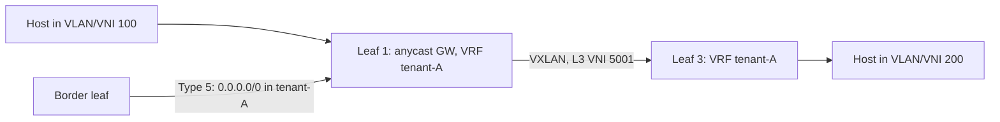

## Why this matters

The back-end compute fabric of an AI cluster is usually a pure routed Layer 3 Clos with no overlay:
each GPU NIC has its own routed link, and simplicity wins. The **front-end** network is different
(`four-networks-of-an-ai-cluster`). It carries everything else: users and APIs reaching inference
endpoints, the Kubernetes or Slurm control plane, image pulls, logging, data ingestion and often part
of the storage traffic. It must support many tenants, VLAN-like segments that span racks, virtual
machines and containers that move, and firewalls and load balancers at the edge.

Doing that with traditional VLANs stretched across the data center brings back everything leaf-spine
was designed to remove: spanning tree, flooding and fragile Layer 2 failure domains. The modern answer
is **EVPN-VXLAN**: keep the routed eBGP underlay you learned in `bgp-in-the-data-center`, and build
virtual Layer 2 and Layer 3 networks on top of it, signalled by BGP. GPU cloud providers rely on it to
isolate tenants, and every network engineer moving into AI infrastructure will meet it on the front-end
and storage networks.

## Concepts

### Underlay and overlay

| Layer | What it is | Example |
|---|---|---|
| **Underlay** | The physical routed fabric. Knows only switch loopbacks and links. | eBGP leaf-spine, ECMP |
| **Overlay** | Virtual networks (segments, VRFs) built by tunnelling tenant frames across the underlay | VXLAN tunnels between leaves |
| **Control plane** | How overlay endpoints learn where tenant MAC and IP addresses live | BGP EVPN |

The switches (or hosts) that encapsulate and decapsulate are **VTEPs** (VXLAN Tunnel End Points),
identified by a loopback IP address advertised in the underlay. In most designs the leaves are the
VTEPs; in some GPU clouds the VTEP runs on a DPU in the server (`nics-dpus-supernics`), so the physical
fabric stays a simple underlay.

### VXLAN encapsulation

VXLAN (RFC 7348) wraps an entire Ethernet frame in UDP/IP:

```text
+------------------+-----------+----------+-------------+------------------------------+
| Outer Ethernet   | Outer IP  | UDP      | VXLAN       | Original (inner) Ethernet    |
| 14 B             | 20 B (v4) | 8 B      | 8 B         | frame, incl. inner headers   |
|                  |           | dst 4789 | 24-bit VNI  |                              |
+------------------+-----------+----------+-------------+------------------------------+
           outer headers = 50 bytes (IPv4 outer, no outer VLAN tag)
```

Key facts:

- **VNI** (VXLAN Network Identifier): 24 bits, so about 16 million segments instead of 4,094 VLANs.
- **UDP destination port 4789** (IANA-assigned).
- **UDP source port** is derived by the VTEP from a hash of the inner headers. Transit switches hash on
  the outer 5-tuple, so different inner flows get spread across ECMP paths without the spines having to
  parse inner headers (`ecmp-hashing`).
- **Overhead:** 50 bytes with an IPv4 outer header (70 with IPv6 outer, 4 more with an outer VLAN tag).
  If tenants use 1,500-byte (or 9,000-byte) MTUs, the underlay MTU must be larger by at least the
  overhead. Fabrics usually run the underlay at around 9,216 bytes and tenants at 9,000 or less
  (`mtu-jumbo-frames`).

> [!ANALOGY]
> VXLAN is to Ethernet what a GRE or MPLS pseudowire is to a leased line: the tenant's frame rides
> inside a tunnel across a routed core, and the core never looks inside. EVPN is to VXLAN what a VPN
> control plane is to tunnels in a service-provider network: BGP distributes "which customer address is
> behind which PE". Where the analogy breaks: in EVPN every leaf is a PE, there may be hundreds of them,
> and they learn tenant MACs and IPs from BGP instead of by flooding.

### Why EVPN instead of flood-and-learn

Plain VXLAN can work like a stretched switch: unknown destinations and broadcasts are flooded to all
VTEPs of the segment (via multicast or a configured list), and VTEPs learn remote MACs from the source
of decapsulated frames. That brings back flooding and slow, data-plane-driven learning.

**EVPN** (RFC 7432, adapted to VXLAN by RFC 8365) replaces it with a BGP control plane: when a leaf
learns a local MAC (and IP, from ARP or DHCP snooping), it advertises a BGP route saying "MAC M, IP I,
in VNI V, reachable via VTEP 10.0.0.11". Every other leaf with that VNI installs it. Flooding becomes the
exception rather than the mechanism.

### The EVPN route types

EVPN uses the BGP address family **L2VPN EVPN** (AFI 25, SAFI 70). The route types you will see most:

| Type | Name | What it carries | Used for |
|---|---|---|---|
| 1 | Ethernet Auto-Discovery (EAD) | Ethernet segment reachability, per ES and per EVI | Multihoming: fast withdraw, aliasing |
| 2 | MAC/IP Advertisement | A MAC address, optionally its IP, VNI(s), VTEP next hop | Host reachability, ARP suppression |
| 3 | Inclusive Multicast Ethernet Tag (IMET) | "I am a VTEP for VNI V" | Building the flood list for BUM traffic (ingress replication) |
| 4 | Ethernet Segment | Which VTEPs attach to a multihomed segment | Designated forwarder (DF) election |
| 5 | IP Prefix (RFC 9136) | An IP prefix in a tenant VRF | Routing subnets and external routes in the overlay |

Each route also carries a **Route Distinguisher** (RD, making the route unique) and **Route Targets**
(RTs, extended communities deciding which VNIs or VRFs import it), as in other BGP VPNs. Many NOSes can
derive RDs and RTs automatically from the ASN and VNI.

## How it works

### Bridging across the fabric (Layer 2 VNI)

Host H1 (MAC aa:01, IP 10.1.100.21) is on leaf 1, VNI 100. Host H2 is on leaf 3, same VNI.

1. Leaf 1 learns aa:01 on its server port (and the IP via ARP snooping).
2. Leaf 1 advertises a **type 2** route: aa:01 / 10.1.100.21, VNI 100, next hop = leaf 1's VTEP loopback.
3. The route travels through the spines (plain eBGP speakers for EVPN; they need no VNIs, but must pass
   EVPN routes with the next hop unchanged, which data center NOSes handle by default or with a simple
   setting, check your documentation).
4. Leaf 3 imports it (matching RT) and programs: "aa:01 in VNI 100 → VXLAN tunnel to leaf 1".
5. H2 sends a frame to aa:01; leaf 3 encapsulates it with VNI 100 to leaf 1; the underlay routes it with
   ECMP; leaf 1 decapsulates and delivers.

**BUM traffic** (broadcast, unknown unicast, multicast) still needs a flood list. Each VTEP advertises a
**type 3** route per VNI, and every leaf builds a list of remote VTEPs for that VNI. A broadcast is then
copied by the ingress leaf to each of them (**ingress replication**), or sent into underlay multicast in
designs that use it.

**ARP suppression:** because type 2 routes carry IP-to-MAC bindings, a leaf can answer ARP requests for
remote hosts locally instead of flooding them across the fabric. Most of the broadcast traffic of a
large L2 segment disappears.

### Routing in the overlay: anycast gateway and IRB

Tenants also need routing between their subnets. EVPN fabrics use a **distributed anycast gateway**: every
leaf that has VNI 100 hosts the same gateway IP and MAC for subnet 10.1.100.0/24. A host's first hop is
always its own leaf, wherever it is, and VMs keep the same gateway when they move.

**Integrated Routing and Bridging** (IRB, RFC 9135) defines how leaves route between VNIs:

| Model | How it works | Trade-off |
|---|---|---|
| **Asymmetric IRB** | The ingress leaf routes into the destination VNI and bridges across the fabric | Every leaf must have every VNI and learn all MACs of all subnets |
| **Symmetric IRB** | Ingress leaf routes into a per-tenant **L3 VNI** (one per VRF); egress leaf routes from it into the destination subnet | Leaves only need the VNIs they serve locally; scales better |

Symmetric IRB with an L3 VNI per tenant VRF is the common choice in large fabrics. Type 2 routes then
carry both the L2 VNI and the L3 VNI, and **type 5** routes carry subnets and external prefixes (for
example a default route from the border leaves) into the tenant VRF.



### Multihoming without MLAG

Servers on the front-end are usually dual-homed to two leaves for redundancy. The traditional way is
MLAG: two leaves pretend to be one switch, with a peer link and a proprietary sync protocol. EVPN
provides a standards-based alternative, **EVPN multihoming** (sometimes called ESI-LAG):

- The server bonds two links (LACP) to two leaves. Both leaves configure the same **Ethernet Segment
  Identifier (ESI)** on those ports.
- **Type 4** routes let the leaves discover each other on that segment and elect a **designated forwarder**
  for BUM traffic, so the server does not receive floods twice.
- **Type 1** routes let remote leaves load-balance to both leaves for MACs learned on the segment
  (**aliasing**), and withdraw a whole segment at once if one leaf loses its link (**mass withdraw**),
  which is far faster than withdrawing MACs one by one.

No peer link, no leaf-to-leaf cabling, and the fabric keeps its pure Clos shape (`clos-leaf-spine`).

### MAC mobility

When a VM or container moves to another leaf, the new leaf advertises the same MAC with a higher
**sequence number** in the MAC Mobility extended community. Other leaves prefer the higher sequence and
the old leaf withdraws its route. Implementations also detect a MAC flapping between leaves too often
(a loop or a duplicate address) and can freeze it; the thresholds are configurable.

### EVPN-VXLAN in AI clusters

| Where | Role |
|---|---|
| Front-end | Tenant VRFs for inference endpoints, management of customer workloads, Kubernetes pod networks, border connectivity to the internet or WAN |
| Storage | Sometimes VRF-separated per tenant, sometimes a plain routed network for performance |
| Back-end compute | Usually not used: a routed L3 Clos is simpler and keeps RoCE behaviour predictable. Some multi-tenant GPU clouds do apply VXLAN-based isolation on the back-end, in switches or DPUs; see `multi-tenancy-isolation` |

If RoCE traffic is ever carried over VXLAN, check that the VTEPs copy DSCP and ECN between inner and
outer headers as your QoS design requires; lossless behaviour depends on it (`qos-trust-and-mapping`).

## In practice

The examples use FRRouting with the Linux kernel's VXLAN and bridge devices, as found in SONiC, Cumulus
Linux and containerlab labs. Other NOSes have equivalents. Output is **illustrative**.

### Linux data plane for one VNI (lab style)

```bash
ip link add br100 type bridge
ip link add vxlan100 type vxlan id 100 dstport 4789 local 10.0.0.11 nolearning
ip link set vxlan100 master br100
ip link set swp1 master br100          # server-facing port
ip link set br100 up; ip link set vxlan100 up
```

`nolearning` disables data-plane MAC learning on the VXLAN device: remote MACs come from EVPN, installed
by FRR. Check the device with `ip -d link show vxlan100`.

### FRR: enable EVPN on a leaf

```text
router bgp 65101
 neighbor FABRIC peer-group
 neighbor FABRIC remote-as external
 neighbor swp51 interface peer-group FABRIC
 neighbor swp52 interface peer-group FABRIC
 address-family ipv4 unicast
  network 10.0.0.11/32
 exit-address-family
 address-family l2vpn evpn
  neighbor FABRIC activate
  advertise-all-vni
 exit-address-family
```

- The IPv4 address family advertises the VTEP loopback (10.0.0.11) in the underlay.
- `address-family l2vpn evpn` with `neighbor FABRIC activate` exchanges EVPN routes over the same eBGP
  sessions.
- `advertise-all-vni` makes the leaf advertise every VNI configured locally (type 3 routes) and its
  local MACs (type 2).

Spines activate the EVPN address family toward the leaves but have no VNIs and no `advertise-all-vni`.

### Verify

```text
leaf01# show evpn vni
VNI      Type VxLAN IF         # MACs   # ARPs   # Remote VTEPs  Tenant VRF
100      L2   vxlan100         12       10       3               tenant-a
5001     L3   vxlan5001        0        0        n/a             tenant-a
```

```text
leaf01# show bgp l2vpn evpn route type macip
   Network          Next Hop            Path
*> [2]:[0]:[48]:[aa:bb:cc:00:01:21]:[32]:[10.1.100.21]
                    10.0.0.11                          i
*> [2]:[0]:[48]:[aa:bb:cc:00:03:42]:[32]:[10.1.100.42]
                    10.0.0.13             65000 65103 i
```

The second route is a remote host behind leaf 3's VTEP (10.0.0.13), learned via the spines (AS 65000).
Then check that the data plane agrees:

```bash
bridge fdb show dev vxlan100
```

```text
aa:bb:cc:00:03:42 dst 10.0.0.13 self extern_learn
00:00:00:00:00:00 dst 10.0.0.12 self permanent
00:00:00:00:00:00 dst 10.0.0.13 self permanent
```

Remote MACs point to their VTEP (`extern_learn` means installed by the control plane), and the all-zero
entries are the ingress replication flood list built from type 3 routes. A MAC present in BGP but not in
the FDB, or a missing remote VTEP in the flood list, narrows the problem to route import or programming.

> [!INTERVIEW]
> **"Explain how a host on leaf 1 reaches a host in a different subnet on leaf 3 in a symmetric-IRB
> EVPN-VXLAN fabric."** A strong answer: the host sends to its anycast gateway on leaf 1; leaf 1 looks up
> the destination in the tenant VRF, finding a type 2 (host) or type 5 (prefix) route with leaf 3's VTEP
> as next hop and the tenant's L3 VNI; it encapsulates with the L3 VNI, using a router MAC learned from
> EVPN as the inner destination MAC; the underlay routes it with ECMP; leaf 3 decapsulates, routes in the
> VRF into the destination subnet and bridges to the host. Bonus points: 50 bytes of overhead and MTU,
> ARP suppression, and why the back-end usually stays a plain L3 fabric.

## Common pitfalls

- **Underlay MTU too small.** Symptom: small pings work, large transfers hang or are slow. Cause: VXLAN
  adds 50 bytes; the underlay drops (or cannot fragment) full-size tenant frames. Fix: raise the underlay
  MTU (for example to around 9,216) and keep tenant MTUs at least 50 bytes lower.
- **Route target mismatch.** Symptom: VNIs are up but no remote MACs or VTEPs appear. Cause: RTs differ
  between leaves (manual configuration or different auto-derivation rules). Fix: compare RTs in `show bgp
  l2vpn evpn` output and align them.
- **VTEP loopback not in the underlay.** Symptom: EVPN routes received but traffic blackholed. Cause: the
  next-hop VTEP address is not routed in the underlay. Fix: advertise all VTEP loopbacks in the IPv4
  address family and check reachability between loopbacks.
- **Spines rewriting the next hop.** Symptom: traffic tunnels to a spine instead of the remote leaf. Cause:
  EVPN next hop changed by an intermediate eBGP speaker. Fix: ensure spines pass EVPN routes with the next
  hop unchanged per your NOS documentation.
- **Asymmetric IRB at scale.** Symptom: leaf MAC and ARP tables overflow. Cause: every leaf must carry
  every VNI and every MAC. Fix: symmetric IRB with L3 VNIs.
- **MAC flapping.** Symptom: a host loses connectivity intermittently; logs show duplicate MAC detection.
  Cause: a loop on a server-facing port, or a misconfigured multihomed bond. Fix: check ESI configuration
  and LACP, and look for loops on access ports.

## Key takeaways

- EVPN-VXLAN builds virtual L2 and L3 networks (overlay) on top of the routed eBGP fabric (underlay); it is
  the standard for multi-tenant front-end networks.
- VXLAN carries a 24-bit VNI over UDP 4789 and adds 50 bytes (IPv4 outer), so the underlay MTU must be
  larger than tenant MTUs; its UDP source port gives ECMP entropy.
- EVPN distributes MACs and IPs in BGP: type 2 (MAC/IP), type 3 (flood lists), type 5 (prefixes), and types
  1 and 4 for multihoming.
- Distributed anycast gateways, ARP suppression and symmetric IRB with per-tenant L3 VNIs make the overlay
  scale.
- EVPN multihoming (ESI) replaces MLAG and keeps the fabric a pure Clos.
- The AI back-end usually stays a plain routed fabric; EVPN-VXLAN lives on the front-end and, in some
  multi-tenant clouds, provides isolation elsewhere.
