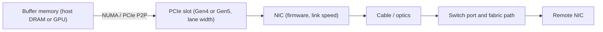

## Why this matters

Before an AI cluster is handed to users, every NIC, cable and switch port must be proven to deliver close to line rate. When a training job later runs slowly, the first question is "is the network itself healthy between these hosts?" perftest is the standard answer to both: a suite of small, focused RDMA benchmarks that measure raw verbs performance without NCCL, GPUs or frameworks in the way.

A perftest number is only useful if you know what it should be and which variable you changed. An engineer who runs `ib_write_bw` with defaults, sees "MB/sec" and a number below line rate, and declares the fabric broken — when actually the test used the wrong GID, the wrong NUMA node or a tiny message size — wastes days. This lesson teaches you to run perftest deliberately and read it critically.

## Concepts

### The tools

perftest is distributed separately from rdma-core (package usually named `perftest`). Each tool tests one operation, in bandwidth or latency mode:

| Tool | Measures | Notes |
|---|---|---|
| `ib_write_bw` / `ib_write_lat` | RDMA Write | The closest match to how NCCL moves bulk data |
| `ib_read_bw` / `ib_read_lat` | RDMA Read | Sensitive to outstanding-read limits and round-trip time |
| `ib_send_bw` / `ib_send_lat` | Send/Receive | Exercises receive posting; supports UD |
| `ib_atomic_bw` / `ib_atomic_lat` | Atomics | Message rate of 8-byte atomics |
| `raw_ethernet_bw` and friends | Raw Ethernet packets via verbs | Ethernet-only, for packet-rate tests |

Despite the `ib_` prefix, all of them work over RoCE as well as InfiniBand.

### Client/server model

Every test has a **server** (started without a peer address) and a **client** (given the server's host name or IP). Before RDMA starts, the two exchange QP numbers, PSNs, addresses and rkeys over a TCP socket (default TCP port 18515, changeable with `-p`). With `-R` they use the RDMA connection manager instead, which also resolves the GID from the IP address. Both sides must use compatible options (same test, same size, same number of QPs).

### The flags you will use most

| Flag | Meaning |
|---|---|
| `-d <dev>` | RDMA device, for example `mlx5_0` |
| `-i <port>` | Port number on the device (default 1) |
| `-x <index>` | GID index (needed on RoCE unless `-R` is used; picks RoCE version, IP and VLAN) |
| `-s <bytes>` | Message size |
| `-a` | Sweep all message sizes from 2 bytes to 8 MiB (powers of two) |
| `-n <iters>` | Number of iterations per size |
| `-D <seconds>` | Run for a duration instead of an iteration count |
| `-q <num>` | Number of QPs (spreads traffic over more connections, and on RoCE over more ECMP hashes) |
| `-b` | Bidirectional bandwidth test |
| `-c <type>` | Connection (transport) type such as `RC`, `UC`, `UD`, where the operation supports it |
| `-m <mtu>` | Path MTU to use (256-4096) |
| `--report_gbits` | Report bandwidth in Gb/s instead of the default MiB/s (labelled `MB/sec` in older releases) |
| `-F` | Suppress the CPU-frequency-scaling check (current perftest only prints a "Conflicting CPU frequency values" warning without it; some older releases refused to produce a report) |
| `-R` | Connect using rdma_cm |
| `-p <port>` | TCP port for the out-of-band exchange (run several tests in parallel) |
| `--use_cuda=<gpu>` | Use GPU memory for buffers, in builds compiled with CUDA support (check `--help` on your build; newer versions add further GPU options) |

Always check `ib_write_bw --help` on your installed version: options evolve between perftest releases.

> [!ANALOGY]
> perftest is to an RDMA fabric what `iperf3` and an RFC 2544 tester are to an IP network: a synthetic, controlled load that tells you what the plumbing can do. Like RFC 2544, it says nothing about the application's real traffic pattern — a fabric that passes perftest pair by pair can still struggle under an all-to-all collective with incast. Use NCCL tests (`nccl-tests-interpretation`) for that.

## How it works

### What a bandwidth test does

In `ib_write_bw` the client keeps up to `-t` (TX depth, default on the order of 128) RDMA Writes in flight on each QP, refilling the send queue as completions arrive, and the server simply waits. Bandwidth is the bytes moved divided by time measured with the CPU cycle counter. A latency test (`ib_write_lat`) instead does a ping-pong: one message in flight, each side waits for the other's write to land before replying.

### Reading bandwidth output

```text
$ ib_write_bw -d mlx5_0 -s 65536 -D 10 --report_gbits 10.0.0.12
---------------------------------------------------------------------------------------
                    RDMA_Write BW Test
 Dual-port       : OFF          Device         : mlx5_0
 Number of qps   : 1            Transport type : IB
 Connection type : RC           Using SRQ      : OFF
 TX depth        : 128
 Mtu             : 4096[B]
 Link type       : IB
 Max inline data : 0[B]
 rdma_cm QPs     : OFF
 Data ex. method : Ethernet
---------------------------------------------------------------------------------------
 local address: LID 0x0c QPN 0x0123 PSN 0x4a5b6c RKey 0x1fff00 VAddr 0x007f5a2c000000
 remote address: LID 0x0d QPN 0x0456 PSN 0x1c2d3e RKey 0x2fff00 VAddr 0x007f9b10000000
---------------------------------------------------------------------------------------
 #bytes     #iterations    BW peak[Gb/sec]    BW average[Gb/sec]   MsgRate[Mpps]
 65536      7473000          392.10             391.85              0.747
---------------------------------------------------------------------------------------
```

*(Illustrative output for a 400 Gb/s NDR link; exact layout varies by perftest version.)*

- **Header block**: verify device, transport, connection type, MTU and link type match what you intended. `Data ex. method : Ethernet` means the out-of-band exchange used TCP; with `-R` it says rdma_cm.
- **Address lines**: on InfiniBand you see LIDs; on RoCE you see the GID being used — the fastest way to confirm you picked the right GID index.
- **BW average** is the number to report. **BW peak** is the best interval and is less meaningful.
- **MsgRate** is messages per second in millions: here 391.85 Gb/s ÷ (65,536 B × 8) ≈ 0.75 million messages per second. At small message sizes the message rate, not the bandwidth, is the limit.

### What "line rate" really is

You will never see the nominal link rate as `BW average`, because headers and link-level overheads consume part of it:

- **Encoding and FEC** are already excluded from the nominal data rate of modern links (for example NDR 4x is 400 Gb/s of data), but per-packet headers are not.
- **Per-packet headers** on InfiniBand are LRH (8) + BTH (12) + ICRC (4) + VCRC (2), plus RETH on first packets, so a 4,096-byte payload carries well under 1 % header overhead (link-level framing and flow-control packets add a little more). On RoCEv2 each packet carries Ethernet, IP, UDP and BTH headers, the FCS, and the Ethernet preamble and inter-frame gap, so overhead is a few percent at a 4,096-byte RDMA MTU. The `rocev2-packet` widget in `rocev2-encapsulation` lets you compute it.
- **Flow-control and management traffic** take a small share.

So for large messages, results in the mid-90s of percent of the nominal rate are typical on a healthy link; treat any specific percentage as adapter- and firmware-dependent. Well below that — say 50 % or 75 % — means something is wrong.

### The bandwidth curve

Running with `-a` produces bandwidth for every message size. A healthy curve rises steeply and then flattens:

| Message size | Typical behaviour |
|---|---|
| Tens of bytes to a few KiB | Limited by message rate (millions of messages/s); bandwidth far below line rate |
| Tens of KiB | Approaches line rate |
| 64 KiB and above | Flat at near line rate |

If the curve never flattens, or flattens well below line rate, suspect the host (PCIe, NUMA, power-saving states) or the path (lower negotiated link speed, errors, congestion).

Try it in the explorer below: change the message-rate ceiling and the MTU to see where the curve reaches half its ceiling, then paste a `BW average` from your own run into the converter to turn MiB/s into Gb/s and a percentage of line rate.

```widget
perftest-explorer
```

### Reading latency output

```text
$ ib_write_lat -d mlx5_0 -s 8 -n 100000 -F 10.0.0.12
 #bytes #iterations  t_min[usec]  t_max[usec]  t_typical[usec]  t_avg[usec]  t_stdev[usec]  99% percentile[usec]  99.9% percentile[usec]
 8      100000       0.98         6.10         1.02             1.03         0.05           1.10                  2.40
```

*(Illustrative; small-message latency on modern adapters through one switch is commonly around 1-2 µs, but depends on adapter, switch hops, CPU and settings.)* For write and send latency tests perftest reports half of the measured round trip; `ib_read_lat` reports the full time for the read to return, so read latency looks roughly double. Look at **t_typical** and the **99 %/99.9 % percentiles**: a large gap between typical and 99.9 % points at jitter from CPU power states, interrupts or a congested path.

### Where the bottleneck can be



Each stage has its own ceiling. PCIe is a frequent one: a PCIe Gen4 x16 slot has 256 Gb/s of raw signalling per direction and somewhat less after protocol overhead, which is enough for 200 Gb/s but not for 400 Gb/s; 400 Gb/s adapters need PCIe Gen5 x16 or an equivalent multi-slot arrangement. Check `lspci -vv` for the negotiated link speed and width ("LnkSta") when bandwidth caps at an odd value.

## In practice

### A basic pair test on InfiniBand

```text
server$ ib_write_bw -d mlx5_0 -D 10 --report_gbits
client$ ib_write_bw -d mlx5_0 -D 10 --report_gbits server-hostname
```

### The same on RoCE

```text
server$ ib_write_bw -d mlx5_0 -x 3 -q 4 -D 10 --report_gbits
client$ ib_write_bw -d mlx5_0 -x 3 -q 4 -D 10 --report_gbits 10.0.0.12
```

`-x 3` selects the RoCEv2 GID in our example table (confirm yours with `show_gids` or sysfs, see `rdma-on-linux`). `-q 4` uses four QPs; on RoCE each QP typically gets a different UDP source port, giving the fabric more ECMP entropy. Alternatively, `-R` lets rdma_cm choose the GID from the IP address.

### Pin to the right NUMA node

The process and its buffers should live on the CPU socket closest to the NIC:

```text
$ cat /sys/class/infiniband/mlx5_0/device/numa_node
1
$ numactl --cpunodebind=1 --membind=1 ib_write_bw -d mlx5_0 -D 10 --report_gbits 10.0.0.12
```

### Testing GPU memory (GPUDirect RDMA)

If perftest was built with CUDA support, `--use_cuda=<gpu index>` places buffers in GPU memory, which tests the GPU-NIC PCIe path that NCCL will use:

```text
client$ ib_write_bw -d mlx5_0 --use_cuda=0 -D 10 --report_gbits 10.0.0.12
```

Pick a GPU that shares a PCIe switch with the NIC (`nvidia-smi topo -m`, see `reading-server-topology`). A large gap between host-memory and GPU-memory results points at topology or at GPUDirect RDMA not being active.

### A validation plan

| Step | Test | Catches |
|---|---|---|
| 1 | Per-NIC pair test, same rail, large messages, unidirectional | Bad cables, wrong link speed, PCIe issues |
| 2 | Same with `-b` (bidirectional) | Asymmetric problems, PCIe or memory bandwidth limits |
| 3 | `-a` sweep | Message-rate or MTU problems at specific sizes |
| 4 | `ib_write_lat` / `ib_read_lat` with percentiles | Jitter, power management, extra hops |
| 5 | GPU memory with `--use_cuda` | GPUDirect RDMA and GPU-NIC topology |
| 6 | Many pairs at once across the fabric | Oversubscription, ECMP collisions, congestion (then move to NCCL tests) |

Record results per NIC and per pair in a table and compare against peers. Outliers are more informative than averages: the slow pair is where your faulty cable or misconfigured host lives.

> [!TIP]
> Run several tests in parallel between different NIC pairs by giving each a different `-p` port. This is how burn-in scripts exercise all eight rails of a server at once.

> [!INTERVIEW]
> *"ib_write_bw between two 400G hosts shows 190 Gb/s. How do you narrow it down?"* Strong answer: check that the link negotiated 400G on both ends (`ibstat` or `ethtool`), that the PCIe link is Gen5 x16 (`lspci -vv`), that the process is pinned to the NIC's NUMA node, that you used a large message size and `--report_gbits`, and on RoCE that the GID index is RoCEv2; then try `-q` with more QPs and a different peer to see whether the problem follows the host or the path. Roughly half of line rate often means half the PCIe bandwidth or half the lanes.

## Common pitfalls

- **Misreading units.** Symptom: "only 46,000 — something is badly wrong". Cause: default output is in 2^20-byte units (labelled `MB/sec` in older perftest releases and `MiB/sec` in current ones), so 46,000 is about 386 Gb/s. Fix: use `--report_gbits`.
- **Wrong or missing GID index on RoCE.** Symptom: the client hangs or the test fails with a completion error. Cause: default GID index is not RoCEv2 with the fabric IP. Fix: pass `-x` with the right index or use `-R`.
- **CPU frequency warnings.** Symptom: perftest prints "Conflicting CPU frequency values detected" (older releases could also abort without a report). Cause: frequency scaling makes the cycle-counter conversion unreliable. Fix: use `-F` to suppress the check (and consider setting a performance governor for repeatable latency).
- **Testing the wrong path.** Symptom: excellent results that do not match production. Cause: both NICs on the same leaf switch, or the test used the management network's IP for the out-of-band exchange and an unexpected device. Fix: name the device with `-d`, check address lines, and test across the spine as well.
- **Small messages or short runs.** Symptom: low and noisy bandwidth. Cause: message-rate limited sizes or too few iterations. Fix: use 64 KiB or larger and `-D 10` or more for bandwidth checks.
- **TCP exchange blocked.** Symptom: the client reports that it could not connect to the server. Cause: host firewall or wrong IP for the exchange port. Fix: open the perftest TCP port or choose another with `-p`.
- **Judging a fabric only by pair tests.** Symptom: perftest perfect, NCCL slow. Cause: collectives create many simultaneous flows, incast and ECMP collisions. Fix: graduate to multi-pair tests and nccl-tests.

## Key takeaways

- perftest tools measure one verbs operation each; `ib_write_bw` is the closest proxy for NCCL's bulk traffic.
- The essential flags are `-d` (device), `-x` (GID index on RoCE), `-s`/`-a` (sizes), `-q` (QPs), `-D` (duration), `-b` (bidirectional), `--report_gbits`, `-F` and `-R`.
- Report `BW average` for large messages; healthy links typically land in the mid-90s of percent of nominal rate because headers cost a few percent.
- Latency tests report percentiles; write/send latency is half the round trip, read latency is the full round trip.
- PCIe width/generation, NUMA placement and GPU-NIC topology are as likely to limit results as the network.
- Pair tests validate links and hosts; collective performance needs multi-pair and NCCL tests.
