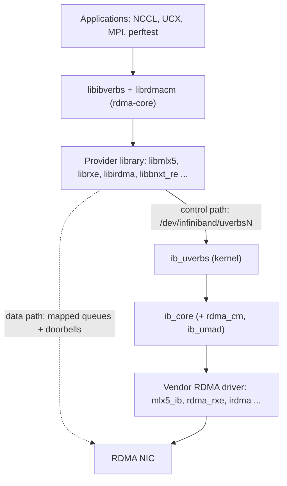

## Why this matters

Most RDMA incidents in an AI cluster are diagnosed on the Linux host before anyone looks at a switch. "Is the port up? Is it InfiniBand or Ethernet? What MTU did it negotiate? Which GID index is RoCEv2? Does the container even see the device? Are the retransmission counters climbing?" Every one of those questions has a precise answer in the Linux RDMA stack, and the engineer who can get those answers in a minute is the one who resolves the incident.

The stack has several layers — a vendor driver, the kernel RDMA core, a user-space library and per-vendor provider plugins — and a failure in any of them looks the same to the application: "no RDMA devices found" or a QP that never connects. This lesson gives you a map of the stack and the commands to interrogate each layer.

## Concepts

### The layers



| Layer | Examples | Role |
|---|---|---|
| Vendor NIC driver | `mlx5_core` (Ethernet/PCI for ConnectX), `mlx5_ib` (its RDMA part) | Owns the hardware; registers an RDMA device with the core |
| Kernel RDMA core | `ib_core`, `ib_uverbs`, `rdma_cm`, `rdma_ucm`, `ib_umad` | Device model, user-space access, connection manager, management datagrams |
| Software RDMA | `rdma_rxe` (Soft-RoCE), `siw` (Soft-iWARP) | RDMA implemented in the kernel on top of an ordinary netdev |
| User-space core | `libibverbs`, `librdmacm` | The `ibv_*` and `rdma_*` APIs |
| Provider | `libmlx5`, `librxe`, ... (loaded as plugins) | Vendor-specific fast path: builds WQEs, rings doorbells |
| Tools | `ibv_devinfo`, `rdma`, `infiniband-diags`, `perftest` | Inspection and testing |

Device files under `/dev/infiniband/` are the doors into the kernel: `uverbsN` for verbs, `rdma_cm` for the connection manager, and `umadN` for management datagrams (used by InfiniBand diagnostic tools and the Subnet Manager). If a container does not have these files, RDMA cannot work inside it, regardless of what the host can do.

### Inbox versus vendor stacks

Linux distributions ship rdma-core and in-kernel drivers ("inbox"). NVIDIA also distributes its own packaged stack — historically **MLNX_OFED**, now delivered as part of **DOCA-Host / DOCA-OFED** — with newer drivers, firmware tools and extra scripts. Both provide the same verbs API. The vendor stack adds helper scripts such as `ibdev2netdev` (maps `mlx5_0` to its network interface) and `show_gids` (prints the RoCE GID table), which are *not* part of upstream rdma-core. Know which stack a host runs before following a guide written for the other.

### Naming: RDMA device, port, netdev

An RDMA device (for example `mlx5_0`) has one or more ports numbered from 1. On RoCE, each port is associated with an Ethernet netdev (for example `ens1f0np0`); on InfiniBand there is no Ethernet netdev, although an IPoIB interface (`ib0`) may exist for IP traffic over the IB fabric. The `rdma link` command shows the mapping in one line.

### GIDs and why RoCE needs the right index

Every RDMA port has a **GID table** of 128-bit Global Identifiers. On InfiniBand, GID index 0 is the port's default GID (subnet prefix plus port GUID; see `ib-architecture`). On RoCE, the kernel builds the GID table from the IP addresses on the associated netdev (and its VLAN sub-interfaces): for each address it typically creates one entry for **RoCE v1** and one for **RoCE v2**. The entry used by a QP, chosen by its `sgid_index`, decides:

- which RoCE version is put on the wire (v1 Ethernet frame or v2 UDP/IP),
- which source IP address is used,
- and, for VLAN interfaces, which VLAN the traffic is tagged with.

So the "GID index" in NCCL (`NCCL_IB_GID_INDEX`), perftest (`-x`) and the rdma-core examples (`-g`) is really a choice of protocol version, source IP and VLAN at once.

> [!ANALOGY]
> A GID index is like choosing a source interface and address for a routing-protocol session (`update-source` in BGP) — pick the wrong one and the session may come up on paper but traffic follows the wrong path or never returns. The difference is that RDMA will not fall back gracefully: a wrong RoCE version or IP simply leads to retransmission timeouts.

## How it works

### Discovering devices and ports

`ibv_devices` lists RDMA devices; `ibv_devinfo` shows ports and their state:

```text
$ ibv_devinfo -d mlx5_0
hca_id: mlx5_0
        transport:                      InfiniBand (0)
        fw_ver:                         28.39.1002
        node_guid:                      b83f:d203:00a1:b2c4
        sys_image_guid:                 b83f:d203:00a1:b2c4
        vendor_id:                      0x02c9
        vendor_part_id:                 4129
        phys_port_cnt:                  1
                port:   1
                        state:                  PORT_ACTIVE (4)
                        max_mtu:                4096 (5)
                        active_mtu:             4096 (5)
                        sm_lid:                 0
                        port_lid:               0
                        port_lmc:               0x00
                        link_layer:             Ethernet
```

*(Illustrative; values depend on adapter and firmware.)* Line by line:

- `transport: InfiniBand (0)` refers to the *verbs transport* (the IB transport), and it appears for RoCE too. The **`link_layer`** line is what tells you InfiniBand versus Ethernet.
- `vendor_id 0x02c9` is Mellanox/NVIDIA; `vendor_part_id` identifies the adapter model (look it up in vendor docs rather than memorising).
- `state: PORT_ACTIVE` means the port is usable for RDMA. On InfiniBand, `PORT_INIT` means the physical link is up but the Subnet Manager has not configured the port yet — a classic sign of a missing or unreachable SM.
- `active_mtu` is the RDMA path MTU available (256-4096 bytes). On RoCE it is derived from the netdev MTU: a 9000-byte Ethernet MTU gives an active MTU of 4096; a 1500-byte MTU gives 1024.
- `sm_lid` and `port_lid` are meaningful only on InfiniBand; 0 is normal on Ethernet.

`ibv_devinfo -v` adds the full capability list (limits such as `max_qp`, `max_mr`, atomics support).

### The rdma tool (iproute2)

The `rdma` command is the modern, vendor-neutral inspection tool:

```text
$ rdma link show
link mlx5_0/1 state ACTIVE physical_state LINK_UP netdev ens1f0np0
link mlx5_1/1 state ACTIVE physical_state LINK_UP netdev ens1f1np1

$ rdma dev show
0: mlx5_0: node_type ca fw 28.39.1002 node_guid b83f:d203:00a1:b2c4 sys_image_guid b83f:d203:00a1:b2c4
1: mlx5_1: node_type ca fw 28.39.1002 node_guid b83f:d203:00a1:b2c5 sys_image_guid b83f:d203:00a1:b2c5

$ rdma resource show
0: mlx5_0: pd 4 cq 12 qp 9 cm_id 0 mr 6 ctx 2 srq 0
```

*(Illustrative.)* Useful sub-commands:

| Command | Shows |
|---|---|
| `rdma link show` | Each port's state, physical state and associated netdev |
| `rdma dev show` | Devices, firmware and GUIDs |
| `rdma resource show qp` (or `cq`, `mr`, `pd`, `cm_id`) | Per-process RDMA objects, QP state and type |
| `rdma statistic show link mlx5_0/1` | Per-port RDMA counters exposed by the driver |
| `rdma system show` | Whether RDMA devices are shared across network namespaces or exclusive to one |
| `rdma link add rxe0 type rxe netdev eth0` | Create a Soft-RoCE device on top of `eth0` |

The `rdma system` network-namespace mode matters for containers: in **shared** mode every namespace sees all RDMA devices; in **exclusive** mode a device is only visible in the namespace it was assigned to, which is how container network plugins isolate RDMA devices per pod.

### The GID table in practice

The NVIDIA script `show_gids` (MLNX_OFED / DOCA) prints the table:

```text
$ show_gids
DEV     PORT  INDEX  GID                                      IPv4           VER  DEV
---     ----  -----  ---                                      ------------   ---  ---
mlx5_0  1     0      fe80:0000:0000:0000:ba3f:d2ff:fea1:b2c4                 v1   ens1f0np0
mlx5_0  1     1      fe80:0000:0000:0000:ba3f:d2ff:fea1:b2c4                 v2   ens1f0np0
mlx5_0  1     2      0000:0000:0000:0000:0000:ffff:0a00:000b  10.0.0.11      v1   ens1f0np0
mlx5_0  1     3      0000:0000:0000:0000:0000:ffff:0a00:000b  10.0.0.11      v2   ens1f0np0
```

*(Illustrative.)* Indexes 0 and 1 come from the IPv6 link-local address; 2 and 3 from the IPv4 address, encoded as an IPv4-mapped IPv6 address (`::ffff:10.0.0.11`). On an IPv4 RoCEv2 fabric, the entry you want is the **v2** entry with your fabric IPv4 address — index 3 in this example, which is common but **not guaranteed**: indexes shift when addresses or VLAN interfaces are added or removed.

Without the script, read sysfs directly (this works on any distribution):

```text
$ cat /sys/class/infiniband/mlx5_0/ports/1/gids/3
0000:0000:0000:0000:0000:ffff:0a00:000b
$ cat /sys/class/infiniband/mlx5_0/ports/1/gid_attrs/types/3
RoCE v2
$ cat /sys/class/infiniband/mlx5_0/ports/1/gid_attrs/ndevs/3
ens1f0np0
```

The RDMA connection manager (librdmacm) chooses the GID itself from the IP address you connect to, using a default RoCE mode that can be inspected and changed through configfs (`/sys/kernel/config/rdma_cm/<device>/ports/<n>/default_roce_mode`, after mounting configfs and creating the device directory). Applications that use raw verbs, including NCCL, need the index explicitly or detect it themselves; recent NCCL versions try to select a RoCEv2 GID automatically, but check your version's documentation.

### Counters

Two families of counters are exposed under `/sys/class/infiniband/<dev>/ports/<n>/`:

- `counters/` — the standard InfiniBand port counters (on IB links these mirror the switch-visible PMA counters): `port_xmit_data`, `port_rcv_data` (in units of 4 bytes), `port_xmit_packets`, `symbol_error`, `link_downed`, `port_rcv_errors`, `port_xmit_discards`, `port_xmit_wait`, and others.
- `hw_counters/` — driver-specific counters. On mlx5 these include transport-level events that are gold for RoCE and IB troubleshooting:

| mlx5 hw counter | Meaning (consult your driver documentation for exact semantics) |
|---|---|
| `out_of_sequence` | Packets received with a PSN gap (something was lost or reordered) |
| `packet_seq_err` | NAKs for sequence errors received by this requester |
| `local_ack_timeout_err` | ACK timeouts on this requester's QPs |
| `rnr_nak_retry_err` | RNR NAKs received by this requester (each one triggers a retry; despite the name it is not only retry exhaustion) |
| `duplicate_request` | Duplicate packets received (retransmissions arriving) |
| `out_of_buffer` | Packets dropped because no receive WQE was available |
| `np_cnp_sent`, `rp_cnp_handled` | RoCE congestion notifications sent and handled (see `ecn-and-dcqcn`) |

`rdma statistic show link mlx5_0/1` prints the same hardware counters. Watch them as *rates* during a test, not as absolute numbers since boot.

## In practice

### Preparing a host

On a typical distribution the packages are named along these lines (names vary by distribution): `rdma-core`, `libibverbs-utils` or `ibverbs-utils` (for `ibv_devinfo`), `infiniband-diags`, `librdmacm-utils` (for `rping`) and `perftest`. Then:

```text
$ lsmod | grep -E "^(mlx5_ib|ib_uverbs|ib_core|rdma_cm)"
$ ls /dev/infiniband/
$ ulimit -l
```

Expect the RDMA modules to be loaded, `uverbs*` and `rdma_cm` device files present, and a locked-memory limit of `unlimited` (or at least large enough for all registered buffers).

### Mapping RDMA devices to interfaces and GPUs

```text
$ rdma link show | awk '{print $2, $NF}'
mlx5_0/1 ens1f0np0
mlx5_1/1 ens1f1np1
```

On NVIDIA stacks `ibdev2netdev` gives the same mapping with port state. Combine it with `nvidia-smi topo -m` (see `reading-server-topology`) to confirm that each GPU has a nearby NIC — that mapping is what NCCL uses to build rails.

### A first connection test with librdmacm

`rping` (from librdmacm-utils) uses the connection manager, so it tests IP-to-GID resolution as well as RDMA:

```text
server$ rping -s -a 10.0.0.12 -v
client$ rping -c -a 10.0.0.12 -v -C 5
ping data: rdma-ping-0: ABCDEFGHIJKLMNOPQRSTUVWXYZ...
```

*(Illustrative.)* If `rping` works but your verbs application fails, the application's GID index or address handling is the prime suspect.

### Soft-RoCE for learning

On any Linux VM without RDMA hardware:

```text
$ sudo modprobe rdma_rxe
$ sudo rdma link add rxe0 type rxe netdev eth0
$ rdma link show
link rxe0/1 state ACTIVE physical_state LINK_UP netdev eth0
$ ibv_devinfo -d rxe0 | grep -E "state|link_layer|active_mtu"
```

Soft-RoCE implements RoCEv2 in the kernel. It is perfect for learning verbs, GIDs and perftest, and it interoperates with real RoCE NICs in principle, but it consumes CPU for everything a hardware NIC offloads, so its performance numbers mean nothing for capacity planning.

### Containers

For a container to use RDMA it needs, at minimum: the `/dev/infiniband` device files for its assigned devices, rdma-core and the right provider library inside the image, a sufficient memlock limit (often granted with the `IPC_LOCK` capability and an unlimited `memlock` ulimit), and — on RoCE — a network interface in the container's namespace whose IPs populate the GID table. Kubernetes clusters typically use an RDMA device plugin or SR-IOV virtual functions to deliver these; follow your platform's documentation for the exact configuration.

> [!INTERVIEW]
> *"`ibv_devinfo` inside a training container says 'No IB devices found', but it works on the host. What do you check?"* Strong answer: whether `/dev/infiniband/uverbs*` are present in the container; whether the image has rdma-core and the vendor provider (for example libmlx5); whether the RDMA namespace mode is exclusive and the device was assigned to the pod's namespace; then memlock limits and, on RoCE, whether the pod interface has the expected IP so the GID table is populated.

## Common pitfalls

- **Reading `transport: InfiniBand` as "this is an IB port".** Symptom: confusion on a RoCE host. Cause: the transport field describes the verbs transport. Fix: read `link_layer`.
- **Hard-coding GID index 3 everywhere.** Symptom: one host in the cluster fails with retry-exceeded errors after a VLAN or IPv6 address is added. Cause: GID indexes shifted. Fix: look up the RoCEv2 entry with your fabric IP per host, or let the software select it by address.
- **Port stuck in INIT on InfiniBand.** Symptom: `state: PORT_INIT`, `rdma link` shows `INIT`, physical state `LINK_UP`. Cause: no Subnet Manager configured the port. Fix: check SM presence and reachability (see `subnet-manager-routing`).
- **Low active MTU on RoCE.** Symptom: `active_mtu: 1024` and poor large-message performance. Cause: netdev MTU left at 1500. Fix: set a jumbo MTU end to end (host and switches; see `mtu-jumbo-frames`).
- **Missing provider library.** Symptom: `ibv_devices` prints nothing although `/sys/class/infiniband/` lists devices. Cause: rdma-core installed without the matching provider, or a mismatched library version in a container. Fix: install the provider matching your driver stack.
- **Reading counters since boot.** Symptom: alarm over a large `out_of_sequence` value. Cause: counters accumulate since driver load. Fix: sample twice and compare deltas during the workload.

## Key takeaways

- The stack is vendor driver → ib_core/ib_uverbs → libibverbs + provider; the data path skips the kernel, the control path does not.
- `link_layer` (not `transport`) tells you InfiniBand versus Ethernet; `PORT_INIT` on IB means "waiting for the SM".
- On RoCE the GID index selects RoCE version, source IP and VLAN at once; verify it per host rather than assuming a fixed number.
- `rdma link|dev|resource|statistic` is the vendor-neutral toolbox; `ibdev2netdev` and `show_gids` are NVIDIA stack scripts.
- `/sys/class/infiniband/<dev>/ports/<n>/counters` and `hw_counters` hold the counters that reveal loss, timeouts and RNR.
- Containers need device files, provider libraries, memlock and (on RoCE) a populated GID table.
