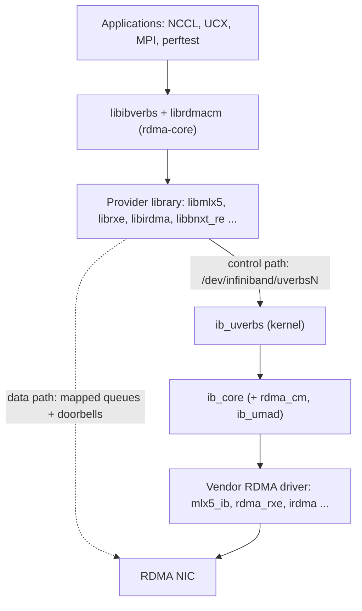

## Why this matters

Most RDMA incidents in an AI cluster are diagnosed on the Linux host before anyone looks at a switch. "Is the port up? Is it InfiniBand or Ethernet? What MTU did it negotiate? Which GID index is RoCEv2? Does the container even see the device? Are the retransmission counters climbing?" Every one of those questions has a precise answer in the Linux RDMA stack, and the engineer who can get those answers in a minute is the one who resolves the incident.

The stack has several layers — a vendor driver, the kernel RDMA core, a user-space library and per-vendor provider plugins — and a failure in any of them looks the same to the application: "no RDMA devices found" or a QP that never connects. This lesson gives you a map of the stack and the commands to interrogate each layer.

## Concepts

### The layers



| Layer | Examples | Role |
|---|---|---|
| Vendor NIC driver | `mlx5_core` (Ethernet/PCI for ConnectX), `mlx5_ib` (its RDMA part) | Owns the hardware; registers an RDMA device with the core |
| Kernel RDMA core | `ib_core`, `ib_uverbs`, `rdma_cm`, `rdma_ucm`, `ib_umad` | Device model, user-space access, connection manager, management datagrams |
| Software RDMA | `rdma_rxe` (Soft-RoCE), `siw` (Soft-iWARP) | RDMA implemented in the kernel on top of an ordinary netdev |
| User-space core | `libibverbs`, `librdmacm` | The `ibv_*` and `rdma_*` APIs |
| Provider | `libmlx5`, `librxe`, ... (loaded as plugins) | Vendor-specific fast path: builds WQEs, rings doorbells |
| Tools | `ibv_devinfo`, `rdma`, `infiniband-diags`, `perftest` | Inspection and testing |

Device files under `/dev/infiniband/` are the doors into the kernel: `uverbsN` for verbs, `rdma_cm` for the connection manager, and `umadN` for management datagrams (used by InfiniBand diagnostic tools and the Subnet Manager). If a container does not have these files, RDMA cannot work inside it, regardless of what the host can do.

Step through a send on both paths below, then switch the RDMA column to the control path: the kernel does the setup, the provider rings the NIC's doorbell for the data. Click a layer to see which tools can observe it and which cannot.

```widget
host-stack-paths
```

### Inbox versus vendor stacks

Linux distributions ship rdma-core and in-kernel drivers ("inbox"). NVIDIA also distributes its own packaged stack — historically **MLNX_OFED**, now delivered as part of **DOCA-Host / DOCA-OFED** — with newer drivers, firmware tools and extra scripts. Both provide the same verbs API. The vendor stack adds helper scripts such as `ibdev2netdev` (maps `mlx5_0` to its network interface) and `show_gids` (prints the RoCE GID table), which are *not* part of upstream rdma-core. Know which stack a host runs before following a guide written for the other.

### Naming: RDMA device, port, netdev

An RDMA device (for example `mlx5_0`) has one or more ports numbered from 1. The device name depends on the stack: NVIDIA's MLNX_OFED / DOCA-OFED names ConnectX devices `mlx5_0`, `mlx5_1`, ..., while a distribution's rdma-core udev rule names them after the PCI address, for example `rocep3s0f0` for a RoCE port at PCI `03:00.0`. Netdev names are the same on both. Never copy a device name from a guide: take it from `rdma link` or `ibv_devices`. On RoCE, each port is associated with an Ethernet netdev (for example `ens1f0np0`); on InfiniBand there is no Ethernet netdev, although an IPoIB interface (`ib0`) may exist for IP traffic over the IB fabric. The `rdma link` command shows the mapping in one line for RoCE ports; for an InfiniBand port it prints the LID, SM LID and state but no netdev, even when an IPoIB interface exists.

### GIDs and why RoCE needs the right index

Every RDMA port has a **GID table** of 128-bit Global Identifiers. On InfiniBand, GID index 0 is the port's default GID (subnet prefix plus port GUID; see `ib-architecture`). On RoCE, the kernel builds the GID table from the IP addresses on the associated netdev (and its VLAN sub-interfaces): for each address it typically creates one entry for **RoCE v1** and one for **RoCE v2**. The entry used by a QP, chosen by its `sgid_index`, decides:

- which RoCE version is put on the wire (v1 Ethernet frame or v2 UDP/IP),
- which source IP address is used,
- and, for VLAN interfaces, which VLAN the traffic is tagged with.

So the "GID index" in NCCL (`NCCL_IB_GID_INDEX`), perftest (`-x`) and the rdma-core examples (`-g`) is really a choice of protocol version, source IP and VLAN at once.

> [!ANALOGY]
> A GID index is like choosing a source interface and address for a routing-protocol session (`update-source` in BGP) — pick the wrong one and the session may come up on paper but traffic follows the wrong path or never returns. The difference is that RDMA will not fall back gracefully: a wrong RoCE version or IP simply leads to retransmission timeouts.

## How it works

### Discovering devices and ports

`ibv_devices` lists RDMA devices; `ibv_devinfo` shows ports and their state. Here is the same dual-port ConnectX-5 (RoCE, 100GbE) under both driver stacks; only the device names differ:

```text stack=inbox real
$ ibv_devices
    device          	   node GUID
    ------          	----------------
    rocep3s0f0      	248a0703000011ee
    rocep3s0f1      	248a0703000011ef
$ ibv_devinfo -d rocep3s0f0
hca_id:	rocep3s0f0
	transport:			InfiniBand (0)
	fw_ver:				16.29.1016
	node_guid:			248a:0703:0000:11ee
	sys_image_guid:			248a:0703:0000:11ee
	vendor_id:			0x02c9
	vendor_part_id:			4119
	hw_ver:				0x0
	board_id:			MT_0000000008
	phys_port_cnt:			1
		port:	1
			state:			PORT_ACTIVE (4)
			max_mtu:		4096 (5)
			active_mtu:		4096 (5)
			sm_lid:			0
			port_lid:		0
			port_lmc:		0x00
			link_layer:		Ethernet
```

```text stack=doca real
$ ibv_devices
libibverbs: Warning: couldn't load driver 'libionic-rdmav59.so': libionic-rdmav59.so: cannot open shared object file: No such file or directory
    device          	   node GUID
    ------          	----------------
    mlx5_0          	248a0703000011ee
    mlx5_1          	248a0703000011ef
$ ibv_devinfo -d mlx5_0
libibverbs: Warning: couldn't load driver 'libionic-rdmav59.so': libionic-rdmav59.so: cannot open shared object file: No such file or directory
hca_id:	mlx5_0
	transport:			InfiniBand (0)
	fw_ver:				16.29.1016
	node_guid:			248a:0703:0000:11ee
	sys_image_guid:			248a:0703:0000:11ee
	vendor_id:			0x02c9
	vendor_part_id:			4119
	hw_ver:				0x0
	board_id:			MT_0000000008
	phys_port_cnt:			1
		port:	1
			state:			PORT_ACTIVE (4)
			max_mtu:		4096 (5)
			active_mtu:		4096 (5)
			sm_lid:			0
			port_lid:		0
			port_lmc:		0x00
			link_layer:		Ethernet
```

With DOCA-OFED every libibverbs program prints a `libibverbs: Warning: couldn't load driver 'libionic-rdmav59.so'` line first: DOCA's provider configuration in `/etc/libibverbs.d/` lists `ionic.driver` (another vendor's NIC) whose library is not installed. It is harmless noise. Line by line:

- `transport: InfiniBand (0)` refers to the *verbs transport* (the IB transport), and it appears for RoCE too. The **`link_layer`** line is what tells you InfiniBand versus Ethernet.
- `vendor_id 0x02c9` is Mellanox/NVIDIA; `vendor_part_id` identifies the adapter model (look it up in vendor docs rather than memorising; 4119 is a ConnectX-5, for example). `board_id` is the board's PSID, which firmware tools also report.
- `state: PORT_ACTIVE` means the port is usable for RDMA. On InfiniBand, `PORT_INIT` means the physical link is up but the Subnet Manager has not configured the port yet — a classic sign of a missing or unreachable SM.
- `active_mtu` is the RDMA path MTU available (256-4096 bytes). On RoCE it is derived from the netdev MTU: a 9000-byte Ethernet MTU gives an active MTU of 4096; a 1500-byte MTU gives 1024.
- `sm_lid` and `port_lid` are meaningful only on InfiniBand; 0 is normal on Ethernet.

`ibv_devinfo -v` adds the full capability list (limits such as `max_qp`, `max_mr`, atomics support) and, in recent rdma-core versions, the GID table with types. Asking for a device that does not exist prints `IB device 'mlx5_0' wasn't found`: the usual cause is a name copied from a guide written for the other stack.

The infiniband-diags tools `ibstat` and `ibstatus` report the same port attributes and work on RoCE ports too (`CA type: MT4119`, `Rate: 100`, `Base lid: 0`, `Link layer: Ethernet` in `ibstat`). Read their rate line with care:

```text stack=inbox real
$ ibstatus
Infiniband device 'rocep3s0f0' port 1 status:
	default gid:	 fe80:0000:0000:0000:268a:07ff:fe00:11ee
	base lid:	 0x0
	sm lid:		 0x0
	state:		 4: ACTIVE
	phys state:	 5: LinkUp
	rate:		 100 Gb/sec (4X EDR)
	link_layer:	 Ethernet
...
```

```text stack=doca real
$ ibstatus
Infiniband device 'mlx5_0' port 1 status:
	default gid:	 fe80:0000:0000:0000:268a:07ff:fe00:11ee
	base lid:	 0x0
	sm lid:		 0x0
	state:		 4: ACTIVE
	phys state:	 5: LinkUp
	rate:		 100 Gb/sec (4X EDR)
	link_layer:	 Ethernet
...
```

> [!VERIFIED]
> **`ibstatus` prints `4X EDR` in the rate line even on an Ethernet (RoCE) port.** On ConnectX-5 with firmware 16.29, both stacks showed `rate: 100 Gb/sec (4X EDR)` next to `link_layer: Ethernet`; the sysfs file `/sys/class/infiniband/<dev>/ports/1/rate` holds the same string. The InfiniBand speed name is only a label for the lane rate; the `link_layer` line decides whether the port is RoCE or InfiniBand, and `ethtool` shows the Ethernet speed.

### The rdma tool (iproute2)

The `rdma` command is the modern, vendor-neutral inspection tool:

```text stack=inbox real
$ rdma link show
link rocep3s0f0/1 state ACTIVE physical_state LINK_UP netdev ens64f0np0 
link rocep3s0f1/1 state ACTIVE physical_state LINK_UP netdev ens64f1np1 

$ rdma dev show
0: rocep3s0f0: node_type ca protocol roce fw 16.29.1016 node_guid 248a:0703:0000:11ee sys_image_guid 248a:0703:0000:11ee 
1: rocep3s0f1: node_type ca protocol roce fw 16.29.1016 node_guid 248a:0703:0000:11ef sys_image_guid 248a:0703:0000:11ee 

$ rdma resource show
0: rocep3s0f0: pd 3 cq 4 qp 1 cm_id 0 mr 0 ctx 0 srq 2 
1: rocep3s0f1: pd 3 cq 3 qp 1 cm_id 0 mr 0 ctx 0 srq 2 
```

```text stack=doca real
$ rdma link show
link mlx5_0/1 state ACTIVE physical_state LINK_UP netdev ens64f0np0 
link mlx5_1/1 state ACTIVE physical_state LINK_UP netdev ens64f1np1 

$ rdma dev show
0: mlx5_0: node_type ca protocol roce fw 16.29.1016 node_guid 248a:0703:0000:11ee sys_image_guid 248a:0703:0000:11ee 
1: mlx5_1: node_type ca protocol roce fw 16.29.1016 node_guid 248a:0703:0000:11ef sys_image_guid 248a:0703:0000:11ee 

$ rdma resource show
0: mlx5_0: pd 3 cq 3 qp 1 cm_id 0 mr 0 ctx 0 srq 2 
1: mlx5_1: pd 3 cq 3 qp 1 cm_id 0 mr 0 ctx 0 srq 2 
```

Both ports of one dual-port adapter share the `sys_image_guid` (here `248a:0703:0000:11ee`, which is also the node GUID of the first port). On an idle host the resource counts are the kernel's own objects, such as the GSI QP each port keeps for management traffic (`rdma resource show qp` lists it as `type GSI state RTS ... comm [ib_core]`). A port whose netdev is administratively down (`ip link set <if> down`) shows `state DOWN physical_state DISABLED`; on mlx5 the far end of a back-to-back cable can stay `ACTIVE`/`LINK_UP` meanwhile, because the downed side keeps its PHY up. Useful sub-commands:

| Command | Shows |
|---|---|
| `rdma link show` | Each port's state, physical state and associated netdev |
| `rdma dev show` | Devices, firmware and GUIDs |
| `rdma resource show qp` (or `cq`, `mr`, `pd`, `cm_id`) | Per-process RDMA objects, QP state and type |
| `rdma statistic show link mlx5_0/1` | Per-port RDMA counters exposed by the driver |
| `rdma system show` | Whether RDMA devices are shared across network namespaces or exclusive to one (`netns shared ...` or `netns exclusive ...`) |
| `rdma link add rxe0 type rxe netdev eth0` | Create a Soft-RoCE device on top of `eth0` |

The `rdma system` network-namespace mode matters for containers: in **shared** mode every namespace sees all RDMA devices; in **exclusive** mode a device is only visible in the namespace it was assigned to, which is how container network plugins isolate RDMA devices per pod.

### The GID table in practice

The NVIDIA script `show_gids` (MLNX_OFED / DOCA) prints the table. The distribution stack has no such script: there, `ibv_devinfo -v` lists the GID entries with their types, and sysfs holds each entry's GID, type and netdev (this works on any install; the type strings are `IB/RoCE v1` and `RoCE v2`):

```text stack=inbox real
$ ibv_devinfo -d rocep3s0f0 -v | grep -E 'state|active_mtu|link_layer|GID'
			state:			PORT_ACTIVE (4)
			active_mtu:		4096 (5)
			link_layer:		Ethernet
			phys_state:		LINK_UP (5)
			GID[  0]:		fe80:0000:0000:0000:268a:07ff:fe00:11ee, RoCE v1
			GID[  1]:		fe80::268a:7ff:fe00:11ee, RoCE v2
			GID[  2]:		0000:0000:0000:0000:0000:ffff:0a0a:0a01, RoCE v1
			GID[  3]:		::ffff:10.10.10.1, RoCE v2
$ cat /sys/class/infiniband/rocep3s0f0/ports/1/gids/3 \
      /sys/class/infiniband/rocep3s0f0/ports/1/gid_attrs/types/3 \
      /sys/class/infiniband/rocep3s0f0/ports/1/gid_attrs/ndevs/3
0000:0000:0000:0000:0000:ffff:0a0a:0a01
RoCE v2
ens64f0np0
```

```text stack=doca real
$ show_gids mlx5_0
DEV	PORT	INDEX	GID					IPv4  		VER	DEV
---	----	-----	---					------------  	---	---
mlx5_0	1	0	fe80:0000:0000:0000:268a:07ff:fe00:11ee			v1	ens64f0np0
mlx5_0	1	1	fe80:0000:0000:0000:268a:07ff:fe00:11ee			v2	ens64f0np0
mlx5_0	1	2	0000:0000:0000:0000:0000:ffff:0a0a:0a01	10.10.10.1  	v1	ens64f0np0
mlx5_0	1	3	0000:0000:0000:0000:0000:ffff:0a0a:0a01	10.10.10.1  	v2	ens64f0np0
n_gids_found=4
```

The `show_gids` output is tab-separated, and without arguments it lists every device. `ibv_devinfo -v` prints RoCE v1 entries in full hexadecimal and RoCE v2 entries in compressed IPv6 notation, so the same address appears as `0000:...:ffff:0a0a:0a01` and as `::ffff:10.10.10.1`. Indexes 0 and 1 are the link-local entries (derived from the port's MAC address); 2 and 3 come from the IPv4 address 10.10.10.1, encoded as an IPv4-mapped IPv6 address (`::ffff:10.10.10.1`). On an IPv4 RoCEv2 fabric, the entry you want is the **v2** entry with your fabric IPv4 address — index 3 here, which is common but **not guaranteed**: indexes shift when addresses or VLAN interfaces are added or removed.

> [!VERIFIED]
> **With one IPv4 address on the netdev, GID index 3 was the IPv4-mapped RoCE v2 entry on both stacks.** On ConnectX-5 (fw 16.29) with the inbox stack and with DOCA-OFED the table was 0 = link-local RoCE v1, 1 = link-local RoCE v2, 2 = IPv4-mapped RoCE v1, 3 = IPv4-mapped RoCE v2 (`n_gids_found=4` per port), so `-x 3` / `-g 3` / `NCCL_IB_GID_INDEX=3` was right there. That held for one IPv4 address and no extra IPv6 or VLAN interfaces; Soft-RoCE (`rxe0`) on the same OS exposed only RoCE v2 entries, putting the IPv4 GID at index 1. Look the index up per host.

The RDMA connection manager (librdmacm) chooses the GID itself from the IP address you connect to, using a default RoCE mode that can be inspected and changed through configfs (`/sys/kernel/config/rdma_cm/<device>/ports/<n>/default_roce_mode`, after mounting configfs and creating the device directory with `mkdir`; it reads `RoCE v2` by default, and `default_roce_tos` next to it reads `0`). Applications that use raw verbs, including NCCL, need the index explicitly or detect it themselves; recent NCCL versions try to select a RoCEv2 GID automatically, but check your version's documentation.

### Counters

Two families of counters are exposed under `/sys/class/infiniband/<dev>/ports/<n>/`:

- `counters/` — the standard InfiniBand port counters (on IB links these mirror the switch-visible PMA counters): `port_xmit_data`, `port_rcv_data` (in units of 4 bytes), `port_xmit_packets`, `symbol_error`, `link_downed`, `port_rcv_errors`, `port_xmit_discards`, `port_xmit_wait`, and others.
- `hw_counters/` — driver-specific counters. On mlx5 these include transport-level events that are gold for RoCE and IB troubleshooting:

| mlx5 hw counter | Meaning (consult your driver documentation for exact semantics) |
|---|---|
| `out_of_sequence` | Packets received with a PSN gap (something was lost or reordered) |
| `packet_seq_err` | NAKs for sequence errors received by this requester |
| `local_ack_timeout_err` | ACK timeouts on this requester's QPs |
| `rnr_nak_retry_err` | RNR NAKs received by this requester (each one triggers a retry; despite the name it is not only retry exhaustion) |
| `duplicate_request` | Duplicate packets received (retransmissions arriving) |
| `out_of_buffer` | Packets dropped because no receive WQE was available |
| `np_cnp_sent`, `rp_cnp_handled` | RoCE congestion notifications sent and handled (see `ecn-and-dcqcn`) |

`rdma statistic show link mlx5_0/1` prints the same hardware counters. Recent iproute2 prints a `link mlx5_0/1` line followed by one indented `name value` pair per line; older versions put everything on one line, so check before you parse it. Watch them as *rates* during a test, not as absolute numbers since boot. With iproute2 6.19 on the reference host, after a few perftest runs:

```text stack=inbox real
$ rdma statistic show link rocep3s0f0/1
link rocep3s0f0/1 
    rx_write_requests 106000 
    rx_read_requests 0 
    rx_atomic_requests 0 
    rx_dct_connect 0 
    out_of_buffer 0 
    out_of_sequence 0 
...
    local_ack_timeout_err 0 
...
    req_transport_retries_exceeded 0 
...
    rp_cnp_ignored 0 
    rp_cnp_handled 0 
    np_ecn_marked_roce_packets 0 
    np_cnp_sent 0 
    rx_icrc_encapsulated 0 
```

```text stack=doca real
$ rdma statistic show link mlx5_0/1
link mlx5_0/1 
    rx_write_requests 129005 
    rx_read_requests 5 
    rx_atomic_requests 0 
    rx_dct_connect 0 
    out_of_buffer 0 
    out_of_sequence 0 
...
    local_ack_timeout_err 0 
...
    req_transport_retries_exceeded 0 
...
    rp_cnp_ignored 0 
    rp_cnp_handled 0 
    np_ecn_marked_roce_packets 0 
    np_cnp_sent 0 
    rx_icrc_encapsulated 0 
```

`rx_write_requests` counts RDMA Writes this port has received as a responder; the error and congestion counters stayed at 0 on this clean back-to-back link. Back to back with no switch, nothing marks ECN, so `np_ecn_marked_roce_packets` stays at 0 even under load.

## In practice

### Preparing a host

On a typical distribution the packages are named along these lines (names vary by distribution): `rdma-core`, `libibverbs-utils` or `ibverbs-utils` (for `ibv_devinfo`), `infiniband-diags`, `librdmacm-utils` or `rdmacm-utils` (for `rping`) and `perftest`. Then:

```text
$ lsmod | grep -E "^(mlx5_ib|ib_uverbs|ib_core|rdma_cm)"
$ ls /dev/infiniband/
$ ulimit -l
```

Expect the RDMA modules to be loaded, `uverbs*` and `rdma_cm` device files present, and a locked-memory limit of `unlimited` (or at least large enough for all registered buffers). Distribution defaults are often far lower (Ubuntu's is 8192 KiB): small tests pass, but a perftest sweep with `-a` then fails with `Couldn't allocate MR` and `Couldn't create IB resources`. Raise the limit in `/etc/security/limits.conf` (or a file under `limits.d`) and log in again. `rping` is often not installed by default: it comes from the `rdmacm-utils` / `librdmacm-utils` package.

### Mapping RDMA devices to interfaces and GPUs

```text stack=inbox real
$ rdma link show | awk '{print $2, $NF}'
rocep3s0f0/1 ens64f0np0
rocep3s0f1/1 ens64f1np1
```

```text stack=doca real
$ rdma link show | awk '{print $2, $NF}'
mlx5_0/1 ens64f0np0
mlx5_1/1 ens64f1np1
$ ibdev2netdev
mlx5_0 port 1 ==> ens64f0np0 (Up)
mlx5_1 port 1 ==> ens64f1np1 (Up)
```

On NVIDIA stacks `ibdev2netdev` gives the same mapping with port state; it is not part of distribution rdma-core, where `rdma link` is the tool. (The awk one-liner relies on `netdev` being the last field of a RoCE port's line; `rdma link` prints a trailing space after it, which awk ignores.) Combine it with `nvidia-smi topo -m` (see `reading-server-topology`) to confirm that each GPU has a nearby NIC — that mapping is what NCCL uses to build rails.

### A first connection test with librdmacm

`rping` (from librdmacm-utils) uses the connection manager, so it tests IP-to-GID resolution as well as RDMA:

```text real=inbox
server$ rping -s -a 10.10.10.2 -v -C 5
client$ rping -c -a 10.10.10.2 -v -C 5
client DISCONNECT EVENT...
ping data: rdma-ping-0: ABCDEFGHIJKLMNOPQRSTUVWXYZ[\]^_`abcdefghijklmnopqr
ping data: rdma-ping-1: BCDEFGHIJKLMNOPQRSTUVWXYZ[\]^_`abcdefghijklmnopqrs
ping data: rdma-ping-2: CDEFGHIJKLMNOPQRSTUVWXYZ[\]^_`abcdefghijklmnopqrst
ping data: rdma-ping-3: DEFGHIJKLMNOPQRSTUVWXYZ[\]^_`abcdefghijklmnopqrstu
ping data: rdma-ping-4: EFGHIJKLMNOPQRSTUVWXYZ[\]^_`abcdefghijklmnopqrstuv
```

The server binds to its own address (10.10.10.2); the client connects to it. The output is the same with DOCA-OFED (plus the harmless `libionic` warning line). If `rping` works but your verbs application fails, the application's GID index or address handling is the prime suspect.

### Soft-RoCE for learning

On any Linux VM without RDMA hardware:

```text
$ sudo modprobe rdma_rxe
$ sudo rdma link add rxe0 type rxe netdev eth0
$ rdma link show
link rxe0/1 state ACTIVE physical_state LINK_UP netdev eth0
$ ibv_devinfo -d rxe0 | grep -E "state|link_layer|active_mtu"
```

Soft-RoCE implements RoCEv2 in the kernel. It is perfect for learning verbs, GIDs and perftest, and it interoperates with real RoCE NICs in principle, but it consumes CPU for everything a hardware NIC offloads, so its performance numbers mean nothing for capacity planning. On the reference hosts (Ubuntu 26.04, a VMXNET3 interface with MTU 1500) `rxe0` reported `fw_ver 0.0.0`, `vendor_id 0xffffff` and `active_mtu 1024 (3)`, exposed only RoCE v2 GIDs (index 0 link-local, index 1 IPv4-mapped, so `-x 1`, not 3), and `ib_write_bw` reached 4.6-5.3 Gb/s. On Ubuntu 26.04 `rdma_rxe` ships in the main kernel modules package.

> [!VERIFIED]
> **Soft-RoCE (`rdma_rxe`) cannot be loaded on a host running NVIDIA DOCA-OFED.** DOCA-OFED 3.4 replaces `ib_core`, `ib_uverbs` and the other RDMA core modules but ships no `rdma_rxe`, and the kernel's own module no longer matches them: `modprobe rdma_rxe` failed with `modprobe: ERROR: could not insert 'rdma_rxe': Invalid argument`, and dmesg showed `rdma_rxe: disagrees about version of symbol ib_get_eth_speed` / `rdma_rxe: Unknown symbol ib_get_eth_speed (err -22)`. DOCA's user-space providers contain no rxe provider either (`/etc/libibverbs.d/` listed only `ionic.driver` and `mlx5.driver`). Seen on Ubuntu 26.04 with kernel 7.0; run the Soft-RoCE labs on a host or VM with the distribution's stack.

### Containers

For a container to use RDMA it needs, at minimum: the `/dev/infiniband` device files for its assigned devices, rdma-core and the right provider library inside the image, a sufficient memlock limit (often granted with the `IPC_LOCK` capability and an unlimited `memlock` ulimit), and — on RoCE — a network interface in the container's namespace whose IPs populate the GID table. Kubernetes clusters typically use an RDMA device plugin or SR-IOV virtual functions to deliver these; follow your platform's documentation for the exact configuration.

> [!INTERVIEW]
> *"`ibv_devinfo` inside a training container says 'No IB devices found', but it works on the host. What do you check?"* Strong answer: whether `/dev/infiniband/uverbs*` are present in the container; whether the image has rdma-core and the vendor provider (for example libmlx5); whether the RDMA namespace mode is exclusive and the device was assigned to the pod's namespace; then memlock limits and, on RoCE, whether the pod interface has the expected IP so the GID table is populated.

## Common pitfalls

- **Reading `transport: InfiniBand` as "this is an IB port".** Symptom: confusion on a RoCE host. Cause: the transport field describes the verbs transport. Fix: read `link_layer`.
- **Hard-coding GID index 3 everywhere.** Symptom: one host in the cluster fails with retry-exceeded errors after a VLAN or IPv6 address is added. Cause: GID indexes shifted. Fix: look up the RoCEv2 entry with your fabric IP per host, or let the software select it by address.
- **Port stuck in INIT on InfiniBand.** Symptom: `state: PORT_INIT`, `rdma link` shows `INIT`, physical state `LINK_UP`. Cause: no Subnet Manager configured the port. Fix: check SM presence and reachability (see `subnet-manager-routing`).
- **Low active MTU on RoCE.** Symptom: `active_mtu: 1024` and poor large-message performance. Cause: netdev MTU left at 1500. Fix: set a jumbo MTU end to end (host and switches; see `mtu-jumbo-frames`).
- **Missing provider library.** Symptom: `ibv_devices` prints nothing although `/sys/class/infiniband/` lists devices. Cause: rdma-core installed without the matching provider, or a mismatched library version in a container. Fix: install the provider matching your driver stack.
- **Reading counters since boot.** Symptom: alarm over a large `out_of_sequence` value. Cause: counters accumulate since driver load. Fix: sample twice and compare deltas during the workload.

## Key takeaways

- The stack is vendor driver → ib_core/ib_uverbs → libibverbs + provider; the data path skips the kernel, the control path does not.
- `link_layer` (not `transport`) tells you InfiniBand versus Ethernet; `PORT_INIT` on IB means "waiting for the SM".
- On RoCE the GID index selects RoCE version, source IP and VLAN at once; verify it per host rather than assuming a fixed number.
- `rdma link|dev|resource|statistic` is the vendor-neutral toolbox; `ibdev2netdev` and `show_gids` are NVIDIA stack scripts.
- `/sys/class/infiniband/<dev>/ports/<n>/counters` and `hw_counters` hold the counters that reveal loss, timeouts and RNR.
- Containers need device files, provider libraries, memlock and (on RoCE) a populated GID table.
