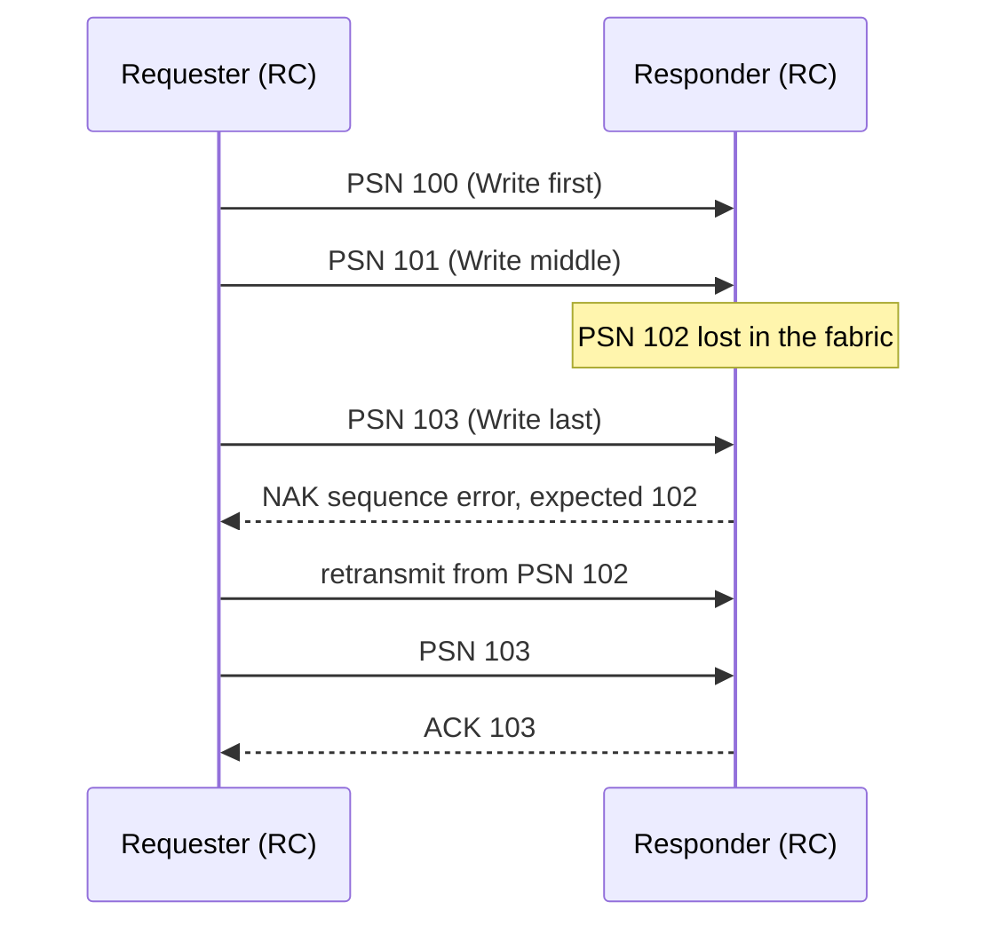

## Why this matters

"RDMA" is not one thing. A queue pair is created with a *transport type*, and that choice decides whether delivery is guaranteed, whether one-sided operations are possible, how big a message can be, and how many connections a large job needs. A 1,024-GPU training job where every process talks to every other process over reliable connections needs on the order of a million QPs across the cluster; a design that ignores this can exhaust NIC caches and host memory, and NIC performance degrades long before hard limits are hit.

As an AI network engineer you will see these transports in NCCL logs, UCX/MPI configuration (`rc`, `ud`, `dc`), storage clients and packet captures. Knowing which operations each transport supports — and how the reliable transport detects and recovers from loss — is what lets you predict how a workload will react to congestion, drops or a link flap.

## Concepts

### Two axes: reliable or not, connected or not

The InfiniBand transport (also used by RoCE) is classified along two axes:

| | Connected (one QP talks to one remote QP) | Datagram (one QP talks to many) |
|---|---|---|
| **Reliable** (ACKs, retransmission, ordering) | **RC** - Reliable Connected | RD - Reliable Datagram (in the spec, never widely implemented) |
| **Unreliable** (no ACKs, no retransmission) | **UC** - Unreliable Connected | **UD** - Unreliable Datagram |

Two further transports solve RC's scalability problem:

- **XRC** (eXtended Reliable Connected) is part of the InfiniBand specification and supported in rdma-core. It lets one initiator QP reach any receive queue in a *target process group* on a remote node, so a process needs connections per remote *node* rather than per remote *process*.
- **DC** (Dynamically Connected) is an NVIDIA (Mellanox) extension available on ConnectX adapters through the `mlx5dv` direct-verbs API. A DC initiator (DCI) connects on the fly to a DC target (DCT) for the duration of a burst of messages and then moves on, so one DCI can serve many destinations while keeping reliable semantics. It is not part of the base InfiniBand specification and is not portable to other vendors.

### Operations

| Operation | Verbs opcode | Sides involved | Consumes a remote receive WR? | Notifies remote application? |
|---|---|---|---|---|
| Send | `IBV_WR_SEND` | Two-sided | Yes | Yes (receive completion) |
| Send with Immediate | `IBV_WR_SEND_WITH_IMM` | Two-sided | Yes | Yes, plus 32-bit immediate data |
| RDMA Write | `IBV_WR_RDMA_WRITE` | One-sided | No | No |
| RDMA Write with Immediate | `IBV_WR_RDMA_WRITE_WITH_IMM` | One-sided data, two-sided notification | Yes | Yes, with 32-bit immediate data |
| RDMA Read | `IBV_WR_RDMA_READ` | One-sided | No | No |
| Compare and Swap | `IBV_WR_ATOMIC_CMP_AND_SWP` | One-sided | No | No |
| Fetch and Add | `IBV_WR_ATOMIC_FETCH_AND_ADD` | One-sided | No | No |

Atomics operate on a naturally aligned 8-byte value in the remote memory region and return the original value to the initiator. Write with Immediate is the workhorse for "here is the data, and now I am telling you it has arrived": the payload goes straight into the target buffer, and the immediate value arrives in a receive completion that the target can poll.

### Which transport supports what

| Capability | RC | UC | UD | XRC | DC (NVIDIA) |
|---|---|---|---|---|---|
| Reliable delivery, in order | Yes | No | No | Yes | Yes |
| Send / Receive | Yes | Yes | Yes | Yes | Yes |
| RDMA Write | Yes | Yes | No | Yes | Yes |
| RDMA Read | Yes | No | No | Yes | Yes |
| Atomics | Yes | No | No | Yes | Yes |
| Max message size | Up to 2 GiB (device-dependent, see `max_msg_sz`) | Up to 2 GiB | One path MTU (at most 4 KiB payload) | Up to 2 GiB | Device-dependent |
| Multicast | No | No | Yes | No | No |
| Connections for N peers | N QPs | N QPs | 1 QP | About one per remote node | A few DCIs for any number of peers |

UD needs an **Address Handle** per destination (created with `ibv_create_ah`) and a **Q_Key** that the receiver checks; each received message is preceded in the buffer by a 40-byte area for the Global Route Header. Because UD cannot exceed one MTU and has no reliability, it is used for discovery, control messages, multicast and connection management — the InfiniBand Subnet Administrator and the RDMA connection manager both use UD-style management QPs.

> [!ANALOGY]
> RC is like TCP (reliable, ordered, connection per peer), UD is like UDP (datagrams, one socket for many peers, message size limited by MTU), and UC is a strange middle ground with no common IP equivalent: connected like TCP but with no retransmission, so a lost packet silently drops the whole message. The analogy breaks down because RC also gives you one-sided memory semantics and hardware offload that TCP never had, and because RDMA "messages" can be gigabytes long while still being reported as a single completion.

## How it works

### The headers that make it happen

All IB-transport packets carry a 12-byte **Base Transport Header (BTH)**: opcode, destination QPN (24 bits), packet sequence number (PSN, 24 bits), partition key, an ACK-request bit and congestion bits (FECN/BECN). Extra headers depend on the operation:

```text
RDMA Write (first packet):   [LRH or Eth/IP/UDP][BTH 12][RETH 16][payload][ICRC 4]
RDMA Write with Imm (last):  [ ... ][BTH 12][ImmDt 4][payload][ICRC 4]
RDMA Read request:           [ ... ][BTH 12][RETH 16][ICRC 4]
Acknowledgement:             [ ... ][BTH 12][AETH 4][ICRC 4]
Atomic request:              [ ... ][BTH 12][AtomicETH 28][ICRC 4]
UD Send:                     [ ... ][BTH 12][DETH 8][payload][ICRC 4]
```

- **RETH** (RDMA Extended Transport Header) carries the remote virtual address (64 bits), rkey (32 bits) and DMA length (32 bits).
- **AETH** (ACK Extended Transport Header) carries an ACK or NAK syndrome and a message sequence number.
- **DETH** (Datagram Extended Transport Header) carries the Q_Key and source QPN for UD.

On InfiniBand these follow a Local Route Header (LRH, 8 bytes) and an optional Global Route Header (GRH, 40 bytes); on RoCEv2 they follow Ethernet, IP and UDP (destination port 4791). The `rocev2-encapsulation` lesson dissects the RoCEv2 header stack.

### Segmentation

A message larger than the path MTU is split into *first*, *middle* and *last* packets (or a single *only* packet), and each carries the next PSN. For an RDMA Write, only the first packet carries the RETH; the receiver remembers the address and key for the rest of the message. The initiator gets **one** completion for the whole message, no matter how many packets it took.

### How RC achieves reliability



- The responder tracks the next expected PSN. A packet with a higher PSN than expected triggers a **NAK (PSN sequence error)**; the requester retransmits from the missing PSN. In classic implementations everything after the lost packet is resent (a go-back-N behaviour), which is why loss is so expensive for RDMA on large messages. Some newer NICs implement more selective recovery; check your adapter's documentation before assuming either behaviour.
- If no ACK or NAK arrives, the requester's **ACK timer** (4.096 µs × 2^`timeout`) fires and it retransmits; after `retry_cnt` attempts the WR fails with `IBV_WC_RETRY_EXC_ERR`.
- ACKs can be **coalesced**: the responder may acknowledge several packets at once, and the requester asks for an ACK explicitly with the BTH ACK-request bit.
- **RNR (Receiver Not Ready)**: if a Send or Write-with-Immediate arrives and the responder has no receive WR posted, it replies with an RNR NAK telling the requester to wait (the `min_rnr_timer` value) and retry up to `rnr_retry` times. RDMA Writes without immediate never cause RNR, because they consume no receive WR.
- **RDMA Read** responses carry the data back to the requester; the number of outstanding Reads per QP is limited by `max_rd_atomic` (requester side) and `max_dest_rd_atomic` (responder side), which you set in the QP transitions. Reads are therefore sensitive to round-trip time: low limits mean poor read bandwidth over long paths.

### Ordering rules worth remembering

- Messages on one RC QP are executed in order, and completions are reported in posting order.
- A WR that must not start until earlier RDMA Reads or atomics on the same QP have completed (for example a Send that reports the result of a preceding Read) needs the **fence** flag (`IBV_SEND_FENCE`); consult the specification for the precise rules before relying on ordering corner cases.
- The target application should not consume RDMA-Written data until it has a signal that the Write completed — typically a Write-with-Immediate completion or a subsequent Send. Polling the last byte of a buffer is a common trick, but its correctness depends on the platform's memory ordering and is not guaranteed by the verbs API.

### The scalability problem and its answers

With RC, every pair of communicating processes needs a QP on each side. For P processes per node and N nodes in an all-to-all pattern, each process needs about (N − 1) × P QPs. Each QP has state on the NIC (cached on chip, backed by host memory), and when the working set of QP contexts no longer fits in the NIC cache, the NIC must fetch state over PCIe, which costs latency and throughput.

| Technique | How it reduces resources |
|---|---|
| **Shared Receive Queue (SRQ)** | Many QPs share one pool of receive buffers, cutting memory for receives (not QP count). |
| **XRC** | Send-side QPs per remote node instead of per remote process; receive side uses XRC SRQs inside an XRC domain (`ibv_open_xrcd`). |
| **DC (NVIDIA)** | A small pool of DC initiators serves any number of targets; connections are set up and torn down implicitly in hardware. |
| **UD** | One QP for all peers, but no RDMA Write/Read and MTU-sized messages; the software must implement reliability. |
| **Fewer peers** | Collective algorithms (rings, trees) mean each rank talks to only a few peers. |

NCCL uses RC QPs because ring and tree collectives keep the number of peers per rank small, and it can open several QPs per peer connection to spread traffic over more ECMP paths (`NCCL_IB_QPS_PER_CONNECTION`; see `nccl-configuration`). MPI and UCX-based applications with all-to-all patterns are where DC and UD shine; UCX exposes them as transports such as `rc_mlx5`, `dc_mlx5` and `ud_mlx5` via `UCX_TLS`.

Filter the matrix by what your workload needs, then enter your node and process counts to see how RC, XRC, DC and UD QP counts diverge.

```widget
transport-matrix
```

## In practice

### Checking device limits

`ibv_devinfo -v` prints the device's capabilities, including limits that matter for transport choice:

```text
$ ibv_devinfo -v -d mlx5_0 | grep -E "max_qp:|max_qp_wr|max_msg_sz|max_qp_rd_atom|max_srq:|atomic_cap"
        max_qp:                 131072
        max_qp_wr:              32768
        max_qp_rd_atom:         16
        atomic_cap:             ATOMIC_HCA (1)
        max_srq:                8388608
                max_msg_sz:     0x40000000
```

*(Illustrative values; they vary with adapter, firmware and configuration.)* `max_qp` is a hard limit, not a performance guarantee — performance usually degrades well before you reach it. `max_qp_rd_atom` bounds how many RDMA Reads you can keep in flight per QP.

### Exercising each transport

rdma-core's examples let you try transports directly:

```text
# server                                 # client
$ ibv_rc_pingpong -d mlx5_0 -g 3          $ ibv_rc_pingpong -d mlx5_0 -g 3 10.0.0.12
$ ibv_uc_pingpong -d mlx5_0 -g 3          $ ibv_uc_pingpong -d mlx5_0 -g 3 10.0.0.12
$ ibv_ud_pingpong -d mlx5_0 -g 3          $ ibv_ud_pingpong -d mlx5_0 -g 3 10.0.0.12
```

On native InfiniBand the `-g` option is not needed. perftest (see `perftest-benchmarking`) selects the transport with `-c` (for example `ib_send_bw -c UD`), and only offers combinations the transport supports: you cannot run `ib_read_bw` over UC or UD.

### Recognising transports in captures and logs

- In a RoCEv2 packet capture (Wireshark's InfiniBand dissector decodes UDP port 4791), the BTH opcode name tells you the transport and operation, for example "RC RDMA Write First" or "UD Send Only".
- In NCCL debug output, the IB transport reports how many QPs it uses per connection and which devices; all of them are RC.
- `rdma resource show qp` lists each QP's `type` (RC, UC, UD, XRC_INI, XRC_TGT and, on NVIDIA adapters, driver-specific types for DC).

> [!INTERVIEW]
> *"Why does NCCL use RC instead of UD, and when would you choose DC?"* A strong answer: NCCL needs large messages and one-sided RDMA Write into GPU buffers with hardware reliability; only connected reliable transports give that, and collective algorithms keep the peer count per rank small, so RC's per-peer QP cost is acceptable. DC (NVIDIA-specific) is attractive when each process talks to very many peers — all-to-all MPI, some expert-parallel or key-value patterns — because a few DC initiators replace thousands of RC QPs while keeping reliability. Mention the trade-off: DC adds connect/disconnect overhead per destination switch and is vendor-specific.

## Common pitfalls

- **Expecting RDMA Read on UC or UD.** Symptom: QP creation or WR post fails, or perftest refuses the combination. Cause: Read and atomics require a reliable transport. Fix: use RC, XRC or DC.
- **UD messages larger than the MTU.** Symptom: sends fail with local length errors. Cause: UD messages are limited to one path MTU. Fix: fragment in software or use RC.
- **Forgetting the GRH space on UD receives.** Symptom: received data appears shifted by 40 bytes. Cause: the first 40 bytes of a UD receive buffer are reserved for the GRH. Fix: allocate and skip 40 bytes.
- **RNR storms.** Symptom: high latency and `IBV_WC_RNR_RETRY_EXC_ERR`, or RNR NAK counters rising on the NIC. Cause: receivers do not keep enough receive WRs posted for Sends or Write-with-Immediate. Fix: post receives earlier and in larger batches, use an SRQ, and size `rnr_retry`/`min_rnr_timer` appropriately.
- **Assuming RDMA loss recovery is cheap.** Symptom: a small drop rate on a RoCE fabric cuts throughput dramatically. Cause: go-back-N style retransmission resends large windows on every loss. Fix: make the fabric lossless or tightly congestion-controlled (`m06-rocev2-lossless`), or use adapters and configurations with better loss recovery.
- **Too many RC QPs.** Symptom: throughput falls as job size grows, with no link errors. Cause: QP context cache misses on the NIC. Fix: reduce peers per process, use XRC/DC/UD where the library supports it, or tune QPs per connection.

## Key takeaways

- RC is reliable and connected and supports every operation; UC drops Read and atomics and gives no reliability; UD is one QP for many peers with MTU-sized Sends only.
- XRC (standard) and DC (NVIDIA-specific) keep reliability while cutting the number of connections.
- RDMA Write moves data without remote involvement; Write-with-Immediate adds a receive completion so the target knows the data arrived.
- RC reliability uses PSNs, NAKs, ACK timeouts and RNR NAKs; retries are bounded by `retry_cnt` and `rnr_retry`.
- Loss is expensive on RDMA because classic recovery retransmits everything after the lost packet.
- NCCL uses RC with a small number of QPs per peer; all-to-all heavy software benefits from DC or UD.
