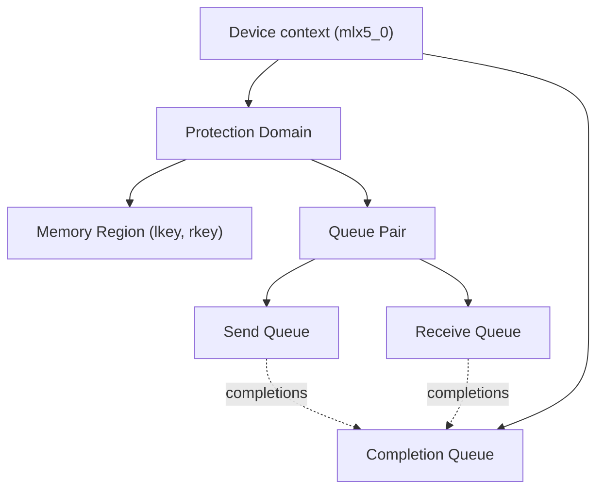
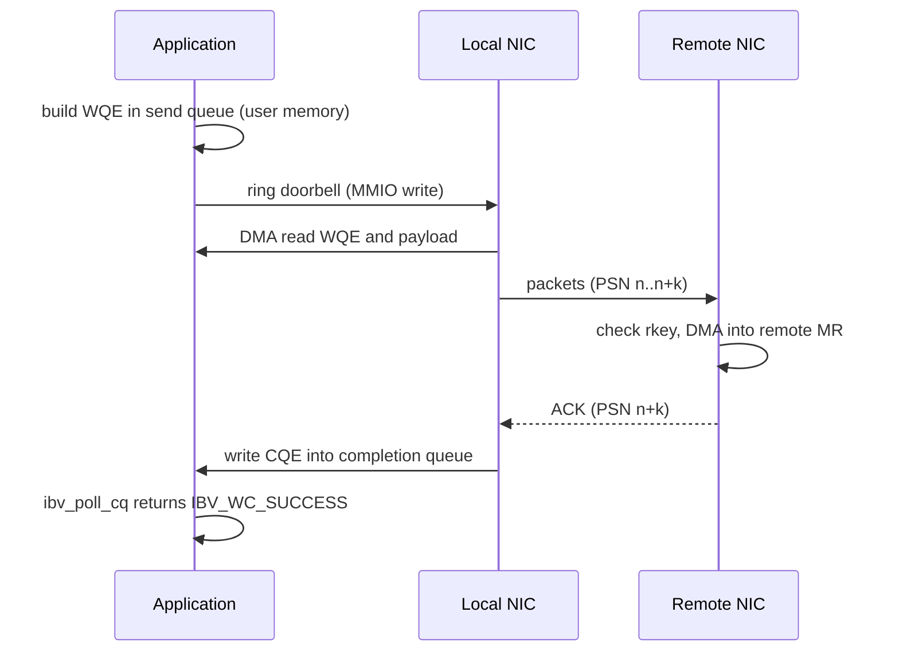

## Why this matters

Every RDMA error you will ever troubleshoot in an AI cluster — a NCCL job hanging at startup, a `transport retry counter exceeded` message, a "remote access error" after a code change — is described in the vocabulary of verbs: queue pairs, memory regions, keys, work requests and completions. NCCL, UCX, MPI libraries, storage clients and benchmark tools are all built on this API, and their error messages surface its states and status codes almost verbatim.

You do not need to become an RDMA programmer to run an AI fabric. You do need to read a QP state, know what "RTR" means and why a QP that never reaches RTS cannot send, understand that a timeout is a property of the QP and not the switch, and recognise that `IBV_WC_RETRY_EXC_ERR` points at the network while `IBV_WC_REM_ACCESS_ERR` points at the application. This lesson gives you that vocabulary.

## Concepts

### Verbs: an abstract API, a concrete library

The InfiniBand specification defines *verbs* as an abstract description of what an RDMA adapter must be able to do ("create a queue pair", "post a send"). On Linux the concrete implementation is **libibverbs**, part of **rdma-core**, plus a vendor *provider* library (for example `libmlx5` for NVIDIA ConnectX, `librxe` for Soft-RoCE). Function names start with `ibv_`. The same API is used for InfiniBand, RoCE and iWARP.

### The object model

| Object | Created with | What it is |
|---|---|---|
| Device list / context | `ibv_get_device_list`, `ibv_open_device` | A handle to one RDMA device (e.g. `mlx5_0`) |
| Protection Domain (PD) | `ibv_alloc_pd` | A security container; QPs and MRs must belong to the same PD to be used together |
| Memory Region (MR) | `ibv_reg_mr` | A registered, pinned buffer with an `lkey`, an `rkey` and access flags |
| Completion Queue (CQ) | `ibv_create_cq` | A queue where the NIC reports finished work (work completions) |
| Queue Pair (QP) | `ibv_create_qp` | The communication endpoint: a Send Queue (SQ) plus a Receive Queue (RQ), each linked to a CQ |
| Address Handle (AH) | `ibv_create_ah` | A path to a remote port, used by datagram QPs |
| Shared Receive Queue (SRQ) | `ibv_create_srq` | A receive queue shared by many QPs, to save memory |
| Completion channel | `ibv_create_comp_channel` | A file descriptor for event-driven (rather than polled) completion notification |



A QP is identified on its port by a 24-bit **QP number (QPN)**. To talk to a remote QP over the reliable connected transport, each side needs the other's QPN, its starting packet sequence number (PSN), and its address (a LID on InfiniBand, a GID on RoCE), plus — for one-sided operations — the remote buffer's virtual address and `rkey`. Exchanging that information is *out of band*: over a TCP socket, through `librdmacm` (the RDMA connection manager), or via a job launcher. This is why NCCL needs a working TCP bootstrap network before RDMA can start.

### Memory regions and keys

`ibv_reg_mr(pd, addr, length, access)` does three things:

1. **Pins** the pages so the OS cannot swap or migrate them while the NIC might DMA into them. This counts against the process's locked-memory limit (`ulimit -l`, "memlock").
2. **Builds a translation table** in the NIC (virtual address to physical/bus address), so the NIC can resolve addresses in work requests without the CPU.
3. **Returns keys**: the `lkey` is used in local work requests to say "this buffer is mine and registered"; the `rkey` is handed to a peer so it may access the region remotely.

Access flags decide what is allowed:

| Flag | Allows |
|---|---|
| `IBV_ACCESS_LOCAL_WRITE` | The local NIC to write into the region (needed for receive buffers and RDMA Read targets) |
| `IBV_ACCESS_REMOTE_WRITE` | Peers to RDMA Write into it (requires local write as well) |
| `IBV_ACCESS_REMOTE_READ` | Peers to RDMA Read from it |
| `IBV_ACCESS_REMOTE_ATOMIC` | Peers to perform atomic operations on it |

Registration is expensive (system call, page pinning, NIC table updates), so applications register large buffers once and reuse them. NCCL, for example, registers its communication buffers and caches registrations. For GPU memory, registration goes through `nvidia-peermem` or, on newer stacks, dma-buf (`ibv_reg_dmabuf_mr`).

> [!ANALOGY]
> An `rkey` is like a capability token or a pre-signed URL for object storage: anyone who holds it may access exactly that object with exactly those permissions, and no further authentication happens per request. As with pre-signed URLs, the protection is only as good as the secrecy and lifetime of the token — which is why memory windows (`ibv_alloc_mw`, `ibv_bind_mw`) exist for finer-grained, revocable remote access.

### Work requests and completions

Applications never "send a packet". They **post work requests (WRs)** to queues and later **poll completions**:

- `ibv_post_recv(qp, wr, &bad_wr)` posts receive buffers to the RQ (or `ibv_post_srq_recv` to an SRQ).
- `ibv_post_send(qp, wr, &bad_wr)` posts operations to the SQ: `IBV_WR_SEND`, `IBV_WR_SEND_WITH_IMM`, `IBV_WR_RDMA_WRITE`, `IBV_WR_RDMA_WRITE_WITH_IMM`, `IBV_WR_RDMA_READ`, `IBV_WR_ATOMIC_CMP_AND_SWP`, `IBV_WR_ATOMIC_FETCH_AND_ADD`.
- Each WR carries a scatter/gather list (`ibv_sge`: address, length, lkey) and a 64-bit `wr_id` the application uses to match completions to requests.
- `ibv_poll_cq(cq, n, wc_array)` returns up to `n` **work completions** (`ibv_wc`), each with `wr_id`, `status`, `opcode`, `byte_len` and, for receives, the source QP and immediate data.

Send WRs can be *unsignaled* (no completion unless they fail) to reduce CQ traffic; `IBV_SEND_SIGNALED` requests a completion. `IBV_SEND_INLINE` copies small payloads into the WQE itself so the NIC does not need a separate DMA read, which lowers latency for tiny messages.

## How it works

### The QP state machine

A newly created QP is in **RESET** and cannot do anything. It is moved through states with `ibv_modify_qp(qp, &attr, attr_mask)`, where `attr_mask` says which attributes are being set. Try the transitions interactively:

```widget
qp-state-machine
```

| State | Meaning | Can post receives? | Can post sends? |
|---|---|---|---|
| `IBV_QPS_RESET` | Just created or reset; no resources active | No | No |
| `IBV_QPS_INIT` | Bound to port, P_Key and access flags | Yes (they wait) | No |
| `IBV_QPS_RTR` | Ready To Receive: knows its remote peer | Yes, and incoming packets are processed | No |
| `IBV_QPS_RTS` | Ready To Send: fully operational | Yes | Yes |
| `IBV_QPS_SQD` | Send Queue Drain: finishing in-flight sends, used to change some attributes | Yes | Posted WRs are not started |
| `IBV_QPS_SQE` | Send Queue Error (unreliable transports): a send failed, RQ still works | Yes | No (until recovered) |
| `IBV_QPS_ERR` | Error: all outstanding WRs are flushed with `IBV_WC_WR_FLUSH_ERR` | Flushed | Flushed |

Any state can be moved to RESET or ERR. A QP enters ERR by itself when a fatal error occurs (for example, retries exhausted on RC). Recovery means moving it to RESET and walking through INIT, RTR and RTS again — in practice most applications destroy and recreate the connection.

### Attributes per transition for an RC QP

This table is the heart of "why won't my QP connect". Attribute names are the fields of `struct ibv_qp_attr`; mask bits are the matching `IBV_QP_*` flags.

| Transition | Required attributes (mask bits) | What they mean |
|---|---|---|
| RESET → INIT | `qp_state`, `pkey_index`, `port_num`, `qp_access_flags` (`IBV_QP_STATE`, `IBV_QP_PKEY_INDEX`, `IBV_QP_PORT`, `IBV_QP_ACCESS_FLAGS`) | Which port and partition; whether remote read/write/atomic are allowed on this QP |
| INIT → RTR | `qp_state`, `ah_attr`, `path_mtu`, `dest_qp_num`, `rq_psn`, `max_dest_rd_atomic`, `min_rnr_timer` (`IBV_QP_AV`, `IBV_QP_PATH_MTU`, `IBV_QP_DEST_QPN`, `IBV_QP_RQ_PSN`, `IBV_QP_MAX_DEST_RD_ATOMIC`, `IBV_QP_MIN_RNR_TIMER`) | Address of the remote port (DLID on IB; GRH with destination GID and `sgid_index` on RoCE), MTU, the remote QPN, expected first PSN, how many incoming RDMA Reads/atomics may be outstanding, and how long a peer should wait before retrying after a receiver-not-ready NAK |
| RTR → RTS | `qp_state`, `sq_psn`, `timeout`, `retry_cnt`, `rnr_retry`, `max_rd_atomic` (`IBV_QP_SQ_PSN`, `IBV_QP_TIMEOUT`, `IBV_QP_RETRY_CNT`, `IBV_QP_RNR_RETRY`, `IBV_QP_MAX_QP_RD_ATOMIC`) | First PSN to send, ACK timeout, how many times to retransmit, how many RNR retries, how many outgoing RDMA Reads/atomics may be in flight |

Unreliable datagram (UD) QPs are simpler: INIT needs a `qkey` instead of access flags, RTR needs only the state, and RTS needs only the `sq_psn`. Different transports are compared in `transport-types-operations`.

Three attributes matter enormously in operations:

- **`timeout`** is an exponent: the local ACK timeout is 4.096 µs × 2^`timeout`. A value of 14 is about 67 ms; 20 is about 4.3 s; 0 means wait forever. NCCL exposes it as `NCCL_IB_TIMEOUT`.
- **`retry_cnt`** (0-7) is how many times the sender retransmits after a timeout or sequence error before giving up. NCCL exposes it as `NCCL_IB_RETRY_CNT`.
- **`rnr_retry`** (0-7) is how many times to retry after a Receiver Not Ready NAK; the value 7 means "retry forever".

When retries are exhausted, the WR completes with `IBV_WC_RETRY_EXC_ERR` (or `IBV_WC_RNR_RETRY_EXC_ERR`) and the QP moves to ERR. Total time before that error is roughly `timeout × (retry_cnt + 1)`, which is why a flapping link can stall an AI job for seconds before the error surfaces.

> [!WARNING]
> On RoCE, the address vector in INIT → RTR must include a GRH (`ah_attr.is_global = 1`) with the right `sgid_index`. Pick the wrong GID index (for example a RoCEv1 or link-local entry when the fabric needs RoCEv2 with an IPv4-mapped address) and the QP may still reach RTS, but packets go nowhere useful and the first send ends in `IBV_WC_RETRY_EXC_ERR`. This is one of the most common RoCE bring-up failures.

### From ibv_post_send to a completion



Details worth knowing:

- The work queue entries (WQEs) and completion queue entries (CQEs) live in host memory that both the process and the NIC can access. The doorbell is a write into a NIC register page mapped into the process (the "UAR" on NVIDIA adapters). Vendor optimisations — such as writing a small WQE directly to the NIC to save a DMA round trip (BlueFlame on ConnectX) — are implementation details of the provider library.
- Completions on one QP are delivered in order of the posted WRs. A successful completion of a send means the data has been acknowledged by the remote NIC (for RC) — not that the remote *application* has seen it.
- A CQ can overflow if the application posts more signaled WRs than the CQ has room for and does not poll. The CQ then goes into error, an asynchronous event is raised, and the affected QPs stop.

### Polling versus events

`ibv_poll_cq` is non-blocking and very cheap; latency-sensitive code busy-polls it in a loop, which is why RDMA benchmarks show one core at 100 %. Event-driven code arms the CQ with `ibv_req_notify_cq`, sleeps in `ibv_get_cq_event` on a completion channel file descriptor, acknowledges with `ibv_ack_cq_events`, then polls to drain. This saves CPU at the cost of wake-up latency.

### Reading completion status codes

| Status | Usually means | Look at |
|---|---|---|
| `IBV_WC_SUCCESS` | Done | — |
| `IBV_WC_WR_FLUSH_ERR` | QP was already in ERR; this WR was flushed | The *first* error completion, not this one |
| `IBV_WC_RETRY_EXC_ERR` | No ACK after `retry_cnt` retransmissions | Fabric: link down, wrong GID/LID, routing, lossy RoCE, peer process died |
| `IBV_WC_RNR_RETRY_EXC_ERR` | Peer had no receive posted, repeatedly | Application flow control on the receiver |
| `IBV_WC_REM_ACCESS_ERR` | Remote rkey, address range or permissions wrong | Application: stale or wrong rkey, MR deregistered, missing remote access flag |
| `IBV_WC_LOC_PROT_ERR` | Local lkey/PD/address mismatch | Application: buffer not registered or registered in another PD |
| `IBV_WC_LOC_LEN_ERR` | Receive buffer too small for incoming message | Application buffer sizing |
| `IBV_WC_REM_INV_REQ_ERR` | Remote rejected the request (e.g. operation not allowed on that QP) | QP access flags, message too large |

`ibv_wc_status_str()` turns these into the human-readable strings you see in logs, such as "transport retry counter exceeded".

## In practice

### A minimal RC setup, as a checklist

Most code you will read follows this sequence (error handling omitted):

```c
struct ibv_device **list = ibv_get_device_list(NULL);
struct ibv_context *ctx  = ibv_open_device(list[0]);
struct ibv_pd *pd        = ibv_alloc_pd(ctx);
struct ibv_mr *mr        = ibv_reg_mr(pd, buf, len,
                             IBV_ACCESS_LOCAL_WRITE | IBV_ACCESS_REMOTE_WRITE);
struct ibv_cq *cq        = ibv_create_cq(ctx, 256, NULL, NULL, 0);

struct ibv_qp_init_attr qia = {
    .send_cq = cq, .recv_cq = cq, .qp_type = IBV_QPT_RC,
    .cap = { .max_send_wr = 128, .max_recv_wr = 128,
             .max_send_sge = 1, .max_recv_sge = 1 } };
struct ibv_qp *qp = ibv_create_qp(pd, &qia);

/* exchange qp->qp_num, PSN, LID or GID, buffer address and mr->rkey out of band */
/* RESET->INIT, INIT->RTR, RTR->RTS with ibv_modify_qp as in the table above     */
```

Then data moves with `ibv_post_send` (an `IBV_WR_RDMA_WRITE` carrying `wr.rdma.remote_addr` and `wr.rdma.rkey`) and completions are reaped with `ibv_poll_cq`.

> [!TIP]
> rdma-core ships small example programs — `ibv_rc_pingpong`, `ibv_uc_pingpong`, `ibv_ud_pingpong`, `ibv_srq_pingpong` — whose source is the best compact verbs tutorial available. Run `ibv_rc_pingpong -d mlx5_0 -g 3` on one host and `ibv_rc_pingpong -d mlx5_0 -g 3 <server-ip>` on the other (on RoCE, `-g` selects the GID index) to prove an RC connection end to end.

### Seeing QPs on a live system

The iproute2 `rdma` tool shows kernel-tracked RDMA resources, including QPs created by user-space processes:

```text
$ rdma resource show qp
link mlx5_0/1 lqpn 1234 rqpn 5678 type RC state RTS sq-psn 9012 comm python3 pid 4242
link mlx5_0/1 lqpn 1235 rqpn 0 type RC state INIT sq-psn 0 comm python3 pid 4242
```

*(Illustrative; exact fields depend on your iproute2 version.)* The first line is a connected QP in RTS. The second never left INIT — if it stays there, the process is probably stuck waiting for its peer's connection details over the out-of-band channel, which points at the bootstrap network, not the RDMA fabric. `rdma resource show` with `mr`, `cq` or `pd` lists the other objects.

### Locked memory

```text
$ ulimit -l
65536
```

*(Illustrative.)* A small memlock limit (in KiB) causes `ibv_reg_mr` to fail with "Cannot allocate memory". RDMA hosts and containers normally set it to `unlimited` (for example in `/etc/security/limits.conf` or the container runtime's ulimit settings).

> [!INTERVIEW]
> *"A NCCL job fails with `transport retry counter exceeded`. Walk me through what that means."* Strong answer: it is `IBV_WC_RETRY_EXC_ERR` — an RC QP sent packets and got no acknowledgement within the ACK timeout (4.096 µs × 2^timeout) for retry_cnt + 1 attempts, so the QP went to ERR and subsequent WRs flushed. It means the path failed: link down or flapping, wrong address (GID index on RoCE), routing or partition problem, persistent loss on a lossy RoCE fabric, or the peer process/host died. Then explain how you would check link state, counters and the peer before blaming the application.

## Common pitfalls

- **Chasing the flush errors.** Symptom: logs full of `IBV_WC_WR_FLUSH_ERR`. Cause: once a QP enters ERR every outstanding WR is flushed; the flush is a consequence. Fix: find the *first* non-flush error completion and debug that.
- **Missing remote access flags.** Symptom: `IBV_WC_REM_ACCESS_ERR` on RDMA Write. Cause: the target MR was registered without `IBV_ACCESS_REMOTE_WRITE`, or the target QP's `qp_access_flags` does not allow remote write. Fix: both the MR and the QP must permit the operation.
- **Stale rkey after re-registration.** Symptom: intermittent remote access errors after buffers are reallocated. Cause: deregistering and re-registering a buffer produces a new rkey, but the peer still uses the old one. Fix: re-exchange keys whenever buffers are re-registered.
- **Wrong GID index on RoCE.** Symptom: QP reaches RTS, first send fails with retry exceeded. Cause: the address vector uses a GID of the wrong RoCE version or wrong IP. Fix: check the GID table (see `rdma-on-linux`) and set the index explicitly (`NCCL_IB_GID_INDEX` for NCCL, `-x` for perftest, `-g` for the pingpong examples).
- **MTU mismatch.** Symptom: QP setup fails or large messages fail while small ones work. Cause: `path_mtu` larger than the port's active MTU or the fabric's MTU. Fix: use the active MTU reported by `ibv_devinfo` and make the fabric MTU consistent.
- **memlock limit.** Symptom: `ibv_reg_mr` returns ENOMEM in containers. Cause: default locked-memory limit. Fix: raise `ulimit -l` for the process or container.

## Key takeaways

- Verbs objects nest: device context → protection domain → memory regions and queue pairs; QPs report to completion queues.
- Registration pins memory and returns an `lkey` (local use) and `rkey` (remote access), with explicit access flags.
- An RC QP must go RESET → INIT → RTR → RTS; RTR needs the remote address, QPN, PSN and MTU; RTS needs the send PSN, timeout and retry counts.
- The ACK timeout is 4.096 µs × 2^timeout; exhausting `retry_cnt` produces `IBV_WC_RETRY_EXC_ERR` and moves the QP to ERR.
- Applications post work requests and poll work completions; the first error completion tells you what went wrong, the flushes that follow do not.
- Connection details (QPN, PSN, LID/GID, rkey) are exchanged out of band, so a broken bootstrap network can stall RDMA setup.
