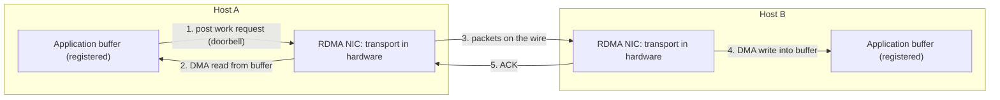

## Why this matters

A modern GPU server for training has eight GPUs and, typically, eight 400 Gb/s back-end NICs. That is 3.2 Tb/s of network bandwidth per server, and during an all-reduce (see `collective-operations`) the training job expects to fill most of it, in bursts, thousands of times per training run. If every one of those bytes had to be copied by the CPU through the Linux socket layer, the host would need dozens of cores doing nothing but moving memory, the GPUs would sit idle waiting on the network, and latency jitter from interrupts and scheduling would make the slowest rank (the straggler) set the pace for the entire cluster.

Remote Direct Memory Access (RDMA) is the reason AI back-end fabrics work at all. It lets an application on one host read or write memory on another host with the network adapter doing the transport work and the operating system kernel out of the data path. Every later topic in this course — InfiniBand, RoCEv2, lossless Ethernet, NCCL tuning, rail-optimized design — exists to deliver RDMA traffic efficiently. If you do not understand what RDMA removes from the data path, you cannot reason about what breaks when it is misconfigured.

## Concepts

### The cost of a traditional socket send

Consider an application that calls `send()` on a TCP socket with a 1 MiB buffer. Conceptually, the kernel does the following:

1. **System call.** The CPU switches from user mode to kernel mode. This is cheap per call but adds up at millions of messages per second.
2. **Copy.** The kernel copies the user buffer into kernel socket buffers (`sk_buff`s), because the application is allowed to reuse its buffer as soon as `send()` returns.
3. **Protocol processing.** TCP segments the data, maintains sequence numbers, congestion window and retransmit timers; IP and Ethernet headers are built.
4. **Driver and DMA.** The NIC driver posts descriptors; the NIC DMAs the kernel buffers out to the wire. Offloads such as TSO and checksum offload help here, but the copy and the per-connection state still live in the kernel.
5. **Receive side.** The receiving NIC raises interrupts (moderated, and with NAPI polling), the kernel reassembles and acknowledges TCP segments, and finally copies data into the application buffer when it calls `recv()`. The receiving thread is woken up by the scheduler.

So a TCP byte typically crosses the memory bus several times, and both CPUs touch every message. At 400 Gb/s (about 50 GB/s), even one extra memory copy per byte is a significant fraction of a server's memory bandwidth, and a single CPU core generally cannot sustain that rate of TCP processing on its own; you need many cores and many flows.

### The four ideas behind RDMA

| Idea | What it means | What it removes |
|---|---|---|
| **Kernel bypass** | After setup, the application posts work directly to the NIC through memory-mapped queues and doorbell registers. | System calls and kernel scheduling on the data path. |
| **Zero copy** | The NIC DMAs directly from the application's registered buffer and into the remote application's registered buffer. | Intermediate copies into kernel buffers. |
| **Transport offload** | Segmentation, sequencing, acknowledgements and retransmission are implemented in NIC hardware. | Per-packet CPU protocol processing. |
| **One-sided operations** | RDMA Write and RDMA Read access remote memory without the remote CPU running any code for that transfer. | Remote CPU involvement (and its wake-up latency). |

The control path still goes through the kernel: opening the device, registering memory, creating queues and connecting them involve system calls, because the kernel must enforce security (which process may touch which memory and which NIC resources). RDMA moves the *data path* out of the kernel, not the *control path*.

> [!ANALOGY]
> Think of a router's control plane and data plane. Routing protocols (BGP, OSPF) run in software and program the forwarding table; packets are then forwarded by the ASIC without the route processor touching them. RDMA is the same split for host networking: the kernel acts as the control plane (setup, permissions), and the NIC is the data plane. The analogy breaks down in one important way: in RDMA, *the application itself* talks to the "ASIC" directly, which is why misbehaving applications can produce errors the kernel never sees.

### Two-sided versus one-sided

RDMA offers two styles of communication:

- **Two-sided (Send/Receive).** The receiver must have posted a receive buffer in advance. The sender's message lands in the next posted buffer. Both sides participate, like sockets, but without copies or kernel involvement.
- **One-sided (RDMA Write, RDMA Read, Atomics).** The initiator names a remote virtual address and a remote key (`rkey`) that the target previously shared. The target NIC validates the key and moves the data; the target CPU is not notified (unless the initiator uses Write-with-Immediate, which you will meet in `transport-types-operations`).

NCCL, the collective library used by most AI frameworks, uses RDMA Write heavily for bulk data movement over InfiniBand and RoCE, with small control messages to tell the receiver where to write and when data has landed.

### Three wire protocols, one programming model

The RDMA programming model (the *verbs*, covered in `verbs-qps-mrs`) is the same regardless of the network underneath. What differs is how packets are carried:

| Transport | Carried over | Loss handling | Where you meet it |
|---|---|---|---|
| **InfiniBand** | Native IB links and switches, managed by a Subnet Manager | Lossless by design (credit-based link-level flow control) | Many large AI training clusters and HPC systems |
| **RoCEv2** | UDP/IP over Ethernet (UDP destination port 4791) | Expects a lossless or near-lossless fabric (PFC and ECN) or newer loss-tolerant NIC features | Ethernet AI fabrics, hyperscalers, Spectrum-X style designs |
| **iWARP** | TCP/IP over Ethernet (TCP offloaded to the NIC) | TCP retransmission | Some storage and enterprise deployments; rare in AI back-end fabrics |

RoCE version 1 carried the InfiniBand transport directly in an Ethernet frame (EtherType 0x8915) and was therefore not routable across IP subnets; RoCEv2 put the same transport headers inside UDP/IP, which made it routable and ECMP-hashable. Today "RoCE" in a data center almost always means RoCEv2.

## How it works

### The data path, step by step



For an RDMA Write:

1. The application builds a *work request* that says "write these local bytes (address, length, local key) to that remote address with this remote key", and writes it into a send queue that lives in its own memory. It then rings a *doorbell*: a write to a memory-mapped NIC register. No system call is involved.
2. The NIC fetches the work request, then DMAs the payload from the registered buffer. Because the memory was *registered* beforehand, the NIC already knows the physical pages and the OS has pinned them so they will not be swapped or moved.
3. The NIC segments the message into packets of the path MTU, adds transport headers with sequence numbers, and transmits.
4. The remote NIC checks the remote key and access rights, then DMAs the payload directly into the target buffer.
5. The remote NIC acknowledges; the local NIC, once all packets are acknowledged, writes a *completion* into a completion queue that the application polls.

Nothing in that list involves a kernel on either side or the remote CPU. That is why RDMA latency for small messages on a modern adapter through one switch is commonly in the low single-digit microseconds, whereas kernel TCP round trips are typically in the tens of microseconds — treat both as orders of magnitude that depend on the NIC, CPU, switch and tuning.

### Why the remote memory is safe

Kernel bypass sounds like a security hole, so it is worth understanding the protections:

- **Memory registration** creates a *memory region* with a local key (`lkey`) and a remote key (`rkey`) and explicit access flags (local write, remote read, remote write, remote atomic). The NIC refuses any access outside the registered range or without the right permission, and reports an error completion instead.
- **Protection domains** group queues and memory regions; a queue can only use memory registered in the same protection domain.
- **Connections** (for the reliable connected transport) bind a local queue to exactly one remote queue, so a random host cannot write into your memory without first being connected and holding the `rkey`.
- **Partitions** (InfiniBand P_Keys) and VLANs/VRFs (RoCE) isolate tenants at the network level.

### GPUDirect RDMA: the AI-specific twist

In AI training the data that needs to move lives in **GPU memory**, not host memory. Without help, the path would be GPU memory → host memory (a copy over PCIe) → NIC → wire, and the reverse on the receiver. **GPUDirect RDMA** (see `gpudirect-rdma-storage`) lets the NIC DMA directly to and from GPU memory over PCIe, ideally through a PCIe switch shared by the GPU and the NIC, so traffic never touches host DRAM or the CPU root complex. On Linux this is enabled through the `nvidia-peermem` kernel module or, on newer stacks, through dma-buf based registration; check your driver and NCCL documentation for which applies.

RDMA's memory registration model is what makes this possible: registering GPU memory gives the NIC the bus addresses of GPU pages, and the rest of the data path is identical.

### What the hardware has to do

Offloading the transport means the NIC holds per-connection state (sequence numbers, retransmission state, keys) for every queue pair. NICs cache this state on-chip and fetch the rest from host memory over PCIe. That is one reason very large numbers of connections can hurt performance, and why transports such as XRC and Dynamically Connected exist (see `transport-types-operations`).

> [!NOTE]
> RDMA is not "faster wires". A 400 Gb/s link carries 400 Gb/s whether TCP or RDMA uses it. RDMA's advantage is that it reaches line rate with almost no CPU, with lower and more predictable latency, and with direct placement into the final buffer (including GPU memory).

## In practice

### Is this host RDMA-capable?

On a Linux host with rdma-core installed, list the RDMA devices:

```text
$ ibv_devices
    device                 node GUID
    ------              ----------------
    mlx5_0              b83fd20300a1b2c4
    mlx5_1              b83fd20300a1b2c5
```

*(Illustrative output.)* `mlx5_*` devices are NVIDIA (Mellanox) ConnectX adapters driven by the `mlx5_ib` driver. A device name such as `rxe0` would be Soft-RoCE, a software RDMA implementation useful for learning (you will use it in labs), and `irdma*` would be an Intel adapter. The full Linux stack is covered in `rdma-on-linux`.

To see whether a port is InfiniBand or Ethernet (RoCE):

```text
$ ibv_devinfo -d mlx5_0 | grep -E "state|link_layer|active_mtu"
            state:          PORT_ACTIVE (4)
            active_mtu:     4096 (5)
            link_layer:     InfiniBand
```

*(Illustrative.)* `link_layer: Ethernet` would mean RoCE.

### Feeling the difference: TCP versus RDMA on the same link

A classic first experiment is to run a TCP benchmark and an RDMA benchmark between the same two hosts over the same NIC and watch CPU usage.

```text
# Host B (server)                     # Host A (client)
$ iperf3 -s                            $ iperf3 -c 192.168.10.12 -P 8 -t 30
$ ib_write_bw -d mlx5_0 --report_gbits $ ib_write_bw -d mlx5_0 --report_gbits 192.168.10.12
```

What you typically observe (orders of magnitude, not guarantees):

| Measurement | TCP (`iperf3`) | RDMA Write (`ib_write_bw`) |
|---|---|---|
| Throughput on a 200-400 Gb/s link | Often needs several parallel streams and tuning to approach line rate | Usually near line rate with a single process and a single connection for large messages |
| CPU usage | Several cores busy on both ends | Close to one core on the client (busy polling), little on the server |
| Small-message latency | Tens of microseconds | Low single-digit microseconds |

The server-side CPU is the striking part: during an RDMA Write test the server process mostly sleeps waiting for the test to end, because the data lands in its memory without its involvement. You will run and interpret these tools properly in `perftest-benchmarking`.

> [!TIP]
> When you check CPU during an RDMA benchmark, remember that perftest clients typically *busy-poll* the completion queue, so one core will show 100 % even though it is not moving bytes. That is a polling design choice, not protocol overhead.

### How AI software uses RDMA

You rarely write verbs code yourself in AI infrastructure work. The usual stack is:

| Layer | Example | Uses RDMA how |
|---|---|---|
| Framework | PyTorch, JAX | Calls a collective library |
| Collective library | NCCL (NVIDIA), RCCL (AMD) | Opens RDMA devices, creates queue pairs, registers GPU buffers, issues RDMA Writes |
| RDMA userspace | libibverbs, provider libraries (e.g. libmlx5) | Talks to the NIC through memory-mapped queues |
| Kernel | ib_core, ib_uverbs, mlx5_ib | Control path only: setup, permissions |
| NIC + fabric | ConnectX / BlueField / other RDMA NICs; IB or Ethernet switches | Data path in hardware |

When NCCL logs `NET/IB` in its debug output it is using the verbs API, and that is true for both InfiniBand and RoCE. A log line saying it fell back to `NET/Socket` means it could not use RDMA and is pushing training traffic through kernel TCP — almost always a dramatic slowdown.

> [!INTERVIEW]
> *"Why can't we just use TCP for GPU-to-GPU traffic between servers?"* A strong answer covers: per-byte CPU cost (copies, protocol processing) at 400 Gb/s per NIC times eight NICs; latency and jitter from kernel scheduling and interrupts, which matter because collectives are synchronous and wait for the slowest rank; and the lack of direct placement into GPU memory. Then mention that RDMA moves the transport to the NIC and the data path out of the kernel, and that the price is a stricter network (lossless or carefully congestion-controlled) and more complex configuration.

## Common pitfalls

- **Assuming RDMA makes the link faster.** Symptom: disappointment that `ib_write_bw` tops out at roughly the same number as a well-tuned TCP test with many streams. Cause: both are limited by the link rate. Fix: measure CPU cost and latency, not just bandwidth, when comparing.
- **Training silently falls back to TCP.** Symptom: training throughput far below expectations, NCCL logs show `NET/Socket`. Cause: RDMA devices not visible in the container, missing `/dev/infiniband` device files, missing provider library, or NCCL configured to exclude the RDMA devices. Fix: check `ibv_devices` inside the container and NCCL's `NCCL_DEBUG=INFO` output (see `nccl-debugging`).
- **Treating RoCE as "just Ethernet".** Symptom: good results in a quiet lab, terrible collective performance under load. Cause: most RoCE transports react badly to packet loss (go-back-N style retransmission), so a lossy fabric collapses goodput. Fix: design the fabric for RDMA (PFC/ECN or vendor loss-tolerant features), covered in `m06-rocev2-lossless`.
- **Forgetting that GPUDirect RDMA needs topology.** Symptom: RDMA works but bandwidth is half of expected. Cause: the NIC and GPU are on different CPU sockets, so traffic crosses the inter-socket link or bounces through host memory. Fix: check `nvidia-smi topo -m` and NIC/GPU affinity (see `reading-server-topology`).
- **Believing kernel bypass means no kernel at all.** Symptom: confusion when an RDMA application fails at setup with permission or `ulimit` errors. Cause: the control path (memory registration, queue creation) still goes through the kernel and is subject to limits such as locked-memory limits. Fix: check the `memlock` limit and device permissions (see `rdma-on-linux`).

## Key takeaways

- RDMA removes the kernel, the memory copies and the transport processing from the data path; the kernel remains in the control path for setup and security.
- One-sided operations (RDMA Write/Read) move data without any code running on the remote CPU; two-sided Send/Receive needs a pre-posted receive buffer.
- Memory registration (keys plus access flags) and protection domains are what make kernel bypass safe.
- InfiniBand, RoCEv2 (UDP port 4791) and iWARP carry the same verbs programming model over different wires; AI back-end fabrics use InfiniBand or RoCEv2.
- GPUDirect RDMA lets the NIC read and write GPU memory directly, which is essential for collective performance.
- RDMA does not make links faster; it makes line rate cheap, latency low and predictable, and it demands a well-behaved fabric.
