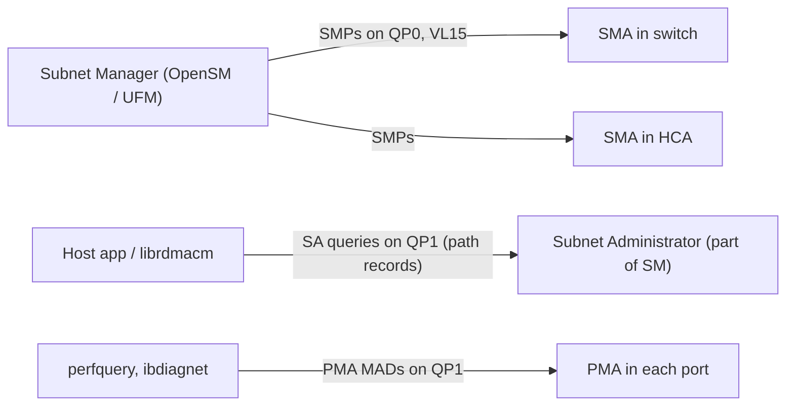

## Why this matters

Many of the largest AI training clusters run their GPU back-end fabric on InfiniBand, and NVIDIA's reference architectures for DGX SuperPOD-class systems have historically used it. InfiniBand is not "Ethernet with different cables": it has its own addressing, a centralised controller (the Subnet Manager) that computes every forwarding table, link-level flow control that never drops packets for lack of buffer, and a management plane built into every device. Engineers coming from Ethernet/IP routinely misread InfiniBand symptoms because their mental model assumes MAC learning, distributed routing protocols and drops under congestion — none of which apply.

When a port is stuck in `Init`, when a host can reach some peers but not others, or when two tenants unexpectedly see each other's traffic, the explanation is in the architecture: LIDs, forwarding tables, partitions and the Subnet Manager. This lesson builds that model so the following lessons on routing, flow control and diagnostics have something to stand on.

## Concepts

### The building blocks

| Component | What it is | Ethernet analogue (approximate) |
|---|---|---|
| **HCA** (Host Channel Adapter) | The NIC in a server, implementing verbs and the transport in hardware (e.g. NVIDIA ConnectX) | NIC with full transport offload |
| **TCA** (Target Channel Adapter) | A simpler adapter in storage or I/O devices | Storage controller NIC |
| **Switch** | Forwards packets within a subnet by destination LID using a forwarding table written by the SM | Layer-2 switch, but with no MAC learning |
| **Router** | Forwards between IB subnets using GIDs (rare in AI clusters) | IP router |
| **Subnet** | Set of ports and switches managed by one Subnet Manager, sharing a subnet prefix | A routed domain with a single controller |
| **Subnet Manager (SM)** | Software that discovers the topology, assigns addresses, computes routes and programs every switch | An SDN controller |
| **Gateway** | Bridges IB and Ethernet (for example NVIDIA Skyway appliances) | Gateway/bridge |

Every switch and HCA also runs a **Subnet Management Agent (SMA)** that answers the SM, and a **Performance Management Agent (PMA)** that serves port counters. You talk to these agents with the diagnostic tools covered in `ib-tools-diagnostics`.

### Three kinds of identifiers

| Identifier | Size | Assigned by | Scope | Used for |
|---|---|---|---|---|
| **GUID** (Globally Unique Identifier) | 64 bits | Manufacturer, burned in | Worldwide | Identity: node GUID, port GUID, system image GUID |
| **LID** (Local Identifier) | 16 bits | Subnet Manager, at bring-up | One subnet | Forwarding: switches route on destination LID |
| **GID** (Global Identifier) | 128 bits | Subnet prefix (from SM) + port GUID | Global, IPv6-formatted | Routing between subnets, multicast, and as the address on RoCE |

- A **node GUID** identifies a device (an HCA or a switch ASIC); each **port GUID** identifies a port; the **system image GUID** groups devices that belong to one system (for example several ASICs inside one modular switch).
- **LIDs**: unicast LIDs are 0x0001-0xBFFF (49,151 addresses), multicast LIDs 0xC000-0xFFFE, and 0xFFFF is the permissive LID used in management. On a switch, only port 0 (the management port) gets a LID; on an HCA each port gets one.
- **LMC** (LID Mask Control) lets the SM assign 2^LMC consecutive LIDs to a port. The SM can route each LID over a different path, giving applications a way to choose among multiple paths to the same port. LMC is 0 (one LID per port) unless configured otherwise.
- **GIDs**: the default GID of a port is the 64-bit subnet prefix (default `fe80:0000:0000:0000`) concatenated with the port GUID.

> [!ANALOGY]
> GUIDs are like MAC addresses (burned in, globally unique), LIDs are like IP addresses handed out by DHCP — except the "DHCP server" (the SM) also computes every switch's forwarding table, which in Ethernet/IP would be the job of distributed routing protocols. The analogy breaks down because a LID is used for layer-2 style forwarding inside the subnet and is never learned by switches: if the SM did not write an entry for a DLID, the switch simply has no route to it.

### Ports have two state machines

A port's **physical state** describes the link training; its **logical state** describes whether the SM has configured it.

| Physical state | Meaning |
|---|---|
| Disabled | Administratively down |
| Polling | Looking for a partner (no cable or no partner) |
| PortConfigurationTraining | Negotiating speed and width |
| LinkUp | Physical link trained |
| LinkErrorRecovery | Retraining after errors |

| Logical state | Meaning |
|---|---|
| Down | No physical link |
| Initialize (Init) | Link is up, but the SM has not configured the port yet |
| Armed | SM configured the port and is about to activate it |
| Active | Ready for data traffic |

"Physical `LinkUp`, logical `Init`" is the most common InfiniBand bring-up symptom: the cable is fine, but no SM has assigned a LID and activated the port.

## How it works

### The InfiniBand packet

```text
+--------+-----------+------------+------------------+-------------+---------+--------+
| LRH 8B | GRH 40B   | BTH 12B    | Extended headers | Payload     | ICRC 4B | VCRC 2B|
|        | (optional)|            | (RETH, AETH...)  | 0-4096 B    |         |        |
+--------+-----------+------------+------------------+-------------+---------+--------+

LRH fields: VL (4 bits) | LVer (4) | SL (4) | rsvd (2) | LNH (2) | DLID (16)
            rsvd (5) | PktLen (11, in 4-byte words) | SLID (16)
```

- **LRH** (Local Route Header) is all a switch needs: **DLID** to choose the output port, **SL** (Service Level) to classify the packet, **VL** (Virtual Lane) to choose the buffer on this hop. The `ib-flow-control-vls` lesson explains SL and VL.
- **LNH** (Link Next Header) says whether a GRH follows.
- **GRH** (Global Route Header) is IPv6-like (source and destination GID, traffic class, flow label, hop limit). It is required between subnets and for multicast, and optional within a subnet.
- **BTH** onward is the transport you met in `transport-types-operations`.
- **ICRC** (invariant CRC) protects fields that do not change hop by hop, end to end; **VCRC** (variant CRC) protects the whole packet per link and is recomputed by each switch.

The maximum transfer unit is 256, 512, 1024, 2048 or 4096 bytes of payload; AI fabrics use 4096.

### Forwarding: the linear forwarding table

Every switch holds a **Linear Forwarding Table (LFT)**: an array indexed by DLID whose entries are output port numbers. Forwarding is a single lookup, with no learning, no ARP, no spanning tree and no routing protocol running in the switch. The SM computes all LFTs centrally and writes them into the switches (see `subnet-manager-routing`). Switches typically forward cut-through, so per-hop latency is small — on the order of a hundred to a few hundred nanoseconds on recent generations (check the switch data sheet for figures).

Adaptive routing, available on NVIDIA Quantum-class switches when enabled by the SM, lets a switch choose among several SM-provided output ports per packet based on load; the transport and HCA must tolerate the resulting reordering. It is covered in `subnet-manager-routing` and `adaptive-routing-packet-spraying`.

### The management model



- Management uses **MADs** (Management Datagrams), 256-byte UD packets.
- **Subnet Management Packets (SMPs)** use the special **QP0** and always travel on **VL15**, a management lane that bypasses data-lane flow control so that management works even when data lanes are congested or misconfigured. SMPs can be **directed route** — the path is given as a list of output ports hop by hop — which is how the SM reaches devices before they have LIDs.
- **General Services** MADs (Subnet Administration queries, performance management, and others) use **QP1** and normal data VLs.
- The **Subnet Administrator (SA)**, part of the SM, answers queries such as "give me a path record from GID A to GID B" (LIDs, SL, MTU, rate). librdmacm uses the SA to resolve paths on InfiniBand.

### Partitions and P_Keys

A **partition** is InfiniBand's isolation mechanism, comparable to a VLAN but enforced at the endpoints (and optionally by switches). Every packet carries a 16-bit **P_Key** in the BTH. The low 15 bits are the partition number and the top bit is the membership type: **full** (bit set) or **limited** (bit clear). Two ports can communicate only if they share a partition and at least one of them is a full member. The default partition is 0x7FFF, so the default full-member key is **0xFFFF**. The SM programs each port's P_Key table; QPs select an entry with `pkey_index` in the RESET → INIT transition you saw in `verbs-qps-mrs`. In multi-tenant AI clusters, P_Keys keep tenants' traffic apart (see `multi-tenancy-isolation`).

UD traffic is additionally protected by a **Q_Key**, checked by the receiving QP.

Step through a subnet manager sweep on a small fabric, follow a packet's DLID through the LFTs, and set P_Key memberships to see which ports can talk:

```widget
ib-addressing
```

### InfiniBand versus Ethernet/IP at a glance

| Aspect | InfiniBand | Ethernet + IP (RoCEv2) |
|---|---|---|
| Control | Central SM computes all routes | Distributed (BGP/OSPF, MAC learning) |
| Forwarding key | 16-bit DLID | MAC (L2) / IP (L3) |
| Loss behaviour | Credit-based flow control, no buffer-overflow drops | Drops unless PFC is configured; ECN for congestion |
| Multipathing | LMC, SM-computed paths, adaptive routing | ECMP hashing, adaptive routing on some platforms |
| Isolation | Partitions (P_Keys) | VLANs, VRFs, ACLs |
| Management plane | Built in (SMA, PMA, MADs) | SNMP, gNMI, vendor CLIs |
| Ecosystem | Primarily NVIDIA today | Many vendors |

> [!INTERVIEW]
> *"Explain how a packet gets from GPU server A to server B in an InfiniBand fat tree."* Strong answer: at bring-up the SM discovered every node with directed-route SMPs, assigned LIDs, computed paths with its routing engine and wrote each switch's LFT. A's application resolved B's LID (from the SA or from an out-of-band exchange), its RC QP put B's LID in the LRH DLID, with an SL that the SL2VL tables map to a VL. Each switch looked up the DLID in its LFT (or chose among adaptive-routing alternatives), sending the packet only when the next hop had advertised credits for that VL, so nothing was dropped for lack of buffer. B's HCA checked the P_Key, the QP and the PSN and DMA'd the data. Bonus points: VCRC per hop, ICRC end to end.

## In practice

### Who am I on the fabric?

```text
$ ibstat mlx5_0
CA 'mlx5_0'
        CA type: MT4129
        Number of ports: 1
        Firmware version: 28.39.1002
        Hardware version: 0
        Node GUID: 0xb83fd20300a1b2c4
        System image GUID: 0xb83fd20300a1b2c4
        Port 1:
                State: Active
                Physical state: LinkUp
                Rate: 400
                Base lid: 12
                LMC: 0
                SM lid: 1
                Capability mask: 0xa751e848
                Port GUID: 0xb83fd20300a1b2c4
                Link layer: InfiniBand
```

*(Illustrative.)* Read it as: the logical state is Active and the physical state LinkUp; the port runs at 400 Gb/s (NDR 4x); the SM gave it LID 12 with LMC 0; the master SM is reachable at LID 1; the port GUID never changes, the LID can change if the SM restarts without a persistent GUID-to-LID mapping (OpenSM normally keeps one in its cache files).

### The default GID and the P_Key table

```text
$ cat /sys/class/infiniband/mlx5_0/ports/1/gids/0
fe80:0000:0000:0000:b83f:d203:00a1:b2c4
$ cat /sys/class/infiniband/mlx5_0/ports/1/pkeys/0
0xffff
```

*(Illustrative.)* GID 0 is the default subnet prefix plus the port GUID; P_Key index 0 holds the default full-membership key.

### Seeing the subnet

```text
$ sminfo
sminfo: sm lid 1 sm guid 0x0002c90300aabbcc, activity count 123456 priority 15 state 3 SMINFO_MASTER
$ ibswitches | head -2
Switch  : 0xfc6a1c0300e4f100 ports 65 "Quantum-2 leaf01" enhanced port 0 lid 2 lmc 0
Switch  : 0xfc6a1c0300e4f200 ports 65 "Quantum-2 leaf02" enhanced port 0 lid 3 lmc 0
```

*(Illustrative; node descriptions are whatever the switch reports.)* `sminfo` confirms there is a master SM and where. `ibswitches` and `ibhosts` list switches and HCAs found by a fabric discovery; the port count includes management port 0. These and other tools are covered in depth in `ib-tools-diagnostics`.

## Common pitfalls

- **Port stuck in Init.** Symptom: `State: Initializing`, `Physical state: LinkUp`, RDMA fails. Cause: no SM running, SM not reaching this part of the fabric, or SM rejecting the port. Fix: check `sminfo`, SM logs and whether the SM's own port is up.
- **Treating LIDs as permanent identities.** Symptom: scripts or inventories break after an SM change. Cause: LIDs are assigned by the SM and can change. Fix: identify ports by GUID (and node description); use LIDs only for live operations.
- **Partition mismatch.** Symptom: two hosts on the same fabric cannot talk, while others can; ibping between them fails. Cause: no common P_Key, or both are limited members. Fix: check the P_Key tables in sysfs and the SM's partition configuration.
- **Assuming switches learn.** Symptom: expecting a newly cabled host to "just work" without an SM sweep. Cause: no LFT entry exists for a new LID until the SM programs it. Fix: let the SM sweep (it reacts to link-state change traps) and verify with diagnostics.
- **Forgetting the GRH on multicast or across subnets.** Symptom: application works within a subnet but not across an IB router, or multicast fails. Cause: GRH required but not set. Fix: set global routing information in the address handle.
- **Confusing physical and logical state.** Symptom: "the link is up" but traffic fails. Cause: LinkUp is only the physical state. Fix: always check both states.

## Key takeaways

- An InfiniBand subnet is HCAs and switches controlled by one central Subnet Manager; switches forward on DLID via SM-written linear forwarding tables, with no learning.
- GUIDs (64-bit, burned in) identify devices and ports; LIDs (16-bit, SM-assigned, unicast up to 0xBFFF) are used for forwarding; GIDs (128-bit, prefix + GUID) are global addresses.
- The LRH carries DLID, SLID, SL and VL; GRH is needed across subnets and for multicast; VCRC is per hop, ICRC end to end.
- Management uses MADs: SMPs on QP0 over VL15 (including directed route), SA and performance queries on QP1.
- Ports have physical (Polling, LinkUp...) and logical (Down, Init, Armed, Active) states; LinkUp + Init means "waiting for the SM".
- Partitions (P_Keys, default 0xFFFF) isolate traffic, and full/limited membership controls who may talk to whom.
