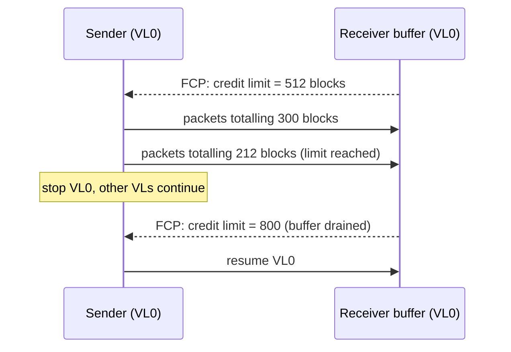

## Why this matters

InfiniBand's reputation as "lossless" comes from a specific mechanism: a sender on every link may transmit only when the receiver has told it, in advance, that buffer space is available. This is fundamentally different from Ethernet, where switches drop packets when queues overflow unless Priority Flow Control (PFC) is configured to pause the sender just in time. Understanding the difference explains why InfiniBand needs no headroom tuning, why it is nevertheless not immune to congestion, and why a single slow receiver can back traffic up across a fabric.

Virtual lanes and service levels are the other half of the story. They give each link several independent buffers, so management traffic, storage traffic and collective traffic do not block each other, and they are what routing engines use to break deadlocks. When an AI cluster shares one InfiniBand fabric between training traffic and storage, or when someone asks why `PortXmitWait` is climbing on a spine port, this lesson is what you need.

## Concepts

### Credits instead of drops

Each receiving port has a buffer per virtual lane. The receiver tells the sender how much space it has, in **credits**; one credit represents **64 bytes** of buffer. The sender keeps track of how much it has sent and transmits a packet on a VL only if the receiver has advertised enough credits for that whole packet. When the receiver forwards or consumes data and frees buffer space, it advertises more credits.

Consequences:

- **No drops due to buffer overflow.** A packet is never sent unless there is room for it. (Packets can still be dropped for other reasons — corrupted CRC, invalid P_Key, no route, or timeouts in a stalled switch.)
- **Back-pressure is proactive and continuous**, not an emergency brake: the sender simply stops when credits run out and resumes as soon as new credits arrive.
- **Per-VL independence**: running out of credits on VL 1 does not stop VL 0.

### Credit flow versus PFC

```widget
ib-credit-flow
```

| Aspect | InfiniBand credit-based flow control | Ethernet PFC (802.1Qbb) |
|---|---|---|
| Model | Proactive: send only into advertised space | Reactive: send freely, receiver says "stop" (XOFF) when a threshold is crossed |
| Granularity | Per virtual lane (up to 15 data VLs) | Per priority (8 priorities) |
| Headroom | Not needed: credits already account for buffer | Must reserve headroom for data in flight after XOFF (cable length, MTU, response time) |
| Default state | Always on, part of the link layer | Optional, must be configured consistently end to end |
| Failure mode if misconfigured | Credit-loop deadlock if routes are cyclic | Drops if headroom too small, pause storms, deadlocks |

> [!ANALOGY]
> PFC is like a highway on-ramp with a traffic light that turns red once the road is already jammed — you need a long ramp (headroom) to hold the cars that were already rolling when the light changed. Credit flow is like a car park that hands out tickets only for free spaces: you cannot enter without a ticket, so the car park never overflows. Where it breaks down: a full car park still blocks the queue of cars waiting outside, and that queue can stretch back across the city — credit flow prevents drops, not congestion.

### Virtual lanes and service levels

- A **Virtual Lane (VL)** is a separate buffer and credit pool on one link. The specification allows **VL0-VL14** for data and **VL15** for subnet management (VL15 has no credit flow control and is used only for SMPs). A port supports 1, 2, 4, 8 or 15 data VLs (its *VLCap*); the SM sets how many are operational.
- A **Service Level (SL)** is a 4-bit label (SL0-SL15) in the LRH that expresses the *class of service* a packet wants end to end. It does not change hop by hop.
- The **SL2VL table** on each port maps SL to VL for the next hop. On switches it is indexed by input port, output port and SL, so the VL can differ per hop while the SL stays constant.
- **VL arbitration** decides which VL transmits next when several have packets and credits: a *high-priority* and a *low-priority* table of (VL, weight) entries, weighted round-robin, with a *limit of high priority* that bounds how much high-priority traffic can be sent before low-priority gets a turn.

The application chooses the SL: verbs code sets `ah_attr.sl` in the QP address vector; the SA returns an SL in path records; NCCL exposes it as `NCCL_IB_SL`. The SM decides what each SL means by programming SL2VL and VL arbitration tables.

## How it works

### The credit protocol in detail

Credit information travels in **flow control packets** (FCPs), small link-local packets sent per VL periodically and when buffer space changes. Conceptually, each FCP carries two values:

- **FCTBS** (Flow Control Total Blocks Sent) from the sender: the running total of 64-byte blocks it has sent on that VL.
- **FCCL** (Flow Control Credit Limit) from the receiver: the total number of blocks the sender is allowed to have sent, i.e. blocks received so far plus free buffer.

The sender may transmit a packet if its total-blocks-sent counter plus the packet's blocks does not exceed the credit limit. Because both values are running totals (with wraparound), a lost FCP is harmless: the next one carries the full state. This is also why the link can self-correct after a corrupted packet.



### How much buffer a link needs

For a link to run at full rate, the receiver must advertise enough credit to cover data in flight during one credit round trip: the time for data to reach the receiver, be forwarded, and the new credit to come back. As an order-of-magnitude estimate:

```text
buffer_needed ~ link_rate x round_trip_time

Example: 400 Gb/s = 50 GB/s; fibre adds ~5 ns per metre each way.
  100 m cable:  RTT ~ 1 us of propagation + processing
  buffer ~ 50 GB/s x 1 us = ~50 KB per active VL (about 800 credits)
```

Switch ASICs size their per-port buffers for the cable lengths found inside a data center. Over much longer distances — campus or metro links — credits run out before the next credit update arrives and throughput collapses, which is why long-haul InfiniBand requires dedicated extension products with deep buffers (NVIDIA's MetroX line is one example). Within an AI cluster, the practical lesson is: credit flow needs no tuning for normal cable lengths, and more VLs split the available buffer among more lanes.

### Head-of-line blocking and congestion spreading

Credit flow prevents drops, but it does not prevent congestion; it *moves* it. If one destination receives more than it can drain (incast, a slow receiver), the switch port toward it runs out of credits, the switch's buffer for that VL fills, and that switch stops granting credits to its upstream neighbours on that VL — even for packets destined elsewhere that happen to share the VL buffer. This is **head-of-line blocking**, and it can grow into a **congestion tree** spanning many switches, slowing unrelated flows.

Mitigations, from simplest to most involved:

- **Routing balance** (`ftree`) and **adaptive routing** keep most links from saturating in the first place (see `subnet-manager-routing`).
- **Separate VLs** for traffic classes (for example storage versus compute), so one class's congestion does not block the other.
- **InfiniBand Congestion Control (CC)**: switches detecting congestion mark packets with **FECN** (Forward Explicit Congestion Notification) in the BTH; the destination HCA returns a **BECN** to the source (in a congestion notification packet); the source HCA reduces the injection rate of that flow using a configured Congestion Control Table (CCT) and recovers over time. CC is configured by the SM or a congestion-control manager. NVIDIA HCAs and switches also implement their own congestion-control algorithms and telemetry; which algorithm is active depends on firmware and fabric-manager settings, so check the vendor documentation.

This mirrors the role of ECN and DCQCN in RoCE fabrics (see `ecn-and-dcqcn`), with the important difference that IB never needed PFC to be lossless.

### VLs and deadlock freedom

Routing engines such as LASH, DFSSSP and torus-2QoS avoid credit-loop deadlocks by assigning different paths to different VLs (via SLs and SL2VL tables), so a cycle in the topology does not become a cycle in buffer dependencies. Every VL used this way is one fewer available for QoS separation, and VLs share the port's buffer. Fat trees routed with updn or ftree are deadlock-free on a single VL, which is one reason they are popular.

### The key counter: PortXmitWait

`PortXmitWait` counts the time (in implementation-defined ticks) during which a port had data to send but could not, because it had no credits (or the VL could not transmit). Steadily growing PortXmitWait on a port means the next hop is not draining fast enough: congestion downstream. It does **not** mean the link is broken. Combine it with `PortXmitData` (throughput, in 4-byte words) to tell "busy and congested" from "idle and stuck". Other counters, such as `PortXmitDiscards` (packets discarded at transmit, for example after a switch lifetime timeout or because the port was down), indicate actual drops.

## In practice

### Inspecting VLs and SL2VL on a port

`smpquery` reads SM attributes directly from a device:

```text
$ smpquery portinfo 12 1 | grep -E "VLCap|OperVLs|VLHighLimit|VLArbHighCap|VLArbLowCap"
VLCap:...........................VL0-7
VLHighLimit:.....................4
VLArbHighCap:....................8
VLArbLowCap:.....................8
OperVLs:.........................VL0-7

$ smpquery sl2vl 12 1
# SL2VL table: Lid 12
#                 SL: | 0| 1| 2| 3| 4| 5| 6| 7| 8| 9|10|11|12|13|14|15|
ports: in  0, out  0: | 0| 1| 2| 3| 4| 5| 6| 7| 0| 1| 2| 3| 4| 5| 6| 7|
```

*(Illustrative; field names and capabilities vary by device and diags version.)* This HCA port supports 8 data VLs, all operational, and maps SLs 0-7 to VLs 0-7 and SLs 8-15 back onto 0-7. `smpquery vlarb <lid> <port>` shows the VL arbitration tables.

### Configuring QoS in OpenSM

OpenSM enables QoS programming with options in `opensm.conf` such as `qos TRUE`, `qos_max_vls`, `qos_high_limit`, `qos_vlarb_high`, `qos_vlarb_low` and `qos_sl2vl`, and supports a more expressive QoS policy file. A minimal two-class design could look like this conceptually:

| Class | SL | VL | Arbitration |
|---|---|---|---|
| Collective (NCCL) traffic | 0 | 0 | Low-priority table, high weight |
| Storage traffic | 1 | 1 | Low-priority table, lower weight |
| Management (SMPs) | - | 15 | Always first |

Then set `NCCL_IB_SL=0` for training jobs and configure the storage client to use SL 1. Exact option syntax is version-dependent; take it from the OpenSM or UFM documentation rather than from memory. With UFM, QoS is configured through UFM.

### Spotting congestion

```text
$ perfquery -x 20 33
# Port extended counters: Lid 20 port 33 (CapMask: 0x5A00 CapMask2: 0x0000000)
PortXmitData:....................183942874662
PortRcvData:.....................174223981100
PortXmitPkts:....................698322011
PortRcvPkts:.....................671003320
$ perfquery 20 33 | grep -E "PortXmitWait|PortXmitDiscards"
PortXmitDiscards:................0
PortXmitWait:....................4120394822
```

*(Illustrative.)* Sample twice, a few seconds apart, during the workload. If `PortXmitWait` grows quickly on one spine port while its `PortXmitData` rate is high, that link is a congestion point: look at what is downstream (an incast target, an under-provisioned path, or routing imbalance). If the rate is low and wait is high, a downstream device may be stalling.

> [!INTERVIEW]
> *"InfiniBand is lossless, so why can't it suffer from congestion?"* Strong answer: it can. Credit-based flow control guarantees no drops due to buffer overflow by only sending into advertised space, per VL. But when a destination is oversubscribed, credits stop flowing, buffers upstream fill and back-pressure spreads hop by hop (head-of-line blocking, congestion trees), slowing flows that do not even go to the hot destination. Remedies are balanced and adaptive routing, VL separation of traffic classes, and end-to-end congestion control (FECN/BECN or vendor algorithms) that throttles the sources. PortXmitWait is the counter that shows it.

## Common pitfalls

- **Equating "lossless" with "no congestion".** Symptom: surprise at slow collectives on a fabric with zero errors. Cause: congestion spreading through back-pressure. Fix: monitor PortXmitWait, rebalance routing, enable congestion control and adaptive routing where supported.
- **Reading PortXmitWait as an error counter.** Symptom: cables replaced unnecessarily. Cause: the counter measures waiting for credits, not link faults. Fix: correlate with symbol and link error counters before touching cables.
- **Inconsistent SL usage.** Symptom: one application's traffic lands on an unexpected VL, or QoS seems to have no effect. Cause: the application uses an SL that the SL2VL tables map differently from what was intended, or QoS programming is disabled in the SM. Fix: verify `NCCL_IB_SL` (or equivalent), the SM's QoS settings and `smpquery sl2vl` on a few hops.
- **Too many VLs enabled "just in case".** Symptom: lower per-VL throughput on long links. Cause: port buffer split across more lanes, fewer credits per lane. Fix: enable only the VLs your QoS design and routing engine need.
- **Extending IB over long distances with ordinary switches.** Symptom: throughput collapses over a campus or metro link even though the optics work. Cause: not enough credits to cover the round-trip time. Fix: use long-haul extension products designed for it.
- **Forgetting VLs are consumed by deadlock-avoidance routing.** Symptom: QoS plan conflicts with the routing engine. Cause: LASH/DFSSSP/torus-2QoS use VLs for deadlock freedom. Fix: plan VL usage for routing and QoS together.

## Key takeaways

- InfiniBand senders transmit only into buffer space the receiver has advertised as credits (64-byte units), per virtual lane, so buffer-overflow drops do not happen.
- Credit flow needs no headroom tuning, unlike PFC, but it still needs buffer of roughly link rate × round-trip time per active VL.
- SLs (0-15, end to end, in the LRH) map to VLs (VL0-14 data, VL15 management) per hop through SL2VL tables; VL arbitration tables weight the lanes.
- Lossless is not congestion-free: back-pressure spreads and causes head-of-line blocking; congestion control (FECN/BECN or vendor algorithms) throttles sources.
- `PortXmitWait` measures time spent waiting for credits — the key congestion counter, not an error counter.
- The SM programs SL2VL and VL arbitration; applications pick SLs (for example `NCCL_IB_SL`).
