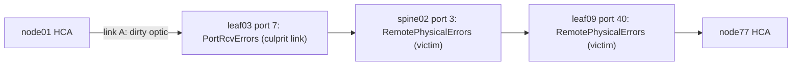

## Why this matters

When a 2,000-GPU job slows down by 20 %, there are tens of thousands of InfiniBand ports that could be responsible. Guessing — reseating random cables, rebooting switches — wastes hours of a very expensive cluster. InfiniBand has a major advantage over most networks here: every device has a built-in management and performance agent, so from *any* host on the fabric you can discover the whole topology, read every port's counters and trace any path, without logging into a single switch.

This lesson turns the tools you met in earlier lessons into a systematic workflow. The goal is to go from "something is slow" to "port 33 on leaf07 has a failing cable" with evidence, and to know which counters mean "broken", which mean "congested", and which mean "misconfigured".

## Concepts

### The toolbox by question

| Question | Tools | Package |
|---|---|---|
| Is my HCA port up, what speed, what LID? | `ibstat`, `ibstatus`, `ibv_devinfo` | infiniband-diags, rdma-core |
| Which SM is master? | `sminfo` | infiniband-diags |
| What does the fabric look like? | `ibnetdiscover`, `ibhosts`, `ibswitches` | infiniband-diags |
| Are all links at the right speed and width? | `iblinkinfo` | infiniband-diags |
| Can I reach a port at the IB level? | `ibping` (with a server started by `ibping -S`) | infiniband-diags |
| Which path does traffic take? | `ibtracert`, `ibroute`, `dump_fts` | infiniband-diags |
| What are the counters on a port? | `perfquery` | infiniband-diags |
| Which ports in the fabric have errors? | `ibqueryerrors` | infiniband-diags |
| Raw SM attributes (PortInfo, NodeInfo, SL2VL...) | `smpquery` | infiniband-diags |
| Query or change a port's state, speed, width | `ibportstate` | infiniband-diags |
| SA records (path records, nodes, multicast) | `saquery` | infiniband-diags |
| Fabric-wide health check and report | `ibdiagnet` | NVIDIA (ibutils2, shipped with the NVIDIA OFED/DOCA stack and UFM) |
| PHY detail: BER, FEC, module info | `mlxlink`, `mlxcables` | NVIDIA MFT |
| Central monitoring, telemetry, alerts | NVIDIA UFM | NVIDIA |

Most of these tools send MADs from the local HCA (they need access to `/dev/infiniband/umad*`, usually root). They address remote ports by **LID** by default; many accept a GUID with `-G` or a directed route with `-D` for ports that have no LID yet. Check each tool's man page for the exact options in your version.

### Counters: errors, congestion, and traffic

The **PortCounters** attribute (served by each port's PMA) is the foundation of InfiniBand diagnostics. The classic counters are small (many are 8 or 16 bits and saturate rather than wrap); **extended counters** (`perfquery -x`) provide 64-bit data and packet counters.

| Counter | Meaning | Usual cause |
|---|---|---|
| `SymbolErrorCounter` | Minor physical errors detected on the link | Signal integrity: dirty or damaged cable/optic, marginal module. On FEC links, interpret per vendor documentation (what counts as a symbol error after FEC is implementation-specific) |
| `LinkErrorRecoveryCounter` | Link went through error recovery (retrained) successfully | Marginal physical link |
| `LinkDownedCounter` | Link failed recovery and went down | Failing cable/optic, reseat, reboot of the peer |
| `PortRcvErrors` | Packets received with errors (bad CRC, malformed) on *this* link | Physical problem on the link into this port |
| `PortRcvRemotePhysicalErrors` | Packets received already marked bad by an upstream hop | The error occurred on an earlier link (cut-through forwarding) |
| `PortRcvSwitchRelayErrors` | Packets a switch could not forward | Routing problems: DLID not in the LFT, invalid VL mapping, packets to a non-existent destination |
| `PortXmitDiscards` | Outbound packets discarded | Port down, or packets that waited too long (head-of-queue lifetime) under severe congestion |
| `PortRcvConstraintErrors` / `PortXmitConstraintErrors` | Packets dropped by partition or filtering enforcement | P_Key mismatch, partition misconfiguration |
| `LocalLinkIntegrityErrors` | Local physical error threshold exceeded | Physical link quality |
| `ExcessiveBufferOverrunErrors` | Receive buffer overrun events | Should not happen with correct credit flow; suggests a flow-control or link problem |
| `VL15Dropped` | Management packets dropped | Management overload or resource exhaustion; usually low priority |
| `PortXmitWait` | Time spent with data to send but no credits | **Congestion** downstream, not an error |
| `PortXmitData` / `PortRcvData` | Data in units of 4 bytes (multiply by 4 for bytes) | Traffic volume |

Three categories to keep in your head:

- **Physical**: SymbolError, LinkErrorRecovery, LinkDowned, PortRcvErrors, LocalLinkIntegrity.
- **Configuration**: SwitchRelay, Constraint errors.
- **Congestion**: PortXmitWait, and in extreme cases PortXmitDiscards.

> [!ANALOGY]
> This is the InfiniBand equivalent of reading `show interface` counters on routers — CRC and input errors for physical problems, output drops for congestion — with one big difference: you can read every port in the fabric from one host over the fabric itself, without SNMP, SSH or switch credentials. The flip side is that if the fabric's management path is broken (for example the SM is down and ports have no LIDs), many tools need directed-route addressing to reach anything.

## How it works

### Localising a bad link: local versus remote physical errors

InfiniBand switches forward cut-through: a switch starts sending a packet before it has received all of it. If a packet is corrupted on link A and the error is detected only once the tail arrives, the switch has already started forwarding it on link B. It then marks the packet as bad (an "end bad packet" delimiter), and downstream ports count it as a **remote** physical error rather than a local one.



Rule: **the faulty link is the one into the port where `PortRcvErrors` (and usually `SymbolErrorCounter`) increases**; ports further downstream that show only `PortRcvRemotePhysicalErrors` are victims, not culprits. Replace the cable or optic on link A, not the spine.

### Rates, not totals

Counters accumulate since they were last cleared, and some are small and saturate. A counter that reads 3 might be from a cable reseat last month. Good practice:

1. Record a baseline (or clear counters fabric-wide at a known time).
2. Run the workload or a stress test (perftest, nccl-tests).
3. Read again and look at the **delta per unit time** for each port.
4. Compare ports of the same role: one leaf port with symbol errors growing while its 63 neighbours stay at zero is your outlier.

`perfquery` can reset counters after reading them, and `ibdiagnet` and UFM can clear counters fabric-wide; coordinate with whoever owns monitoring, because clearing counters destroys history.

### ibdiagnet: the fabric-wide check

`ibdiagnet` (NVIDIA) discovers the fabric, checks for duplicate GUIDs and LIDs, validates links (speed, width, state), reads all port counters, checks routing consistency and can collect cable and PHY information. It writes a summary to the screen and detailed reports — log, CSV database of the fabric and counters, topology files — under an output directory (by default `/var/tmp/ibdiagnet2/` in recent versions). It supports options for counter clearing and threshold-based checks, cable information collection, BER tests and more; run `ibdiagnet --help` for the options in your version. Running it before and after a workload is a standard acceptance and post-maintenance step.

### The SM's view

The Subnet Manager log (for OpenSM, typically `/var/log/opensm.log`; for UFM, the UFM logs) records topology changes, heavy sweeps, routing-engine results and traps. When diagnostics show a link flapping, the SM log tells you *when* it started and how often; when routing looks wrong, it tells you which engine actually ran.

## In practice

### Step 1: the host

```text
$ ibstat mlx5_3 | grep -E "State|Physical|Rate|Base lid|SM lid"
                State: Active
                Physical state: LinkUp
                Rate: 400
                Base lid: 57
                SM lid: 1
```

*(Illustrative.)* Active, LinkUp, expected rate, a LID and an SM LID: the host's view is healthy. `ibstatus` gives a similar summary across all HCAs.

### Step 2: the link and its neighbour

```text
$ iblinkinfo | grep '"node09 HCA-4"'
          2    17[  ] ==( 4X     106.25 Gbps Active/  LinkUp)==>      57    1[  ] "node09 HCA-4" ( )
```

*(Illustrative.)* The leaf side (LID 2, port 17) agrees: 4X at NDR lane speed. Filtering on the node description is the simplest version-independent way to find one link; your iblinkinfo version may also offer options to select a switch or port directly.

### Step 3: counters on both ends

```text
$ perfquery 57 1
# Port counters: Lid 57 port 1 (CapMask: 0x5A00)
PortSelect:......................1
CounterSelect:...................0x0000
SymbolErrorCounter:..............0
LinkErrorRecoveryCounter:........0
LinkDownedCounter:...............0
PortRcvErrors:...................0
PortRcvRemotePhysicalErrors:.....0
PortRcvSwitchRelayErrors:........0
PortXmitDiscards:................0
PortXmitConstraintErrors:........0
PortRcvConstraintErrors:.........0
CounterSelect2:..................0x00
LocalLinkIntegrityErrors:........0
ExcessiveBufferOverrunErrors:....0
VL15Dropped:.....................0
PortXmitData:....................4294967295
PortRcvData:.....................4294967295
PortXmitPkts:....................4294967295
PortRcvPkts:.....................4294967295
PortXmitWait:....................1288227

$ perfquery 2 17
...
SymbolErrorCounter:..............1834
LinkErrorRecoveryCounter:........3
PortRcvErrors:...................211
...
```

*(Illustrative.)* Notice the 32-bit data counters on the host saturated at 4294967295 — use `perfquery -x` for 64-bit extended counters. On the switch side, port 17 (receiving from node09's HCA) shows symbol errors, link recoveries and receive errors: the transmit path from the HCA's optic to the switch is bad. Clean or replace the cable/optic on that link, then clear and re-measure.

### Step 4: the whole fabric

```text
$ ibqueryerrors
Errors for 0xfc6a1c0300e4f300 "leaf03"
   GUID 0xfc6a1c0300e4f300 port 7: [SymbolErrorCounter == 52113] [PortRcvErrors == 409]
Errors for 0xfc6a1c0300e50b00 "spine02"
   GUID 0xfc6a1c0300e50b00 port 3: [PortRcvRemotePhysicalErrors == 409]
```

*(Illustrative.)* `ibqueryerrors` scans the fabric and reports ports whose error counters exceed thresholds (and has options to adjust thresholds, include data counters or suppress specific counters; see its man page). Read it with the localisation rule: leaf03 port 7 is the culprit link, spine02 port 3 is a downstream victim.

### Step 5: the path and the SM

```text
$ ibtracert 12 57          # which switches and ports are on the path
$ sminfo                   # is the master SM the expected one?
$ ibnetdiscover > fabric.topo
$ diff <(sort expected.topo) <(sort fabric.topo)   # compare with the cabling plan
```

`ibnetdiscover` output lists every switch and HCA and every cable between them, with GUIDs, node descriptions and link speed/width. Comparing it with an expected topology (generated from the cabling plan, after normalising formats) is the most reliable way to catch miscabling, which silently ruins ftree balance and rail alignment.

### Step 6: ibping for reachability

```text
node77$ ibping -S
node01$ ibping 88
Pong from node77.(none) (Lid 88): time 0.012 ms
```

*(Illustrative.)* `ibping` checks MAD-level reachability between two ports using the IB path, independent of IP and of the application. If ibping works but RDMA fails, look at partitions, QP configuration or the application.

### A troubleshooting checklist

| # | Check | Tool | Bad sign |
|---|---|---|---|
| 1 | Host port state, rate, LID | `ibstat` | Init, Down, wrong rate, no LID |
| 2 | Master SM present and expected | `sminfo` | No SM, unexpected GUID, state not master |
| 3 | Link speed and width on both ends | `iblinkinfo` | 2X/1X width, lower lane speed |
| 4 | Physical error counter rates | `perfquery`, `ibqueryerrors` | Growing SymbolError, PortRcvErrors, LinkDowned |
| 5 | Configuration errors | `perfquery` | SwitchRelay or Constraint errors |
| 6 | Congestion indicators | `perfquery` (PortXmitWait, extended data) | High wait growth on specific ports |
| 7 | Path and routing | `ibtracert`, `ibroute`, `dump_fts` | Unexpected path, unbalanced uplinks |
| 8 | Fabric-wide report | `ibdiagnet` | Errors, warnings, duplicate GUIDs/LIDs |
| 9 | History | SM logs, UFM | Flaps, heavy sweeps, master changes |

> [!TIP]
> Always identify ports by **switch node description + port number** or by GUID in tickets, never by LID alone. LIDs can change; "leaf03 port 7" means the same physical cable tomorrow.

> [!INTERVIEW]
> *"ibqueryerrors shows PortRcvRemotePhysicalErrors on eight spine ports and PortRcvErrors on one leaf port. Which cable do you replace?"* Strong answer: the cable into the leaf port with PortRcvErrors (and probably symbol errors). Because switches forward cut-through, a packet corrupted on that link is already being forwarded when the error is detected, so downstream switches count it as a remote physical error — the eight spine ports are victims. Then clear counters and verify the rate drops to zero after the replacement, and check the other end's transmit side (optics) as well.

## Common pitfalls

- **Replacing the victim, not the culprit.** Symptom: errors continue after replacing spine cables. Cause: replaced links that only showed `PortRcvRemotePhysicalErrors`. Fix: find the port with local `PortRcvErrors`/symbol errors.
- **Reading totals instead of rates.** Symptom: chasing old, static error counts. Cause: counters accumulate since the last clear. Fix: baseline, run load, compare deltas.
- **Trusting saturated 32-bit counters.** Symptom: `PortXmitData` stuck at 4294967295. Cause: classic counters saturate. Fix: use extended counters (`perfquery -x`) or UFM telemetry.
- **Treating PortXmitWait as a fault.** Symptom: healthy cables replaced on busy spine ports. Cause: PortXmitWait measures congestion. Fix: check physical counters first; investigate traffic patterns and routing for wait.
- **Clearing counters without coordination.** Symptom: monitoring loses history, alerts reset. Cause: a fabric-wide clear by one engineer. Fix: agree on when counters are cleared, or rely on rates computed by monitoring.
- **Ignoring the SM.** Symptom: intermittent fabric-wide hiccups that no single port explains. Cause: heavy sweeps from a flapping link or a master SM change. Fix: read the SM log and `sminfo` as part of every investigation.
- **Running diagnostics without permissions.** Symptom: tools fail with "can't open MAD port" style errors. Cause: no access to `/dev/infiniband/umad*`. Fix: run as root or with appropriate permissions on a host with an Active port.

## Key takeaways

- Every IB device has a management (SMA) and performance (PMA) agent, so one host can discover, query and trace the whole fabric.
- Work bottom-up: host (`ibstat`) → SM (`sminfo`) → link (`iblinkinfo`) → counters (`perfquery`, `ibqueryerrors`) → path (`ibtracert`) → fabric (`ibdiagnet`) → history (SM/UFM logs).
- Physical counters (SymbolError, LinkErrorRecovery, LinkDowned, PortRcvErrors) mean broken links; SwitchRelay and Constraint errors mean configuration; PortXmitWait means congestion.
- The culprit link is where `PortRcvErrors` rises; ports with only `PortRcvRemotePhysicalErrors` are downstream victims of cut-through forwarding.
- Use rates and extended (64-bit) counters, and identify ports by node description and port number or GUID, not LID.
- Compare `ibnetdiscover` output with the cabling plan to catch miscabling before it ruins routing balance.
