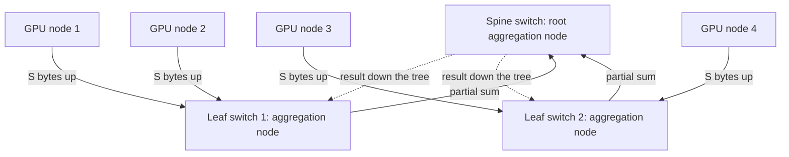

## Why this matters

All-reduce is the collective that dominates data-parallel training: every step, every GPU contributes its gradients and every GPU needs the sum. With ring or tree algorithms implemented on the hosts (see `collective-operations`), each byte of gradient crosses each NIC almost twice, and the work of adding numbers together is done by GPUs that would rather be training. **SHARP** (Scalable Hierarchical Aggregation and Reduction Protocol), NVIDIA's in-network computing technology on InfiniBand, moves the additions into the switches. Data goes up a tree of switches once, gets reduced on the way, and the result comes back down once.

For a network engineer, SHARP is unusual: it is a fabric feature whose benefit shows up as *application* bandwidth, whose configuration spans the Subnet Manager, a separate Aggregation Manager, host libraries and NCCL plugins, and whose silent failure mode is "the job runs, just slower". You need to know what it does, how much it should help, and how to prove it is active.

## Concepts

### All-reduce traffic without and with in-network aggregation

Assume N ranks each holding S bytes of gradient.

| Approach | Bytes each NIC sends | Bytes each NIC receives | Who does the arithmetic |
|---|---|---|---|
| Ring all-reduce (reduce-scatter + all-gather) | 2 × (N − 1)/N × S ≈ 2S | ≈ 2S | GPUs (or CPUs) |
| In-network aggregation (SHARP) | S | S | Switch ASICs |

Because large all-reduces are bandwidth-bound, halving the bytes per NIC can approach **twice the effective all-reduce bandwidth** in the best case. In practice the gain depends on message size, the number of nodes, how much of the collective crosses the IB fabric (versus NVLink inside the server), and implementation details; NVIDIA has published speed-ups for specific configurations, but measure your own.

For small messages the benefit is latency: a ring needs 2(N − 1) sequential steps, whereas an aggregation tree's depth grows with the number of switch levels (two or three in a fat tree), not with N.

```widget
allreduce-sim
```

Use the simulator to compare ring and tree behaviour; SHARP is the limiting case of a tree in which the interior nodes are switches rather than GPUs.

### The aggregation tree



1. Each host sends its data to its leaf switch.
2. The leaf's aggregation logic combines (for example, sums) the contributions of its children and forwards one partial result upward.
3. The root combines the partial results into the final result.
4. The result is sent back down the same tree to every participant.

Every link carries the data once up and once down, regardless of how many hosts sit below it.

### SHARP generations

| Generation | Switch family (InfiniBand speed) | Key capability |
|---|---|---|
| SHARP v1 | Switch-IB 2 (EDR) | Low-latency reductions for small messages (MPI-style collectives) |
| SHARP v2 | Quantum (HDR) | Adds **streaming aggregation** for large messages at line rate - the feature that made SHARP useful for deep learning; limited number of concurrent streaming trees |
| SHARP v3 | Quantum-2 (NDR) | Streaming aggregation for many concurrent trees and jobs (multi-tenant in-network computing) |
| Later generations | Quantum-X800 (XDR) | NVIDIA has announced further SHARP generations with XDR; check current documentation for capabilities |

Exact limits — how many concurrent trees, which data types and operations, maximum message sizes, which switches can act as aggregation nodes — depend on the switch generation and software release. Treat the table as the shape of the evolution and take numbers from NVIDIA's SHARP documentation.

> [!ANALOGY]
> SHARP is a bit like multicast in reverse, combined with an aggregation router. In a service-provider network, multicast replicates one stream down a tree so the source does not send N copies. SHARP adds the opposite direction: N streams flow up a tree and are merged into one at every branch, so the root never sees N copies. Where the analogy breaks down: the switch is not just copying packets, it is doing arithmetic on the payload, so the data type, operation and reduction order all matter — and resources inside the switch are finite and must be allocated per job.

## How it works

### Software components

| Component | Where it runs | Role |
|---|---|---|
| Subnet Manager | UFM or OpenSM host | Normal fabric management (prerequisite) |
| **Aggregation Manager (AM)** | Alongside the SM (UFM, or a SHARP AM daemon with OpenSM) | Discovers SHARP-capable switches, builds aggregation trees over the fat tree, allocates switch resources to jobs |
| SHARP libraries (`libsharp`, `libsharp_coll`) | Compute nodes | Request a tree for a group of processes, post reduction operations |
| SHARP daemon (`sharpd`) | Compute nodes, in some (mostly older) releases | Mediates between jobs and the AM; newer releases reduce or remove this dependency |
| Collective library integration | Compute nodes | NCCL via the SHARP/CollNet plugin; MPI via HPC-X collectives |

The flow for a job is: the job starts, the collective library asks (through the SHARP library) for an aggregation tree covering the job's nodes, the AM allocates a tree and switch resources, and the library then issues reductions that the switches execute. When the job ends, resources are released.

### SHARP in NCCL: CollNet

NCCL integrates SHARP through its **CollNet** network-collective interface, implemented by the NCCL SHARP plugin (part of `nccl-rdma-sharp-plugins`). Inside a server, NCCL reduces across the local GPUs over NVLink; between servers, it hands the inter-node part of the all-reduce to the network via CollNet. NCCL exposes algorithm names such as `CollNetDirect` and `CollNetChain` in its tuning and logs, and `NCCL_COLLNET_ENABLE=1` enables CollNet when the plugin and fabric support it. Check the NCCL release notes for current defaults; NCCL versions differ in whether CollNet is attempted automatically.

On rail-optimized fabrics (see `rail-optimized-topology`) the inter-node all-reduce runs per rail, so each rail needs its own aggregation trees, and the AM must have enough resources for all rails of all concurrent jobs.

A related technology inside the server is **NVLink SHARP (NVLS)**: NVSwitch-based in-network reduction for GPUs within an NVLink domain (Hopper-generation NVSwitch onward). NCCL can combine NVLS inside the NVLink domain with InfiniBand SHARP across servers. Do not confuse the two when reading NCCL logs: NVLS refers to the NVLink fabric, CollNet to the InfiniBand fabric.

### What the switch actually computes

The switch aggregation units implement a set of reduction operations (such as sum, min and max) over supported data types (integer and floating-point types; support for lower-precision formats such as FP16 and BF16 depends on the generation). Because the reduction order is fixed by the tree, results are deterministic for a given tree — but they can differ in the last bits from a ring all-reduce, because floating-point addition is not associative. Teams that compare loss curves bit-for-bit between runs with and without SHARP should expect tiny numerical differences.

### Constraints you will hit

- **Resources are finite.** Each switch has a limited number of aggregation resources; the AM may refuse a tree when they are exhausted, and the library then falls back to host-based algorithms.
- **Topology must be understood by the AM.** SHARP trees follow the fat tree; miscabling or non-standard topologies can prevent tree creation.
- **All participating switches must be SHARP-capable** and on compatible firmware.
- **Fallback is silent by default.** If anything is missing, NCCL simply uses ring or tree on the hosts; the job runs, just slower.

## In practice

### Is SHARP enabled on the fabric?

In UFM, SHARP aggregation management is enabled in UFM's configuration and its status is visible in the UFM interface and logs; with OpenSM, the SHARP Aggregation Manager runs as its own service alongside the SM. Follow the SHARP or UFM user manual for your release: configuration file locations and service names have changed across versions.

On compute nodes, check that the SHARP libraries and NCCL plugin are installed (often via HPC-X or NVIDIA's container images) and that the plugin is found by NCCL (`NCCL_DEBUG=INFO` prints which network plugin was loaded).

### Measuring the effect with nccl-tests

Run the same all-reduce benchmark with CollNet enabled and disabled (see `nccl-tests-interpretation` for reading the output):

```text
$ NCCL_DEBUG=INFO NCCL_COLLNET_ENABLE=0 mpirun ... all_reduce_perf -b 1M -e 4G -f 2 -g 1
$ NCCL_DEBUG=INFO NCCL_COLLNET_ENABLE=1 mpirun ... all_reduce_perf -b 1M -e 4G -f 2 -g 1
```

What to look for:

| Check | Expected when SHARP is active |
|---|---|
| NCCL INFO lines at init | Mentions of CollNet being initialised and the SHARP plugin, without errors or fallback warnings |
| Algorithm chosen (with `NCCL_DEBUG_SUBSYS` including tuning, or in newer NCCL logs) | CollNet algorithms selected for the inter-node part at large sizes |
| `busbw` for large messages | Clearly higher than with CollNet disabled; the exact gain depends on scale and system |
| IB port counters during the test | Lower bytes per host NIC for the same all-reduce size |

*(Exact log wording varies by NCCL and plugin version; search the log for "CollNet" and "SHARP" rather than relying on a fixed string.)*

For MPI jobs using HPC-X, SHARP is enabled through the HPC-X collective components and SHARP environment variables documented in the SHARP guide — for example, streaming aggregation has its own enable switch, documented in SHARP releases as `SHARP_COLL_ENABLE_SAT`; confirm variable names and defaults against the guide for your release.

> [!TIP]
> Make "SHARP on/off" a standard A/B test in cluster acceptance. If enabling it makes no difference at all, it is almost certainly not active — investigate the AM, plugin and resource allocation before concluding that SHARP does not help your workload.

> [!INTERVIEW]
> *"How does SHARP speed up all-reduce, and when would it not help?"* Strong answer: with ring all-reduce each NIC sends and receives about 2S bytes; with SHARP each host sends S up the tree and receives S down, the switches doing the reduction, so bandwidth-bound all-reduces can approach a 2x improvement and small-message latency scales with tree depth rather than rank count. It helps less when most reduction happens inside the NVLink domain (large NVLink domains leave little inter-node traffic), when messages are small and latency is dominated by software, when the collective is not an all-reduce (for example all-to-all in expert parallelism), or when switch resources are exhausted and the library falls back.

## Common pitfalls

- **Silent fallback.** Symptom: no performance change with `NCCL_COLLNET_ENABLE=1`. Cause: plugin not loaded, AM not running, or tree allocation failed. Fix: read NCCL INFO logs for CollNet/SHARP messages, check the AM, and check plugin installation inside the container.
- **Confusing NVLS with IB SHARP.** Symptom: "SHARP is working" based on NVLS lines in the log. Cause: NVLS is NVLink in-switch reduction inside the server domain. Fix: look specifically for CollNet initialisation for the InfiniBand part.
- **Resource exhaustion with many jobs.** Symptom: SHARP works for the first jobs, later jobs fall back. Cause: aggregation resources or tree limits reached. Fix: plan SHARP capacity per job and rail, and monitor AM allocation (UFM shows this).
- **Expecting bit-identical results.** Symptom: loss curves differ in the last digits between SHARP and non-SHARP runs. Cause: different floating-point reduction order. Fix: compare with tolerances; this is expected.
- **Topology problems block tree creation.** Symptom: AM logs errors about the topology. Cause: miscabling, missing links or unsupported switches. Fix: validate cabling against the plan (`ibnetdiscover`, `ibdiagnet`) and firmware versions.
- **Over-promising the gain.** Symptom: management expects 2x training speed. Cause: 2x applies at best to the inter-node all-reduce bandwidth, not end-to-end step time. Fix: estimate the communication share of step time first.

## Key takeaways

- SHARP performs reductions in InfiniBand switches along an aggregation tree: each host sends its data once and receives the result once.
- Compared with ring all-reduce (about 2S bytes per NIC each way), SHARP moves about S, so bandwidth-bound all-reduces can approach a 2x speed-up; small messages benefit from tree-depth latency.
- v1 (Switch-IB 2, EDR) targeted small messages, v2 (Quantum, HDR) added streaming aggregation for large messages, v3 (Quantum-2, NDR) added many concurrent streaming trees; later generations follow on XDR.
- The Aggregation Manager (with UFM or OpenSM) builds trees and allocates switch resources; NCCL uses SHARP through the CollNet plugin (`NCCL_COLLNET_ENABLE`).
- Failure is silent fallback to host algorithms; always A/B test and read NCCL logs for CollNet.
- NVLS (NVLink SHARP) is the intra-NVLink-domain counterpart; do not confuse it with InfiniBand SHARP.
