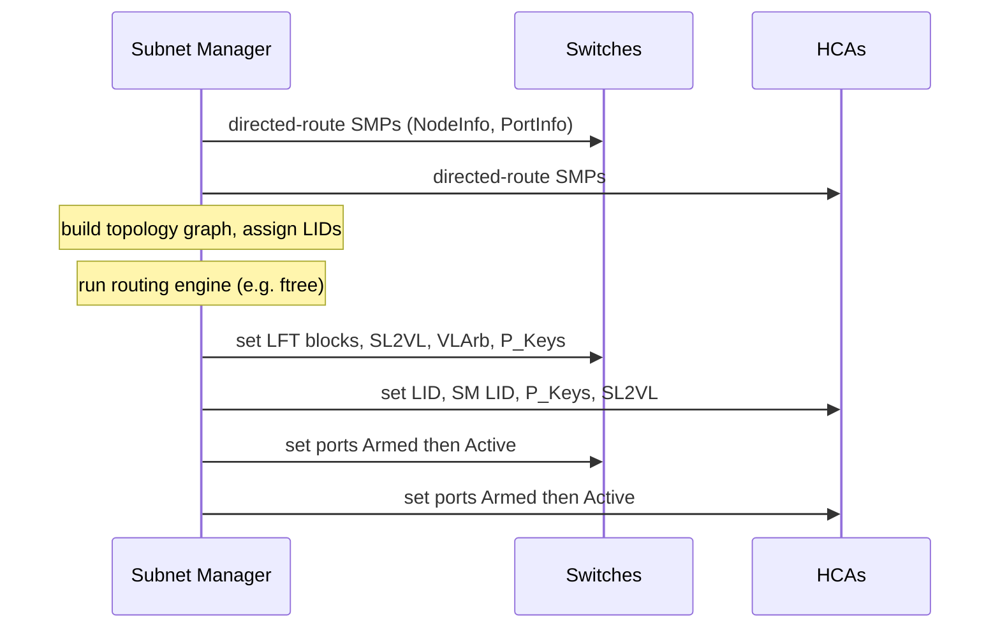
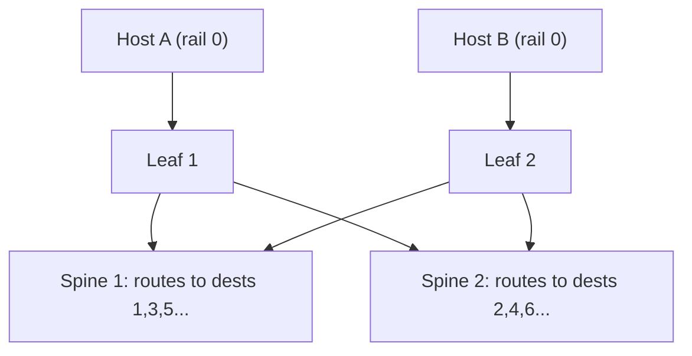

## Why this matters

On an InfiniBand fabric, *nothing* forwards until the Subnet Manager says so. The SM assigns every address, computes every path and writes every switch's forwarding table. Its choice of routing algorithm decides whether a 1,024-GPU all-reduce sees a non-blocking fabric or a handful of overloaded spine links, and its failover behaviour decides whether a controller crash is a non-event or a cluster-wide stall.

In an Ethernet AI fabric, path selection is spread across ECMP hash functions in every switch; on InfiniBand it is a single, inspectable, deterministic computation — plus adaptive routing when enabled. That makes InfiniBand easier to reason about, but only if you know which routing engine is running, how it balances destinations across uplinks, and what happens when a link fails. This lesson gives you that knowledge and the commands to verify what the SM actually did.

## Concepts

### What the SM is responsible for

| Task | What happens |
|---|---|
| **Discovery** | Walks the fabric hop by hop with directed-route SMPs, reading NodeInfo, PortInfo and SwitchInfo from every device |
| **LID assignment** | Gives every HCA port and every switch (port 0) a LID; keeps a GUID-to-LID mapping so LIDs stay stable across restarts when possible |
| **Path computation** | Runs a *routing engine* to decide, for every switch and every destination LID, which output port to use |
| **Table programming** | Writes linear forwarding tables (LFTs), multicast tables, P_Key tables, SL2VL and VL arbitration tables |
| **Port activation** | Moves ports from Init to Armed to Active once they are configured |
| **Subnet Administration** | Answers SA queries (path records, multicast joins, service records) from hosts |
| **Monitoring** | Receives traps (for example link-state changes) and re-sweeps |

### Where the SM runs

- **OpenSM**: the open-source SM, packaged with Linux distributions and run as a daemon on a host (or on a managed switch's CPU).
- **Switch-embedded SM**: managed NVIDIA switches can run an SM on the switch itself, which is convenient for small fabrics; vendor guidance typically recommends a host-based SM for large fabrics because of CPU and memory requirements (check current NVIDIA guidance for your scale).
- **NVIDIA UFM** (Unified Fabric Manager): a management platform that includes an SM derived from OpenSM plus telemetry, monitoring and configuration management. Large AI clusters commonly run UFM on a pair of dedicated servers. UFM is covered further in `ufm-netq-management`.

### Election: master and standby

Several SMs can run on one subnet for redundancy, but only one is **master**. Election compares the SM **priority** (0-15, higher wins) and, on a tie, the **lower port GUID** wins. Other SMs become **standby**, poll the master and take over if it stops responding. A higher-priority SM that comes up later can take over the master role (OpenSM has options that control whether it does).

> [!WARNING]
> An unmanaged extra SM is a classic incident source: someone starts OpenSM on a test host plugged into the production fabric with a higher priority, it becomes master, and it reprograms the fabric with its own (default) routing engine and configuration. Lock down which hosts may run an SM, set priorities deliberately, and monitor `sminfo`.

### Sweeps

- A **light sweep** happens periodically (OpenSM's `sweep_interval`, commonly 10 seconds by default) and checks for changes cheaply.
- A **heavy sweep** rediscovers the topology and recomputes routes. It is triggered by changes such as a port coming up or going down (reported by traps or detected in a light sweep).
- On a large fabric a heavy sweep and route recomputation can take seconds or longer and briefly perturb traffic, so a flapping link that causes repeated heavy sweeps is a fabric-wide problem, not a local one.

## How it works

### From discovery to forwarding tables



Linear forwarding tables are written in blocks of 64 entries. Because routing is destination-based, all traffic to a given DLID entering a given switch leaves on the same port (unless adaptive routing is enabled). The quality of a routing engine is therefore how well it spreads *destinations* across links.

Walk through discovery, LID assignment, route computation and LFT programming on a two-switch fabric; fail an inter-switch link to see the tables recomputed:

```widget
ib-addressing
```

### Credit loops: why routing must be deadlock-free

InfiniBand never drops packets for lack of buffer; a sender waits for credits instead (see `ib-flow-control-vls`). If routes form a cycle of buffer dependencies — packets in buffer A waiting for buffer B, B for C, and C for A — and all those buffers fill, no one can ever move: a **credit loop deadlock**. Routing engines prevent this either by restricting paths so no cycle can form, or by putting potentially cyclic paths on different virtual lanes, which have separate buffers.

### The routing engines

OpenSM includes several engines, selected with the `routing_engine` option (several can be listed as fallbacks). The main ones:

| Engine | Idea | Deadlock freedom | Typical use |
|---|---|---|---|
| `minhop` | Shortest paths, balancing port usage | Not guaranteed in general | Default; small or simple fabrics |
| `updn` (Up/Down) | Rank switches from root(s); a path may go up then down but never down then up | Yes, by construction | General topologies with clear roots |
| `dnup` | Variant of updn for fabrics where some CAs attach closer to the roots than some switches | Yes, by construction (ranking rules like updn) | Special cases |
| `ftree` | Fat-tree aware; spreads destinations evenly across uplinks so shift-style traffic is non-blocking | Yes on proper fat trees | Fat-tree / Clos AI and HPC fabrics |
| `dor` | Dimension-order routing (shortest paths taken in a fixed dimension order) | Yes for hypercubes and meshes cabled as such; not for tori (use torus-2QoS) | Mesh and hypercube topologies |
| `torus-2QoS` | Torus routing with VLs for deadlock freedom and QoS | Yes, uses VLs | 2D/3D tori |
| `lash` | Layered shortest path; assigns paths to layers (VLs) to break cycles | Yes, uses VLs | Irregular topologies |
| `dfsssp` / `sssp` | (Deadlock-free) single-source shortest path, globally balanced | dfsssp: yes, uses VLs | Irregular topologies, good balance |

The list of engines and their options evolves between OpenSM releases, and NVIDIA's OpenSM/UFM adds engines of its own — for example adaptive-routing variants named with an `ar_` prefix such as `ar_updn` and `ar_ftree`. Treat exact names and behaviour as version-specific and confirm in the documentation for the SM release you run.

### Why ftree for AI fat trees

In a two- or three-tier fat tree (see `clos-leaf-spine`), every leaf has many uplinks. `ftree` identifies the tree levels (it can be told which nodes are compute nodes or which switches are roots via GUID files if auto-detection is not reliable) and then assigns destination LIDs to uplinks in a round-robin, globally coordinated way: each spine "owns" a share of the destinations, and traffic to a destination always goes up to the spine that owns it and down from there. The result is that common permutation patterns (like the shifts in ring all-reduce) map onto distinct links instead of colliding.



This deterministic spreading is roughly what ECMP tries to achieve by hashing, but without hash collisions. The trade-off is that it balances *destinations*, not live load: two heavy flows to destinations owned by the same spine still share a link, and if the topology is not a clean fat tree (missing cables, asymmetric wiring), balance degrades. That is why cabling accuracy matters so much on IB fabrics.

### Adaptive routing

With adaptive routing (AR) on NVIDIA Quantum-class switches, the SM programs *several* valid output ports per destination and the switch picks among them per packet (or per flowlet, depending on mode) based on queue occupancy. AR addresses the residual collisions of static routing and reacts to failures faster. It requires:

- an SM configuration that enables AR (in NVIDIA's OpenSM/UFM, the `ar_*` engines or equivalent settings — check your release documentation),
- switch firmware with AR support,
- an HCA and transport that tolerate packets of one QP arriving out of order (recent ConnectX adapters support this for RC traffic when configured; verify for your adapter and software stack).

NVIDIA also documents fast, switch-local reaction to link failures (marketed as SHIELD) that reroutes around a dead link before the SM finishes a heavy sweep. Compare static hashing, adaptive routing and spraying in the widget below; the same intuition applies to IB's static versus adaptive routing.

```widget
ecmp-collision
```

### LMC and multipath

With LMC > 0 each port has several LIDs, and the SM routes each LID differently. A host can then spread QPs over different paths by addressing different DLIDs of the same destination. This is an older, explicit multipath mechanism; with adaptive routing available, most AI fabrics run LMC 0.

## In practice

### Configuring OpenSM

OpenSM can write its full default configuration to a file you then edit:

```text
$ opensm --create-config /etc/opensm/opensm.conf
$ grep -E "^(routing_engine|sm_priority|sweep_interval|lmc) " /etc/opensm/opensm.conf
routing_engine (null)
sm_priority 0
sweep_interval 10
lmc 0
```

*(Illustrative; option names and defaults should be checked against your OpenSM version.)* For a fat tree you would set `routing_engine ftree` (optionally with fallbacks, for example `ftree,updn,minhop`), give production SMs high priorities, and point root or compute-node GUID files at the right lists if your topology needs them. On the command line, `-R` / `--routing_engine` selects the engine, `-p` / `--priority` sets the priority and `-g` / `--guid` binds OpenSM to a specific local port.

With UFM, the same settings are made through UFM's configuration rather than directly in opensm.conf; follow the UFM documentation.

### Is there exactly one master SM?

```text
$ sminfo
sminfo: sm lid 1 sm guid 0x0002c90300aabbcc, activity count 98321 priority 15 state 3 SMINFO_MASTER
```

*(Illustrative.)* State 3 is master. A steadily increasing activity count shows the SM is alive. Query the standby with `sminfo` against its LID to confirm it is in standby state.

### What route did the SM install?

`ibroute` dumps a switch's unicast LFT; `dump_fts` dumps all switches' tables; `ibtracert` follows the path between two LIDs:

```text
$ ibroute 2
Unicast lids [0x0-0x5f] of switch Lid 2 guid 0xfc6a1c0300e4f100 (leaf01):
  Lid  Out   Destination
       Port     Info
0x000c 001 : (Channel Adapter portguid 0xb83fd20300a1b2c4: 'node01 HCA-1')
0x000d 002 : (Channel Adapter portguid 0xb83fd20300a1b2d8: 'node02 HCA-1')
0x002d 033 : (Channel Adapter portguid 0xb83fd20300a1c7e0: 'node40 HCA-1')
0x002e 034 : (Channel Adapter portguid 0xb83fd20300a1c7f4: 'node41 HCA-1')

$ ibtracert 12 45
From ca {0xb83fd20300a1b2c4} portnum 1 lid 12-12 "node01 HCA-1"
[1] -> switch port {0xfc6a1c0300e4f100}[1] lid 2-2 "leaf01"
[33] -> switch port {0xfc6a1c0300e50a00}[1] lid 20-20 "spine01"
[3] -> switch port {0xfc6a1c0300e4f300}[33] lid 4-4 "leaf03"
[5] -> ca port {0xb83fd20300a1c7e0}[1] lid 45-45 "node40 HCA-1"
To ca {0xb83fd20300a1c7e0} portnum 1 lid 45-45 "node40 HCA-1"
```

*(Illustrative.)* On leaf01, destinations 0x2d and 0x2e leave on consecutive uplinks 33 and 34 — the spreading `ftree` is designed to produce. If many remote destinations share one uplink while others are unused, either the engine is not the one you think, or the topology confused it (for example a miscabled spine).

> [!TIP]
> After any recabling or switch replacement, compare `dump_fts` output (or UFM's routing report) with the expected balance and run a fabric-wide check such as `ibdiagnet` (see `ib-tools-diagnostics`) before returning the fabric to production.

> [!INTERVIEW]
> *"Your IB fat tree shows hot spine links during all-reduce even though no link is down. What do you look at?"* Strong answer: confirm which SM is master and which routing engine it actually used (logs, `sminfo`, configuration) — a fallback to minhop or a rogue SM is common; check the topology for miscabling or missing links that break ftree's symmetry; dump the LFTs to see whether destinations are evenly spread across uplinks; then consider adaptive routing (with transport support for reordering) for residual collisions, and check that the job's rank placement matches the rail design.

## Common pitfalls

- **Rogue or misconfigured SM becomes master.** Symptom: sudden fabric-wide performance change after someone's maintenance; `sminfo` shows an unexpected GUID. Cause: an extra SM with higher priority or lower GUID. Fix: control where SMs run, set priorities explicitly, alert on master changes.
- **Silent fallback to a different engine.** Symptom: routing imbalance despite `ftree` being configured. Cause: the topology did not satisfy ftree's requirements, so OpenSM fell back to the next engine in the list. Fix: read the SM log for routing engine messages, fix cabling or provide root/compute-node GUID files.
- **Flapping link triggers heavy sweeps.** Symptom: periodic fabric-wide hiccups, SM log full of topology changes. Cause: a marginal cable going up and down. Fix: find it with link error counters and disable or replace it.
- **Using minhop on a topology prone to credit loops.** Symptom: rare but total traffic freezes under heavy load. Cause: routes with cyclic buffer dependencies. Fix: use a deadlock-free engine for the topology (updn/ftree for trees, VL-based engines for others).
- **Enabling adaptive routing without transport support.** Symptom: performance drops or retransmissions rise after enabling AR. Cause: out-of-order arrival not handled by the HCA configuration or application stack. Fix: follow the vendor's AR enablement guide end to end, including HCA settings.
- **Inventories by LID.** Symptom: wrong device blamed after an SM failover. Cause: LIDs reassigned. Fix: identify devices by GUID and node description.

## Key takeaways

- The SM discovers the fabric with directed-route SMPs, assigns LIDs, computes routes with a routing engine and programs LFTs, SL2VL, VLArb and P_Key tables, then activates ports.
- One master SM per subnet: highest priority wins, lowest GUID breaks ties; standbys take over on failure.
- Light sweeps are periodic; heavy sweeps on topology changes recompute routes and can perturb large fabrics.
- Routing must avoid credit-loop deadlocks; updn and ftree do so by construction on trees, lash/dfsssp/torus-2QoS use VLs.
- `ftree` spreads destinations across uplinks deterministically, which suits fat-tree AI fabrics; adaptive routing (NVIDIA `ar_*` engines, version-specific) handles residual collisions.
- Verify the result with `sminfo`, `ibroute`, `dump_fts` and `ibtracert` rather than trusting the configuration file.
