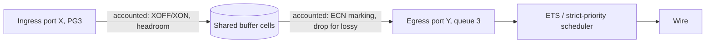
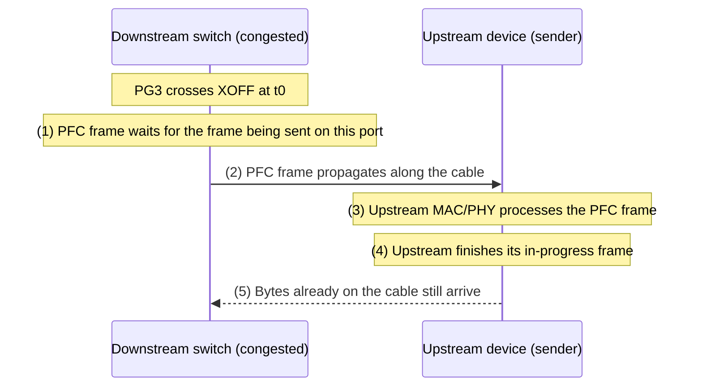

## Why this matters

PFC promises "no drops", but the promise only holds if the switch has somewhere to put the bytes
that keep arriving *after* it has asked its neighbour to stop. That reserved space is **headroom**.
Size it too small and the "lossless" class drops packets precisely during the worst congestion
events, which then look like random RDMA retransmission storms. Size it too large, or for too many
priorities and ports, and you starve the shared buffer that absorbs the microbursts of everything
else. Buffer is the scarcest resource in a modern switch. A 51.2 Tb/s ASIC moves about 6.4 GB every
millisecond but has on-chip buffer on the order of a hundred megabytes (check your datasheet), so
it holds microseconds, not milliseconds, of traffic per port.

Alongside buffers sit two other pieces of the Data Center Bridging (DCB) toolkit: **ETS**, which
decides how a port's bandwidth is shared between traffic classes, and **DCBX**, which can negotiate
PFC and ETS settings between neighbours. Together with PFC they define how lossless RoCE coexists
with everything else on the same wires.

## Concepts

### Shared-buffer switches

Data centre switch ASICs use a **shared memory** buffer: one pool of memory, divided into fixed-size
**cells** (typically on the order of a couple of hundred bytes, depending on ASIC), that all ports
draw from. Each packet is accounted twice:

- **Ingress accounting**, per port and per **priority group (PG)**. This decides when to send PFC.
- **Egress accounting**, per port and per **queue** (traffic class). This decides tail drop for
  lossy queues, ECN marking, and scheduling.

| Buffer region | Purpose |
|---|---|
| Reserved / guaranteed (per PG and per queue) | A small minimum so that every port and class can make progress |
| Shared pool(s) | The bulk of memory, used dynamically. Lossless and lossy traffic usually draw from **separate pools**, so that one cannot exhaust the other. |
| Headroom (per lossless PG per port) | Absorbs in-flight bytes after XOFF. Only lossless PGs need it. |

### Dynamic thresholds

A fixed per-queue limit wastes memory. **Dynamic thresholds** let a PG or queue grow up to
`alpha × (free shared buffer)`. When the switch is quiet, one congested port can borrow a lot of
memory. When many ports are congested, each gets less, and the thresholds fall together. A larger
alpha favours absorbing big bursts on few ports. A smaller alpha favours fairness across many
ports. For a lossless PG, the dynamic threshold effectively *is* the XOFF trigger. That means PFC
fires earlier when the switch is busy, which is the desired behaviour.



> [!ANALOGY]
> A shared buffer is like a hotel with one big pool of rooms rather than a fixed block per tour
> company. Ingress accounting is the tour guide who radios "stop sending buses" when his group
> holds too many rooms. Headroom is a block of rooms held back for the buses that are already on
> the road when he radios. The analogy breaks down because the hotel must also check guests *out*
> through a fixed number of doors (egress queues and their scheduler), and that is where ECN and ETS act.

### ETS: sharing bandwidth between traffic classes (802.1Qaz)

ETS has two parts:

1. **Priority to traffic class mapping.** The eight priorities (from PCP or from DSCP trust)
   are mapped to up to eight traffic classes (TCs), which are the egress queues.
2. **Transmission selection per TC.** Each TC is either **strict priority** (always served first,
   used for small, latency-critical traffic such as CNPs or network control) or **ETS**
   (weighted, with a bandwidth percentage).

ETS percentages are **minimum guarantees under contention**, not caps. If TC3 (RoCE) is guaranteed
60 % and TC0 (TCP) 40 %, and TC0 has nothing to send, TC3 may use 100 % of the link. Strict
priority classes are served before all ETS classes, so they must carry little traffic, or they
can starve everything else.

| TC | Example use in a RoCE fabric | Scheduler | Example share |
|---|---|---|---|
| 0 | Default / TCP / management | ETS | remainder |
| 3 | RoCE data (lossless) | ETS | the majority |
| 6 | CNP (congestion notifications) | Strict | n/a (tiny volume) |
| 7 | Network control (routing protocols), where used | Strict or ETS | small |

These numbers are an illustration of the *shape* of a policy, not a standard. NVIDIA's RoCE
defaults and SONiC's default QoS maps differ in detail. Use your platform's validated profile.

### DCBX: negotiating it over LLDP

**DCBX** (Data Center Bridging eXchange) carries DCB settings in LLDP TLVs between directly
connected neighbours:

| TLV | Carries |
|---|---|
| ETS Configuration / ETS Recommendation | Priority-to-TC map, TSA per TC, bandwidth percentages |
| PFC Configuration | Which priorities are PFC-enabled. It also carries an MBC bit and a PFC capability field. |
| Application Priority | Maps applications to priorities, e.g. "UDP port 4791 → priority 3" or "DSCP 26 → priority 3" |

Each side advertises a **willing** bit. A willing device adopts its peer's configuration. In the
classic pattern, the switch is non-willing and the host NIC is willing, so the switch "pushes" PFC
and ETS settings to the host. Two DCBX flavours exist in the field: the **IEEE** version
(standardised in 802.1Qaz) and the older pre-standard **CEE** version. Both ends must speak the same one.

Many AI back-end fabrics do **not** rely on DCBX. They configure hosts explicitly (with
`mlnx_qos`, `dcb`, or NIC firmware settings via the vendor's tools), because explicit configuration
is easier to audit and does not depend on LLDP sessions coming up in the right order. Whichever
approach you choose, be consistent. A willing NIC that receives an unexpected DCBX advertisement
can silently change its PFC settings.

## How it works

### What headroom has to absorb

When a lossless PG crosses XOFF at time *t₀*, bytes keep arriving for a while. The headroom must
cover the sum of these contributions:



1. **Downstream transmit delay.** The PFC frame is sent out of the same port the data arrives on.
   If that port has just started transmitting a maximum-size frame towards the upstream device,
   the PFC frame waits behind it (up to one port MTU). Data keeps arriving meanwhile.
2. **Propagation of the PFC frame** across the cable: about 5 ns per metre in fibre, and the
   same order in copper.
3. **Response delay** in the upstream device: PHY, FEC and MAC latency plus the time for the
   upstream scheduler to stop the queue. IEEE 802.3 specifies maximum delays for the MAC and PHY
   sublayers, and the PFC headroom model in IEEE 802.1Q (Annex N, from 802.1Qbb) builds on them. Real
   implementations, especially at 400G/800G with heavier FEC, add PHY and FEC latency on top. This
   component is device-specific.
4. **Upstream in-progress frame.** The upstream device cannot abort a frame it has started, so up
   to one more MTU is sent.
5. **Bytes in flight on the cable** in the forward direction: another propagation delay's worth of
   data at line rate.

In short: **headroom ≈ line rate × (2 × cable propagation delay + response delays) + about 2 × MTU**.
On top of that, you add a margin for **cell granularity**: a 64-byte packet still occupies a whole
buffer cell, so a burst of small packets consumes more buffer than its byte count suggests.

### Worked example (order of magnitude)

400 Gb/s port, 100 m fibre between leaf and spine, 9216-byte port MTU, and an assumed combined
response delay of about 1 µs (a placeholder: real values depend on PHY, FEC and ASIC).

| Component | Calculation | Bytes |
|---|---|---|
| Cable, round trip | 2 × 100 m × 5 ns/m = 1 µs → 400 Gb/s × 1 µs = 400 000 bits | ≈ 50 000 |
| Two maximum-size frames | 2 × 9 216 | ≈ 18 400 |
| Response delays | 400 Gb/s × ~1 µs | ≈ 50 000 |
| **Total before cell-efficiency margin** | | **≈ 120 KB** |

So: on the order of **100 KB per lossless priority per port** at 400G in a data hall. Multiply it out:

- 64 ports × 1 lossless PG × ~120 KB ≈ **7.5 MB** reserved. That is acceptable on an ASIC with tens to
  hundreds of MB.
- 64 ports × **2** lossless PGs ≈ 15 MB. Still feasible, but it now visibly eats into the shared pool.
- Change the cable to **2 km** (a campus or building-to-building link): the cable term alone becomes
  400 Gb/s × 20 µs = 8 Mbit = **1 MB per PG per port**. This is why long-distance lossless Ethernet
  is hard, and why designs avoid PFC across long links.
- Double the speed to 800G and *every* rate-proportional term doubles, while buffer per port has not
  grown as fast across ASIC generations.

Reproduce the worked example below (it defaults to 400G, 100 m, 9216 bytes and 1 µs), then stretch the cable to 2 km or add a second lossless priority and watch the total budget.

```widget
headroom-calculator
```

> [!TIP]
> Do not hand-calculate production headroom. Switch vendors provide headroom calculators, or compute
> headroom automatically from port speed, configured cable length and MTU (for example SONiC's buffer
> manager and NVIDIA's RoCE profiles on Spectrum switches). Your job is to give the switch the
> correct **cable length** and **MTU**, understand the order of magnitude, and recognise when a
> design (long links, many lossless classes) breaks the budget.

### Headroom on the NIC

NICs also have receive buffers, and they send PFC when those fill. On ConnectX adapters the receive
buffer is split into a small number of buffers that priorities are mapped to, each with its own
XOFF/XON. The driver normally sizes these from MTU and cable length. NVIDIA's `mlnx_qos` exposes
`--prio2buffer`, `--buffer_size` and `--cable_len` options on recent versions for manual control.
Check `mlnx_qos --help` and the NIC documentation before changing them, because wrong values cause
NIC-side drops (`rx_discards_phy` increasing in `ethtool -S`).

### How ETS schedules

At each egress port, the scheduler picks the next queue to transmit:

1. Any non-empty **strict-priority** TC is served first (highest first).
2. Otherwise, the **ETS** TCs are served by a weighted algorithm (typically a deficit-weighted
   round-robin variant) in proportion to their percentages, among the TCs that currently have data.
3. A **paused** TC (PFC received for its priorities) is skipped. Other TCs keep the link busy.

Note the interaction with PFC: PFC pauses *priorities*, and ETS schedules *TCs*. If two priorities
share a TC and only one is lossless, a pause for one blocks the shared queue for both. Keep the
lossless priority alone in its own TC.

### Lossy and lossless on the same port

A well-designed profile keeps the classes from hurting each other:

- **Separate pools** for lossless ingress and lossy egress, so that a lossy burst cannot consume
  the space lossless traffic needs before XOFF.
- **Lossy queues drop at egress** (tail drop or WRED). They never generate PFC.
- **Lossless queues should not drop at egress**. Their back-pressure comes from ingress PFC. In
  practice the egress limit for the lossless queue is set high or effectively unlimited, and ECN
  marking happens well below it.

```widget
pfc-ecn-sim
```

Use the simulator to see the ordering of thresholds: ECN marking starts first (low), XOFF sits
above it, and headroom sits above XOFF. If you misconfigure ECN thresholds above XOFF, PFC fires
before any congestion signal reaches the sender.

## In practice

### Host: inspect priority-to-TC, ETS and buffers

The captures are from a ConnectX-5 with PFC on priority 3. The inbox one shows the default ETS state;
the DOCA one was taken after the `mlnx_qos --tsa ... --tcbw ...` command shown further down, without
`--prio_tc`:

```bash stack=inbox
dcb ets show dev ens64f0np0
```

```text stack=inbox real
willing off ets-cap 8 cbs off
tc-bw 0:0 1:0 2:0 3:0 4:0 5:0 6:0 7:0
pg-bw 0:0 1:0 2:0 3:0 4:0 5:0 6:0 7:0
tc-tsa 0:vendor 1:vendor 2:vendor 3:vendor 4:vendor 5:vendor 6:vendor 7:vendor
prio-tc 0:1 1:0 2:2 3:3 4:4 5:5 6:6 7:7
reco-tc-bw 0:0 1:0 2:0 3:0 4:0 5:0 6:0 7:0
reco-tc-tsa 0:strict 1:strict 2:strict 3:strict 4:strict 5:strict 6:strict 7:strict
reco-prio-tc 0:0 1:0 2:0 3:0 4:0 5:0 6:0 7:0
```

```bash stack=doca
mlnx_qos -i ens64f0np0
```

```text stack=doca real
DCBX mode: OS controlled
Priority trust state: dscp
dscp2prio mapping:
...
Receive buffer size (bytes): 130944,130944,0,0,0,0,0,0,max_buffer_size=262016
Cable len: 7
PFC configuration:
	priority    0   1   2   3   4   5   6   7
	enabled     0   0   0   1   0   0   0   0
	buffer      0   0   0   1   0   0   0   0
tc: 0 ratelimit: unlimited, tsa: ets, bw: 10%
	 priority:  1
tc: 1 ratelimit: unlimited, tsa: ets, bw: 5%
	 priority:  0
...
tc: 3 ratelimit: unlimited, tsa: ets, bw: 60%
	 priority:  3
...
tc: 6 ratelimit: unlimited, tsa: strict
	 priority:  6
tc: 7 ratelimit: unlimited, tsa: ets, bw: 10%
	 priority:  7
```

Line by line (`mlnx_qos`): priority 3 is PFC-enabled and mapped to receive buffer 1 (the lossless
one), TC3 gets an ETS share, and TC6 is strict for CNPs. On a ConnectX-5, enabling PFC on one priority
split the 262016-byte receive buffer into two buffers of 130944 bytes. Before any ETS configuration,
every TC shows `tsa: vendor` (in `dcb`, `tc-tsa 0:vendor ...`). The exact layout of this output varies
between versions; under DOCA-OFED the default `dcb ets show` read `tc-bw 0:100 1:100 ...` where the
inbox driver printed `tc-bw 0:0 1:0 ...`.

> [!VERIFIED]
> **The default mlx5 priority-to-TC map put priority 0 in TC1 and priority 1 in TC0.**
> On ConnectX-5 (fw 16.29) with both stacks, `dcb ets show` printed `prio-tc 0:1 1:0 2:2 3:3 4:4 5:5 6:6 7:7`
> and `mlnx_qos` listed `tc: 0 ... priority:  1` and `tc: 1 ... priority:  0`. Because `--tcbw` values are per TC,
> the `--tcbw 10,5,...` above gave priority 1 the 10 % and default traffic on priority 0 only 5 %. Check the map
> before you assign ETS shares, or set it explicitly with `--prio_tc` (`mlnx_qos`) or `prio-tc` (`dcb ets`).

Setting ETS explicitly with `mlnx_qos` looks like this (the values are an example policy):

```bash
mlnx_qos -i ens64f0np0 \
  --prio_tc 0,1,2,3,4,5,6,7 \
  --tsa ets,ets,ets,ets,ets,ets,strict,ets \
  --tcbw 10,5,5,60,5,5,0,10
```

`--prio_tc` maps priority *i* to TC *i*. `--tsa` sets the selection algorithm per TC. `--tcbw`
gives the ETS percentages, which must add up to 100, with 0 for strict TCs (otherwise the command
fails with `Netlink error: Bad value. see dmesg.`). `mlnx_qos` comes with NVIDIA's stack only. The
upstream Linux alternative is the iproute2 `dcb` tool (`dcb ets`, `dcb pfc`, `dcb buffer`). See
`man dcb` for the syntax supported by your iproute2 version and driver. `dcb buffer` shows the
receive-buffer split on both stacks:

```bash
dcb buffer show dev ens64f0np0
```

```text real=inbox
prio-buffer 0:0 1:0 2:0 3:1 4:0 5:0 6:0 7:0
buffer-size 0:130944b 1:130944b 2:0b 3:0b 4:0b 5:0b 6:0b 7:0b
total-size 262016b
```

Before PFC was enabled the same command printed `prio-buffer 0:0 1:0 ...` and `buffer-size 0:262016b 1:0b ...`:
one buffer holding everything.

### Switch: watch PG and queue watermarks

Watermarks (peak occupancy since the last clear) are the most useful buffer telemetry. In SONiC:

```bash
show priority-group watermark shared       # peak shared-buffer use per PG
show priority-group watermark headroom     # peak headroom use per PG: non-zero means XOFF was crossed
show queue watermark unicast               # peak egress queue occupancy
```

```text
# illustrative: headroom watermark, bytes
     Port    PG0    PG1    PG2      PG3     PG4    PG5    PG6    PG7
---------  -----  -----  -----  -------  ------  -----  -----  -----
Ethernet0      0      0      0   38,912       0      0      0      0
```

How to read it: headroom use above zero means pauses happened. Headroom use approaching the
**configured headroom size** means you are close to dropping lossless traffic. Either headroom is
under-sized (wrong cable length or MTU), or ECN is not acting early enough.

On Cumulus Linux with NVUE, `nv show qos roce` summarises the RoCE profile, including the
buffer-related settings that the profile applies, and NVUE has further `nv show qos ...` views for
buffers and per-interface QoS. Check the NVUE command reference for your release.

### DCBX status

On hosts with LLDP agents (`lldpad` and `lldptool`, or NIC firmware LLDP), you can view advertised
and received DCBX TLVs. On ConnectX, whether DCBX is handled by the OS or the firmware is itself a
setting (`mlnx_qos` reports "DCBX mode"). Pick one owner and document it.

## Common pitfalls

- **Wrong cable length in the buffer profile.** *Symptom:* lossless drops (ingress discards on
  the lossless PG) on long uplinks only, during incast. *Cause:* headroom computed for a default
  short cable (often a few metres) while the actual link is 100 m or more. *Fix:* set the real cable
  length per port and let the switch recompute headroom, then check that the headroom watermark has margin.
- **Too many lossless classes.** *Symptom:* lossy traffic drops early, or the platform refuses
  the configuration. *Cause:* headroom × PGs × ports exceeds the budget. *Fix:* one lossless RoCE
  class, a second only if there is a clear need (storage).
- **Lossless and lossy priorities in the same TC.** *Symptom:* TCP or other lossy traffic stalls
  whenever RoCE is paused. *Cause:* a shared queue is blocked by PFC. *Fix:* give the lossless
  priority its own TC.
- **Reading ETS percentages as rate limits.** *Symptom:* "RoCE reaches 95 % of the link although
  we gave it 60 %." *Cause:* ETS is a minimum under contention, and unused share is redistributed.
  *Fix:* nothing is wrong. Use a shaper or rate limit if a cap is really required.
- **Putting bulk traffic in strict priority.** *Symptom:* every other class starves. *Cause:*
  strict TCs are always served first. *Fix:* reserve strict priority for tiny control flows such as CNP.
- **DCBX surprises.** *Symptom:* a host's PFC settings change after a switch change or reboot.
  *Cause:* a willing NIC accepted a neighbour's DCBX advertisement, or the IEEE/CEE versions do not
  match. *Fix:* choose static host configuration or switch-driven DCBX deliberately, and verify after
  every change.

## Key takeaways

- Switches use a shared, cell-based buffer with **ingress PG accounting** (PFC) and **egress
  queue accounting** (ECN, drops, scheduling). Dynamic thresholds scale limits with free buffer.
- **Headroom** absorbs bytes in flight after XOFF: about line rate × (2 × cable delay + response
  delays) + about 2 MTU, plus a cell-efficiency margin. At 400G and 100 m, that is on the order of
  100 KB per lossless PG per port.
- Headroom grows with **speed** and **cable length**. Long links and many lossless classes break
  the budget. Use vendor calculators and give the switch correct cable lengths.
- **ETS** maps priorities to TCs and guarantees minimum bandwidth shares under contention. Strict
  priority is for tiny control flows such as CNP.
- **DCBX** exchanges PFC, ETS and application-priority settings via LLDP. Use it or static
  configuration deliberately, never by accident.
- Watermarks (shared, headroom, queue) are the telemetry that tells you whether your buffer design holds up.
