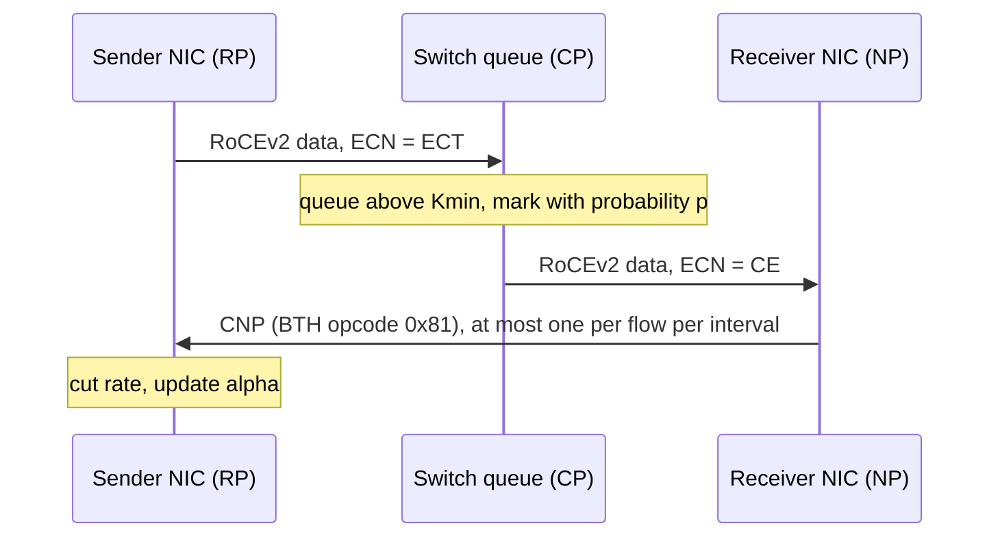

## Why this matters

PFC stops packet loss but does nothing to fix the *cause* of congestion. If eight GPUs each send at
400 Gb/s to one receiver behind a single 400 Gb/s port, PFC will keep pausing them, and the pause
will spread backwards through the fabric, hurting innocent flows. Only the senders can solve the
problem, by slowing down to their fair share. They can only do that if someone tells them that
the path is congested.

**ECN** (Explicit Congestion Notification) is how the switch says "I am getting full" without
dropping anything. **DCQCN** (Data Center Quantized Congestion Notification) is the algorithm,
implemented in RoCE NIC hardware, that turns those marks into per-flow rate changes. Together they
are the steady-state congestion control of a RoCE fabric. When they are tuned well, queues stay
short, PFC almost never fires, and all-to-all traffic gets close to fair sharing. When they are
missing or mistuned, you get a fabric where PFC does all the work, and the ugly behaviour from the
previous lessons appears at scale.

## Concepts

### ECN in the IP header (RFC 3168)

The low two bits of the IPv4 ToS byte (and of the IPv6 Traffic Class) are the ECN field:

| Bits | Name | Meaning |
|---|---|---|
| `00` | Not-ECT | Sender does not support ECN. A congested switch must **drop** rather than mark. |
| `10` | ECT(0) | ECN-capable transport |
| `01` | ECT(1) | ECN-capable transport (the alternate codepoint) |
| `11` | CE | **Congestion Experienced**: set by a switch instead of dropping |

A RoCE NIC with congestion control enabled sends its data packets as ECN-capable. A switch whose
queue for that class is building up rewrites ECT to **CE**. It only changes the two ECN bits, and
the RoCEv2 ICRC masks the ToS byte, so marking does not corrupt the packet.

### Marking: Kmin, Kmax, Pmax

Switches decide *whether* to mark using a RED-like profile (often configured through the WRED/ECN
feature) on the egress queue:

```text
 mark probability
   1.0 |                               +-----------  (above Kmax: mark every packet)
       |                              /|
       |                             / |
  Pmax |                       ....-'  |
       |                   .-'         |
       |               .-'             |
     0 +-----------+-'-----------------+------------> egress queue depth
                  Kmin                Kmax
```

- Below **Kmin**: no marking.
- Between **Kmin** and **Kmax**: mark with probability rising linearly from 0 to **Pmax**.
- Above **Kmax**: mark every ECN-capable packet.

Some implementations use the *instantaneous* queue depth, as DCTCP and the DCQCN paper do, rather
than the averaged queue of classic RED. Some can also mark at *dequeue* rather than enqueue, which
gets the signal to the receiver sooner. Check what your ASIC does.

> [!NOTE]
> The DCQCN paper used Kmin = 5 KB, Kmax = 200 KB and Pmax = 1 % on its 40 Gb/s testbed. Do not
> copy these to a 400 Gb/s fabric. Vendor RoCE profiles for current speeds use different (generally
> larger) thresholds and often a much steeper marking curve. Start from your vendor's validated
> profile and tune with measurements.

### DCQCN roles

DCQCN splits the work among three parties, using the terminology of the QCN standard it descends from:

| Role | Who | Job |
|---|---|---|
| **CP**, congestion point | Switch egress queue | Marks CE according to Kmin/Kmax/Pmax |
| **NP**, notification point | Receiving NIC | Sees CE-marked packets and sends **CNPs** back to the sender, rate-limited per flow |
| **RP**, reaction point | Sending NIC | Cuts the flow's rate when CNPs arrive, and recovers it when they stop |



The **CNP** is itself a small RoCEv2 packet: UDP 4791, BTH opcode **0x81**, addressed to the
sender's QP. It is sent with its own DSCP and priority, commonly a strict-priority class (DSCP 48 /
priority 6 is a common NVIDIA convention, covered in the QoS lesson), so that it overtakes the
congested data traffic. A CNP stuck behind the congestion it reports is useless.

> [!ANALOGY]
> ECN plus DCQCN is like TCP with ECN, or DCTCP, implemented in NIC silicon. The switch marks, the
> receiver echoes, the sender backs off. The differences matter. TCP echoes congestion inside ACKs
> and adjusts a *window*. DCQCN sends a separate CNP and adjusts a *rate*, because RDMA NICs pace
> packets with hardware rate limiters, and RoCE ACKs are not generated per packet. DCQCN also starts
> every flow at **line rate**, with no slow start, because AI and storage flows want full bandwidth immediately.

## How it works

### The notification point

When the receiving NIC gets a CE-marked packet for a flow (typically per QP), it generates a CNP
to the source, *unless* it has already sent one for that flow within the last **N** microseconds
(the DCQCN paper used 50 µs). This rate limit keeps CNP traffic small no matter how many packets
are marked, and it quantises feedback: the sender learns "this flow saw congestion in the last
interval", not how many packets were marked.

### The reaction point: cutting the rate

The sender NIC keeps, per flow, a **current rate** R_C, a **target rate** R_T, and a congestion
estimate **α** (between 0 and 1, initialised to 1 in the paper). When a CNP arrives:

```text
R_T ← R_C
R_C ← R_C × (1 − α / 2)
α   ← (1 − g) × α + g
```

The rate cut is proportional to α: a flow that has been seeing persistent congestion (α close to 1)
halves its rate, and a flow that sees occasional marks (small α) cuts gently. If no CNP arrives
for a period K (55 µs in the paper), α decays:

```text
α ← (1 − g) × α
```

The gain **g** is small (the paper used 1/256), so α is a slowly moving average of "how often am I
being told about congestion". This is the same idea as DCTCP's α, implemented with a timer
instead of per-ACK fractions.

### The reaction point: recovering

DCQCN increases the rate in three stages. Two counters drive the stages: a **timer** that fires
every period T, and a **byte counter** that fires every B bytes sent. Each firing is an increase
event, and both counters reset when a CNP arrives.

| Stage | When | Update |
|---|---|---|
| **Fast recovery** | First F events after a cut (F = 5 in the paper) | R_C ← (R_T + R_C) / 2. R_T unchanged: binary search back towards the rate before the cut. |
| **Additive increase** | After F events on the timer *or* the byte counter | R_T ← R_T + R_AI, then R_C ← (R_T + R_C) / 2 |
| **Hyper increase** | After F events on *both* the timer and the byte counter | R_T ← R_T + i × R_HAI (growing with the number of rounds *i*, as in QCN; the DCQCN paper defers the details to the QCN standard), then R_C ← (R_T + R_C) / 2 |

The byte counter makes fast flows recover quickly (they send B bytes sooner), and the timer makes
sure slow flows also recover. Hyper increase lets a flow grab freed bandwidth quickly once
congestion is clearly over, for example after a competing collective phase ends.

### A worked example

A sender is at 400 Gb/s with α = 1 when the first CNP arrives:

| Event | α (approx.) | R_T | R_C |
|---|---|---|---|
| Start | 1.0 | – | 400 Gb/s |
| CNP #1 | 1.0 | 400 | 400 × (1 − 0.5) = **200** |
| Fast recovery step 1 | decaying | 400 | (400 + 200) / 2 = 300 |
| CNP #2 (still congested) | ~1.0 | 300 | 300 × 0.5 = **150** |
| ... no CNPs for a while, α decays towards 0 | small | | |
| Later CNP | ~0.1 | R_C | R_C × 0.95, a gentle cut |

Eight such senders sharing a 400 Gb/s bottleneck oscillate around 50 Gb/s each, with the queue
hovering near the marking range rather than near XOFF. That is the goal.

```widget
pfc-ecn-sim
```

In the simulator, enable DCQCN and vary Kmin, Kmax and Pmax. Watch three things: how quickly the
sender's rate reacts, how deep the queue gets, and whether XOFF is ever reached. Lower thresholds
give shorter queues but risk under-utilisation. Thresholds near XOFF let PFC fire first.

### Parameters live in the NIC

The RP and NP algorithms run in NIC hardware and firmware. Their parameters (rate-increase timer,
byte counter, R_AI, R_HAI, g, minimum time between CNPs, the rate to set on the first CNP, the
minimum rate, and so on) have vendor- and firmware-specific names and defaults. On ConnectX NICs
with MLNX_OFED, many are exposed through sysfs under `/sys/class/net/<if>/ecn/` (see In practice),
and NVIDIA also documents firmware-level configuration. Treat any specific default you read about,
including those in this lesson, as illustrative, and check the release notes and documentation for
your NIC generation and firmware.

### Ordering of thresholds

```text
 egress queue / ingress PG occupancy
 ──────────────────────────────────────────────────────────────▶
 |  Kmin  |=====ECN marking (probabilistic)=====| Kmax |...| XOFF | headroom |
           ^ DCQCN reacts here                               ^ PFC is the safety net
```

ECN thresholds apply to the egress queue and XOFF to the ingress PG, so they are not literally on
one axis. The design intent still holds: **senders must hear about congestion through ECN well
before PFC triggers.** If ECN marks only at a depth the queue never reaches before XOFF, DCQCN never
acts and PFC carries the full load.

### Beyond ECN: RTT-based congestion control

ECN needs every switch to be configured correctly. An alternative is to measure **round-trip time**
in the NIC and treat rising RTT as congestion, as in Google's TIMELY and Swift. NVIDIA offers an
RTT-based algorithm for ConnectX NICs, commonly called **RTTCC**, and a "Zero Touch RoCE" variant
(**ZTR-RTTCC**) intended to run RoCE with little or no switch-side QoS configuration. The NIC
measures RTT using its own timestamped probes and adjusts per-flow rates. Availability, defaults
and how to enable it depend on NIC generation (it is associated with ConnectX-6 Dx and later) and
firmware, so check NVIDIA's documentation before planning around it.

| Approach | Signal | Switch config needed | Strengths | Weaknesses |
|---|---|---|---|---|
| DCQCN | ECN marks → CNP | ECN thresholds on every hop | Mature, widely deployed, well studied | Tuning-sensitive; feedback quantised |
| RTT-based (TIMELY, Swift, RTTCC) | Measured RTT | Little or none | Works without switch tuning | RTT noise; harder to separate the bottleneck hop |
| Telemetry-based (HPCC with INT; vendor-specific schemes) | Per-hop queue/link telemetry | Telemetry-capable switches | Precise, fast | Needs specific hardware support |

Module 7 covers telemetry-driven congestion control in end-to-end Ethernet AI platforms.

## In practice

### Host: is ECN enabled, and is it working?

On ConnectX NICs with MLNX_OFED, the per-priority ECN enables for the NP and RP roles have
historically been exposed in sysfs like this. These paths are driver-specific and may be absent or
different with inbox drivers or newer releases, so check NVIDIA's documentation for your release.

```bash
cat /sys/class/net/ens1f0np0/ecn/roce_np/enable/3    # 1 = act as NP (send CNPs) for prio 3
cat /sys/class/net/ens1f0np0/ecn/roce_rp/enable/3    # 1 = act as RP (react to CNPs) for prio 3
cat /sys/class/net/ens1f0np0/ecn/roce_np/cnp_dscp    # DSCP used for generated CNPs
cat /sys/class/net/ens1f0np0/ecn/roce_np/cnp_802p_prio
```

The most reliable evidence comes from the RDMA hardware counters, which exist in the upstream
mlx5 driver:

```bash
rdma statistic show link mlx5_0/1
# or
grep . /sys/class/infiniband/mlx5_0/ports/1/hw_counters/{np_ecn_marked_roce_packets,np_cnp_sent,rp_cnp_handled,rp_cnp_ignored}
```

```text
# illustrative, receiver host during an incast test
np_ecn_marked_roce_packets: 1843221   # CE-marked RoCE packets received (switch marked)
np_cnp_sent:                  61004   # CNPs this NIC sent as NP
rp_cnp_handled:                   0   # CNPs this NIC reacted to as RP (it is not sending much)
rp_cnp_ignored:                   0
```

```text
# illustrative, one of the sender hosts
np_ecn_marked_roce_packets:       0
np_cnp_sent:                      0
rp_cnp_handled:               7720    # CNPs received and acted on: DCQCN is throttling this sender
rp_cnp_ignored:                   0
```

How to read the pair:

- Receiver `np_ecn_marked_roce_packets` rising: switches are marking, so ECN is configured on the path.
- Receiver `np_cnp_sent` rising: the NP is working. It is much smaller than the marked count
  because of the per-flow CNP interval.
- Sender `rp_cnp_handled` rising: CNPs are arriving and the RP is reacting.
- Marks at the receiver but **no** `rp_cnp_handled` at the senders: CNPs are being lost or
  misclassified on the way back (wrong DSCP, dropped in a congested lossy queue, filtered).
- `rp_cnp_ignored` rising: CNPs arrive but RP reaction is disabled for that priority, or does not
  apply to it.

### Switch: the marking profile

On SONiC, ECN marking for the lossless queues is configured through a WRED profile (in the default
QoS templates often named along the lines of `AZURE_LOSSLESS`) and inspected with `ecnconfig`:

```bash
ecnconfig -l          # list WRED/ECN profiles: min/max thresholds, drop/mark probability
```

On Cumulus Linux, RoCE mode configures ECN for the RoCE traffic class as part of its profile
(`nv show qos roce` shows the thresholds in use), and NVUE also has congestion-control settings
under `nv set qos ...`. Check the NVUE reference for your release before changing thresholds.

To see whether a switch is actually marking, look for per-queue ECN-marked or WRED counters.
Availability varies by platform and release: newer SONiC releases add per-queue WRED/ECN counters,
and Spectrum switches expose ECN-marked counters through NVUE and telemetry. If you have no switch
counter, the receiver's `np_ecn_marked_roce_packets` is a good proxy.

### A validation test

1. Start a sustained incast: several senders running `ib_write_bw` to one receiver, on the RoCE
   priority (set the ToS with perftest's `--tclass`).
2. Check that the receiver's ECN-marked and CNP-sent counters rise, and that the senders'
   `rp_cnp_handled` rises.
3. Check that aggregate throughput sits near the bottleneck line rate, and that PFC pause duration
   on the leaf stays low.
4. Repeat with ECN disabled on the switch (in a lab only): PFC counters jump, which proves PFC had
   been the backup rather than the primary mechanism.

## Common pitfalls

- **ECN enabled on hosts, not on switches (or the other way round).** *Symptom:* heavy PFC under
  incast, zero `np_ecn_marked_roce_packets`. *Cause:* the CP is missing, or the NIC does not set
  ECT. *Fix:* configure ECN marking on the RoCE queue on every hop, and enable NP and RP on the RoCE
  priority on all hosts.
- **Kmin/Kmax above the effective XOFF point.** *Symptom:* PFC pause frames precede ECN marks,
  and throughput oscillates. *Cause:* marking thresholds sized for a different buffer profile or
  speed. *Fix:* lower the marking thresholds well below XOFF. Use the vendor's RoCE profile as a baseline.
- **CNPs in the congested queue.** *Symptom:* senders react late, and queues overshoot. *Cause:*
  CNP DSCP maps to the same queue as data, or to a lossy queue that drops. *Fix:* give CNPs a
  dedicated, high-priority (usually strict) queue, consistently on all hops.
- **Copying the paper's parameters.** *Symptom:* under-utilisation or slow convergence at
  400 Gb/s. *Cause:* 40 Gb/s-era Kmin/Kmax/Pmax and timers. *Fix:* use generation-specific vendor
  defaults, and change one parameter at a time with a repeatable incast test.
- **Assuming marks mean drops.** *Symptom:* someone files a "packet loss" ticket for
  `np_ecn_marked_roce_packets`. *Cause:* confusing the congestion signal with loss. *Fix:* marks are
  expected and healthy under load. Watch for sequence errors and retransmissions as the loss indicator.
- **Not-ECT RoCE traffic.** *Symptom:* drops (or PFC) instead of marks for some flows. *Cause:*
  an application set the ToS byte with the ECN bits at `00`, and the NIC did not override them, or
  congestion control is disabled for that priority. *Fix:* verify ECN capability per priority, and
  verify the actual ECN bits on the wire with a switch mirror.

> [!INTERVIEW]
> **"Walk me through DCQCN from switch to sender, and tell me how you would prove it works."**
> The CP (switch egress) marks CE using Kmin/Kmax/Pmax. The NP (receiver NIC) turns CE marks into
> CNPs (opcode 0x81), at most one per flow per interval, sent in a high-priority class. The RP
> (sender NIC) cuts its rate by α/2 and updates α (an EWMA with gain g), then recovers through fast
> recovery, additive increase and hyper increase, driven by a timer and a byte counter. To prove it:
> run an incast and watch `np_ecn_marked_roce_packets` and `np_cnp_sent` on the receiver,
> `rp_cnp_handled` on the senders, and PFC pause duration on the switch, which should stay low.
> Mention that parameters are NIC- and firmware-specific.

## Key takeaways

- ECN codepoints (RFC 3168): `00` Not-ECT, `10` ECT(0), `01` ECT(1), `11` CE. Switches set CE instead of dropping.
- Switches mark with a RED-like curve: none below **Kmin**, linear up to **Pmax** at **Kmax**, and
  every packet above Kmax.
- DCQCN: **CP** (switch) marks, **NP** (receiver NIC) sends **CNPs** (BTH opcode 0x81, rate-limited
  per flow), **RP** (sender NIC) cuts its rate by α/2 and recovers in fast recovery, additive
  increase and hyper increase stages.
- CNPs must travel in a high-priority (usually strict) queue, or the feedback loop is too slow.
- ECN must act **before** PFC. PFC is the safety net, not the brake.
- DCQCN parameters live in NIC firmware and are generation-specific. Verify behaviour with
  `np_ecn_marked_roce_packets`, `np_cnp_sent` and `rp_cnp_handled`.
- RTT-based congestion control (for example NVIDIA RTTCC) reduces dependence on switch ECN tuning.
  Check NIC and firmware support.
