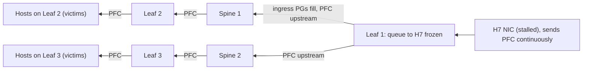
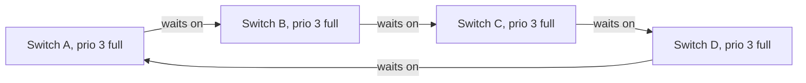

## Why this matters

PFC turns congestion into back-pressure. Back-pressure has a dark side: it lets one broken device
hold up traffic that has nothing to do with it, and with the right (wrong) topology it can freeze
part of the network permanently. Microsoft's account of running RDMA at scale (Guo et al., SIGCOMM
2016) describes both failure classes in production: **PFC storms**, where a malfunctioning NIC
paused the network continuously, and **PFC deadlocks**, where a cycle of paused links stopped
traffic even though nobody was sending. Neither shows up as a link going down. Your monitoring
reports every port up, every BGP session established, and an entire training cluster at zero
throughput.

In an AI cluster the blast radius is enormous. A synchronised training job is only as fast as its
slowest rank, so a storm that stalls a subset of hosts stalls the job, and possibly every job on
the fabric. This lesson explains how storms and deadlocks form, how watchdogs contain them, and
why part of the industry is moving towards RoCE that tolerates loss instead of preventing it.

## Concepts

### Congestion, storm and deadlock: three different things

| Condition | What is happening | Does it clear by itself? |
|---|---|---|
| **Congestion** (normal) | Queues build, PFC pauses briefly, ECN and DCQCN slow senders | Yes, within microseconds to milliseconds |
| **PFC storm** | A device sends pause frames continuously, typically because it has stopped receiving | Only when the faulty device recovers or is isolated |
| **PFC deadlock** | A cycle of buffers, each full and each waiting on the next one in the cycle | **No.** It persists even if all senders stop, until something drops packets. |

### How a storm spreads

Suppose host H7's NIC stops draining its receive buffer. The cause might be a hung host, a PCIe
fault, a firmware bug, or a driver that has crashed while the NIC remains powered. The NIC's
receive buffer for priority 3 stays above XOFF, so the NIC keeps sending PFC to its leaf, forever.



1. Leaf 1's egress queue towards H7 is paused and cannot drain.
2. Packets for H7 arriving from the spines pile up. Leaf 1's ingress PGs on its uplinks cross XOFF,
   and Leaf 1 pauses priority 3 **on those uplinks**. That stops *all* priority-3 traffic arriving
   from the spines, not just the traffic for H7.
3. The spines' queues towards Leaf 1 now stall. Their ingress PGs fill, and they pause the leaves
   that feed them.
4. Hosts on other leaves are paused even though they never talk to H7.

The congestion tree grows outward from the faulty port, and because the root never recovers, the
tree never collapses.

> [!ANALOGY]
> A broken-down truck in the only exit lane of a car park. Each row of cars waits for the row in
> front. Soon cars that wanted a different exit are stuck too, because they share the aisles. In a
> classic lossy network the truck would simply be towed (packets dropped) and everyone else would
> keep moving. A PFC fabric, without a watchdog, has no tow truck.

### Deadlock: cyclic buffer dependency

A **buffer dependency** exists from buffer A to buffer B when packets in A can only move once B has
space. Draw those dependencies for the lossless class across the fabric. If the graph contains a
**cycle**, and every buffer on the cycle fills at the same time, then none can drain. Each waits
for the next to free space, and the next is paused by its own downstream. That is a **PFC deadlock**.



Three conditions are needed: (1) a lossless class with hop-by-hop back-pressure, (2) a cyclic
dependency created by the *routes actually in use*, and (3) enough load to fill every buffer on the
cycle at once. Remove any one and deadlock cannot happen.

## How it works

### Why a healthy Clos fabric is deadlock-free, and how it stops being

In a leaf-spine fabric with **up-down routing**, every path goes up (leaf to spine) and then down
(spine to leaf), and never goes up again. Dependencies only point from "up" buffers to "down"
buffers, so there is no cycle. Cycles appear when packets take a path that goes **down and then up again**:

| Trigger | How it creates a cycle | Mitigation |
|---|---|---|
| **Link failure with valley routing** | A spine loses its link to Leaf 2. It still has a route to Leaf 2 through another leaf, so it sends traffic down to Leaf 3, which sends it up to a different spine. Several such bounces in opposite directions can close a loop. | Design routing so that leaves never re-advertise spine-learned routes back up (for example, a common BGP design puts all spines in one ASN so that AS-path loop prevention rejects those paths). Prefer dropping over valley routing. |
| **Transient routing loops** | During convergence two switches can briefly point at each other. With lossless traffic the loop can fill buffers and lock into a deadlock that outlives the loop. | Fast, loop-free convergence. TTL expiry drops looping packets, but it may not be fast enough. PFC watchdog as a backstop. |
| **Flooding of lossless traffic** | If a switch has an ARP/ND entry for a host but its MAC table entry has expired, it may *flood* unicast to all ports in the VLAN, including back up towards other switches. Guo et al. describe this pattern causing deadlock. | Do not flood lossless traffic: drop it when the destination MAC is unknown. Align ARP and MAC timers. Prefer routed (L3) host links. |
| **Topologies with cycles by design** | Rings, tori, dragonfly or "extra" cross links, without deadlock-free routing | Use virtual channels or priority changes per hop (research and HPC techniques), or avoid lossless across them |

### PFC watchdog (switch side)

A **PFC watchdog** monitors every lossless queue on every port. Implementations differ in details,
but the logic is broadly the same:

1. **Detect.** The queue is in the paused state (it keeps receiving PFC) *and* it has not
   transmitted anything for a **detection time** (typically configured in the order of hundreds of
   milliseconds; check your platform's defaults and supported range).
2. **Act.** Choose an action per policy:
   - **drop**: discard packets queued for, and arriving into, that queue, so that buffers
     upstream drain and the congestion tree collapses;
   - **forward**: ignore incoming PFC on that queue and keep transmitting (the downstream device may
     then drop);
   - **alert**: only raise an event or log.
3. **Restore.** Once the pause condition has cleared for a **restoration time**, return the queue to
   normal lossless operation.

The watchdog sacrifices the traffic to (or through) one port to save the rest of the fabric. That
is the right trade, because the traffic to a stalled host is not going anywhere anyway. The
watchdog also breaks deadlocks: dropping on any queue in the cycle frees space and lets the cycle
unwind.

### Pause-storm prevention (NIC side)

NICs can protect the network from their own host. The mlx5 driver documents a *PFC storm prevention*
feature: if the device has been sending pauses continuously for longer than a configurable timeout,
it stops sending them, and it reports this in counters. The upstream kernel exposes the timeout as
an ethtool tunable (`pfc-prevention-tout`), and the counters `tx_pause_storm_warning_events` and
`tx_pause_storm_error_events` record when the device has been pausing for a long time and when it
gave up pausing. Support and defaults depend on the NIC and driver, so check the mlx5 documentation
for your version.

### Lossy RoCE and "resilient RoCE"

PFC's failure modes, its headroom cost, and its poor fit for long links have pushed the industry
towards making RoCE tolerate loss:

- **Better loss recovery in the NIC.** Go-back-N is what makes loss expensive. Newer NIC
  generations add more selective retransmission, so that a drop costs one packet's retransmission
  rather than a whole window. The IRN paper (Mittal et al., SIGCOMM 2018) showed that with selective
  retransmission and a BDP-sized cap on outstanding data, RoCE can perform well *without* PFC.
- **ECN-only operation.** NVIDIA uses "Resilient RoCE" for running RoCE over a fabric with ECN and
  congestion control but without PFC, relying on the NIC's congestion control to keep drops rare
  and its retransmission to absorb the rest. On Cumulus Linux the RoCE profile offers a lossy mode
  alongside the lossless one.
- **Designs built for loss.** Ultra Ethernet's transport and vendor platforms with packet spraying
  and NIC-side reordering assume a lossy or mostly-lossy fabric. Module 7 covers these.

| | Lossless RoCE (PFC + ECN) | Lossy / resilient RoCE (ECN, no PFC) |
|---|---|---|
| Packet loss under congestion | None (with correct headroom) | Rare if CC works, but nonzero |
| Failure modes | Storms, deadlock, congestion spreading, HoL blocking | Retransmissions, tail latency on drops |
| Buffer cost | Headroom per lossless PG per port | No headroom reservation |
| Long links | Hard (headroom scales with distance) | Fine |
| Dependence on NIC | Works even with go-back-N | Needs good loss recovery and CC |
| Typical use today | Most RoCE AI back-end fabrics | Growing: newer NICs, some hyperscalers, UEC-style designs |

Neither is universally right. Lossless RoCE remains the mainstream recommendation for many NIC
generations and vendor reference architectures. Lossy RoCE becomes attractive when NIC loss
recovery is strong and the operational cost of PFC outweighs its benefit.

```widget
pfc-ecn-sim
```

In the simulator, set the receiver's drain rate to zero to model a stalled NIC. With PFC on, the
sender is paused indefinitely: a storm at its smallest scale. Then imagine that sender as a spine
carrying traffic for a hundred other hosts.

## In practice

### Recognising a storm

| Signal | Healthy congestion | Storm |
|---|---|---|
| PFC rate on a port | Bursty, correlated with collective phases | Continuous, independent of workload |
| Pause duration | Small fraction of time | Close to 100 % on the root port |
| Queue transmit progress | Drains between bursts | Zero on the root queue |
| Throughput | Near line rate in aggregate | Collapses across many unrelated hosts |
| Host NIC `tx_prioN_pause` | Near zero | Climbing fast on one host (the root) |

### Tracing a storm to its origin

Pauses flow *against* the data direction. Follow the pause trail to the device that **sends pauses
but does not receive them**.

1. On the leaves, find ports with fast-growing **Rx PFC** on a downlink, that is, pauses
   *received from a host*. That host is a candidate root.
2. Confirm on the host: `ethtool -S <if> | grep -E 'tx_prio3_pause|pause_storm'`. A climbing
   `tx_prio3_pause` or `tx_pause_storm_*` counter confirms it.
3. If no host is sending pauses, look for a switch port receiving pauses from another switch whose
   own uplink queues are not draining. That points at a deadlock or a switch fault.
4. Contain the problem first (watchdog action, or administratively shut the root port), then
   investigate the host (`dmesg`, NIC firmware health, PCIe errors, process or kernel hang).

### PFC watchdog on SONiC

```bash
pfcwd show config
pfcwd show stats
# example: enable on all ports with drop action (check 'pfcwd start --help' for your release)
sudo pfcwd start --action drop ports all detection-time 400 --restoration-time 400
```

```text
# illustrative 'pfcwd show stats', trimmed
      QUEUE    STATUS    STORM DETECTED/RESTORED    TX OK/DROP    RX OK/DROP
-----------  --------  -------------------------  ------------  ------------
Ethernet16:3  stormed                        1/0        0/48211       0/9127
```

A queue in `stormed` state with drop counters rising means the watchdog is actively isolating that
queue. `STORM DETECTED/RESTORED` counts tell you how often it has flapped. Repeated cycles point at
a host that keeps hanging and recovering.

### PFC watchdog on Cumulus Linux and others

Cumulus Linux supports a PFC watchdog on Spectrum switches, configured through NVUE in recent
releases (under the QoS configuration, with per-interface enablement). Other NOSes have equivalent
features with different names, for example "PFC watchdog" or "priority-flow-control watchdog".
Check your vendor's documentation for the syntax, defaults and supported actions. Whatever the
platform, decide the policy ahead of time: action **drop** is the usual choice in RoCE fabrics.

### Deadlock prevention checklist

- Strict up-down routing, and BGP policy that prevents valley paths after failures.
- Routed host links, or no flooding of lossless traffic on unknown unicast.
- Consistent ARP/ND and MAC aging timers where L2 is used.
- PFC watchdog enabled on all lossless queues on all switches.
- PFC limited to the AI back-end fabric. Do not extend lossless classes across DCI or long links.
- ECN/DCQCN tuned so that PFC is rare in the first place. Fewer pauses mean fewer chances to fill
  every buffer on a cycle.

## Common pitfalls

- **No PFC watchdog.** *Symptom:* one hung server takes down throughput for a whole pod. *Cause:*
  nothing breaks the pause chain. *Fix:* enable the watchdog with the drop action on every lossless
  queue, and alert on its events.
- **Blaming the switch reporting the pauses.** *Symptom:* hours spent replacing a spine. *Cause:*
  the spine is a victim and only relays back-pressure. *Fix:* follow pauses to the device that sends
  them without receiving any.
- **Watchdog flapping without root-cause analysis.** *Symptom:* periodic dips in throughput, with
  `STORM DETECTED` counts climbing. *Cause:* a host that repeatedly stalls (thermal, PCIe, a driver
  bug). *Fix:* treat watchdog events as host incidents. Drain and repair the node.
- **Assuming Clos means no deadlock.** *Symptom:* a deadlock after a link failure or during
  maintenance. *Cause:* valley routing or flooding created a temporary cycle. *Fix:* routing policy
  that forbids down-up paths, no lossless flooding, and the watchdog as a backstop.
- **Turning off PFC without the NIC support for it.** *Symptom:* throughput collapses with
  retransmission counters (`out_of_sequence`, `packet_seq_err`, timeouts) rising after moving to
  lossy mode. *Cause:* the NIC's loss recovery and congestion control are not suited to lossy
  operation. *Fix:* adopt lossy RoCE only with NIC generations and firmware validated for it, and
  test under incast first.
- **Detection times set too aggressively.** *Symptom:* the watchdog drops lossless traffic during
  legitimate heavy congestion. *Cause:* a detection time shorter than normal pause episodes.
  *Fix:* set detection well above observed healthy pause durations. Use your telemetry to choose it.

> [!INTERVIEW]
> **"Explain the difference between a PFC storm and a PFC deadlock, and how a watchdog helps with both."**
> A storm has a *root*: a device, usually a stalled NIC, that keeps sending pauses. Back-pressure
> spreads outward from it, stalling victims. A deadlock has *no* root. A cyclic buffer dependency,
> created by down-up routing after a failure, a routing loop, or flooding, leaves every buffer on
> the cycle full and waiting on the next, and it persists even with no new traffic. A watchdog
> detects a queue that is paused and not transmitting for longer than the detection time, then drops
> (or ignores pauses) on that queue. For a storm, that isolates the root. For a deadlock, it frees
> buffer and unwinds the cycle. Prevention still matters: up-down routing, no lossless flooding,
> ECN so that PFC is rare, and NIC-side storm prevention.

## Key takeaways

- **PFC storm:** a faulty device pauses continuously, and back-pressure spreads hop by hop to
  unrelated victims. Trace pauses to the device that sends them without receiving any.
- **PFC deadlock:** a cyclic buffer dependency with all buffers full. It needs lossless traffic, a
  cycle in the routes in use, and enough load. It does not clear by itself.
- Clos with up-down routing is cycle-free. **Valley routing after failures, transient loops and
  flooding** introduce cycles.
- **PFC watchdogs** (switch) and **pause-storm prevention** (NIC) detect stuck paused queues and
  drop or stop pausing to save the fabric. Enable them everywhere and alert on their events.
- **Lossy / resilient RoCE** trades PFC's failure modes for reliance on NIC loss recovery and
  congestion control. Adopt it with hardware and firmware validated for it.
