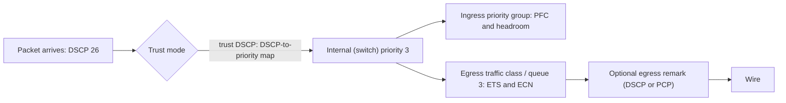

## Why this matters

PFC, headroom, ETS and ECN are all configured *per priority* or *per traffic class*. None of it
helps a packet that is classified into the wrong one. Classification is the quiet foundation of
every RoCE fabric. If the host marks RoCE with one value and a switch expects another, RoCE silently
lands in a lossy best-effort queue. It drops under congestion, never generates PFC, may never be
ECN-marked, and the job runs at a fraction of its expected speed. Nothing is "down". Ping works,
small perftest runs work, and only the large, congested collectives suffer.

The most common real-world RoCE misconfiguration is exactly this kind of mismatch: a wrong DSCP,
the wrong trust mode, ToS and DSCP confused, or CNPs mapped into the congested queue. This lesson
gives you a mental model and a vocabulary for tracing a packet's class hop by hop, so that you can
find those mistakes in minutes rather than days.

## Concepts

### Two places a packet can carry its class

| Marking | Where it lives | Bits | Survives routing? |
|---|---|---|---|
| **PCP** (802.1p Priority Code Point) | 802.1Q VLAN tag | 3 (values 0-7) | No. The tag is rebuilt at every routed hop, and untagged links carry no PCP at all. |
| **DSCP** (Differentiated Services Code Point) | IP header ToS / Traffic Class byte | 6 (values 0-63) | Yes, unless a device deliberately remarks it |

A switch port decides which one to believe through its **trust** mode:

- **Trust PCP (L2).** Classify by the VLAN tag's PCP. Requires tagged frames on every link.
- **Trust DSCP (L3).** Classify by the IP DSCP. Works on untagged, routed links.
- **Trust port / none.** Ignore markings and assign the port's default priority, which is useful
  at untrusted edges.

Modern AI back-end fabrics are routed (L3 to the host or to the leaf, BGP underlay, often untagged
host links), so **trust DSCP** is the norm. Trust PCP is a legacy of L2 designs and RoCEv1, and it
is still found in some storage networks.

> [!ANALOGY]
> PCP is a sticker on the shipping crate (the Ethernet frame), which is thrown away at every depot,
> where the goods are repacked into a new crate. DSCP is a label on the parcel inside (the IP
> packet), which stays on all the way to the destination. If every depot sorts by the crate sticker,
> each depot must re-apply it correctly before the next leg. The analogy breaks down because
> switches *can* rewrite PCP on egress from their internal priority, so a fully tagged L2 design
> works, but every hop then becomes one more place to get it wrong.

### The internal pipeline: from marking to queue

Inside a switch (and, in a simpler form, inside a NIC), classification proceeds in stages:



| Stage | Map | Controls |
|---|---|---|
| Classification | DSCP→priority (or PCP→priority) | Everything that follows |
| Ingress | priority→PG | PFC generation, headroom, XOFF/XON |
| Egress | priority→TC (queue) | ETS share or strict priority, ECN marking profile, egress drop |
| Remark | priority→DSCP/PCP | What the next hop sees, if remarking is enabled |

PFC frames carry **priorities**, not DSCP values. When a switch pauses "priority 3", the
upstream device stops whatever *it* has classified as priority 3. Every device on the path must
therefore map the RoCE DSCP to the **same** priority.

### DSCP, ToS and "traffic class": three numbers for one byte

The IP ToS byte (the IPv6 Traffic Class byte) is **DSCP (upper 6 bits) + ECN (lower 2 bits)**:

```text
  bit:  7   6   5   4   3   2 | 1   0
       [        DSCP          ] [ ECN ]
  ToS value = DSCP × 4 + ECN
```

RDMA APIs and tools almost always ask for the **whole byte**: verbs `traffic_class` in the GRH
attributes, NCCL's `NCCL_IB_TC`, perftest's `--tclass`, and the rdma_cm default ToS. So:

| DSCP | Name | ToS byte with ECN 00 | ToS with ECT(0) (`10`) | Default class-selector priority (DSCP >> 3) |
|---|---|---|---|---|
| 0 | default | 0 | 2 | 0 |
| 26 | AF31 | **104** (0x68) | **106** (0x6A) | **3** |
| 46 | EF | 184 | 186 | 5 |
| 48 | CS6 | **192** (0xC0) | 194 | **6** |

Notice the last column. Many devices' *default* DSCP-to-priority mapping uses the top three bits of
DSCP (the class-selector bits): DSCP 26 → priority 3, DSCP 48 → priority 6. That is one reason the
NVIDIA convention below is convenient. It lines up with defaults on many platforms, but always
check the actual map.

> [!WARNING]
> "Set traffic class 26" is a classic mistake. A ToS byte of 26 is binary `000110 10`: **DSCP 6**,
> ECN ECT(0). DSCP 6 maps to priority 0 under a class-selector map, which is best-effort and lossy.
> If you want DSCP 26, the traffic-class value is **104** (or 106).

Try the conversions below: type a DSCP or a ToS byte, load the "NCCL_IB_TC=26" preset, and switch the trust mode to PCP on an untagged link.

```widget
dscp-mapper
```

### The common NVIDIA convention

NVIDIA's RoCE documentation, the Cumulus Linux RoCE profile and many reference designs use:

| Traffic | DSCP | Priority | Treatment |
|---|---|---|---|
| RoCE data | **26** | **3** | PFC enabled (lossless), ECN marking, ETS share |
| CNP | **48** | **6** | Strict priority, no PFC needed (CNPs are tiny, and losing an occasional one is tolerable) |
| Everything else | 0 (and others) | 0 | Lossy, ETS share |

This is a **convention, not a standard**. Nothing in IBTA or IEEE mandates DSCP 26. SONiC's default
QoS templates, for example, have traditionally used different lossless priorities (3 and 4, mapped
from different DSCPs), and many operators choose their own values. What matters is that **one plan
is applied identically on every NIC and every switch**, and that it is written down.

## How it works

### How the host decides DSCP and priority for RoCE

For a RoCEv2 QP, the NIC builds the IP header itself. The DSCP and ECN bits come from the
**traffic class** that the QP was given when it moved to RTR:

1. **The application or library sets it explicitly.** NCCL uses `NCCL_IB_TC`, perftest uses
   `--tclass`, and UCX has its own IB traffic-class setting (check `ucx_info -c` for your version).
2. **rdma_cm applies a default** to connections it creates, if one is configured. NVIDIA's
   `cma_roce_tos` script sets this default per device. It writes to the rdma_cm configfs entry
   (`/sys/kernel/config/rdma_cm/<dev>/ports/<port>/default_roce_tos`). This only affects
   rdma_cm-established QPs. NCCL, for example, sets up its QPs without rdma_cm, so it needs `NCCL_IB_TC`.
3. **Otherwise it is 0**, which means best effort.

With **trust DSCP** configured on the NIC (`mlnx_qos --trust dscp`), the NIC also uses the DSCP to
pick the *local* priority, through its DSCP-to-priority table. That priority decides which transmit
queue honours incoming PFC and which receive buffer is lossless. With trust PCP, the NIC instead
uses the VLAN priority, which requires a VLAN interface with an egress priority mapping.

ECN bits: when DCQCN is enabled for the priority, the NIC marks RoCE data as ECN-capable. Whether
it overrides the ECN bits you passed in the traffic class is implementation-specific. Passing
106 (ECT(0)) rather than 104 is a common belt-and-braces choice. Verify on the wire.

### How CNPs are classified

CNPs are generated by the NIC's NP logic, not by your application. Their DSCP and priority are NIC
settings of their own. On ConnectX with MLNX_OFED, these have been exposed as `cnp_dscp` and
`cnp_802p_prio` under `/sys/class/net/<if>/ecn/roce_np/` (check your driver release). Switches must
map the CNP DSCP to a strict-priority queue on every hop, in **both directions**, because any host
can be a receiver.

### Where remarking is legitimate

- At an **untrusted edge** (for example, tenant-facing ports in a multi-tenant cluster), you might
  trust nothing, classify by ACL, and remark to your fabric's plan.
- At a **boundary between networks** with different plans (the frontend or storage network meeting
  the backend), you remark consistently in one place.
- **Inside** the RoCE fabric, remarking should be absent or a no-op. Every extra rewrite is a chance
  to break the plan.

## In practice

### Host: set and verify trust and mapping

```bash
# trust DSCP on the RoCE port, PFC on priority 3 only
mlnx_qos -i ens1f0np0 --trust dscp
mlnx_qos -i ens1f0np0 --pfc 0,0,0,1,0,0,0,0

# show the full state, including the DSCP-to-priority table
mlnx_qos -i ens1f0np0
```

```text
# illustrative, trimmed
Priority trust state: dscp
dscp2prio mapping:
        prio:0 dscp:07,06,05,04,03,02,01,00,
        prio:1 dscp:15,14,13,12,11,10,09,08,
        prio:2 dscp:23,22,21,20,19,18,17,16,
        prio:3 dscp:31,30,29,28,27,26,25,24,
        prio:4 dscp:39,38,37,36,35,34,33,32,
        prio:5 dscp:47,46,45,44,43,42,41,40,
        prio:6 dscp:55,54,53,52,51,50,49,48,
        prio:7 dscp:63,62,61,60,59,58,57,56,
```

The default table shown is the class-selector map: DSCP 24-31 (including 26) → priority 3, and DSCP
48-55 → priority 6. Individual entries can be changed (`mlnx_qos --dscp2prio set,<dscp>,<prio>`
on versions that support it). The upstream iproute2 equivalent is `dcb app` with `dscp-prio`
entries, for example `dcb app add dev ens1f0np0 dscp-prio 26:3`. See `man dcb-app`.

Set the default ToS for rdma_cm connections, and the traffic class for NCCL:

```bash
cma_roce_tos -d mlx5_0 -t 106          # rdma_cm default: DSCP 26, ECT(0)
export NCCL_IB_TC=106                   # NCCL QPs: same DSCP 26
```

Confirm by sending traffic and watching the per-priority counters, which count bytes the NIC
transmitted and received per priority (not every RDMA path may be reflected the same way on every
driver version):

```bash
ethtool -S ens1f0np0 | grep -E 'tx_prio3_bytes|rx_prio3_bytes|tx_prio0_bytes'
```

If an NCCL job's traffic shows up under `tx_prio0_bytes` instead of `tx_prio3_bytes`, the job is
not marking DSCP 26.

### Switch: trust and maps

On Cumulus Linux, enabling the RoCE profile (`nv set qos roce`, then `nv config apply`) sets DSCP
trust and installs the convention above: DSCP 26 to switch-priority 3 (lossless, ECN), and DSCP 48
to priority 6 for CNPs. `nv show qos roce` displays the resulting mapping, and NVUE also has
`nv show qos mapping ...` views. Exact output and sub-commands vary between releases, so check the
NVUE reference.

```text
# illustrative excerpt of the kind of mapping a RoCE profile shows
  roce mode: lossless     trust: dscp
  switch-prio  dscp   traffic-class   pfc   ecn
  3            26     3               on    on
  6            48     6               off   off  (strict)
```

On SONiC, the maps live in `config_db` tables such as `DSCP_TO_TC_MAP`, `TC_TO_QUEUE_MAP`,
`TC_TO_PRIORITY_GROUP_MAP` and `PORT_QOS_MAP` (which binds the maps and the `pfc_enable` list to
ports). You can inspect them with `sonic-cfggen -d --var-json DSCP_TO_TC_MAP` or `redis-cli` against
CONFIG_DB. The default templates differ by platform and release, so read them before assuming a
priority.

### A hop-by-hop classification trace

When RoCE performance is poor and you suspect classification, answer these questions for every device on the path:

| Question | Host A | Leaf 1 | Spine | Leaf 2 | Host B |
|---|---|---|---|---|---|
| What DSCP does the packet carry here? | 26 | 26 | 26 | 26 | 26 |
| Trust mode? | dscp | dscp | dscp | dscp | dscp |
| DSCP 26 → priority? | 3 | 3 | 3 | 3 | 3 |
| PFC enabled on that priority? | yes | yes | yes | yes | yes |
| ECN marking on the egress queue? | n/a | yes | yes | yes | n/a |
| CNP DSCP 48 → strict queue? | yes | yes | yes | yes | yes |

Any cell that differs from its neighbours is a bug.

## Common pitfalls

- **ToS versus DSCP confusion.** *Symptom:* RoCE counted in `tx_prio0_bytes`, drops under load, no
  PFC. *Cause:* `NCCL_IB_TC=26` or `--tclass 26`, which is DSCP 6. *Fix:* use the ToS byte value:
  104 or 106 for DSCP 26.
- **Switch trusts PCP, hosts send untagged.** *Symptom:* every RoCE packet lands in priority 0 on
  the leaf. Host-side PFC is configured, but no switch PFC is ever seen. *Cause:* an L2 trust mode on
  a routed, untagged design. *Fix:* trust DSCP on host-facing and fabric ports.
- **Inconsistent priority maps between hops.** *Symptom:* PFC frames sent for priority 3 by one
  switch, and the upstream keeps sending (pause has no effect), so the downstream switch drops.
  *Cause:* the upstream device classifies DSCP 26 into another priority. *Fix:* one documented map,
  pushed by automation to every device. Audit it with a hop-by-hop trace.
- **rdma_cm default set, NCCL unmarked.** *Symptom:* perftest with `-R` (rdma_cm) is perfect,
  NCCL jobs suffer. *Cause:* `cma_roce_tos` affects only rdma_cm QPs. *Fix:* set `NCCL_IB_TC` (and
  any other library's traffic-class setting) explicitly, or confirm your NCCL version's behaviour.
- **CNPs in the data queue or a lossy congested queue.** *Symptom:* receivers send CNPs
  (`np_cnp_sent` rises) but senders react late or never (`rp_cnp_handled` is low). *Cause:* the CNP
  DSCP is not mapped to a strict queue somewhere on the reverse path. *Fix:* map the CNP DSCP to
  strict priority on every hop.
- **An unexpected remark in the middle.** *Symptom:* packets leave the host with DSCP 26 and
  arrive with DSCP 0. *Cause:* a device, often a firewall, a border leaf or a QoS policy inherited
  from the enterprise network, resets DSCP. *Fix:* mirror and inspect at hops along the path, and
  remove or fix the remarking policy.

> [!INTERVIEW]
> **"Your RoCE fabric uses PFC on priority 3, but a new tenant's training job shows drops and no
> pauses. Where do you look?"** A strong answer starts at classification, not buffers. Check which
> traffic class the job sets (`NCCL_IB_TC`; remember the ToS/DSCP ×4 relationship), check the host's
> trust mode and DSCP-to-priority map, and check per-priority host counters to see whether the
> bytes are in prio 3 or prio 0. Then check the leaf's trust mode and DSCP map, and confirm that the
> CNP DSCP lands in a strict queue in both directions. Mention a hop-by-hop table and automation to
> keep maps consistent.

## Key takeaways

- Classification decides everything: DSCP or PCP → priority → ingress PG (PFC, headroom) and
  egress TC (ETS, ECN).
- Routed AI fabrics **trust DSCP**. PCP lives in the VLAN tag and does not survive routed hops.
- Traffic-class and ToS values are **DSCP × 4 + ECN**: DSCP 26 is ToS **104** (106 with ECT(0)).
  "Traffic class 26" is DSCP 6, a classic bug.
- Common NVIDIA convention, not a standard: **RoCE DSCP 26 → priority 3** (lossless, ECN) and **CNP
  DSCP 48 → priority 6** (strict). Use one plan everywhere.
- `cma_roce_tos` affects only rdma_cm QPs. Libraries such as NCCL need their own traffic-class setting.
- PFC frames name priorities, so every hop must map the RoCE DSCP to the same priority.
