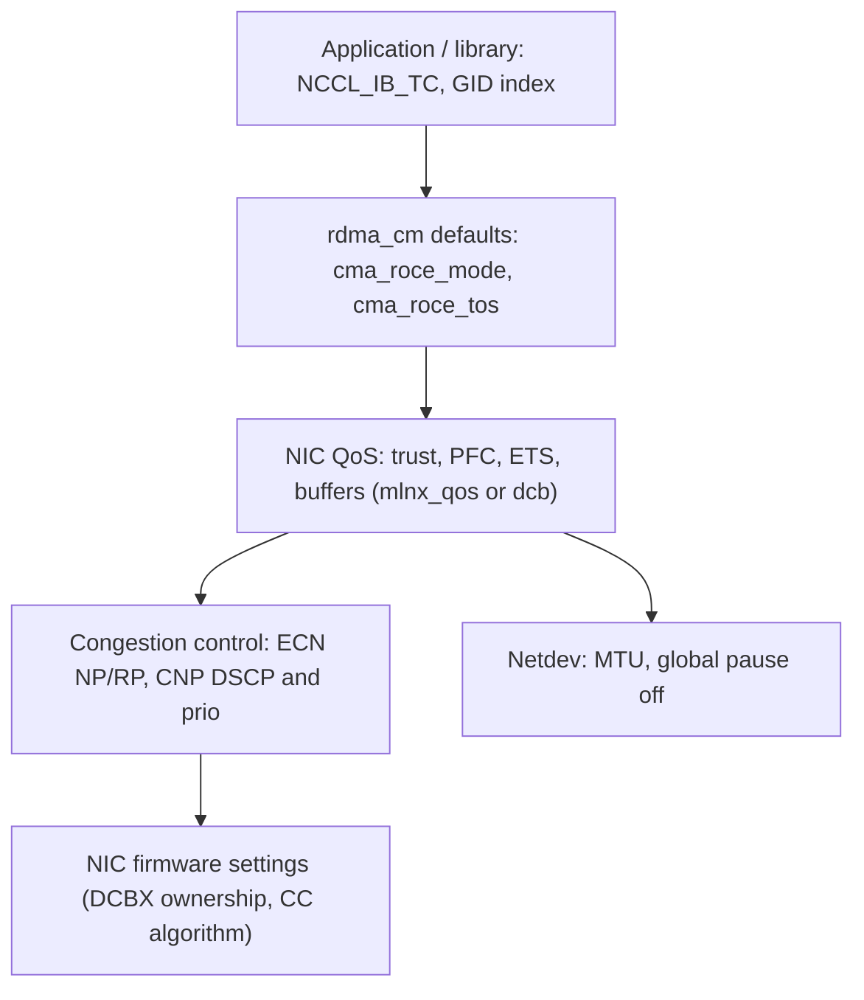

## Why this matters

Every previous lesson in this module described one mechanism. In production they only work as a
**set**, configured identically on hundreds of NICs and dozens of switches. One host with the wrong
trust mode, one leaf with a default MTU, one spine without ECN on the RoCE queue, or one NCCL job
without a traffic class is enough to turn a lossless fabric into a lossy one for some flows. Because
AI collectives run at the speed of their slowest participant, one bad flow is a slow job.

This lesson turns the theory into a procedure. First you write a **QoS contract**: one page that
says what every device must do. Then you apply it to hosts and switches, and you **prove** it with
staged tests and a few golden counters. The commands are real tools, but exact syntax and defaults
change between driver, firmware and NOS releases. Treat every command here as a well-annotated
starting point, and check it against the documentation for the versions you run.

## Concepts

### The QoS contract

Write this down before touching a device. Everything else is an implementation of this table.

| Item | Example value (common NVIDIA-style plan) | Applies to |
|---|---|---|
| RoCE version | RoCEv2 (UDP 4791), IPv4 | Hosts |
| MTU | 9000 on host netdevs, 9216 on switch ports (RDMA MTU 4096) | All |
| Trust | DSCP on every RoCE-facing and fabric port | Hosts, switches |
| RoCE data | DSCP 26 → priority 3, **PFC on**, ECN marking on, ETS share | All |
| CNP | DSCP 48 → priority 6, strict priority, no PFC | All |
| Other traffic | DSCP 0 → priority 0, lossy, ETS share | All |
| Global 802.3x pause | Off | Hosts, switches |
| Congestion control | DCQCN enabled for priority 3 (NP and RP) | Hosts |
| ECN thresholds | Vendor RoCE profile defaults, tuned with tests | Switches |
| Headroom | Auto-calculated from correct cable lengths | Switches |
| PFC watchdog | On, action drop, on all lossless queues | Switches |
| Application | `NCCL_IB_TC=106` (DSCP 26 + ECT(0)), correct GID selection | Jobs |

The DSCP 26 / 48 values and priorities 3 / 6 are a **common convention**, not a standard. If your
organisation, NOS defaults or storage vendor require a different plan, change the table and keep
everything else identical.

### Layers of configuration on a host



The layers fail independently. A perfect `mlnx_qos` setup does nothing for a job that sends with
traffic class 0, and a correct `NCCL_IB_TC` does nothing on a host that trusts PCP.

> [!ANALOGY]
> Configuring RoCE is like provisioning an MPLS L3VPN with strict QoS SLAs across a provider
> network. The service only works if the PE, every P router, and the CE all agree on markings and
> queue treatment, which is why providers drive it from a central template. The analogy breaks
> down on timescales: a QoS mismatch in a VPN costs some jitter for voice calls, while a mismatch in
> a RoCE fabric can cost a large fraction of a training job's throughput.

## How it works

### Host configuration (NVIDIA ConnectX)

The steps below use NVIDIA's OFED tools (`mlnx_qos`, `cma_roce_mode`, `cma_roce_tos`, `show_gids`)
and upstream tools (`ip`, `ethtool`). Replace `ens1f0np0` / `mlx5_0` with your devices, and repeat
on **every** RDMA NIC (in a rail-optimised server, typically eight).

> [!NOTE]
> `mlnx_qos`, `cma_roce_mode`, `cma_roce_tos`, `show_gids` and the `/sys/class/net/<if>/ecn/` tree
> come with NVIDIA's stack (MLNX_OFED / DOCA-OFED). A distro (inbox) driver with upstream rdma-core
> does not ship them; the equivalents are iproute2's `dcb` for trust, PFC and ETS, the rdma_cm
> configfs files for the ToS and mode, and the sysfs GID table. Device names also follow the stack:
> `mlx5_0` with NVIDIA's stack, names like `rocep3s0f0` (built from the PCI address) with distro
> rdma-core. Take yours from `rdma link`, which also shows the netdev for each RDMA port.

**1. MTU and global pause**

```bash
ip link set dev ens1f0np0 mtu 9000
ethtool -A ens1f0np0 rx off tx off        # disable 802.3x link-level pause
```

On ConnectX (mlx5) global pause is on by default, and enabling PFC on any priority turns it off
by itself, so this line mainly documents intent. The reverse is the trap: running
`ethtool -A <if> rx on tx on` later silently clears PFC on every priority (no error, exit code 0).
Check both with `ethtool -a <if>` (expect `RX: off`, `TX: off`) after the PFC step.

Before moving on, check that the contract's MTUs agree: enter 9000 on the host and 9216 on each hop, then try a hop left at a default MTU and see what breaks.

```widget
mtu-calculator
```

**2. Trust and PFC**

```bash
mlnx_qos -i ens1f0np0 --trust dscp
mlnx_qos -i ens1f0np0 --pfc 0,0,0,1,0,0,0,0     # PFC on priority 3 only
```

With trust DSCP, the NIC's default DSCP-to-priority map already sends DSCP 26 to priority 3 and DSCP
48 to priority 6 (DSCP >> 3). Verify it in the `mlnx_qos` output rather than assuming it: after
`--trust dscp` it prints a `dscp2prio mapping:` block, and the `PFC configuration:` table shows `1`
under priority 3 in the `enabled` row.

With the inbox driver, use iproute2's `dcb` instead. `dcb apptrust` is not supported by mlx5 (it
prints `Attribute not found`); adding a DSCP entry to the APP table is what switches the port to
DSCP trust:

```bash
dcb pfc set dev ens1f0np0 prio-pfc all:off 3:on
dcb app replace dev ens1f0np0 dscp-prio 26:3     # DSCP 26 -> prio 3; also switches mlx5 to DSCP trust
dcb pfc show dev ens1f0np0 prio-pfc               # prio-pfc 0:off 1:off 2:off 3:on 4:off ...
dcb app show dev ens1f0np0                        # prints dscp-prio AF31:3 (use 'dcb -N' for 26:3)
```

**3. ETS (optional, if you want explicit shares)**

```bash
mlnx_qos -i ens1f0np0 --tsa ets,ets,ets,ets,ets,ets,strict,ets --tcbw 10,5,5,60,5,5,0,10
```

The shares are per TC, and mlx5's default map puts priority 0 in TC1 and priority 1 in TC0, so
check the `priority:` line under each `tc:` in the output (or set `--prio_tc` explicitly) before
deciding which share your default traffic gets. The percentages must add up to 100.

**4. ECN / DCQCN and CNP marking**

On ConnectX with NVIDIA's stack, DCQCN is typically enabled by default: on a ConnectX-5 with
DOCA-OFED, NP and RP were enabled on all eight priorities, with `cnp_dscp` 48 and `cnp_802p_prio` 6.
Verify it on yours. The per-netdev `ecn/` sysfs tree below exists **only with NVIDIA's stack**. With
the inbox driver the directory does not exist; DCQCN parameters live in debugfs
(`/sys/kernel/debug/mlx5/<pci-address>/cc_params/`), which kernel lockdown blocks even for root
when Secure Boot is on. Defaults and availability vary by driver release and NIC generation.

```bash
echo 1  > /sys/class/net/ens1f0np0/ecn/roce_np/enable/3    # send CNPs for CE-marked prio-3 packets
echo 1  > /sys/class/net/ens1f0np0/ecn/roce_rp/enable/3    # react to CNPs on prio 3
echo 48 > /sys/class/net/ens1f0np0/ecn/roce_np/cnp_dscp    # CNP DSCP
echo 6  > /sys/class/net/ens1f0np0/ecn/roce_np/cnp_802p_prio
```

If you plan to use an RTT-based algorithm instead (NVIDIA RTTCC / ZTR-RTTCC), it is selected
through NIC firmware configuration. Follow NVIDIA's documentation for your NIC and firmware.

**5. rdma_cm defaults (for rdma_cm-based applications)**

```bash
cma_roce_mode -d mlx5_0 -p 1 -m 2      # default RoCE mode for rdma_cm: v2 (prints "RoCE v2")
cma_roce_tos  -d mlx5_0 -t 106         # default ToS for rdma_cm: DSCP 26, ECT(0)
```

These write to the rdma_cm configfs tree (`/sys/kernel/config/rdma_cm/`), which must be mounted.
Without NVIDIA's scripts, write the same files directly (the defaults are ToS `0` and mode `RoCE v2`):

```bash
mkdir /sys/kernel/config/rdma_cm/rocep3s0f0           # creates ports/1/default_roce_tos and default_roce_mode
echo 106 > /sys/kernel/config/rdma_cm/rocep3s0f0/ports/1/default_roce_tos
```

They do **not** affect applications that create QPs without rdma_cm.

**6. Application settings**

```bash
export NCCL_IB_TC=106                  # traffic class (ToS byte) for NCCL's RoCE QPs
export NCCL_IB_GID_INDEX=3             # only if auto-selection is not used or not correct; check the GID table
export NCCL_IB_HCA=mlx5_0,mlx5_1       # restrict NCCL to the back-end NICs (example)
```

Check the NCCL environment-variable documentation for your NCCL version: recent versions can select
the RoCEv2 GID automatically, and defaults change between releases. `show_gids` (NVIDIA stack) lists
the GID table; without it, read `/sys/class/infiniband/<dev>/ports/1/gids/N` and
`gid_attrs/types/N` (`RoCE v2`). With one IPv4 address per port, index 3 is typically the RoCEv2
IPv4 GID, but check rather than assume.

**7. Persistence**

`mlnx_qos` or `dcb` settings, sysfs writes, `ethtool -A` and configfs writes do **not** survive a reboot or a driver
reload. Apply them from a boot-time mechanism that runs after the NIC driver loads, such as a
systemd unit, a NetworkManager dispatcher script or your cluster manager's node-configuration
system, and re-verify after every reboot and firmware upgrade. Decide also who owns DCBX. If NIC
firmware DCBX or a host LLDP agent is enabled and *willing*, a neighbour can overwrite your
settings. NVIDIA documents the firmware settings that control this.

### Switch configuration: Cumulus Linux (NVUE)

On NVIDIA Spectrum switches running Cumulus Linux 5.x, the RoCE profile applies the trust,
mapping, PFC, ECN and buffer settings of the NVIDIA convention in one step:

```bash
nv set qos roce                         # enable RoCE QoS profile (lossless is the default mode)
nv set qos roce mode lossless           # explicit; 'lossy' configures ECN without PFC
nv set interface swp1-64 link mtu 9216  # jumbo MTU on fabric and host ports
nv config apply
nv show qos roce
```

```text
# illustrative output shape of 'nv show qos roce' (fields and values vary by release)
                 operational  applied
---------------  -----------  ---------
enable           on           on
mode             lossless     lossless
congestion-control
  congestion-mode  ECN
  min-threshold    ...
  max-threshold    ...
  probability      ...
lldp-app-tlv
  priority         3
  protocol-id      4791
  selector         UDP
trust            dscp
roce traffic-class   3   (switch-prio 3, DSCP 26, PFC on)
cnp  traffic-class   6   (switch-prio 6, DSCP 48, strict)
```

Notes:

- The profile's ECN thresholds and buffer settings are NVIDIA-validated defaults for the platform.
  Change them only with a test plan and a reason.
- Cable lengths matter for headroom (previous lessons). Check how your release computes headroom
  and whether you need to set cable lengths explicitly.
- PFC watchdog configuration lives under NVUE's QoS settings in recent releases. Check the NVUE
  reference for the commands and defaults in your version, and enable it on all lossless queues.
- NVUE syntax evolves between releases. `nv list-commands` and the release's NVUE reference are
  the authority.

### Switch configuration: SONiC

SONiC usually generates its lossless configuration from platform-specific templates
(`buffers.json.j2`, `qos.json.j2`) at deploy time. `config qos reload` regenerates it. The result
lands in `CONFIG_DB`, and these are the tables to read:

```json
{
  "PORT_QOS_MAP": {
    "Ethernet0": {
      "dscp_to_tc_map": "AZURE",
      "tc_to_queue_map": "AZURE",
      "tc_to_pg_map": "AZURE",
      "pfc_to_queue_map": "AZURE",
      "pfc_enable": "3,4"
    }
  },
  "QUEUE": {
    "Ethernet0|3": { "scheduler": "scheduler.1", "wred_profile": "AZURE_LOSSLESS" }
  },
  "WRED_PROFILE": {
    "AZURE_LOSSLESS": { "ecn": "ecn_all", "wred_green_enable": "true",
                        "green_min_threshold": "...", "green_max_threshold": "...",
                        "green_drop_probability": "..." }
  },
  "CABLE_LENGTH": { "AZURE": { "Ethernet0": "5m" } }
}
```

This excerpt is **illustrative**. Table names are real, but values, profile names and reference
syntax differ between releases (older releases write references as `[DSCP_TO_TC_MAP|AZURE]`) and
between platforms. SONiC's community defaults traditionally make **priorities 3 and 4** lossless,
which differs from the NVIDIA convention. If you mix vendors, align them to one contract explicitly.

Typical SONiC operations:

```bash
config interface mtu Ethernet0 9100       # check the maximum your platform supports
config qos reload                          # regenerate buffer/QoS config from templates
sudo config pfcwd start --action drop all 400 --restoration-time 400
show pfc counters
show queue counters
show priority-group watermark headroom
ecnconfig -l
pfcwd show stats
```

## In practice

### A staged validation plan

Do not go straight from "configured" to "run a training job". Validate in stages, so that each
failure points at one layer.

| Stage | Test | Pass criteria |
|---|---|---|
| 0. Static audit | Script or automation that collects MTU, trust, DSCP map, PFC vector, ECN enable, CNP DSCP from every host and switch | Every device matches the contract |
| 1. Path | `ib_write_bw` between hosts on different leaves, `-x <RoCEv2 GID> --tclass 106` | Near line rate (for example over 90 % of link speed at large messages), RoCE bytes counted on priority 3 |
| 2. Incast | N senders to 1 receiver for tens of seconds | Aggregate near receiver line rate. ECN marks and CNPs present. PFC low. No sequence errors. |
| 3. Fabric stress | All-to-all across leaves (perftest mesh or `nccl-tests` all-to-all) | Stable bandwidth. No growth in drops or retransmission counters. Headroom watermark has margin. |
| 4. Fault | Pull an uplink. Simulate a stalled host in a lab. | Traffic reroutes. Watchdog detects and restores. No deadlock. |

### Golden counters

| Where | Counter / command | Healthy under load |
|---|---|---|
| Host | `ethtool -S` `tx_prio3_bytes` / `rx_prio3_bytes` | Carries the RoCE bytes (not prio 0) |
| Host | `ethtool -S` `rx_prio3_pause`, `tx_prio3_pause` | rx: occasional bursts. tx: near zero. |
| Host | hw_counters `np_ecn_marked_roce_packets`, `np_cnp_sent` | Rising during incast on receivers |
| Host | hw_counters `rp_cnp_handled` | Rising on senders during incast |
| Host | hw_counters `out_of_sequence`, `packet_seq_err`, `local_ack_timeout_err` | Flat (no loss or timeouts) |
| Host | `ethtool -S` `rx_discards_phy` | Flat |
| Switch | PFC Tx/Rx per priority (`show pfc counters` on SONiC, `ethtool -S swpN` or NVUE on Cumulus) | Low, bursty, prio 3 only |
| Switch | PG headroom watermark | Below configured headroom with margin |
| Switch | Lossless queue drops | Zero |
| Switch | PFC watchdog stats | No storms |

```text
# illustrative: stage-2 incast, receiver host, 30-second window (deltas)
tx_prio3_bytes              +1.2 GB     (ACKs travel on prio 3; CNPs on prio 6)
rx_prio3_bytes              +1.5 TB     <- RoCE data on priority 3: classification correct
rx_prio3_pause              +2,140      <- leaf paused us occasionally: acceptable
tx_prio3_pause              +0          <- host keeps up with the receive rate
np_ecn_marked_roce_packets  +4.1 M      <- switches are marking
np_cnp_sent                 +310 k      <- NP is generating CNPs
out_of_sequence             +0          <- no loss
```

The deltas above illustrate the *shape* of a healthy result, not reference values.

```widget
pfc-ecn-sim
```

Use the simulator to rehearse stage 2 before running it: predict what the counters should do when
you change Kmin or disable ECN, then check that prediction against the real fabric.

### Automate, then keep auditing

At cluster scale, configure hosts and switches from one source of truth (Ansible, Salt, your NOS
automation framework, a cluster manager), and run the stage-0 audit continuously, not just at
deployment. Drift happens: a host is reimaged with a stock profile, a switch is replaced with the
default QoS config, a firmware upgrade resets a setting.

## Common pitfalls

- **Settings lost at reboot.** *Symptom:* the fabric was perfect last week, and after a
  maintenance reboot some nodes are slow and show RoCE on priority 0 or PFC disabled. *Cause:*
  `mlnx_qos` and sysfs settings are runtime-only. *Fix:* apply them from a boot-time unit, and add a
  post-boot audit to node health checks.
- **One NIC of eight forgotten.** *Symptom:* one rail shows drops and retransmissions, and
  collectives are throttled by it. *Cause:* configuration applied to `mlx5_0` only. *Fix:* loop over
  every back-end NIC, and audit per NIC rather than per host.
- **MTU mismatch on one hop.** *Symptom:* small-message tests pass, large messages stall or drop,
  and `active_mtu` is lower than expected. *Cause:* a switch port or host left at its default MTU.
  *Fix:* set the MTU in the contract on every port. Check host `active_mtu` and switch interface MTU.
- **NCCL without a traffic class.** *Symptom:* perftest with `--tclass 106` is perfect, NCCL is
  slow under load, and NCCL traffic appears in `tx_prio0_bytes`. *Cause:* `NCCL_IB_TC` is not set
  in the job environment (container, scheduler prolog). *Fix:* set it in the job template, and audit
  it with per-priority counters.
- **Mixed vendor defaults.** *Symptom:* PFC works between some switch pairs and not others.
  *Cause:* SONiC-default lossless priorities (3, 4) and NVIDIA-convention priority 3, with
  different DSCP maps, meeting in one fabric. *Fix:* one contract, translated explicitly for each NOS.
- **DCBX overwrites host settings.** *Symptom:* host PFC settings change after a switch reboot or
  configuration change. *Cause:* a willing NIC accepts the switch's DCBX TLVs. *Fix:* pick a single
  owner (static host configuration or switch-driven DCBX) and verify.
- **Tuning ECN before validating classification.** *Symptom:* weeks spent adjusting Kmin/Kmax with
  no effect. *Cause:* RoCE is not in the queue being tuned. *Fix:* stage 0 and stage 1 first, always.

> [!INTERVIEW]
> **"You're handed a new 512-GPU RoCE cluster. How do you bring the network up and know it's right?"**
> Start with the contract: MTU, trust DSCP, the DSCP and priority plan (for example 26 → 3 lossless,
> 48 → 6 strict for CNP), PFC on one priority, ECN on the RoCE queue, watchdog, ETS shares.
> Apply it with automation to every NIC (all rails) and every switch, using the vendor RoCE profile
> on switches and making the host configuration persistent. Then validate in stages: static audit,
> pairwise perftest across leaves on the correct GID and traffic class, incast (watching ECN marks,
> CNPs and PFC), all-to-all at scale with nccl-tests, and failure tests. Name the golden counters,
> and say you would keep the audit running to catch drift.

## Key takeaways

- Write a **QoS contract** first: MTU, trust, DSCP/priority plan, PFC, ECN, CNP, ETS, watchdog,
  application traffic class. Then implement it identically on every device.
- **Host:** jumbo MTU, global pause off, `mlnx_qos --trust dscp`, `--pfc 0,0,0,1,0,0,0,0` (inbox:
  `dcb pfc` and `dcb app`), ECN NP/RP on the RoCE priority, CNP DSCP and priority,
  `cma_roce_mode` / `cma_roce_tos` (or the rdma_cm configfs files) for rdma_cm, and `NCCL_IB_TC` for
  NCCL. Make all of it persistent.
- **Cumulus:** `nv set qos roce` (mode lossless or lossy) applies the NVIDIA RoCE profile, and
  `nv show qos roce` shows it. **SONiC:** read `PORT_QOS_MAP`, `WRED_PROFILE`, `QUEUE` and the buffer
  tables, and note that its default lossless priorities may differ.
- Validate in stages (audit → path → incast → stress → fault) so that each failure points at one layer.
- Golden counters: per-priority bytes, PFC Tx/Rx, ECN marks / CNP sent / CNP handled, sequence
  errors, PG headroom watermark, watchdog stats.
- Vendor syntax and defaults change between releases. Verify every command against the
  documentation for your versions.
