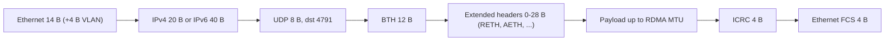
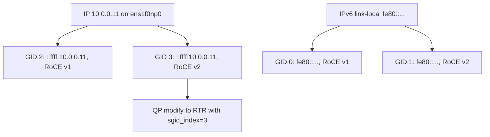

## Why this matters

RDMA was born inside InfiniBand: the verbs, queue pairs and transport semantics you met in the RDMA
module all assume an InfiniBand transport layer. RoCE (RDMA over Converged Ethernet) is how that
same transport rides on Ethernet. In RoCEv2, the version used in essentially every Ethernet-based AI
cluster today, the InfiniBand transport header is wrapped in an ordinary UDP/IP packet. That one
design decision explains a large share of what you will do as an AI fabric engineer. It is why
RoCE traffic can be routed across a leaf-spine fabric, why ECMP hashing has anything to hash on,
why the switch marks congestion in the IP header rather than in the InfiniBand header, and why the
GID table on every host has entries you need to pick from.

When engineers get the encapsulation wrong, the failures are confusing rather than loud. A job
that picks a RoCEv1 GID instead of a RoCEv2 GID cannot leave its own subnet. A port MTU of 1500 quietly
caps the RDMA MTU at 1024 bytes and costs bandwidth. An ACL or firewall rule that forgets UDP 4791
blackholes all RDMA traffic while ping and SSH work fine. And a packet capture shows nothing at all
because the kernel never sees RDMA traffic. This lesson takes the packet apart byte by byte so that none
of those surprises you later.

## Concepts

### Three generations of "RDMA on Ethernet"

| Variant | What carries the IB transport | Routable? | How to recognise it on the wire |
|---|---|---|---|
| InfiniBand (native) | IB link layer (LRH), optional GRH | Yes, via IB routers (rare) | Not Ethernet at all |
| RoCEv1 (IBTA Annex A16, 2010) | Ethernet frame with EtherType `0x8915`, then IB GRH | No, it is layer 2 only | EtherType 0x8915 |
| RoCEv2 (IBTA Annex A17, 2014) | Ethernet + IPv4/IPv6 + UDP | Yes, plain IP routing | UDP destination port **4791** |

RoCEv1 removed the InfiniBand local route header (LRH) and placed the 40-byte InfiniBand **Global
Route Header (GRH)** directly after the Ethernet header. Ethernet switches forward on MAC
addresses, and nothing in an IP router knows how to read a GRH. So RoCEv1 traffic stays inside one
broadcast domain. That was fine for a rack, but it is useless for a routed Clos fabric with thousands
of GPUs.

RoCEv2 replaces the GRH with a real IP header and adds a UDP header in front of the InfiniBand
**Base Transport Header (BTH)**. Routers and switches now see an ordinary UDP datagram. They route it,
hash it for ECMP, classify it by DSCP and mark ECN on it like any other IP packet. The NIC at each
end still speaks full InfiniBand transport: queue pairs, packet sequence numbers, ACK/NAK, RDMA
READ/WRITE semantics.

> [!ANALOGY]
> RoCEv2 is a tunnel in the same family as VXLAN. VXLAN carries an Ethernet frame inside UDP 4789 so
> that a layer-2 service can cross a layer-3 underlay. RoCEv2 carries an InfiniBand transport packet
> inside UDP 4791 so that RDMA can cross a routed fabric. In both cases the outer UDP source port is
> varied to give ECMP entropy. The analogy breaks down in one important way. VXLAN inner traffic is
> usually TCP, which recovers well from loss. RoCEv2's inner transport (classic go-back-N on many
> NICs) recovers poorly from loss, which is why the rest of this module is about making the
> Ethernet underneath behave well.

### The RoCEv2 header stack



| Layer | Size | What it is for |
|---|---|---|
| Ethernet header | 14 B (18 B with an 802.1Q tag) | MAC addressing for one hop. The VLAN tag carries PCP if you trust PCP. |
| IPv4 / IPv6 header | 20 B / 40 B | Routing, **DSCP** for QoS classification, **ECN** bits for congestion marking, TTL |
| UDP header | 8 B | Destination port 4791 identifies RoCEv2. The source port carries **flow entropy**. |
| BTH | 12 B | InfiniBand transport: opcode, destination QP, PSN, partition key, ack request |
| Extended transport headers | 0-28 B | Depend on opcode, for example RETH (16 B) for RDMA WRITE/READ, AETH (4 B) for ACKs |
| Payload | up to the RDMA path MTU | 256, 512, 1024, 2048 or 4096 bytes |
| ICRC | 4 B | Invariant CRC: end-to-end integrity of the fields routers never change |
| FCS | 4 B | Normal Ethernet CRC, recomputed at every hop |

```widget
rocev2-packet
```

Use the widget to switch between IPv4 and IPv6, add a VLAN tag, and change the RDMA MTU. Watch how
the fixed overhead becomes almost irrelevant at 4096 bytes and significant at 1024 bytes.

## How it works

### The Base Transport Header, field by field

The BTH is the same 12 bytes that an InfiniBand HCA would send. Every RoCEv2 packet carries one.

```text
 0                   1                   2                   3
 0 1 2 3 4 5 6 7 8 9 0 1 2 3 4 5 6 7 8 9 0 1 2 3 4 5 6 7 8 9 0 1
+---------------+-+-+---+-------+-------------------------------+
|    OpCode     |S|M|Pad| TVer  |            P_Key              |
+---------------+-+-+---+-------+-------------------------------+
|F|B|  Resv6    |            Destination QP (24 bits)           |
+-+-+-----------+-----------------------------------------------+
|A|   Resv7     |        Packet Sequence Number (24 bits)       |
+-+-------------+-----------------------------------------------+
```

- **OpCode (8 bits).** The top three bits select the transport service: `000` RC, `001` UC,
  `011` UD and so on. The lower five bits select the operation. Examples: `0x04` RC SEND Only,
  `0x06`/`0x07`/`0x08` RC RDMA WRITE First/Middle/Last, `0x0A` RC RDMA WRITE Only,
  `0x0C` RC RDMA READ Request, `0x11` RC Acknowledge. RoCEv2 also defines opcode **`0x81`** for the
  **Congestion Notification Packet (CNP)** used by DCQCN (see the ECN and DCQCN lesson).
- **SE, M, PadCnt, TVer.** Solicited event, migration state, number of pad bytes that align the
  payload to 4 bytes, and transport header version.
- **P_Key (16 bits).** Partition key, the InfiniBand equivalent of a VLAN membership check. On RoCE
  it is almost always the default `0xFFFF`.
- **F/B bits.** FECN/BECN in native InfiniBand. RoCEv2 does not use them for congestion. It uses the
  IP ECN field instead, because switches can read that field.
- **Destination QP (24 bits).** Which queue pair on the receiving NIC owns this packet. There is no
  source QP in the BTH. For RC the receiver knows the peer from connection state.
- **A (AckReq) and PSN (24 bits).** The packet sequence number drives in-order delivery, duplicate
  detection and retransmission. A gap in PSNs at the responder triggers a NAK (out-of-sequence),
  and the requester then retransmits.

### Extended transport headers

What follows the BTH depends on the opcode:

| Header | Size | Present in |
|---|---|---|
| RETH (RDMA Extended Transport Header) | 16 B: 64-bit virtual address, 32-bit R_Key, 32-bit DMA length | First (or Only) packet of RDMA WRITE, and RDMA READ Request |
| AETH (ACK Extended Transport Header) | 4 B: syndrome + message sequence number | ACK/NAK, and RDMA READ Response First/Last/Only |
| ImmDt | 4 B | Operations "with immediate" |
| DETH | 8 B: Q_Key + source QP | Every UD packet |
| AtomicETH / AtomicAckETH | 28 B / 8 B | Atomic operations and their responses |

So a 1 MB RDMA WRITE at a 4096-byte MTU becomes 256 packets. The first carries a RETH, the middle
ones carry only a BTH, and the last one may request an ACK. The remote address and key travel only
once. The responder NIC tracks the rest from the PSN sequence.

### The IP header replaces the GRH

The InfiniBand GRH was deliberately designed to look like an IPv6 header. It has a version field,
an 8-bit traffic class, a 20-bit flow label, a payload length, a next-header field, a hop limit, and
128-bit source and destination **GIDs**. RoCEv2 maps those fields onto a real IP header:

| IB GRH field | RoCEv2 equivalent |
|---|---|
| SGID / DGID (128-bit) | IP source / destination address. IPv4 addresses appear in the GID table as IPv4-mapped IPv6, `::ffff:a.b.c.d`. |
| Traffic Class (8 bits) | IP ToS / Traffic Class byte = **DSCP (6 bits) + ECN (2 bits)** |
| Flow Label | IPv6 flow label (IPv6 only) |
| Hop Limit | IPv4 TTL / IPv6 Hop Limit |
| Next Header (0x1B = BTH) | IP protocol 17 (UDP), then UDP destination port 4791 |

This is why an application or library that asks for a "traffic class" on RoCE, such as NCCL's
`NCCL_IB_TC` or perftest's `--tclass`, actually sets the IP ToS byte, DSCP and ECN together. The
QoS lesson in this module covers the arithmetic (DSCP 26 shifted left by two bits is 104).

### UDP: the port that identifies RoCEv2, and the port that spreads it

- **Destination port 4791** is the IANA-registered port for RoCEv2. Switches, ACLs, Wireshark and
  QoS classifiers all key on it.
- **Source port** is free for the sender to choose. The RoCEv2 annex recommends that it carry flow
  entropy: all packets of one QP use the same source port, so that one QP stays on one ECMP path and
  stays in order, while different QPs get different source ports. How the NIC derives the value
  (for example from a hash of QP numbers) is implementation-specific. Some NICs and libraries can
  steer it. Check your NIC documentation before relying on any particular scheme.
- **UDP checksum** is normally sent as zero for RoCEv2, which IPv4 allows. Integrity comes from the
  ICRC instead. Check your platform's behaviour for IPv6, where zero UDP checksums are restricted by
  RFC 6935/6936.

> [!NOTE]
> A collective with few QPs between a pair of GPUs gives ECMP very few distinct 5-tuples to hash.
> Two large flows can easily land on the same spine uplink while another uplink sits idle. NCCL
> mitigates this by opening several QPs per connection, and adaptive routing or packet spraying go
> further. Module 7 covers this in depth. The root cause is here: one QP equals one UDP 5-tuple.

### ICRC: an end-to-end CRC that survives routing

The Ethernet FCS is stripped and recomputed at every hop, so it proves nothing end to end. The
**Invariant CRC** is calculated by the sending NIC over the parts of the packet that no router should
change. The fields that routers *do* legitimately change are replaced with all-ones during the
calculation. For IPv4 these are TTL, DSCP/ECN (the ToS byte) and the header checksum. For IPv6 they
are hop limit, traffic class and flow label. The UDP checksum is masked as well. A switch can therefore
remark DSCP or set ECN Congestion Experienced without breaking the ICRC. If anything *else* changes in
flight, for example a buggy middlebox that rewrites a UDP field, the receiving NIC drops the packet as
an ICRC error.

### GIDs and the GID table

Every RDMA port has a **GID table**, a list of 128-bit global identifiers. On InfiniBand the GID is
built from the subnet prefix and the port GUID. On RoCE the GIDs come from the IP addresses
configured on the associated network interface, plus an IPv6 link-local entry. Each address
typically appears **twice**: once as a RoCEv1 GID and once as a RoCEv2 GID, if the NIC supports both.

When an application creates a QP and moves it to RTR (ready to receive), it supplies a
`sgid_index`, which is the index into this table. That one integer decides three things:

1. **The source IP address** of every packet on the QP.
2. **The RoCE version** (v1 or v2) of the QP.
3. **The VLAN and netdev**, because each GID is bound to a specific network device, which may be a
   VLAN subinterface.

Libraries that use `rdma_cm` resolve the GID for you from the IP address. Others, including NCCL
and perftest, may need to be told which index to use. NCCL exposes `NCCL_IB_GID_INDEX`, and recent
NCCL releases can also pick a GID automatically. Check the NCCL environment variable documentation
for your version. perftest uses `-x <index>`.



> [!WARNING]
> "GID index 3" is a habit, not a law. The layout depends on how many IP addresses, VLAN
> subinterfaces and IPv6 addresses the interface has, and the order in which they were added. Adding
> an address can shift indexes. Always look the index up (`show_gids` or sysfs) rather than
> hard-coding it across a heterogeneous fleet.

### MTU: Ethernet MTU versus RDMA path MTU

The RDMA transport only supports the InfiniBand MTU values 256, 512, 1024, 2048 and 4096 bytes of
*payload*. The NIC picks the largest IB MTU whose full RoCEv2 packet still fits in the Ethernet
interface MTU:

| Interface MTU | Largest RDMA MTU that fits | Why |
|---|---|---|
| 1500 | 1024 | 2048 + headers would exceed 1500 |
| 4200 | 4096 | 4096 + about 60-80 B of headers fits |
| 9000 (typical AI fabric) | 4096 | 4096 is the IB maximum. The extra room is unused by RDMA but harmless. |

The switch MTU must of course be at least as large as the hosts' MTU on every hop, or large packets
are dropped (or, for IPv4 with DF clear, fragmented by a router, which RoCE NICs will not reassemble).

### Worked example: payload efficiency

Take an RDMA WRITE middle packet (BTH only, no RETH) over IPv4 without a VLAN tag at a 4096-byte RDMA MTU:

| Component | Bytes |
|---|---|
| Ethernet header | 14 |
| IPv4 | 20 |
| UDP | 8 |
| BTH | 12 |
| Payload | 4096 |
| ICRC | 4 |
| FCS | 4 |
| **Frame total** | **4158** |
| Preamble + SFD + minimum inter-frame gap (on the wire, not in the frame) | 20 |
| **Wire total** | **4178** |

Efficiency = 4096 / 4178 ≈ **98.0 %**. At a 1024-byte MTU the same overhead gives
1024 / 1106 ≈ **92.6 %**, so about 5 % of the link is lost to headers. On a 400 Gb/s link that is
roughly 20 Gb/s of goodput gone, per port, for every port in the cluster. Packet rate matters too:
at a 1024-byte MTU the NIC and switches must process about four times as many packets per second
for the same bandwidth.

## In practice

The examples below assume an NVIDIA ConnectX NIC with rdma-core (and, where noted, the MLNX_OFED or
DOCA-OFED utilities). Output is **illustrative** and trimmed. Your device names and values will differ.

### Is the device RoCE, and what MTU is active?

```bash
ibv_devinfo -d mlx5_0
```

```text
# illustrative output
hca_id: mlx5_0
        transport:                      InfiniBand (0)
        fw_ver:                         28.xx.xxxx
        ...
        port:   1
                state:                  PORT_ACTIVE (4)
                max_mtu:                4096 (5)
                active_mtu:             4096 (5)
                link_layer:             Ethernet
```

- `transport: InfiniBand` is normal even on RoCE. It describes the transport layer, which *is*
  InfiniBand.
- `link_layer: Ethernet` is what tells you this is RoCE.
- `active_mtu: 1024 (3)` on a fabric meant for jumbo frames is a red flag: check `ip link show` for the netdev MTU.

### Read the GID table

`show_gids` is a script shipped with NVIDIA's OFED distributions. It reads sysfs and prints one
line per GID:

```text
# illustrative output of: show_gids mlx5_0
DEV     PORT  INDEX  GID                                      IPv4         VER  DEV
---     ----  -----  ---                                      ----         ---  ---
mlx5_0  1     0      fe80:0000:0000:0000:0e42:a1ff:fe12:3456               v1   ens1f0np0
mlx5_0  1     1      fe80:0000:0000:0000:0e42:a1ff:fe12:3456               v2   ens1f0np0
mlx5_0  1     2      0000:0000:0000:0000:0000:ffff:0a00:000b  10.0.0.11    v1   ens1f0np0
mlx5_0  1     3      0000:0000:0000:0000:0000:ffff:0a00:000b  10.0.0.11    v2   ens1f0np0
```

Without the script, the same information is in sysfs:

```bash
cat /sys/class/infiniband/mlx5_0/ports/1/gids/3              # the 128-bit GID
cat /sys/class/infiniband/mlx5_0/ports/1/gid_attrs/types/3   # "RoCE v2" or "IB/RoCE v1"
cat /sys/class/infiniband/mlx5_0/ports/1/gid_attrs/ndevs/3   # bound netdev, e.g. ens1f0np0
```

`ibv_devinfo -v` also lists the GIDs together with their type in recent rdma-core versions.

### Prove RoCEv2 connectivity with perftest

```bash
# server (10.0.0.12)
ib_write_bw -d mlx5_0 -x 3 --report_gbits
# client
ib_write_bw -d mlx5_0 -x 3 --report_gbits 10.0.0.12
```

`-x 3` selects GID index 3, the IPv4 RoCEv2 entry in the table above. If you pass a v1 index
between hosts on *different* subnets, the connection fails, because v1 cannot be routed.

### Seeing the packets

RDMA traffic bypasses the kernel network stack, so a plain `tcpdump -i ens1f0np0` usually shows
**nothing** for an active RDMA flow. Your options are:

- Mirror the switch port (SPAN/ERSPAN) to a capture host. Wireshark decodes UDP 4791 as RoCEv2 and
  dissects the BTH and extended headers.
- Use the NIC vendor's RDMA traffic sniffing support, where available. NVIDIA documents an offloaded
  capture mechanism for ConnectX. Check the documentation for your driver release, because the
  mechanism has changed between versions.
- Look at counters instead of packets. Much of RoCE troubleshooting happens with counters, which
  later lessons cover.

### Firewalls, ACLs and security groups

Anything that filters the RDMA path must allow UDP destination port 4791 *in both directions*,
including for CNPs, which are themselves RoCEv2 packets. On hosts, the kernel firewall does not
normally see RDMA traffic at all. On switches and any middlebox, it does.

## Common pitfalls

- **Wrong GID index.** *Symptom:* RDMA works between two hosts in the same rack but fails, or
  times out, across leaves. Alternatively, traffic appears with an unexpected source IP or VLAN.
  *Cause:* the application uses a RoCEv1 or link-local GID, or an index that points to another
  address. *Fix:* check `show_gids` and pick the RoCEv2 entry with the intended IPv4 address. Set
  it explicitly (`NCCL_IB_GID_INDEX`, perftest `-x`) or let the library choose it from the IP address.
- **Assuming the index is the same on every host.** *Symptom:* a handful of nodes in a large job
  fail to connect. *Cause:* those nodes have an extra IP address or VLAN, which shifted the table.
  *Fix:* standardise interface configuration, and validate GIDs as part of node burn-in.
- **MTU mismatch.** *Symptom:* `active_mtu` 1024 and lower than expected bandwidth, or large
  messages fail while small ones succeed. *Cause:* host netdev at 1500, or a switch hop with a
  smaller MTU. *Fix:* set a consistent jumbo MTU end to end, then confirm `active_mtu: 4096`.
- **Filtering UDP 4791.** *Symptom:* ping and TCP work, RDMA connections time out.
  *Cause:* an ACL, security group or firewall permits only known TCP ports. *Fix:* permit UDP 4791
  on the RDMA path in both directions.
- **Expecting tcpdump to show RDMA.** *Symptom:* "there is no traffic" while counters climb.
  *Cause:* kernel bypass. *Fix:* use switch mirroring, vendor sniffing support, or counters.
- **Middleboxes that rewrite headers.** *Symptom:* ICRC error counters climb and RDMA throughput
  collapses only along one path. *Cause:* a device on that path modifies fields covered by the ICRC.
  *Fix:* keep the RDMA path free of NAT and rewriting devices. Only DSCP/ECN/TTL changes are safe.
- **Calling RoCE "UDP so it is unreliable".** *Symptom:* wrong design conclusions. *Cause:* confusing
  the UDP wrapper with the transport. *Fix:* remember that reliability lives in the BTH (PSN, ACK/NAK,
  retransmission). UDP is only an envelope.

> [!INTERVIEW]
> **"Why did RoCE need a version 2, and what exactly changed on the wire?"** A strong answer covers
> four points. RoCEv1 put the IB GRH directly after the Ethernet header (EtherType 0x8915), so it was
> confined to one L2 domain. RoCEv2 replaces the GRH with an IPv4/IPv6 header and adds UDP with
> destination port 4791, so standard routers forward it and ECMP can hash it. The UDP source port
> carries per-QP entropy. The IP header brings DSCP for classification and ECN for congestion
> marking, which is what makes DCQCN possible. Bonus points: the ICRC masks the fields that routers
> change, and the GID index selects v1 or v2 per QP.

## Key takeaways

- RoCEv2 = Ethernet + IP + **UDP dst 4791** + **BTH (12 B)** + optional extended headers + payload
  + **ICRC (4 B)** + FCS. The transport inside is InfiniBand, so reliability lives in the BTH.
- RoCEv1 (EtherType 0x8915, IB GRH) is layer-2 only. RoCEv2 swaps the GRH for an IP header and is routable.
- The **UDP source port** provides ECMP entropy, typically one value per QP, which keeps each QP in
  order on one path.
- DSCP and ECN live in the IP header, which is why switches can classify and mark RoCE traffic. The
  ICRC deliberately masks those fields.
- The **GID index** chosen at QP setup decides source IP, VLAN and RoCE version. Look it up rather
  than assuming "3".
- RDMA MTU is at most 4096 bytes. You need an interface MTU of about 4200 or more (commonly 9000)
  end to end to reach it, which gives roughly 98 % payload efficiency.
