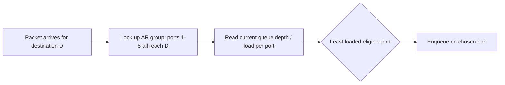

## Why this matters

The previous lesson showed that static ECMP is a dice roll: some links collect two or three
elephant flows while others stay idle, and an AI collective runs at the speed of the unluckiest
flow. Adding entropy makes the dice fairer, but it cannot react when a link actually fills up.
Large AI fabrics therefore move to load balancing that **looks at congestion** and/or works at a
**finer granularity than a flow**.

Every such scheme pays for better balance with one risk: **packet reordering**. RDMA transports
were designed for networks that deliver a connection's packets in order, and a traditional RoCE NIC
treats a gap in packet sequence numbers as loss. Get the load balancing right and the network looks
twice as fast; get the reordering story wrong and throughput collapses into retransmissions. This
lesson gives you the vocabulary and the mechanisms to tell the two apart.

## Concepts

### Three granularities

| Granularity | What gets a path decision | Balance quality | Reordering risk | Needs at the receiver |
|---|---|---|---|---|
| Per-flow (static ECMP) | The whole flow, once | Poor for few large flows | None | Nothing special |
| Per-flowlet | Each burst separated by an idle gap | Good if gaps exist | Low, by design | Nothing special (if gap is large enough) |
| Per-packet (spraying) | Every packet | Near-ideal | High: packets take paths of different delay | Out-of-order tolerance or reordering |

And two ways of choosing the path:

- **Oblivious**: random or round-robin, no knowledge of load (ECMP, random spraying).
- **Adaptive (congestion-aware)**: the switch prefers the egress port with the shortest queue or
  the least measured load, sometimes using information from downstream switches.

"Adaptive routing" (AR) in vendor language usually means a switch choosing, from a group of valid
equal-cost egress ports, the one that is currently least loaded, often per packet.

### Flowlets

A **flowlet** is a burst of packets from one flow separated from the next burst by an idle gap
larger than some threshold δ. If δ is larger than the maximum difference in delay between the
candidate paths, the switch can move the next flowlet to a different path and the first packet of
the new flowlet still arrives after the last packet of the old one. Balance improves, order is
preserved.

- **CONGA** (Alizadeh et al., SIGCOMM 2014) combined flowlet switching with congestion feedback
  carried between leaf switches, so each leaf knew the load on paths through the spine.
- **LetFlow** (Vanini et al., NSDI 2017) showed that simply picking a **random** path at each flowlet
  boundary already balances well, because flowlet sizes are elastic: senders on a congested path
  back off and create gaps, so their flowlets end sooner and get re-placed, while flowlets on
  uncongested paths grow longer and "stick". Flowlet sizes adapt to congestion by themselves.

> [!ANALOGY]
> A flowlet is like a convoy of cars that only changes lanes when there is a long enough gap in
> traffic behind it: no car can overtake the one ahead because the gap is bigger than any lane's
> speed difference. Where it breaks down: an RDMA sender at line rate is a convoy with no gaps at
> all, so it never gets a chance to change lanes.

### Why flowlets alone do not rescue RDMA

Flowlet switching was designed around TCP, whose ACK clocking and window limits naturally create
gaps. A RoCE or InfiniBand sender with a large message posted keeps the wire busy continuously,
pacing only via its congestion control. There may be **few or no gaps** larger than δ for the whole
transfer, so the flow behaves like a single giant flowlet and gets the same placement as static ECMP.
Flowlets help with bursty traffic between collectives, much less inside a large collective.

## How it works

### Per-packet adaptive routing in the switch



The switch keeps, for each destination, a group of eligible egress ports (the equal-cost paths).
For each packet (or each small batch), it picks the port with the lowest local congestion
estimate, typically queue occupancy, sometimes weighted with link utilization. Because the decision
is local and per packet, two consecutive packets of the same QP may leave on different spine
uplinks, see different queue depths, and arrive at the destination leaf out of order.

### Why reordering hurts RDMA

On a RoCEv2 Reliable Connection (RC) QP, every packet carries a 24-bit Packet Sequence Number
(PSN). A classic receiver expects PSN n+1 after PSN n. If it sees n+2 first, it treats n+1 as lost,
sends a NAK (sequence error), and the sender retransmits **from n+1 onwards** (go-back-N on many
NIC generations). Under heavy spraying, almost every message triggers spurious retransmissions:
the network was perfectly balanced, but goodput collapses.

There is also a subtler problem: in a multi-packet RDMA WRITE, only the **first** packet carries the
RETH header with the remote virtual address and key; middle and last packets carry only the PSN.
A naive receiver can only work out where a middle packet belongs in memory if it has seen the
packets before it.

### Making the receiver tolerate out-of-order arrival

Packet spraying is only safe if the receiving NIC can accept packets in any order and still place
data correctly and complete the operation exactly once. The general recipe:

1. **Place each packet independently.** Each packet must carry, or allow the NIC to derive, where
   its payload goes in memory. This is often called **direct data placement (DDP)**: the NIC writes
   the payload straight to its final buffer position regardless of arrival order.
2. **Track arrivals, not just the next expected PSN.** The receiver keeps a bitmap or window of
   received PSNs rather than a single "expected" counter.
3. **Complete only when everything is there.** The completion (and any immediate data) is delivered
   to the application only after all packets of the message have arrived, so software still sees
   in-order semantics at message granularity.
4. **Selective, not go-back-N, recovery.** If a packet is genuinely lost, retransmit only that one.

NVIDIA describes its Spectrum-X SuperNICs (BlueField-3 and ConnectX-8 based) as handling
out-of-order RoCE packets with this kind of direct data placement, so that Spectrum-4 switches can
spray packets of a flow across all available paths. Treat this as a vendor description of a
platform capability rather than a standard: the implementation details are not public in full, and
the feature requires both the switch and NIC sides to be configured for it (check NVIDIA's
Spectrum-X documentation for your software release).

> [!WARNING]
> Never enable per-packet adaptive routing for RoCE traffic toward NICs that do not tolerate
> reordering. The fabric dashboards will look beautifully balanced while applications see
> sequence-error NAKs, retransmissions and lower throughput than plain ECMP.

### Adaptive routing on InfiniBand

InfiniBand has had switch-based adaptive routing for years. In an NVIDIA Quantum fabric:

- The Subnet Manager (OpenSM or UFM) programs **AR groups**: for a destination LID, a set of output
  ports that are all valid. NVIDIA's OpenSM provides AR-aware routing engines (names such as
  `ar_updn` and `ar_ftree` appear in its documentation; check your OpenSM/UFM release).
- The switch chooses among the group's ports per packet based on local load.
- AR is typically enabled per Service Level, so you can choose which traffic is allowed to be
  reordered.
- The HCA and the software above it must cope with out-of-order arrival. NCCL has an IB-specific
  setting for AR-friendly transfers (`NCCL_IB_ADAPTIVE_ROUTING`; its default depends on version and
  on whether the link layer is IB or Ethernet, so read the env-var docs for your release).

Because InfiniBand is a managed fabric with a central SM, AR there is a well-integrated end-to-end
feature. On Ethernet the switch and NIC come from separate ecosystems, which is exactly the gap
Spectrum-X and the Ultra Ethernet Consortium target.

### Other approaches you will meet

| Approach | Idea | Where you see it |
|---|---|---|
| Dynamic / "flowlet-aware" load balancing in merchant silicon | Reassign flows at idle gaps based on port load | Various Ethernet ASICs (vendor-specific names such as DLB) |
| Scheduled / cell-based fabric | Chop packets into cells, spray cells over all fabric links, reassemble and reorder at the egress chip, with VOQs and credit-based scheduling | Chassis-style and "distributed disaggregated" Ethernet systems (e.g. Broadcom Jericho/Ramon-based designs) |
| Endpoint-driven spraying | The NIC changes the entropy value (e.g. UDP source port) per packet or per batch, so plain ECMP switches spread it; the NIC reorders | Ultra Ethernet Transport, some cloud-provider transports |
| Multipath transports | One connection, several sub-paths with per-path congestion control | Research and some proprietary RDMA stacks |

Notice the pattern: either the **fabric** hides reordering (a scheduled fabric reorders cells before
they leave the system) or the **endpoint** tolerates it. Somebody must pay for reordering.

```widget
ecmp-collision
```

Switch the widget between static ECMP, adaptive routing and packet spraying. Note how adaptive
routing reacts to the collision you just saw, and how spraying turns the per-link load from
"lumpy" to almost flat.

## In practice

### Deciding which mode to use

| Situation | Recommended starting point |
|---|---|
| InfiniBand fabric with current NVIDIA HCAs and UFM | Enable AR per vendor guidance; verify NCCL settings for AR |
| Spectrum-4 switches with Spectrum-X SuperNICs end to end | RoCE adaptive routing as documented for Spectrum-X |
| Mixed or third-party RoCE NICs | ECMP with good entropy (more QPs), rail alignment; per-packet AR only if NICs are validated for out-of-order |
| UEC-compliant NICs and switches (emerging) | Spraying via UET entropy values, per the UEC specification |

### Configuring adaptive routing on Cumulus Linux (illustrative)

Cumulus Linux NVUE exposes adaptive routing on Spectrum switches. The commands look like the
following in recent releases; verify the exact syntax and prerequisites (for example RoCE QoS mode)
for your Cumulus version before applying:

```bash
# Illustrative NVUE workflow; check your Cumulus Linux release documentation
nv set router adaptive-routing enable on
nv set interface swp1-32 router adaptive-routing enable on
nv config apply
nv show router adaptive-routing
```

AR on Spectrum applies to traffic classified as eligible (RoCE traffic in the documented setups),
and only on ports where it is enabled. On the NIC side, Spectrum-X deployments also require the
SuperNIC to be configured for the matching mode; follow NVIDIA's Spectrum-X deployment guide rather
than guessing firmware parameters.

### Verifying that it works

1. **Balance**: per-uplink TX rates during an all-reduce should now be within a few percent of each
   other, independent of restarts.
2. **No reordering penalty**: on the NICs, out-of-sequence and retransmission counters should stay
   flat. On ConnectX with the mlx5 driver, `ethtool -S <iface>` and the RDMA hardware counters
   under `/sys/class/infiniband/<dev>/ports/<n>/hw_counters/` include counters such as
   `out_of_sequence`, `packet_seq_err` and `local_ack_timeout_err` (availability varies by driver
   and firmware).
3. **Throughput**: nccl-tests bus bandwidth should rise and, just as important, its variance across
   runs should shrink.

```text
# Illustrative: hw_counters before/after a 60 s all-reduce run, sprayed traffic, AR-capable NIC
out_of_sequence      0 -> 0
packet_seq_err       0 -> 0
duplicate_request    0 -> 0
```

If `out_of_sequence` or `packet_seq_err` climb quickly once AR is enabled, the receiving side is
not handling reordering, and you should disable per-packet AR for that traffic until it is.

> [!INTERVIEW]
> "Why can't we just turn on packet spraying on our existing RoCE fabric?" A strong answer explains
> that spraying sends packets of one QP over paths with different queueing delay, so they arrive out
> of order; a traditional RC receiver interprets a PSN gap as loss and triggers go-back-N
> retransmission, so goodput drops. Spraying needs NIC support for out-of-order placement and
> completion (direct data placement, PSN tracking, selective retransmit), as in Spectrum-X SuperNICs,
> InfiniBand AR-capable HCAs or UEC's unordered delivery modes. Bonus: mention flowlets as the
> reorder-free middle ground and why RDMA flows have few flowlet gaps.

## Common pitfalls

- **Enabling switch AR without NIC support.** Symptom: balanced uplinks but lower throughput and
  rising sequence-error counters. Cause: receivers cannot handle reordering. Fix: enable AR only for
  traffic classes whose endpoints are validated for out-of-order delivery.
- **Expecting flowlets to fix elephant collisions.** Symptom: flowlet-based load balancing shows
  little improvement for collectives. Cause: line-rate RDMA flows have almost no idle gaps. Fix:
  use per-packet AR with reordering support, or add entropy.
- **Asymmetric configuration.** Symptom: AR works in one direction, or on some leaves only. Cause:
  AR enabled on some switches or ports but not others. Fix: apply AR consistently on every switch
  and port along the paths; audit with automation.
- **Mixing lossless assumptions.** Symptom: AR reduces congestion but PFC pauses still spread.
  Cause: AR balances the fabric but cannot fix **endpoint** congestion (many senders to one
  receiver). Fix: treat incast with congestion control (next lesson), not with load balancing.
- **Trusting a single headline number.** Symptom: vendor claims of "near-100 % effective bandwidth"
  do not reproduce. Cause: claims depend on topology, message size and traffic pattern. Fix:
  benchmark your workload with nccl-tests and your real job, with AR on and off.

## Key takeaways

- Load balancing trades balance against reordering: per-flow is in-order but lumpy, per-packet is
  smooth but reorders, flowlets sit in between.
- Flowlet switching (CONGA, LetFlow) moves bursts only across idle gaps; continuous RDMA flows offer
  few such gaps.
- Adaptive routing lets the switch pick the least-loaded eligible port, often per packet.
- Per-packet schemes require receivers that place data out of order and complete messages only when
  all packets arrive, as NVIDIA describes for Spectrum-X SuperNICs and as UEC specifies.
- InfiniBand has mature SM-managed adaptive routing; Ethernet needs switch and NIC to cooperate.
- Load balancing fixes fabric hotspots, not endpoint incast.
