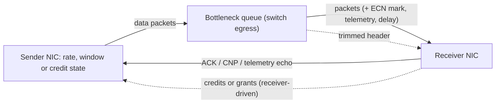

## Why this matters

`ecn-and-dcqcn` taught the algorithm that most RoCE fabrics still run: switches mark ECN when a
queue passes a threshold, the receiver returns CNPs, and the sender NIC cuts its rate. DCQCN works,
but the people who ran it at scale documented its limits. The HPCC authors (Alibaba) describe
having to choose between tuning DCQCN to avoid PFC pauses, which left average link utilisation
very low, and tuning it for throughput, which built deep queues that hurt latency-sensitive
traffic. Their diagnosis: DCQCN's timer-based rate recovery trades throughput against stability,
and its queue-threshold signal trades latency against bandwidth.

AI training makes this harder. A collective starts thousands of flows in the same microsecond, an
all-to-all produces incast at every receiver, and on sprayed fabrics one transfer uses many paths
at once. Every new AI transport you will evaluate in 2026 (Spectrum-X, Ultra Ethernet, Google's
Falcon, vendor "AI NICs") makes its case largely on congestion control. A master-level engineer
needs to place each design on the map: which signal it uses, what it controls, what it needs from
the switches, and how to test whether it actually behaves on your fabric.

## Concepts

### The two questions every algorithm answers

Every congestion-control (CC) algorithm is a feedback loop. It answers two questions:

1. **What tells the sender that the network is congested?** (the signal)
2. **What does the sender adjust?** (the control variable: a sending rate, a window of bytes in
   flight, or permission granted by the receiver)



### Five kinds of signal

| Signal | Who produces it | Information content | Needs from switches |
|---|---|---|---|
| ECN mark | Switch marks a packet when the queue exceeds a threshold | One bit per packet: "a queue was above threshold" | ECN marking configured on every hop |
| Delay (RTT) | Sender NIC timestamps; receiver echoes | Multi-bit: total queueing along the path (plus host delay) | Nothing beyond normal forwarding |
| In-band telemetry | Each switch writes queue length, transmitted bytes, timestamps or a congestion value into the packet | Multi-bit, per hop: how full and how busy each link is | Telemetry support in the switch ASIC, consistent across the path |
| Receiver credits or grants | The receiver decides who may send how much | Exact knowledge of the receiver's own downlink | Little (receiver-driven), but core congestion needs a second mechanism |
| Trimming / loss | A switch trims a packet to its header instead of dropping it, or the packet is lost | "This specific packet did not make it" | Trimming support for fast signals; otherwise timeouts |

### Three things to control

| Control variable | Behaviour when feedback is late | Examples |
|---|---|---|
| **Rate** | The sender keeps sending at the old rate until feedback arrives; in-flight data can grow without bound | DCQCN, TIMELY |
| **Window** (bytes in flight) | The sender stops when the window is full, even if feedback is delayed | Swift, HPCC, UEC NSCC |
| **Credits / grants** | The sender sends only what the receiver has allowed | Homa (scheduled part), UEC RCCC |

The HPCC paper makes the point sharply: when feedback is delayed by the very congestion it
reports, a pure rate controller keeps pumping data in. For incast in which PFC had propagated
back to the hosts, the authors calculate at least 11 times the bandwidth-delay product in
flight per flow on average. A window bounds that.

> [!ANALOGY]
> Rate control is a motorway on-ramp light set from a traffic report radioed in every few minutes:
> cars keep entering at the old rate while the report is stuck in traffic. Window control is a car
> park with a fixed number of tickets: once the tickets are out, nobody enters until one comes
> back. Credit control is a restaurant that phones you when your table is ready. The analogy breaks
> down on fairness: real CC must also share the bottleneck evenly among thousands of senders.

## How it works

### Delay-based: TIMELY and Swift

**TIMELY** (Google, SIGCOMM 2015) showed that NIC hardware timestamps make RTT measurable with
microsecond accuracy, enough to estimate switch queueing without any switch feedback. TIMELY is
**rate-based** and reacts to the **RTT gradient**: the difference between consecutive RTT samples,
normalised by a fixed minimum RTT and smoothed with an EWMA. A zero or negative gradient means the
queue is stable or draining, so the rate increases additively; a positive gradient means the queue
is growing, so the rate decreases multiplicatively in proportion to the gradient. Two thresholds
guard the edges: below `Tlow` the sender increases regardless (filtering RTT spikes caused by
bursty 64 KB segments), and above `Thigh` it cuts multiplicatively regardless of gradient (a
gradient can sit at zero while a queue stays high). The paper reports 9x lower 99th-percentile
latency when TIMELY was turned on for OS-bypass messaging over a PFC fabric.

**Swift** (Google, SIGCOMM 2020) kept delay as the signal but changed the controller. Per the
paper's abstract, it uses NIC hardware timestamps and **AIMD around a target end-to-end delay**,
and reports tail latency for short RPCs around 50 us while sustaining 100 Gb/s per server near full
load. Design points worth knowing:

- **Window-based**, and the window may fall **below one packet**, enforced by pacing. With
  thousands of senders converging on one host, even one packet per sender is more than the path's
  bandwidth-delay product; the authors report line-rate handling of a 5,000-to-1 incast at 50 Gb/s.
- **Two windows**: one driven by fabric delay and one by endpoint (host and NIC) delay, with the
  effective window the minimum of the two. Delay decomposes cleanly into "the network is congested"
  and "the receiving host is slow", which ECN cannot express.
- **Scaled targets**: the target delay grows with the number of hops on the path (Swift derives hop
  count from the IP TTL) and as the window shrinks (more competing flows), so long paths and big
  incasts are not punished for unavoidable delay.

Delay needs no switch configuration, which is its operational appeal. Its weakness is attribution:
RTT tells you how much queueing there was in total, not which hop caused it.

### Telemetry-based: HPCC

**HPCC** (Alibaba with academic co-authors, SIGCOMM 2019) asks the switches directly. Each switch
on the path appends **in-band network telemetry (INT)** for the packet's egress port: a timestamp,
cumulative transmitted bytes (`txBytes`), queue length (`qLen`) and the link speed. The receiver
copies the stack into the ACK. From two ACKs the sender computes each link's `txRate`, then its
normalised in-flight bytes:

```
U_j = qlen_j / (B_j x T) + txRate_j / B_j        (T = base RTT, B_j = link capacity)
W   = W / (max_j U_j / eta) + W_AI               (eta ~ 0.95, W_AI small)
```

The sender sizes its **window** so the most loaded link on its path runs at a target `eta` of its
capacity, which keeps queues near zero. Because the signal is exact, a single update usually
resolves a single-bottleneck incast. To avoid overreacting to several ACKs that describe the same
queue, HPCC combines per-ACK updates with a per-RTT reference window. The paper lists three
parameters (`eta`, `maxStage` and `W_AI`), reports up to 95% shorter flow completion times than
DCQCN and TIMELY, and reports no PFC pauses in an incast simulation where DCQCN and TIMELY suffered
PFC storms. The cost: INT support in every switch, and header overhead (HPCC's format adds 8 bytes
per hop plus a small header: at most 42 bytes for a path of up to 5 hops, about 4% of a 1 KB packet).

### Receiver-driven: credits and grants

When many senders converge on one receiver, the receiver is the only party that sees all of them.
**Homa** (SIGCOMM 2018) lets a sender transmit the first round-trip's worth of a message
("RTTbytes") blindly; after that, packets are sent only when the receiver issues grants, and the
receiver assigns switch priority queues per packet so short messages overtake long ones. Homa
deliberately **overcommits** the downlink (grants to a few senders at once) because a granted
sender may be busy elsewhere. The Homa paper notes that NDP also schedules incoming packets at the
receiver. Receiver-driven schemes handle incast almost perfectly but cannot see congestion in the
core, which is why the UEC spec pairs its credit algorithm with a sender-based one.

### Ultra Ethernet: NSCC, RCCC, CSIG and PCM

The Ultra Ethernet specification (`ultra-ethernet`) puts these ideas into one transport. Per
Specification 1.1 (October 2026):

- **NSCC** (Network Signal-based Congestion Control) keeps **one window for a transfer sprayed over
  many paths** and combines ECN with queueing delay (RTT minus base RTT, or switch-reported delay
  where available). The four combinations drive different actions: no ECN and low delay, increase
  in proportion to headroom; no ECN but high delay, additive "fair" increase (the queue has
  drained); ECN but low delay, **do nothing**, because light ECN marking on a sprayed fabric is
  often a load-balancing symptom that path selection should fix first; ECN and high delay, decrease
  in proportion to the excess queue. A `quick_adapt` step resets the window from measured goodput
  on loss or severe delay. NSCC assumes switches set ECN on **dequeue** (the spec says switches
  SHOULD mark there and that NSCC will not perform as desired with enqueue marking).
- **RCCC** (Receiver-Credit Congestion Control) tracks each source's backlog at the receiver and
  hands out credits. The spec expects it to work best on non-blocking fat trees and to be
  complemented by NSCC where the core is oversubscribed.
- **CSIG** (Congestion Signaling) is a lightweight in-band telemetry tag (4-byte compact or 8-byte
  wide) that switches update along the path with per-hop congestion values; the destination
  reflects it in ACKs. It is the UEC answer to HPCC's per-hop INT stack, aggregated into a
  fixed-size tag.
- **PCM** (Programmable Congestion Management) lets implementers run alternative CC and
  load-balancing algorithms, including manipulating the table of entropy values used for spraying.

Treat 1.1 features as new: check which algorithms and options a product implements before
designing around them.

### What vendors ship today (as of 2026)

| Platform | What is public | Hedge |
|---|---|---|
| NVIDIA ConnectX (RoCE) | DCQCN by default; an RTT-based algorithm commonly called RTTCC on newer NICs (`ecn-and-dcqcn`) | Availability and defaults depend on NIC generation and firmware |
| NVIDIA BlueField-3 (DOCA PCC) | **Programmable Congestion Control**: users write their own CC algorithm that runs on the NIC's datapath accelerator (DPA). Reference examples include an RTT template and "switch telemetry" variants that use IFA probe packets from the last-hop switch | Requires specific firmware and tools per the DOCA guide; a development platform, not a default |
| NVIDIA Spectrum-X | NVIDIA describes "telemetry-based congestion control" between Spectrum-X switches and SuperNICs that provides noise isolation between tenants (`spectrum-x-architecture`) | The algorithm and telemetry format are not public |
| Google Falcon | Hardware transport contributed to OCP (announced October 2023); Google lists Swift (and CSIG) among the technologies it builds on; it uses hardware-assisted RTT measurements and multipath-capable connections; first available in Intel IPU E2000 | Check OCP for current spec status |
| UEC NICs | NSCC and/or RCCC per profile, optional trimming, CSIG and PCM in 1.1 | Ask which algorithms, profile and spec version |

### Comparing the families

| Property | ECN (DCQCN) | Delay (TIMELY, Swift) | Telemetry (HPCC, CSIG) | Credits (Homa, RCCC) |
|---|---|---|---|---|
| Switch support needed | ECN thresholds on every hop | None | Telemetry in every switch ASIC | Little; priorities for Homa |
| Signal precision | One bit, threshold-dependent | Total path queueing, noisy | Per-hop, exact | Exact at the receiver only |
| Reaction speed | After queue reaches threshold, plus CNP path | One RTT after delay rises | About one RTT, often one update | Before the queue forms (scheduled data) |
| Incast | Needs aggressive tuning; PFC as backstop | Good with sub-packet windows (Swift) | Very good | Excellent |
| Core congestion | Yes | Yes (cannot locate it) | Yes, located per hop | No, needs a second mechanism |
| Tuning burden | High (Kmin, Kmax, Pmax, timers) | Target delay, scaling | Few parameters | Overcommitment, priorities |
| Multipath spraying | Per-flow rate; spraying hides which path is hot | One RTT signal mixes many paths | Per-path telemetry possible | Indifferent to path |

## In practice

### Worked example: how small is a window under incast?

Assumptions: 400 Gb/s links, base RTT 10 us inside one data hall, 4 KiB RDMA MTU.

1. Bandwidth-delay product: 400 x 10^9 / 8 B/s x 10 x 10^-6 s = **500,000 bytes** (about 122
   packets of 4 KiB). That is all the data that needs to be in flight to fill one receiver's link.
2. A 64-to-1 incast (one all-to-all step on a 64-rank group): each sender's fair share is
   500,000 / 64 = about **7,800 bytes**, just under two 4 KiB packets. Tight, but a one-packet
   minimum still fits.
3. A 512-to-1 incast (an all-to-all step across 64 nodes of 8 GPUs): the fair share is
   500,000 / 512 = about **977 bytes**, less than one 4 KiB packet.
4. Any algorithm whose minimum is one packet per sender then puts 512 x 4 KiB = 2,097,152 bytes into
   the network: about 4x the BDP, so about 1.6 MB more than the link can drain in one RTT piles up
   in the receiver's leaf queue. That is
   why Swift allows windows below one packet (pacing) and why receiver credits suit incast.

```widget
queue-latency
```

Use the widget with 64 senders at 400G to see how fast a queue builds and how long it takes to
drain. The widget stops at 64; with 512 senders the excess arrival rate is about eight times higher
(511 instead of 63 links' worth).

### Worked example: one HPCC update

Assumptions as above, plus INT from the bottleneck reports `qLen` = 1,000,000 bytes and `txRate` =
400 Gb/s (the link is saturated), `eta` = 0.95, and `W_AI` ignored.

1. `B x T` = 500,000 bytes.
2. `U` = 1,000,000 / 500,000 + 400 / 400 = 2 + 1 = **3** (three times what the link can hold).
3. New window = W / (3 / 0.95) = **0.317 W**: every sender sharing that link cuts to about a third
   in one step, so the queue drains in roughly one RTT and is not rebuilt.

Compare DCQCN: the same queue produces ECN marks with a probability set by Kmin/Kmax/Pmax, CNPs
are generated per flow, and each sender cuts by a factor derived from its own alpha estimate, so
convergence takes several rounds and depends on tuning (`pfc-ecn-sim` shows the loop).

```widget
pfc-ecn-sim
```

### Evaluating congestion control on your fabric

You rarely get to choose the algorithm freely, but you do choose between NIC firmware settings,
vendor platforms and transports. Test them the same way:

1. **Incast sweep.** N senders to one receiver for N = 2, 8, 32, 128 (and beyond if you can), with
   perftest or nccl-tests all-to-all on increasing rank counts. Record receiver throughput, which
   should stay near line rate.
2. **Victim test.** Run a latency-sensitive flow (small-message `ib_write_lat` or a small
   all-reduce) to a host behind the same leaf, but not to the incast receiver. Good CC keeps its
   latency flat; PFC spreading or deep shared queues will not.
3. **Collective-on-collective.** Two jobs on overlapping links: does each get a fair share, and
   does the bursty one degrade the steady one (noise isolation)?
4. **Metrics to collect**, from `telemetry-counters` and `streaming-telemetry-gnmi`:

| Metric | Where | What good looks like |
|---|---|---|
| Queue watermark on the receiver's leaf port | Switch buffer statistics | Bounded and well below the PFC threshold |
| PFC pause frames sent and received | Switch per-priority counters, NIC pause counters | Rare or zero in steady state |
| ECN-marked packets and CNPs | Switch ECN counters; NIC RDMA congestion counters | Present under load (the loop is working), not saturating |
| Retransmissions, out-of-sequence | NIC RDMA hardware counters | Near zero on a lossless fabric |
| Flow completion time slowdown (FCT / ideal FCT) at p50 and p99 | Test harness | Small multiple of ideal, tight tail |
| busbw of the collective | nccl-tests | Stable across repeats |

```text
# illustrative summary of an incast sweep (not measured data)
senders  rx_Gbps  leaf_q_watermark  pause_tx  victim_p99_lat
   8      392        0.4 MB             0        3.1 us
  32      388        1.1 MB             0        3.4 us
 128      361        3.8 MB           1,204     41.0 us   <- CC not keeping up: PFC took over
```

The bottom row is the pattern to look for: throughput holds, but the queue grows until PFC fires
and the victim flow suffers. That is congestion control falling behind, not a broken link.

> [!TIP]
> Change one thing at a time and repeat each run several times. CC behaviour depends on firmware
> versions, ECN thresholds, buffer settings and traffic phase; a single run proves little.

> [!INTERVIEW]
> "DCQCN versus HPCC versus Swift: when would you pick which?" A strong answer frames them by
> signal and control variable: DCQCN is ECN plus rate, mature and everywhere but tuning-heavy;
> Swift is delay plus window, needs nothing from switches, handles huge incast with sub-packet
> windows but cannot locate the hot hop; HPCC is per-hop telemetry plus window, fast and precise
> with few parameters but needs INT in every switch. Then add the 2026 picture: receiver credits
> (UEC RCCC) for incast, NSCC for sprayed traffic, programmable CC on NICs, and vendor
> telemetry-based schemes, and say you would validate any of them with an incast sweep and a
> victim-flow test.

## Common pitfalls

- **Expecting CC to replace PFC on day one.** Symptom: drops appear after PFC is disabled "because
  we have good CC now". Cause: the first RTT of a synchronized collective arrives before any
  feedback can. Fix: keep the lossless backstop (or a transport that tolerates loss, such as UET
  with trimming) and verify with an incast sweep.
- **Rate control with delayed feedback.** Symptom: queues and pauses balloon during large incasts
  even though CC is enabled. Cause: rate-based senders keep transmitting until feedback arrives.
  Fix: prefer windowed or credit-based schemes where available; tune DCQCN for faster cuts.
- **Mixing algorithms on one priority.** Symptom: one job starves another. Cause: a delay-based
  sender backs off at a queue level that an ECN-threshold sender tolerates. Fix: one CC algorithm
  per traffic class, or separate classes.
- **Wrong ECN marking point.** Symptom: an NSCC-based NIC under-performs. Cause: the switch marks
  on enqueue; the UEC spec assumes marking on dequeue. Fix: confirm the switch behaviour.
- **Delay targets that ignore topology.** Symptom: flows crossing the spine run slower than
  intra-leaf flows. Cause: one fixed delay target for all paths. Fix: scale targets by hop count,
  as Swift does, or validate the vendor's equivalent.
- **Believing headline claims.** Symptom: a CC feature looks great in a datasheet and does nothing
  in your fabric. Cause: different traffic, topology or firmware. Fix: reproduce with your own
  incast and victim tests.

## Key takeaways

- Every CC algorithm is a signal plus a control variable: ECN, delay, per-hop telemetry, receiver
  credits or trimming, controlling a rate, a window or credits.
- Windows bound in-flight data when feedback is late; pure rate control does not.
- TIMELY reacts to the RTT gradient; Swift uses AIMD around scaled delay targets with sub-packet
  windows; HPCC uses per-hop INT to size the window in about one step.
- Receiver-driven credits handle incast best but need a second mechanism for core congestion.
- UEC NSCC combines ECN and delay over one window for sprayed traffic; RCCC adds receiver credits;
  CSIG and PCM (Specification 1.1, October 2026) add compact telemetry and programmable CC.
- Under incast, the per-sender fair share can be far below one packet (about 977 bytes for 512-to-1
  at 400G and 10 us RTT, where the BDP is 500,000 bytes).
- Validate any algorithm with incast sweeps, victim flows, queue watermarks, pause and CNP counters
  and FCT slowdown.
