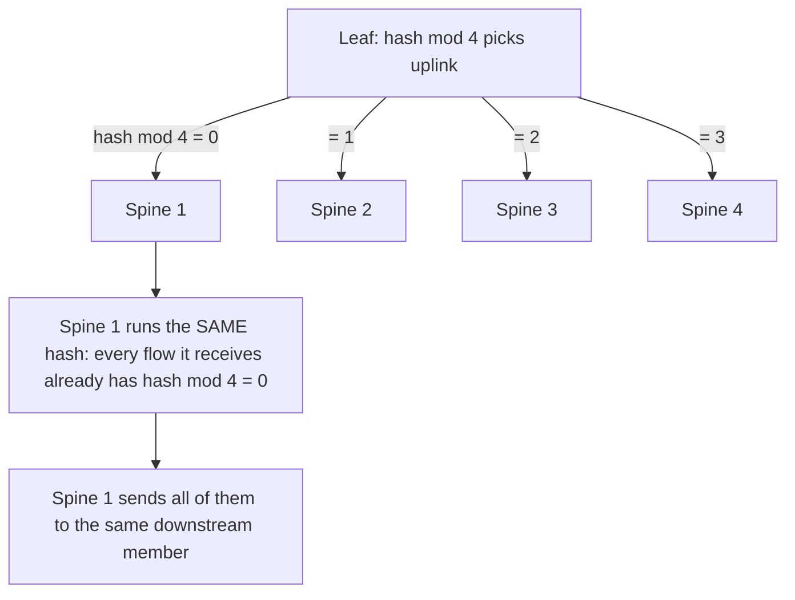

## Why this matters

A non-blocking leaf-spine fabric has enough capacity on paper. If every leaf has as much uplink
bandwidth as downlink bandwidth, any GPU should be able to send at line rate to any other GPU. In
practice, AI teams regularly measure all-reduce bandwidth well below what the fabric "should"
deliver, while the switch dashboards show some spine uplinks at 100 % and others nearly idle. The
fabric is not short of capacity. It is short of **good placement**: the traffic is spread across
paths by a hash function, and the hash puts several large flows on one link while other links sit
empty.

Enterprise networks get away with hashing because they carry many thousands of small, independent
flows, and the law of large numbers smooths them out. An AI training job does the opposite: it opens
a small number of long-lived, very large, **synchronized** flows, and the whole job waits for the
slowest one. Two flows colliding on one 400 Gb/s link do not cost "a bit of efficiency": they halve
the speed of the collective, and therefore every GPU in the job waits. This lesson explains why
that happens, how to estimate it, and which knobs add the **entropy** the hash needs.

## Concepts

### ECMP in one paragraph

Equal-Cost Multi-Path (ECMP) routing installs several next hops for one prefix. For each packet the
switch computes a hash over header fields, takes it modulo the number of next hops (or looks it up in
a table of hash buckets), and forwards the packet to the selected member. All packets of one flow
produce the same hash, so they take the same path and arrive in order. That **per-flow stickiness**
is the whole point: TCP and RDMA reliable connections assume in-order delivery.

The fields usually hashed are the **5-tuple**:

| Field | RoCEv2 value | Varies between flows? |
|---|---|---|
| Source IP | GPU NIC address | Per NIC |
| Destination IP | Peer NIC address | Per peer |
| IP protocol | 17 (UDP) | Never |
| UDP destination port | 4791 (IANA-assigned for RoCEv2) | Never |
| UDP source port | Chosen by the NIC per QP | Yes: the main entropy source |

Many switches can also include the IPv6 flow label, VLAN, or inner headers of a tunnel; which
fields are available is platform-specific, so check your switch documentation.

### Entropy

**Entropy** here means "how many distinct hash inputs the traffic presents". If 1,000 flows have
1,000 different 5-tuples, the hash has plenty of material to spread them. If 8 flows have 8 tuples,
the hash can only make 8 random choices, and random choices collide.

For RoCEv2, four of the five fields are constant for a given NIC pair (protocol, destination port,
and both IPs). The only field that can differ between two connections between the same two NICs is
the **UDP source port**. NVIDIA ConnectX NICs derive it per Queue Pair (QP), so each QP is,
from the switch's point of view, a separate flow. Fewer QPs means less entropy.

### Elephants, mice and synchronization

| Property | Typical enterprise/web traffic | AI training collective traffic |
|---|---|---|
| Number of concurrent flows per link | Hundreds to thousands | A handful |
| Flow size | Mostly small (mice) | Very large (elephants, MBs to GBs per step) |
| Flow duration | Short | Long-lived connections, reused every step |
| Timing | Independent, Poisson-like | Synchronized: all GPUs start together |
| What matters | Average throughput, tail latency of small requests | Completion time of the **slowest** flow |

The last row is the killer. An all-reduce finishes when its last chunk arrives. If one flow out of
64 runs at half speed because it shares a link, the collective runs at roughly half speed.

> [!ANALOGY]
> ECMP is like a motorway toll plaza where the booth is chosen by the last digit of your licence
> plate. With thousands of cars, every booth gets about the same queue. Now send eight 40-tonne
> trucks that all leave the depot at the same second: two of them will often have plates ending in
> the same digit, queue at one booth, and the convoy cannot leave until the last truck is through,
> while other booths stay empty. Where it breaks down: real trucks could look at the queues and
> change lanes. Static ECMP never looks; it only reads the plate.

## How it works

### The balls-into-bins math

Model the hash as throwing each flow (ball) into a uniformly random uplink (bin). With N flows and
N uplinks:

- The probability that a given uplink receives **no** flow is (1 - 1/N)^N, which approaches
  1/e ≈ 0.37 for large N.
- So roughly **37 % of uplinks are idle** and the remaining 63 % carry everything, which means some
  of them carry two, three or more flows.
- The probability that **no** two flows collide is N!/N^N. For N = 8 this is 40,320 / 16,777,216 ≈
  0.24 %. Almost every step of the job hits at least one collision.
- The most-loaded link grows slowly with N (on the order of ln N / ln ln N for large N), so in a
  large fabric you should expect some links carrying three or four elephants.

Worked example: a leaf has 8 × 400 Gb/s uplinks and 8 GPUs each start one 400 Gb/s flow to remote
leaves.

| Uplink | Flows hashed to it | Throughput per flow |
|---|---|---|
| 1 | 2 | 200 Gb/s |
| 2 | 0 | (idle) |
| 3 | 1 | 400 Gb/s |
| 4 | 3 | 133 Gb/s |
| 5 | 0 | (idle) |
| 6 | 1 | 400 Gb/s |
| 7 | 1 | 400 Gb/s |
| 8 | 0 | (idle) |

This is one plausible random outcome, not a measurement. The leaf has 3.2 Tb/s of uplink capacity
and 3.2 Tb/s of demand, yet three flows run at a third of line rate. Because the collective waits for
its slowest participant, the effective bandwidth of the whole job is close to 133 Gb/s per GPU, a
third of what the hardware can do.

```widget
ecmp-collision
```

Use the widget in static ECMP mode, reroll the hash several times, and watch how rarely you get a
perfect one-flow-per-link assignment.

### Why "more flows" helps, and by how much

If each GPU spreads its data over k flows (k QPs) instead of one, the leaf hashes 8k smaller flows
onto 8 links. The load on each link becomes a sum of many small random pieces, and the relative
imbalance shrinks roughly like 1/√k. With k = 4 the worst link is typically much closer to the
average than with k = 1, though not perfect. This is the reason NCCL exposes
`NCCL_IB_QPS_PER_CONNECTION`: more QPs per peer connection means more distinct UDP source ports.

The trade-offs are real: every QP consumes NIC context memory and connection setup time, and more
QPs per connection can change NCCL's message sizes per QP. Increase it deliberately and measure.

### Where the UDP source port comes from

The RoCEv2 annex of the InfiniBand specification lets the sender choose the UDP source port and
describes it as a flow identifier that network devices can use for ECMP. On ConnectX NICs the port is derived from QP attributes (the exact derivation, and whether
it can be influenced by firmware or the flow label, is NIC- and firmware-specific). Two consequences:

- Two QPs between the same NIC pair will normally have different source ports and therefore hash
  independently.
- One QP keeps one source port for its whole life. A long-lived QP that collides at job start
  stays collided for the whole job unless something re-maps it.

### Hash polarization

Polarization happens when two switching tiers use **the same hash function with the same seed** on
the same fields.



The leaf has already sorted flows by hash value. Every flow arriving at spine 1 has the same low
bits of the hash, so when spine 1 runs the identical computation to pick among its own next hops,
all of those flows land on one member. Entropy was "used up" at the first tier. In a two-tier
leaf-spine where spines have a single path to each destination leaf this does not bite, but in
three-tier (super-spine) fabrics and in designs with parallel links (LAG or multiple links between a
spine and leaf) it does.

The fix is to make the tiers hash differently:

- Configure a **different hash seed** per switch (many network operating systems derive it from a
  unique value such as the system MAC, or let you set it).
- Use **different hash functions or field sets** at different tiers where the platform allows it.
- Avoid tier-wide configuration templates that pin the same seed everywhere.

### Static ECMP has no feedback loop

The most important property of classic ECMP is that it is **oblivious**: it never looks at link
load. It does not know that uplink 4 is full and uplink 2 is idle. Every improvement in the next
lesson (adaptive routing, flowlets, packet spraying) adds some form of feedback or finer granularity.
Static ECMP plus more entropy only makes the dice fairer; it does not stop them from landing badly.

> [!NOTE]
> Rail-optimized designs reduce how much traffic crosses the spine at all: GPU 0 of every server
> connects to the same rail leaf, and most collective traffic stays on that leaf. Collisions still
> matter for traffic that must leave the rail, and for clusters larger than one rail leaf can hold.

## In practice

### Look at uplink balance, not average utilization

A collision problem shows up as **imbalance** between ECMP members, not as high average load. On a
Linux-based NOS or SONiC you can compare interface counters on the uplinks during a benchmark:

```text
# Illustrative output: TX rate on 8 leaf uplinks during an all-reduce benchmark
Interface   TX Gb/s
swp49       398
swp50         2
swp51       397
swp52       399
swp53         1
swp54       396
swp55       398
swp56         3
```

Three nearly idle uplinks while the others are at line rate is the classic signature of
low-entropy hashing. The exact command depends on your NOS (for example `show interfaces counters`
on SONiC, `nv show interface <port> counters` on Cumulus Linux NVUE).

### Check what the switch hashes on

Every platform has a way to show and set the ECMP hash fields and seed; the syntax differs by vendor
and release, so consult your NOS guide. Verify:

1. The UDP source and destination ports are included (some defaults hash only on IPs).
2. The seed differs between tiers, or at least between leaf and spine roles.
3. If traffic is tunnelled (VXLAN on a front-end network), the hash uses inner headers or the
   tunnel source port carries inner entropy.

### Add entropy at the endpoints

With NCCL over RoCE or InfiniBand you can ask for more QPs per connection:

```bash
# Spread each NCCL connection over 4 QPs (documented default is 1; check your NCCL version's docs)
export NCCL_IB_QPS_PER_CONNECTION=4
```

Then rerun the same `all_reduce_perf` test and compare bus bandwidth and its run-to-run variance.
A typical result of more entropy is not a higher peak but a **tighter distribution**: fewer runs
where the job is inexplicably 30-50 % slow.

> [!TIP]
> Run a benchmark many times, not once. Hash collisions are random per QP set-up. A single good run
> proves little; a bimodal histogram of bandwidth across 20 restarts is the fingerprint of ECMP
> collisions.

### A quick diagnostic table

| Observation | Likely meaning |
|---|---|
| Uplinks very uneven, average utilization moderate | Low entropy / collisions |
| Performance changes every time the job restarts | QPs re-hashed differently each start |
| Spine uplinks balanced but one spine-to-leaf link saturated | Possible polarization or destination hotspot |
| All uplinks balanced and full, still slow | Not a hashing problem: look at oversubscription or incast |

## Common pitfalls

- **Judging the fabric by average utilization.** Symptom: "uplinks are only 60 % busy, so the network
  is fine." Cause: the average hides a few saturated members and several idle ones. Fix: look at
  per-member utilization and at the max/min ratio across an ECMP group.
- **Hashing without L4 ports.** Symptom: all traffic between two NICs uses one path regardless of
  QP count. Cause: switch hash configured for L3 only (source/destination IP). Fix: include UDP
  source and destination ports in the ECMP hash.
- **Same seed on every tier.** Symptom: one spine downlink or super-spine link is hot while its
  peers are idle, even with many flows. Cause: hash polarization. Fix: per-switch or per-tier seeds,
  or different hash functions per tier.
- **Expecting more QPs to fix everything.** Symptom: raising `NCCL_IB_QPS_PER_CONNECTION` helped a
  little, then made start-up slower or hurt small messages. Cause: entropy only improves the odds;
  it adds QP state and splits messages. Fix: tune with measurements, and move to adaptive routing for
  a structural fix.
- **Benchmarking once.** Symptom: a vendor demo shows full bandwidth, production does not. Cause: one
  lucky hash. Fix: repeat tests across many restarts and node pairings.
- **Forgetting the IP pair.** Symptom: two GPUs on the same NIC pair both slow. Cause: same source
  and destination IP, so only the source port differs; if the NIC uses one QP per peer there is no
  entropy at all. Fix: more QPs per connection, or a rail-aligned layout that keeps such traffic
  off the spine.

## Key takeaways

- ECMP picks a path per flow by hashing header fields; it is blind to link load.
- AI training creates few, huge, synchronized flows, so random hashing collisions directly slow the
  whole job, which waits for its slowest flow.
- With N flows on N links, about 37 % of links stay idle and collisions are almost certain
  (N!/N^N ≈ 0.24 % chance of none for N = 8).
- In RoCEv2 the UDP source port, set per QP, is the main entropy source; more QPs per connection
  means more entropy.
- Hash polarization occurs when tiers share hash function and seed; use different seeds or
  functions per tier.
- Entropy improves the odds; adaptive routing and packet spraying change the game.
