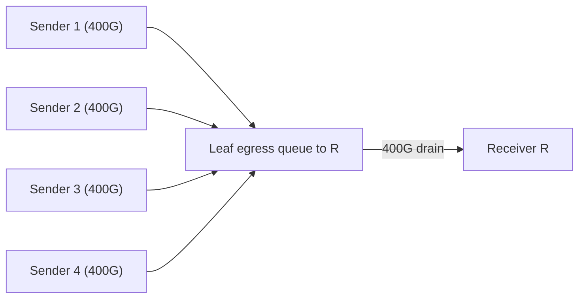
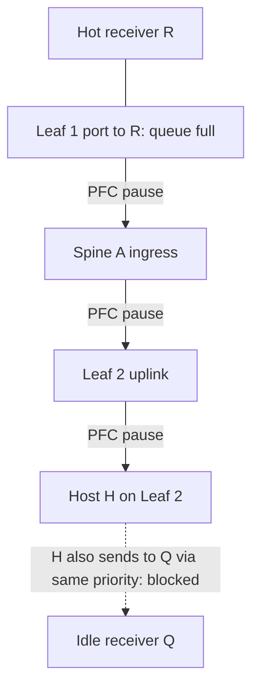

## Why this matters

Adaptive routing and packet spraying can make every spine link equally busy. They cannot do
anything when eight senders all want to reach **the same receiver** at line rate: there is only one
cable into that NIC. This many-to-one pattern is called **incast**, and it is the congestion that no
amount of clever path selection removes. In AI clusters it appears in Mixture-of-Experts all-to-all
exchanges, in the reduce phase of some collectives, in checkpoint and dataset reads from storage,
and whenever a straggler finally catches up and many peers send to it at once.

On a lossless RoCE fabric, incast does not stay local. The switch queue in front of the hot port
fills, PFC pauses upstream ports, those ports stop carrying **unrelated** traffic too, and a single
hotspot grows into a congestion tree that slows flows which never touched the hot receiver. This
lesson shows how to recognise incast, how to estimate its scale, and which layer should handle it.

## Concepts

### Two kinds of congestion

| Type | Where | Example | Fixed by load balancing? |
|---|---|---|---|
| Fabric (in-network) congestion | Leaf uplinks, spine links | Two elephants hashed onto one spine uplink | Yes: AR, spraying, more entropy |
| Endpoint (last-hop) congestion | The leaf port facing the receiver, or the receiver NIC/PCIe | 8 GPUs sending to 1 GPU | No: total demand exceeds the one link |

The test is simple: if the sum of traffic headed to one destination port exceeds that port's rate,
it is endpoint congestion. Only **reducing the sending rate** (congestion control), **scheduling**
the senders, or **absorbing** the burst in buffers can help.

### Anatomy of an incast



Four senders at 400 Gb/s offer 1.6 Tb/s to a 400 Gb/s port. The queue grows at the **excess**
rate: 1.6 - 0.4 = 1.2 Tb/s = 150 GB/s, i.e. **150 KB per microsecond**.

### Buffer math you can do on a whiteboard

| Senders N (400G each) | Excess rate | Queue growth per µs | Time to fill 1 MB of buffer | Time to fill 10 MB |
|---|---|---|---|---|
| 2 | 400 Gb/s | 50 KB | 20 µs | 200 µs |
| 4 | 1.2 Tb/s | 150 KB | ~6.7 µs | ~67 µs |
| 8 | 2.8 Tb/s | 350 KB | ~2.9 µs | ~29 µs |
| 32 | 12.4 Tb/s | 1.55 MB | < 1 µs | ~6.5 µs |

Modern data center switch ASICs in the 51.2 Tb/s class have shared packet buffers in the order of
tens of megabytes to roughly a couple of hundred megabytes, shared by all ports (check the
datasheet of your specific ASIC). Only a fraction can be dedicated to one queue. Compare that with
congestion-control reaction times: DCQCN needs at least one round trip (ECN mark, CNP back to the
sender, rate cut), typically several microseconds to tens of microseconds in a large fabric, and
several rate-cut iterations to converge. In other words, a large incast fills its share of buffer
**before** end-to-end congestion control can react. That is why lossless fabrics need PFC as a
backstop, and why PFC thresholds and headroom matter.

Check the table with the calculator: set 400G and a 1 MB or 10 MB buffer, vary N and the burst size, and compare tail drop with pausing the senders.

```widget
queue-latency
```

> [!ANALOGY]
> Incast is a stadium emptying through one exit gate. Building more corridors inside the stadium
> (adaptive routing) does not help; the gate is the limit. You can hold people in the concourse
> (buffers), close the upper-tier doors so the concourse does not overflow (PFC), or tell sections to
> leave in turns (congestion control and scheduling). Where it breaks down: closing an upper-tier
> door also blocks people heading to a different exit, which is exactly PFC's victim-flow problem.

## How it works

### Step by step through an incast on a lossless class

1. **Burst arrives.** N senders start a phase of an all-to-all at the same time (they are
   synchronized by the previous collective step).
2. **Queue builds.** The egress queue toward receiver R grows at (N-1) × line rate.
3. **ECN marking starts.** Above the ECN minimum threshold (Kmin), the switch marks packets with
   CE, with marking probability rising toward Kmax. In DCQCN, the receiver NIC returns CNPs and the
   senders cut their rates.
4. **PFC triggers if marking is too slow.** If the ingress accounting for the lossless priority on
   any port crosses the XOFF threshold, the switch sends a PFC PAUSE for that priority to the
   upstream device on that port.
5. **Pause propagates.** The upstream device (sender NIC or another switch) stops transmitting that
   priority. If it is a switch, its own queues for that priority now fill, and it pauses **its**
   upstream ports. This is the congestion tree.
6. **Victims appear.** A flow from sender S1 to a completely different receiver Q shares the paused
   priority on S1's uplink. It stops too, even though Q is idle. This is head-of-line blocking.
7. **Recovery.** As DCQCN cuts rates, queues drain below XON, pauses lift, and senders slowly
   increase their rate again, often overshooting and repeating the cycle.

```widget
pfc-ecn-sim
```

In the widget, raise the number of senders and compare two settings: ECN thresholds low enough
that marking starts early, versus ECN thresholds above the PFC XOFF point. In the second case PFC
fires first on every burst, and congestion control never gets a chance to do its job.

### The congestion tree and victim flows



Host H was not even part of the incast. Its traffic to Q is collateral damage because PFC pauses a
whole priority on a link, not a flow. In a large fabric a few persistent incasts can keep large
parts of the network partially paused. This is the main reason to keep PFC as a **rarely used
safety net** and let ECN-based congestion control do the steady-state work.

### Incast patterns in AI workloads

| Workload phase | Pattern | Why it is incast-prone |
|---|---|---|
| MoE expert-parallel all-to-all (dispatch/combine) | Every rank sends to every other rank | Uneven token routing makes some experts hot; many-to-one per destination |
| Tree or reduce phases of collectives | Children send to a parent | Fan-in at each tree level (bounded by tree arity) |
| Pipeline parallel stage boundaries | Point-to-point | Usually mild, unless stages are unbalanced |
| Checkpoint write / dataset read | Many GPUs to few storage nodes (or reverse) | Storage nodes have fewer NICs than the compute side |
| Straggler recovery | Many peers resend to the slow rank | Synchronized bursts toward one endpoint |

Ring all-reduce, by contrast, is incast-free by construction: each rank receives from exactly one
neighbour. That is one reason rings behave so well on networks.

### Receiver-side and host-side congestion

Not all endpoint congestion is at the switch. If the receiving NIC cannot write into GPU memory fast
enough (for example because the PCIe path to the GPU crosses a CPU socket interconnect instead of a
PCIe switch, or because PCIe ordering and IOMMU settings limit throughput), the NIC's own receive
buffers fill and the NIC sends PFC pauses toward the switch. Symptoms look like network incast, but
the root cause is in the server. Look for pause frames **transmitted by the NIC** rather than
received by it.

## In practice

### Recognising incast from counters

| Counter / observation | What it suggests |
|---|---|
| Switch egress queue depth spikes on host-facing ports, not on uplinks | Endpoint congestion (incast) |
| ECN-marked packet counters rising on host-facing ports | Congestion control is engaged |
| PFC pause frames sent by leaf toward spine, and from spine toward other leaves | Congestion tree forming |
| PFC pause frames transmitted by a NIC | Receiver-side bottleneck (host, PCIe, GPU memory path) |
| CNPs sent/received counters on NICs rising (e.g. `np_cnp_sent`, `rp_cnp_handled` on mlx5 hw_counters) | DCQCN is reacting (names vary by driver version) |
| Packet drops on a lossy class | Expected under incast if that class is lossy; check whether RoCE traffic is mapped correctly |

Illustrative Linux view of NIC-side counters during an MoE all-to-all benchmark:

```text
# Illustrative: per-priority pause counters (netdev) and CNP counters (RDMA device) on a ConnectX port
$ ethtool -S ens1f0 | grep prio3_pause
     rx_prio3_pause: 18234
     rx_prio3_pause_duration: 912340
     tx_prio3_pause: 12
     tx_prio3_pause_duration: 40
     rx_prio3_pause_transition: 9117
$ grep -H . /sys/class/infiniband/mlx5_0/ports/1/hw_counters/{np_cnp_sent,rp_cnp_handled}
/sys/class/infiniband/mlx5_0/ports/1/hw_counters/np_cnp_sent:4410923
/sys/class/infiniband/mlx5_0/ports/1/hw_counters/rp_cnp_handled:1022
```

Where the counters live: on mlx5 the per-priority `prioN_pause` counters appear in `ethtool -S` only
for priorities that have PFC enabled, while CNP and ECN counters (`np_cnp_sent`,
`np_ecn_marked_roce_packets`, `rp_cnp_handled`, `rp_cnp_ignored`) are RDMA hardware counters, not
in `ethtool -S`; `rdma statistic show link <dev>/1` shows the same set. Take `<dev>` from
`rdma link`: NVIDIA's driver stack names it `mlx5_0`, distro rdma-core names it like `rocep3s0f0`.
On a back-to-back link or any path where nothing ECN-marks, `np_ecn_marked_roce_packets` stays at 0, and
so do the CNP counters while nothing is dropped; ConnectX receivers were also seen sending CNPs on
out-of-sequence packets (loss) with no ECN mark, so read `np_cnp_sent` next to `out_of_sequence`.

Reading the output: the NIC is **receiving** many pauses for priority 3 (it is being told to stop, so the
network in front of it is congested), but sending almost none (it is not the bottleneck itself). As
the notification point it is also sending many CNPs, meaning traffic arriving at it is ECN-marked.
Consistent with the host being one of several receivers that are hot spots during all-to-all.

### Mitigation by layer

| Layer | Mitigation | Effect |
|---|---|---|
| Switch | ECN thresholds below PFC XOFF; correct headroom; enough shared buffer for the lossless pool | Congestion control engages before pauses |
| Switch | PFC watchdog | Breaks pathological pause storms (see the PFC storms lesson) |
| NIC | DCQCN or vendor congestion control tuned for the fabric RTT; faster CNP generation | Senders back off quickly and fairly |
| NIC | Telemetry-based congestion control (for example as NVIDIA describes for Spectrum-X) | Earlier, more precise signals than ECN alone |
| Transport | Receiver-driven or credit-based schemes (e.g. UEC's receiver credit-based CC) | Receivers grant capacity, preventing overload |
| Application/library | Schedule all-to-all as pairwise rounds; limit in-flight chunks; balance MoE expert load | Fewer simultaneous senders per receiver |
| Design | Enough NICs on storage and service nodes; avoid oversubscribing receiver-side links | Removes structural incast points |

> [!TIP]
> When tuning ECN thresholds, change one thing at a time and keep a baseline. Run an incast-heavy
> test (an `alltoall_perf` from nccl-tests across many nodes is a good generator) and track three
> numbers together: throughput, PFC pause frames per second, and p99 latency of a small probe flow.

## Common pitfalls

- **Treating incast as a load-balancing problem.** Symptom: AR or spraying enabled, PFC pauses on
  host-facing ports unchanged. Cause: endpoint congestion. Fix: congestion control, scheduling and
  buffers, not path selection.
- **ECN thresholds above PFC XOFF.** Symptom: frequent pauses, few ECN marks, DCQCN counters near
  zero. Cause: PFC fires before ECN marking starts. Fix: configure ECN Kmin/Kmax so marking begins
  well below the XOFF point.
- **Missing the receiver-side bottleneck.** Symptom: one server's NIC transmits many pause frames.
  Cause: host-side limits such as PCIe topology, GPU-NIC affinity, or IOMMU settings. Fix: check
  GPU-NIC placement and PCIe paths; do not tune the switch for a server problem.
- **Ignoring victim flows.** Symptom: unrelated jobs slow down when one tenant runs all-to-all.
  Cause: PFC head-of-line blocking spreads congestion across a shared priority. Fix: keep PFC rare,
  separate traffic classes where possible, use congestion control and performance isolation.
- **Measuring averages.** Symptom: one-second counters look fine while jobs stall. Cause: incast
  bursts last microseconds to milliseconds. Fix: use high-frequency telemetry, queue-depth
  histograms or watermarks, and ECN/PFC counters sampled at short intervals.

## Key takeaways

- Incast is many-to-one congestion at the last hop; it cannot be fixed by spreading traffic over
  more paths.
- Queue growth is (N-1) × line rate: eight 400G senders fill 1 MB in about 3 µs.
- End-to-end congestion control needs at least one RTT, so buffers and PFC must absorb the first
  part of every burst.
- PFC pauses whole priorities, so one hotspot can grow into a congestion tree with victim flows.
- MoE all-to-all, tree fan-in and storage traffic are the main incast sources in AI clusters; ring
  all-reduce is incast-free.
- Keep ECN marking below PFC XOFF so congestion control does the work and PFC stays a safety net.
