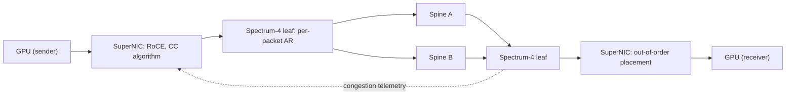

## Why this matters

The previous three lessons built up the problem: static ECMP collides elephant flows, per-packet
load balancing reorders packets that classic RoCE NICs cannot handle, and incast needs faster and
more precise congestion control than plain ECN-based DCQCN often delivers. InfiniBand solved much
of this inside one tightly integrated, centrally managed stack. Ethernet, built from independent
switches and NICs, has historically not.

**NVIDIA Spectrum-X** is NVIDIA's answer for Ethernet AI fabrics: rather than a single new
protocol, it is a platform in which the switch and the NIC are designed to work together, so that
features which need both ends (packet spraying with reordering, telemetry-driven congestion
control, tenant isolation) become possible on RoCE. You will meet it in large GPU clusters,
reference architectures and job interviews, so you need to know what is inside, what is standard
RoCE and what is NVIDIA-specific, and how to test vendor claims rather than repeat them.

## Concepts

### The building blocks

| Component | What it is | Role in Spectrum-X |
|---|---|---|
| Spectrum-4 switch ASIC (e.g. SN5600 systems) | 51.2 Tb/s Ethernet switch, for example 64 × 800G or 128 × 400G ports | Per-packet adaptive routing for RoCE, congestion telemetry, lossless/ECN QoS |
| BlueField-3 SuperNIC | 400 Gb/s-class NIC built on the BlueField-3 DPU silicon, positioned for east-west GPU traffic | Out-of-order placement, programmable congestion control, isolation |
| ConnectX-8 SuperNIC | 800 Gb/s-class SuperNIC generation (with PCIe Gen6 and an integrated PCIe switch, per NVIDIA) | Same role at higher speed, used with Blackwell-generation systems |
| Software | Cumulus Linux or SONiC on switches, DOCA and drivers on hosts, NetQ for telemetry, NCCL on GPUs | Configuration, monitoring, collective libraries |
| Reference architectures | NVIDIA-validated topologies and settings | The tested combination that the claims apply to |

Product generations and names move quickly (NVIDIA has, for example, announced Spectrum-X800
variants and Spectrum-X Photonics switches with co-packaged optics). Check current NVIDIA material
for which switch and NIC generations a given feature requires.

> [!NOTE]
> A "SuperNIC" is NVIDIA's term for a NIC optimized for GPU-to-GPU (east-west) AI traffic, with
> fewer general-purpose DPU duties than a full BlueField DPU deployment. The key point for this
> lesson is that the receiving NIC participates in features that a plain RoCE NIC would not.

### Three headline capabilities

1. **RoCE adaptive routing**: the switch distributes packets of a RoCE flow across all eligible
   paths based on load, and the SuperNIC at the receiver places them correctly even when they
   arrive out of order.
2. **Congestion control assisted by switch telemetry**: the NIC runs a congestion-control algorithm
   that, according to NVIDIA, uses telemetry from the switches in addition to end-to-end signals, so
   it can react to congestion earlier and more precisely than ECN-only DCQCN.
3. **Performance isolation (noise isolation)**: in multi-tenant clusters, the combination of AR and
   congestion control aims to stop one job's traffic (for example a bursty all-to-all) from degrading
   another job's collectives.

> [!ANALOGY]
> Classic RoCE is like building a motorway from parts by different suppliers: the road surface,
> traffic lights and car engines each follow a standard, but none was designed knowing the others.
> Spectrum-X is closer to a rail system where the track signals and the trains are designed together,
> so the trains can accept being routed onto parallel tracks and arriving in a different order.
> Where it breaks down: rail systems are closed; Spectrum-X still runs standard Ethernet and RoCE
> and interoperates at the protocol level, but the extra features only work when both ends are
> Spectrum-X components.

## How it works

### End-to-end data path



### Adaptive routing with direct data placement

On a generic RoCE fabric, all packets of one QP follow one ECMP path. In Spectrum-X mode:

- The leaf switch chooses, for each packet of eligible RoCE traffic, the least-congested uplink
  among those that reach the destination (the same idea as InfiniBand AR, implemented in the
  Spectrum ASIC).
- Packets therefore traverse different spines and arrive at the destination leaf in a different
  order than they were sent.
- The receiving SuperNIC writes each packet's payload directly to its final location in GPU or host
  memory (NVIDIA calls this direct data placement) and tracks which packets of a message have
  arrived. The application sees completions only for complete messages, so the RDMA semantics above
  the NIC do not change.

The effect is that the fabric behaves much more like a single big switch: per-link load becomes
nearly uniform, and the run-to-run variance caused by hash collisions disappears. The cost is that
this works only when **both** the switch and the receiving NIC support and are configured for it;
traffic to a non-SuperNIC endpoint must not be sprayed this way.

```widget
ecmp-collision
```

Compare "static ECMP" with "packet spraying" in the widget. Spectrum-X's adaptive routing is the
congestion-aware form of the latter, with the reordering problem moved into the receiving NIC.

### Telemetry-assisted congestion control

Classic DCQCN uses one bit of information: a packet was ECN-marked somewhere. The sender learns
about congestion one RTT late and has to guess how severe it is from the rate of CNPs. NVIDIA
describes Spectrum-X congestion control as:

- running on the SuperNIC (on the BlueField-3 data path accelerator, a programmable engine on the
  NIC, per NVIDIA's descriptions);
- using telemetry from Spectrum switches about congestion along the path, in addition to
  end-to-end measurements such as RTT;
- metering each flow's rate in hardware so that senders converge to fair shares quickly, which
  matters most for incast bursts.

The precise algorithm, the telemetry format and its timing are NVIDIA-specific and not fully
documented publicly. For your own designs, the useful mental model is: **richer and earlier
congestion signals let the sender back off before buffers fill**, which reduces reliance on PFC and
the congestion trees it creates.

```widget
pfc-ecn-sim
```

In the widget, observe how much buffer is used before the sender reacts. Earlier and more precise
signals have the same effect as moving the reaction point to the left: lower queue peaks and fewer
PFC pauses.

### Performance isolation

Multi-tenant AI clouds run several jobs on one fabric. Without isolation, a job doing heavy
all-to-all can fill shared buffers and trigger PFC pauses that slow a neighbouring job's
all-reduce. Spectrum-X's approach, as NVIDIA describes it, relies on the combination of adaptive
routing (so one job cannot monopolize a path) and per-flow congestion control (so the noisy job is
throttled at its own NICs rather than through shared pauses). This is complementary to classic
isolation tools (VRFs or EVPN for addressing, separate traffic classes, rail separation).

### What NVIDIA claims, and how to read it

NVIDIA has published comparisons stating that Spectrum-X delivers substantially higher effective
AI network performance than "traditional Ethernet": NVIDIA's marketing has cited figures such as
around 1.6× higher AI networking performance, and in announcements about large deployments (for
example xAI's Colossus cluster in 2024) NVIDIA stated that Spectrum-X sustained about 95 % data
throughput versus roughly 60 % for standard Ethernet with flow collisions. These are **NVIDIA's
numbers**, measured on NVIDIA's chosen workloads and baselines. Treat them as a hypothesis to test:

| Question to ask | Why |
|---|---|
| What was the baseline (ECMP config, entropy, QPs per connection)? | A badly tuned baseline inflates the gain |
| Which collectives and message sizes? | Large all-reduce and all-to-all benefit differently |
| Single job or multi-tenant? | Isolation benefits appear only with interfering jobs |
| Which topology and scale? | Collision effects grow with the number of paths and flows |

## In practice

### Enabling the switch side (illustrative)

On Spectrum switches running Cumulus Linux, the RoCE QoS profile and adaptive routing are enabled
through NVUE. A typical sequence in recent releases looks like the following; confirm the exact
commands and any Spectrum-X-specific profile in the Cumulus Linux documentation for your version:

```bash
# Illustrative NVUE commands; verify against your Cumulus Linux release notes
nv set qos roce mode lossless          # RoCE QoS profile: PFC + ECN on the RoCE class
nv set router adaptive-routing enable on
nv set interface swp1-64 router adaptive-routing enable on
nv config apply
nv show qos roce                        # review the applied RoCE QoS settings
```

On the host side, Spectrum-X behaviour is configured through NVIDIA's DOCA/driver stack and NIC
firmware settings documented in the Spectrum-X deployment guides. Do not guess firmware parameter
names; use the guide that matches your NIC generation and software release.

### Validation plan

1. **Baseline without Spectrum-X features**: tuned ECMP (L4 hashing, several QPs per connection),
   RoCE lossless QoS. Run `all_reduce_perf` and `alltoall_perf` across all nodes, 20+ restarts each.
2. **Enable AR and the matching NIC mode**: repeat. Expect higher mean and, most importantly, much
   lower variance.
3. **Check reordering counters**: out-of-sequence and sequence-error counters should not climb (if
   they do, a NIC is not in the right mode).
4. **Multi-tenant test**: run an all-reduce job and an all-to-all "noisy neighbour" simultaneously
   on disjoint nodes sharing spines; compare the all-reduce job's bandwidth with and without the
   neighbour.
5. **Telemetry**: use NetQ or your streaming telemetry to compare per-uplink utilization spread and
   PFC pause counts in each phase.

```text
# Illustrative summary of a validation run (not NVIDIA data)
Phase                     all_reduce busbw (GB/s)   stdev across 20 runs   PFC pauses/s (spine)
ECMP, 1 QP/conn           mean 290                  45                     high
ECMP, 4 QPs/conn          mean 330                  20                     medium
AR + SuperNIC mode        mean 365                  4                      low
```

The pattern to look for is the shrinking standard deviation, not only the higher mean.

> [!INTERVIEW]
> "What is Spectrum-X, and how is it different from just buying a fast Ethernet switch?" A strong
> answer: it is NVIDIA's end-to-end Ethernet AI platform combining Spectrum-4-class switches with
> BlueField-3 or ConnectX-8 SuperNICs and software. Its key features need both ends: per-packet
> adaptive routing works because the SuperNIC places out-of-order packets directly; congestion
> control runs on the NIC with switch telemetry; isolation comes from both. Then show judgement:
> the protocol is still RoCEv2, the advanced features do not apply to third-party NICs, and vendor
> performance numbers should be validated on your workload.

## Common pitfalls

- **Assuming any NIC works with Spectrum-X AR.** Symptom: AR enabled, some servers show sequence
  errors and low throughput. Cause: those endpoints are not SuperNICs in the right mode and cannot
  absorb reordering. Fix: apply AR only for validated endpoints; follow the reference architecture.
- **Quoting marketing numbers as facts.** Symptom: design review challenge you cannot answer. Cause:
  figures such as "95 % vs 60 %" are NVIDIA's measurements under NVIDIA's conditions. Fix: present
  them as vendor claims and show your own validation data.
- **Forgetting the lossless basics.** Symptom: pauses and drops despite AR. Cause: RoCE QoS
  (trust, PFC priority, ECN thresholds, buffers) not consistently configured. Fix: Spectrum-X builds
  on a correct RoCE QoS configuration; audit it end to end.
- **Partial deployment.** Symptom: improvements on some leaves only. Cause: AR enabled on a subset of
  switches or ports. Fix: consistent configuration through automation; verify with `nv show`.
- **Mixing up isolation layers.** Symptom: expecting Spectrum-X to provide tenant address separation.
  Cause: performance isolation is not network segmentation. Fix: still use VRFs/EVPN, partitioning
  and access control for tenancy.

## Key takeaways

- Spectrum-X is a platform: Spectrum-4-class switches plus BlueField-3 or ConnectX-8 SuperNICs plus
  software, validated together by NVIDIA.
- Its adaptive routing sprays RoCE packets per packet; the SuperNIC's direct data placement absorbs
  the reordering.
- Congestion control runs on the NIC and, per NVIDIA, uses switch telemetry for earlier, finer
  signals than ECN alone.
- Performance (noise) isolation comes from AR plus per-flow congestion control, not from
  segmentation.
- NVIDIA's performance figures are vendor claims; validate with repeated nccl-tests and multi-tenant
  experiments, focusing on variance.
