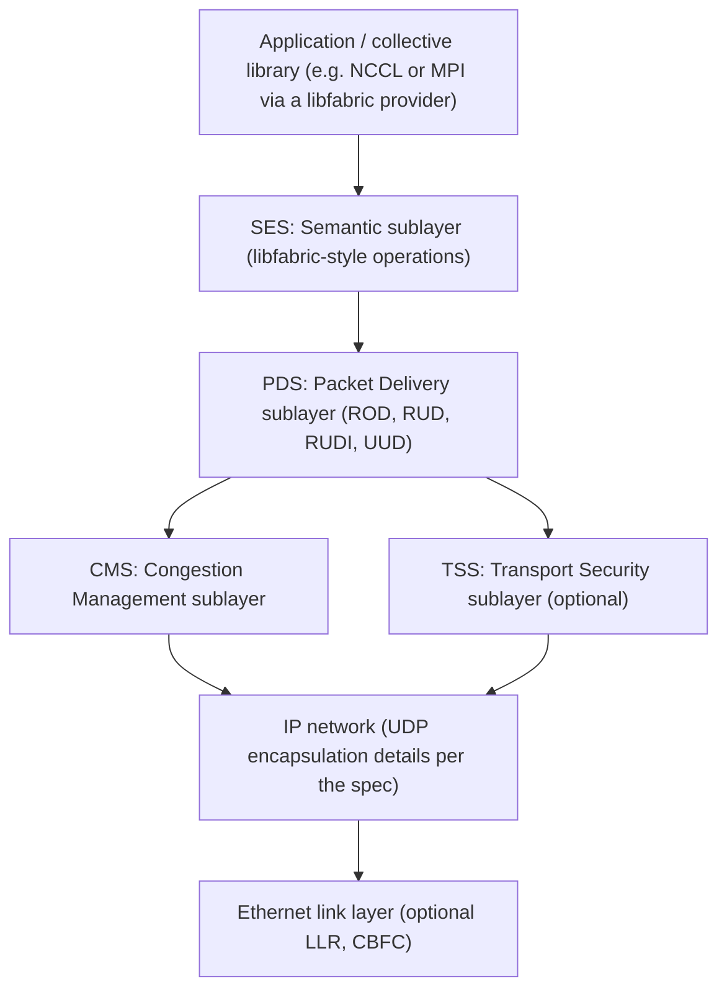

## Why this matters

RoCEv2 carries InfiniBand's transport over UDP/IP. That made RDMA routable on Ethernet, but it also
imported assumptions from a different world: one path per connection, in-order delivery, go-back-N
style recovery, and a lossless network maintained with PFC. The previous lessons showed what that
costs at AI scale: ECMP collisions, the reordering problem when you try to spray, PFC congestion
trees under incast, and expensive per-connection state when every GPU talks to thousands of peers.

The **Ultra Ethernet Consortium (UEC)** was formed in 2023 under the Linux Foundation by a group of
switch, NIC, system and cloud companies to define an Ethernet-based stack for AI and HPC that
starts from those lessons rather than inheriting them. Its **Specification 1.0**, released in June
2025, defines a new transport, **Ultra Ethernet Transport (UET)**, together with changes at the
software, network and link layers. Products claiming UEC compliance are appearing, and every AI
networking architect will be asked how UEC compares with RoCE, InfiniBand and Spectrum-X. This
lesson gives you an accurate, appropriately hedged picture.

## Concepts

### What UEC is, and what it is not

| Statement | Accurate? |
|---|---|
| UEC is a consortium producing open specifications for Ethernet-based AI/HPC networking | Yes |
| UEC 1.0 replaces Ethernet framing | No: it builds on standard Ethernet and IP |
| UET is wire-compatible with RoCEv2 | No: it is a different transport protocol; RoCE and UET can coexist on a fabric but do not interoperate |
| UEC defines a software API | It specifies semantics mapped onto **libfabric** (OpenFabrics Interfaces) rather than inventing a new verbs API |
| Every feature is mandatory | No: the spec defines profiles and many optional features |

Founding members announced in 2023 included AMD, Arista, Broadcom, Cisco, Eviden, HPE, Intel, Meta
and Microsoft; membership has grown considerably since. The consortium has said that the
specification is meant to be implementable on a wide range of NICs and switches, not one vendor's
silicon.

### Design goals in one table

| RoCEv2 pain point | UEC approach (per Specification 1.0) |
|---|---|
| One path per QP, ECMP collisions | Multipath by default: the sender varies an **entropy value** per packet so standard ECMP switches spray it |
| Receiver needs in-order packets | Unordered delivery modes; receiver places data directly and tracks arrivals |
| Go-back-N recovery | Selective acknowledgement and retransmission |
| Heavy per-connection state, slow setup | Ephemeral packet delivery contexts created on demand, no separate handshake round trip |
| PFC dependence | Designed to run on lossy or lossless fabrics; congestion control and optional link-layer features reduce reliance on PFC |
| Slow congestion signals | Sender-based congestion control using ECN and delay, plus an optional receiver credit-based mode; optional packet trimming |

> [!ANALOGY]
> RoCEv2 is a train: carriages coupled in order on one track, and if one goes missing everything
> behind it is sent again. UET is a courier company: each parcel is labelled with its destination
> address and shelf position, couriers take whichever road is clear, and the warehouse shelves
> parcels as they arrive and signs for the whole delivery when the last one comes in. Where it breaks
> down: some deliveries really must be opened in order (message ordering for certain semantics), so
> UET still offers an ordered mode, at a cost.

## How it works

### The UET stack



| Sublayer | Responsibility |
|---|---|
| Semantic sublayer (SES) | Defines operations such as send/receive, RMA read/write and atomics, tagged messaging, matching and addressing, aligned with libfabric's model |
| Packet Delivery sublayer (PDS) | Reliability, ordering, acknowledgements and retransmission, delivery modes, delivery contexts |
| Congestion Management sublayer (CMS) | Rate/window control, multipath (entropy) management |
| Transport Security sublayer (TSS) | Optional encryption and authentication, designed for groups of endpoints in a job |

### Packet delivery modes

The PDS defines four delivery modes. The application (via the semantic layer) chooses what it
needs per operation type:

| Mode | Name | Reliable | Ordered | Typical use |
|---|---|---|---|---|
| ROD | Reliable, Ordered Delivery | Yes | Yes | Semantics that require ordering; behaves like a traditional connection, limits spraying |
| RUD | Reliable, Unordered Delivery | Yes | No | Bulk RMA and most collective payloads: spray freely, receiver places data, completion when all arrived |
| RUDI | Reliable, Unordered Delivery for Idempotent operations | Yes | No | Operations that can safely be applied twice (e.g. some RMA writes), so less duplicate-tracking state is needed; per UEC's design paper, limited to the HPC profile |
| UUD | Unreliable, Unordered Delivery | No | No | Traffic that tolerates loss or has its own recovery |

The key insight: **most AI payload traffic does not need packet ordering**, only message
completion. Picking RUD (or RUDI, where the profile offers it) for that traffic is what makes packet spraying safe by design
rather than by NIC-specific tricks.

See the difference for yourself: spray a message and compare a classic go-back-N receiver with direct placement, which is what an unordered mode such as RUD lets the receiver do:

```widget
spray-reorder
```

### Packet delivery contexts

Instead of long-lived, pre-established QPs for every peer, UET uses **packet delivery contexts
(PDCs)** that are created when traffic starts and can be torn down when idle. The first packets of
a transfer establish the context, avoiding a separate handshake round trip. For a GPU that talks to
thousands of peers in an all-to-all, this keeps NIC state proportional to active communication
rather than to job size. The details of context lifetime and state are defined in the spec and are
implementation-sensitive.

### Multipath through entropy values

UET packets carry an **entropy value** chosen by the sender. Switches include it in their normal
ECMP hash, so by changing the entropy value per packet (or per small batch), the sender sprays a
single transfer over many paths **without requiring any adaptive-routing feature in the switches**.
The sender's congestion management can also learn which entropy values (paths) are congested and
avoid them, which gives a form of endpoint-driven adaptive routing. Switch-side adaptive routing,
where present, is complementary.

```widget
ecmp-collision
```

Use packet-spraying mode in the widget: that is the effect UET aims for using only standard ECMP
in the switches, with the receiver tolerating the resulting reordering.

### Congestion management

The CMS specifies congestion-control algorithms designed for spraying. In the 1.0 specification,
these include:

- **NSCC (network signal-based congestion control)**: sender-based, using signals such as ECN marks
  and round-trip delay to adjust a window, with fast reaction to incast.
- **RCCC (receiver credit-based congestion control)**: optional; the receiver grants credits to
  senders, which is effective against incast because the receiver can admit only as much traffic
  as its link can absorb.

Because a sprayed flow uses many paths, congestion control must reason about the flow as a whole
**and** about individual paths (entropy values); the spec addresses both. Read the CMS chapters
of the specification for the precise algorithms and parameters rather than relying on summaries.

### Link and network layer options

- **Packet trimming**: when a switch would drop a packet because of congestion, it can instead
  truncate it to the header and forward it (often at higher priority). The receiver learns
  immediately that a specific packet was lost and can request a fast, selective retransmission,
  instead of waiting for a timeout.
- **Link Level Retry (LLR)**: an optional link-layer mechanism that retransmits frames corrupted on
  a single link locally, hiding bit errors from the end-to-end transport.
- **Credit-based flow control (CBFC)**: an optional link-level alternative to PFC, conceptually
  similar to InfiniBand credits.

These are optional and depend on switch and NIC support; the transport is designed to work without
them.

### Profiles

UEC 1.0 groups features into profiles so that implementations can target a workload without
building everything. The spec describes AI-oriented profiles (an "AI Base" and a richer "AI Full")
and an HPC profile with more extensive semantics such as richer tag matching. Always check which
profile a product claims.

### What Specification 1.1 adds (October 2026)

The consortium released **Specification 1.1** in October 2026 (its announcement page is dated
2026-10-12; the specification history page lists 1.0.1 to 1.0.3 as point releases in between).
Per the consortium's release announcement, 1.1 adds, among other items:

| Addition | What it is (per the UEC announcement) |
|---|---|
| Scale-up optimizations | Less per-packet overhead for small transfers between accelerators (**scale-up** links, compare `open-scale-up-fabrics`), including a reduced inter-packet gap |
| Unified Forwarding Header (UFH) | A header that overlays the Ethernet header and saves about 20 bytes compared with a conventional IP packet, while keeping IP routing and coexisting with standard Ethernet |
| Unified Local profile | A simplified, UET-compatible transport for scale-up endpoints with write, read and atomic operations and lighter headers (trade press reports it targets lossless fabrics built with PFC or CBFC) |
| In-network collectives (INC) | Switches reduce data in flight and broadcast the result, the same idea as SHARP (`sharp-in-network-computing`); the consortium cites up to 2x for large all-reduce |
| CSIG (Congestion Signaling) | A 4- or 8-byte Layer-2 tag that switches update along the path to report congestion magnitude and location; NSCC and RCCC can use it |
| PCM (Programmable Congestion Management) | A common language and APIs exposed by NICs so that custom congestion-control and load-balancing algorithms can be written once and run on any PCM-capable NIC |
| UET Verbs | A verbs mapping for the AI Base profile, to ease porting of applications written to a verbs-style interface, alongside the libfabric-aligned semantics |

These are brand-new features: treat any product claim of 1.1 support as something to verify
feature by feature, and read the specification itself rather than summaries (including this one).
`congestion-control-algorithms` covers NSCC, RCCC, CSIG and PCM in more depth.

## In practice

### Positioning UEC against the alternatives

| Aspect | RoCEv2 (classic) | Spectrum-X | InfiniBand | UEC / UET |
|---|---|---|---|---|
| Transport | IB transport over UDP | RoCEv2 with NVIDIA extensions | Native IB | New transport (UET) |
| Multipath | ECMP per QP | Switch AR + SuperNIC reordering | Switch AR (SM-managed) + HCA support | Endpoint entropy spraying (+ optional switch AR) |
| Ordering | In-order expected | Reordering hidden by NIC | AR traffic tolerated per SL/HCA | Explicit delivery modes (ROD/RUD/RUDI/UUD) |
| Loss model | Lossless (PFC) typical | Lossless with improved CC | Credit-based lossless | Lossy or lossless; trimming, selective retransmit |
| API | Verbs | Verbs | Verbs | libfabric |
| Vendor scope | Multi-vendor | NVIDIA end to end | Mostly NVIDIA | Multi-vendor by design |

### What adoption looks like

As of the 1.0 release, several vendors have announced NICs and switches described as UEC-ready or
UEC-compliant (for example AMD's Pensando Pollara 400 NIC was marketed as "UEC-ready", and Broadcom
and others have announced UEC-compliant products). Compliance and interoperability testing
programmes are still maturing. Practical questions for an evaluation:

1. Which spec version and profile does the NIC implement, and which delivery modes?
2. Is there a libfabric provider, and does the collective library you use (NCCL through a net
   plugin, RCCL, MPI) support it in production?
3. Which optional switch features (trimming, LLR, CBFC) does the design depend on, and do your
   switches support them?
4. Can UET and existing RoCE traffic share the fabric during migration (separate traffic classes,
   QoS)?

> [!WARNING]
> "UEC-ready" in a datasheet is a marketing statement, not a certification. Ask for the profile,
> the implemented delivery modes and congestion-control algorithms, and evidence of interoperability
> with another vendor's endpoint.

### A mental test you can run on any design

When someone proposes a fabric, ask four questions that UEC made explicit:
**Who chooses the path?** (switch, NIC, or hash luck) **Who handles reordering?** (fabric, NIC, or
nobody) **What signals congestion and how fast?** (ECN, delay, telemetry, credits, trimming)
**What happens on loss?** (go-back-N, selective retransmit, link-level retry). A design with good
answers to all four will behave well on AI traffic, whatever brand it is.

## Common pitfalls

- **Treating UEC as "RoCE v3".** Symptom: expecting existing RoCE NICs or verbs applications to
  speak UET. Cause: misunderstanding the scope. Fix: UET is a new transport with a libfabric-based
  API; RoCE and UET coexist but do not interoperate.
- **Assuming all features are mandatory.** Symptom: designs that depend on packet trimming or LLR
  without checking switch support. Cause: overlooking profiles and optional features. Fix: map
  each dependency to a specific spec feature and verified product support.
- **Using ordered delivery everywhere.** Symptom: poor multipath gains. Cause: selecting ROD for
  bulk traffic that only needs message completion. Fix: use RUD (or RUDI where the profile offers it) for bulk payloads, ROD only
  where semantics require ordering.
- **Over-trusting summaries.** Symptom: a design document quotes UEC behaviour that the spec does
  not say. Cause: relying on blog posts. Fix: cite the specification sections directly.
- **Ignoring the software path.** Symptom: excellent NIC, but the training stack cannot use it.
  Cause: no production-grade libfabric provider or collective-library plugin. Fix: evaluate the
  full stack, including NCCL/RCCL plugins and MPI.

## Key takeaways

- UEC is a Linux Foundation consortium; its Specification 1.0 was released in June 2025.
- Ultra Ethernet Transport (UET) is a new transport over standard Ethernet/IP, with a semantic
  layer aligned to libfabric.
- UET has four delivery modes: ROD, RUD, RUDI and UUD; unordered reliable modes make spraying safe.
- Senders spray by varying an entropy value that ordinary ECMP switches hash on.
- Congestion management includes sender-based (ECN/delay) and optional receiver credit-based
  control; packet trimming, LLR and CBFC are optional helpers.
- It is not wire-compatible with RoCEv2; evaluate products by profile, implemented modes and
  software support.
- Specification 1.1 (October 2026) adds scale-up optimizations (Unified Local profile, Unified
  Forwarding Header), in-network collectives, CSIG telemetry, programmable congestion management
  and a verbs mapping;
  verify each feature in products rather than assuming it.
