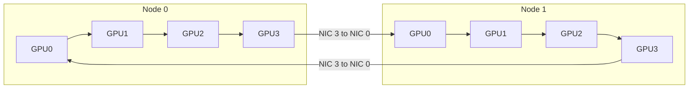

## Why this matters

A collective such as all-reduce is defined by **what** it computes: every rank ends up with the sum
of everybody's buffers. It says nothing about **how** the bytes move. The "how" is an algorithm:
a schedule of who sends what to whom in which step. Different algorithms move different amounts of
data, in different numbers of steps, over different links, and the best choice depends on message
size, number of ranks and the topology underneath.

As a network engineer you need these algorithms for three reasons. First, they determine the
traffic pattern your fabric sees (a ring is neighbour-to-neighbour and incast-free; a tree fans in).
Second, they determine what "good" bandwidth looks like, which is how you decide whether a cluster is
healthy. Third, NCCL chooses among them automatically, and when performance is wrong you must
recognise which one it picked and why. This lesson builds the cost model that every later NCCL
lesson relies on.

## Concepts

### The alpha-beta model

The simplest useful model of sending a message of m bytes between two ranks is:

```text
T(m) = alpha + m * beta        where beta = 1 / B (seconds per byte, B = link bandwidth)
```

| Term | Meaning | Dominates when | Typical order of magnitude |
|---|---|---|---|
| alpha (α) | Per-message latency: software, NIC, switch hops, synchronization | Small messages, many steps | A few µs per network step (NVLink steps are lower) |
| m·β | Serialization time at the bottleneck bandwidth | Large messages | 1 GB at 50 GB/s = 20 ms |

A collective algorithm is then characterised by **how many steps** it takes (multiplies α) and
**how many bytes each rank sends over its bottleneck link** (multiplies β).

### The operations and their minimum data movement

Let S be the buffer size per rank and n the number of ranks.

| Collective | Result | Minimum bytes each rank must send (no in-network compute) |
|---|---|---|
| All-reduce | Everyone gets the reduction of all buffers | 2(n-1)/n · S |
| Reduce-scatter | Each rank gets 1/n of the reduced result | (n-1)/n · S |
| All-gather | Everyone gets everybody's 1/n piece (S total) | (n-1)/n · S |
| Broadcast | Everyone gets root's buffer | S (pipelined) |
| Reduce | Root gets the reduction | S (pipelined) |
| All-to-all | Each rank sends a distinct 1/n of S to each peer | (n-1)/n · S |

Note that **all-reduce = reduce-scatter + all-gather**, which is why its volume is twice
(n-1)/n · S. These factors reappear as the "bus bandwidth" correction factors in nccl-tests.

Use the explorer to check each row of the table: choose a collective and n, and read the bytes each rank sends and the matching nccl-tests busbw factor.

```widget
collective-explorer
```

> [!ANALOGY]
> Think of all-reduce as a group of accountants each holding one page of the company's expenses,
> who all need the final totals. Passing pages around a circle so each person totals one column and
> then reads out their column (ring) involves many hand-offs but everyone works all the time. Having
> everyone shout their numbers to one head accountant (naive reduce) is fast to organise but the head
> accountant becomes the bottleneck. Where it breaks down: real networks have topology; the "circle"
> must be mapped onto NVLink and NICs carefully, or one hand-off crosses a slow link and stalls
> everyone.

## How it works

### Ring all-reduce, step by step

Arrange n ranks in a logical ring. Split each rank's buffer into n chunks.

**Phase 1, reduce-scatter (n-1 steps).** In each step, every rank sends one chunk to its right
neighbour and receives one from its left neighbour, adding the received chunk to its own copy.
After n-1 steps, each rank holds one fully reduced chunk.

**Phase 2, all-gather (n-1 steps).** Each rank forwards its fully reduced chunk around the ring;
after n-1 more steps everyone has every reduced chunk.

Example with n = 4 ranks (R0..R3) and chunks c0..c3. "Σ" means reduced over all four ranks.

| Step | R0 sends | R1 sends | R2 sends | R3 sends | State after the step |
|---|---|---|---|---|---|
| RS 1 | c0 | c1 | c2 | c3 | Each chunk now summed over 2 ranks on the receiver |
| RS 2 | c3 (2 ranks) | c0 (2) | c1 (2) | c2 (2) | Summed over 3 ranks |
| RS 3 | c2 (3) | c3 (3) | c0 (3) | c1 (3) | R0 holds Σc1, R1 Σc2, R2 Σc3, R3 Σc0 |
| AG 1-3 | forward the Σ chunk it just received or owns | ... | ... | ... | After 3 steps all ranks hold Σc0..Σc3 |

Each step moves S/n bytes per rank, and there are 2(n-1) steps:

```text
T_ring = 2(n-1) * alpha  +  2(n-1)/n * S * beta
```

The bandwidth term is **optimal**: it equals the lower bound in the table above. The latency term
grows **linearly** with n, which is the ring's weakness at scale and for small messages.

```widget
allreduce-sim
```

Step through ring all-reduce in the widget with 4 and then 8 ranks, then increase n and watch the
alpha term start to dominate for small message sizes.

### Trees and NCCL's double binary tree

A tree reduce sends data up a binary tree to the root, then broadcasts it back down. Done naively
this takes 2·log2(n) steps with the whole message each time, wasting bandwidth. **Pipelining**
(splitting the message into many small chunks that flow up and down concurrently) makes the
bandwidth term roughly 2·S·β in theory, close to the ring's, while the latency term is
**logarithmic** in n.

There is a catch: in a single binary tree, leaves only send and receive once, while interior nodes
send to their parent and to two children, so interior nodes become the bandwidth bottleneck. NCCL
(from version 2.4) uses a **double binary tree**: two complementary trees, each carrying half the
data, built so that a node that is interior in one tree is a leaf in the other. Every rank then
does a balanced amount of work, and the combined bandwidth approaches that of the ring.

```text
T_tree ≈ 2 * log2(n) * alpha  +  ~2 * S * beta     (pipelined, idealized)
```

NCCL builds trees across **nodes** (one tree position per node, with chains inside the node over
NVLink), so the logarithm is over the number of nodes, not the number of GPUs.

### Recursive halving-doubling

Popular in MPI (Rabenseifner's algorithm): in log2(n) rounds, ranks exchange halves of their data
with partners at distance n/2, n/4, ..., performing reduce-scatter, then the reverse to all-gather.

```text
T_rhd = 2 * log2(n) * alpha  +  2(n-1)/n * S * beta
```

It is optimal in both terms on paper, but partners are far apart in the topology, many pairs cross
the network simultaneously, and it prefers power-of-two counts. NCCL relies on rings and trees for
all-reduce instead.

### Comparison

| Algorithm | Latency term | Bandwidth term | Best for | Network pattern |
|---|---|---|---|---|
| Ring | 2(n-1)·α | 2(n-1)/n·S·β (optimal) | Large messages, modest n | Neighbour-to-neighbour, no incast |
| Double binary tree | ~2 log2(n)·α | ~2·S·β (idealized) | Small/medium messages, large n | Fan-in of 2 per level |
| Recursive halving-doubling | 2 log2(n)·α | 2(n-1)/n·S·β | MPI, power-of-two counts | Long-distance pairwise exchanges |
| In-network reduction (SHARP) | ~2 × tree depth of switches | ~S·β (each rank sends and receives S once) | Large n, all-reduce on supported fabrics | Up to switches, back down |

A quick sense of scale for α: with α = 5 µs and n = 512 ranks in a flat ring, the latency term is
2 × 511 × 5 µs ≈ 5 ms, longer than the bandwidth term for a 64 MB all-reduce at 50 GB/s
(2 × 511/512 × 64 MB / 50 GB/s ≈ 2.6 ms).
That is why large jobs use trees or hierarchical schemes for small and medium messages. (The numbers
are illustrative; real α values depend on hardware and protocol.)

### In-network and in-switch reduction

- **CollNet / SHARP (InfiniBand).** NVIDIA Quantum switches with SHARP perform the reduction inside
  the switch ASICs. Each GPU (via its NIC) sends its data up once and receives the result once, so
  the network volume per rank drops from about 2·S to about S. NCCL exposes this through the CollNet
  algorithms (CollnetDirect, CollnetChain), using a network plugin that talks to SHARP. It requires
  SHARP-capable switches and the aggregation management software.
- **NVLS (NVLink SHARP).** On Hopper-generation and later systems with NVSwitch, the NVSwitch chips
  themselves can perform reductions and multicast for GPUs in the NVLink domain. NCCL uses this as
  the NVLS algorithm (added in the NCCL 2.17 era; check release notes for your version), and
  NVLSTree combines in-node NVLS with a tree across nodes.
- **PAT (Parallel Aggregated Trees).** Added in NCCL 2.23 (per its release notes) for all-gather and
  reduce-scatter. It targets cases where rings have too many steps, notably at large scale with one
  GPU per node, offering logarithmic step counts. Treat its applicability as version-dependent.

### Hierarchy: why NCCL is not "one ring of 1,024 GPUs"

Inside a server, eight GPUs share NVLink at hundreds of GB/s per GPU; between servers each GPU has a
NIC of tens of GB/s. NCCL builds its rings and trees so that the fast intra-node hops and the slow
inter-node hops are both used efficiently: many rings (channels) run in parallel, each crossing the
node boundary through a different NIC. The next lesson covers how NCCL discovers the topology and
builds these structures.



## In practice

### Estimating expected time

For a 1 GB all-reduce across n = 16 GPUs, if each ring's bottleneck link is a 400 Gb/s NIC (about
50 GB/s) and you ignore α:

```text
Bytes per rank over the bottleneck = 2(n-1)/n * S = 2 * 15/16 * 1 GB = 1.875 GB
Time at 50 GB/s                    = 37.5 ms   (one ring through one NIC per direction)
```

With 8 rings in parallel, each through its own NIC, each ring carries 1/8 of the data, and the time
drops to roughly 4.7 ms. That parallelism is exactly what NCCL's channels provide.

### Recognising algorithms in NCCL logs

With `NCCL_DEBUG=INFO`, NCCL prints the rings and trees it built at initialization, and with
`NCCL_DEBUG_SUBSYS=TUNING` (or including it) it can print tuning decisions. You can force an
algorithm to compare, for testing only:

```bash
# Testing only: compare algorithms on the same benchmark
NCCL_ALGO=Ring ./build/all_reduce_perf -b 1K -e 1G -f 2 -g 1
NCCL_ALGO=Tree ./build/all_reduce_perf -b 1K -e 1G -f 2 -g 1
```

Expected pattern (illustrative): Tree wins at small and medium sizes on many nodes, Ring catches up
or wins at large sizes, and NVLS/CollNet (where available) can beat both for large all-reduce.

> [!INTERVIEW]
> "Derive the cost of ring all-reduce and explain why NCCL also uses trees." A strong answer splits
> ring all-reduce into reduce-scatter and all-gather, each n-1 steps of S/n bytes, giving
> 2(n-1)α + 2(n-1)/n·S·β; notes the bandwidth term is optimal but latency grows linearly with n;
> then explains pipelined trees with log(n) latency and the double binary tree trick (interior in one
> tree, leaf in the other) that recovers near-full bandwidth. Bonus: SHARP halves the network volume
> by reducing in the switches; NVLS does the same inside the NVSwitch domain.

## Common pitfalls

- **Using S instead of 2(n-1)/n · S for all-reduce volume.** Symptom: you predict all-reduce should
  run twice as fast as it does. Cause: forgetting that all-reduce moves almost twice the buffer.
  Fix: use the factors in the table; it is also the basis of bus bandwidth.
- **Assuming the ring is always best.** Symptom: poor small-message performance at scale. Cause:
  linear latency term. Fix: let NCCL choose trees for small sizes; do not pin `NCCL_ALGO=Ring` in
  production.
- **Ignoring topology mapping.** Symptom: one ring hop crosses a slow link (for example a CPU
  socket interconnect instead of NVLink or a local PCIe switch). Cause: the algorithm's bottleneck
  link is whatever is slowest in the ring. Fix: check NCCL's topology detection and GPU-NIC affinity.
- **Expecting SHARP or NVLS everywhere.** Symptom: CollNet/NVLS never selected. Cause: they need
  specific hardware, software and NCCL versions. Fix: check prerequisites and NCCL INFO output.
- **Treating α as fixed.** Symptom: model predictions off for mid-size messages. Cause: NCCL protocol
  choice (LL, LL128, Simple) changes effective latency and bandwidth. Fix: use the model for
  intuition and nccl-tests for truth.

## Key takeaways

- The alpha-beta model: steps × α plus bytes over the bottleneck × β.
- Ring all-reduce = reduce-scatter + all-gather: 2(n-1)α + 2(n-1)/n·S·β, bandwidth-optimal but
  linear in latency.
- NCCL's double binary tree gives logarithmic latency with near-full bandwidth by making each node
  interior in only one tree.
- In-network (SHARP/CollNet) and in-switch (NVLS) reduction reduce network volume from about 2S to
  about S per rank.
- Data-volume factors: all-reduce 2(n-1)/n, all-gather and reduce-scatter (n-1)/n, broadcast and
  reduce 1.
- Rings are incast-free neighbour traffic; trees and all-to-all create fan-in that the fabric must
  absorb.
