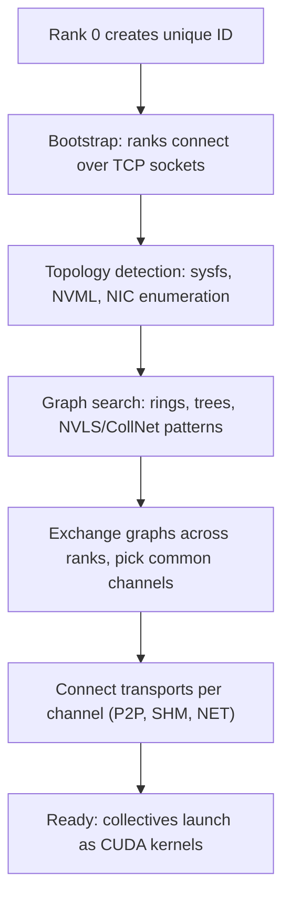
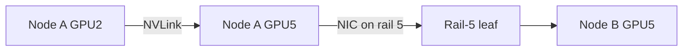

## Why this matters

NCCL (the NVIDIA Collective Communications Library, pronounced "nickel") is the layer between
PyTorch, JAX or other frameworks and your fabric. Every gradient all-reduce, every tensor-parallel
all-gather and every MoE all-to-all in a typical NVIDIA GPU cluster is executed by NCCL. When a
network engineer says "the fabric delivers 400 Gb/s per port" and the ML engineer says "all-reduce
is slow", NCCL is where both statements meet.

You do not need to read NCCL's source code to operate a fabric, but you do need a working mental
model: how it discovers which GPU is near which NIC, why it opens many parallel connections, which
transport carries which hop, and what runs on the CPU versus the GPU. With that model, NCCL's debug
output stops being noise and becomes a precise description of how your traffic will flow.

## Concepts

### The main objects

| Concept | What it is |
|---|---|
| Rank | One participant in a communicator, usually one GPU driven by one process |
| Communicator | A group of ranks that run collectives together (`ncclComm_t`); a job may have many (e.g. one per data-parallel group, one per tensor-parallel group) |
| Unique ID | A token created by one rank (`ncclGetUniqueId`) and distributed out of band (by the framework, MPI, or a key-value store) so that all ranks can find each other |
| Topology | NCCL's internal graph of GPUs, NVLink/NVSwitch, PCIe switches, CPUs and NICs, with link bandwidths |
| Channel | One parallel instance of the communication pattern: a ring or tree that uses a specific set of links; each runs in its own CUDA thread block |
| Transport | How a channel moves data between two specific ranks: P2P, SHM or NET (and CollNet/NVLS for in-network/in-switch reduction) |
| Protocol | How data and synchronization flags are packed in buffers: LL, LL128 or Simple |
| Proxy thread | A CPU thread per GPU that drives network operations on behalf of the GPU kernel |

### The communicator lifecycle



1. **Bootstrap.** Ranks open TCP connections to each other over an IP interface (selected with
   `NCCL_SOCKET_IFNAME`) to exchange addresses and metadata. This is control traffic only.
2. **Topology detection.** Each rank builds a graph of its server from Linux sysfs (PCIe hierarchy),
   NVML (GPUs and NVLink) and the network plugin (NICs and their speeds). It can be dumped to an
   XML file with `NCCL_TOPO_DUMP_FILE`, and overridden with a topology file (`NCCL_TOPO_FILE`) on
   systems such as VMs where sysfs does not show the real hardware.
3. **Graph search.** NCCL searches for the set of rings and trees that maximizes bandwidth given
   the topology: for example, rings that traverse all GPUs via NVLink and leave the node through
   the NIC closest to the last GPU.
4. **Connection setup.** For each channel and each neighbour, NCCL sets up the transport: CUDA
   peer-to-peer mappings within a node, or RDMA queue pairs and memory registrations across nodes.
5. **Execution.** A collective call enqueues a CUDA kernel on the user's stream. Thread blocks
   (one or more per channel) move data through the buffers; the proxy thread drives the NIC.

### Transports

| Transport | Used between | Mechanism |
|---|---|---|
| P2P | GPUs in the same node with peer access (NVLink or PCIe) | Direct GPU-to-GPU loads/stores or copies through mapped memory |
| SHM | GPUs in the same node without usable P2P | Staging through host shared memory (`/dev/shm`) |
| NET | GPUs in different nodes | A network plugin: built-in IB verbs (InfiniBand and RoCE) or sockets, or an external plugin |
| CollNet | Ranks using in-network reduction | Network plugin that offloads reduction (e.g. SHARP on InfiniBand) |
| NVLS | GPUs in an NVSwitch domain with NVLink SHARP | In-switch reduction and multicast on NVSwitch |

The NET layer is **pluggable**. NCCL ships an internal IB verbs implementation (used for both
InfiniBand and RoCE) and a TCP socket fallback. External plugins implement the same interface for
other networks; examples include the AWS OFI plugin (aws-ofi-nccl, for libfabric/EFA) and NVIDIA's
SHARP plugin for CollNet. A slow job that logs "Using network Socket" instead of IB has fallen back
to TCP, which is a common and severe performance problem.

> [!ANALOGY]
> NCCL is like a logistics company. The bootstrap is the phone call that sets up the deal. The
> topology is the map of warehouses and roads. Channels are the parallel delivery routes, each with
> its own truck. Transports are the vehicle types: hand trolleys between rooms of the same building
> (P2P over NVLink), a shared loading dock (SHM), and long-haul freight (NET over RDMA). The proxy
> thread is the dispatcher who books freight slots while the warehouse staff (GPU threads) pack
> boxes. Where it breaks down: in NCCL the dispatcher and the warehouse coordinate through
> lock-free flags in memory, not phone calls, so every microsecond matters.

## How it works

### Channels: parallelism across links

A single ring through 16 GPUs would use one NIC per node in each direction. A server with 8 NICs
would leave 7 idle. NCCL therefore creates **multiple channels**: several rings (and trees), each
using a different path, and splits each collective's buffer among them. On a typical 8-GPU,
8-NIC server, NCCL builds rings so that different channels enter and leave the node through
different NICs, using all of them in parallel.

- Each channel corresponds to CUDA thread blocks on the GPU, so more channels consume more SMs
  that would otherwise compute. NCCL balances this automatically.
- The channel count can be bounded with `NCCL_MIN_NCHANNELS` and `NCCL_MAX_NCHANNELS`; the defaults
  are usually best.
- Illustrative INFO output shows channels and their rank order:

```text
# Illustrative NCCL_DEBUG=INFO lines (format varies by version)
NCCL INFO Channel 00/16 :    0   1   2   3   4   5   6   7   8   9  10  11  12  13  14  15
NCCL INFO Channel 01/16 :    0   3   2   1   5   4   7   6   8  11  10   9  13  12  15  14
NCCL INFO Trees [0] 1/8/-1->0->-1 [1] 1/-1/-1->0->8
NCCL INFO Channel 00/0 : 7[7] -> 8[0] [send] via NET/IB/7/GDRDMA
NCCL INFO Channel 00/0 : 0[0] -> 1[1] via P2P/IPC
NCCL INFO Connected all rings
NCCL INFO Connected all trees
```

Reading it: channel 0's ring visits ranks 0 to 15; the hop from rank 7 (node 0's last GPU) to
rank 8 (node 1's first GPU) goes over the network via NIC index 7 using GPUDirect RDMA; the hop
from rank 0 to rank 1 uses P2P inside the node. In the tree line, the numbers around the arrows
describe children and parent of this rank in each tree (the exact notation is version-dependent).

### The proxy thread and the network path

In the classic NCCL design, GPU kernels do not post work requests to the RDMA NIC themselves (recent
releases add GPU-initiated networking options for some cases; check the release notes). Instead:

1. The GPU kernel writes data into a buffer that is registered with the NIC and sets a flag.
2. The **proxy thread** on the CPU notices the flag, posts an RDMA write (or send) to the NIC.
3. The NIC reads the data directly from GPU memory (**GPUDirect RDMA**) or from a host bounce
   buffer if GDR is unavailable, and sends it.
4. On the receiver, the NIC writes into the peer's GPU buffer; the receiver's proxy polls the
   completion and updates a flag that the receiving GPU kernel waits on.

Consequences for operators: the proxy thread needs CPU time on the right NUMA node; CPU starvation
or bad pinning shows up as network slowness; and GPUDirect RDMA requires the peer-memory kernel
support (for example the `nvidia-peermem` module or DMA-BUF support, depending on driver and kernel
version) plus a good PCIe path between GPU and NIC. NCCL decides whether to use GDR from the
topology distance between GPU and NIC; `NCCL_NET_GDR_LEVEL` controls that threshold (values such as
`PIX`, `PXB`, `PHB`, `SYS`).

```widget
pcie-topo
```

Use the widget to see why a GPU and a NIC under the same PCIe switch (PIX/PXB) are a good GDR pair,
while a pair connected across sockets (SYS) is not.

### PXN: PCI × NVLink

In a rail-optimized cluster, GPU k of every server connects to rail leaf k. If GPU 2 on node A
must send to GPU 5 on node B, the direct path would go out of GPU 2's NIC on rail 2 and need to
cross the spine to reach rail 5. With **PXN** (introduced in NCCL 2.12), NCCL can instead move
the data over NVLink to GPU 5 on node A, then send it out of **that** GPU's NIC on rail 5, keeping
the traffic on one rail leaf. The proxy of the intermediate GPU drives the send. Benefits: less
spine traffic, better message aggregation and markedly better all-to-all performance, as NVIDIA
described in its 2.12 announcement. PXN can be disabled with `NCCL_PXN_DISABLE=1` for comparison.



Try the GPU 2 to GPU 5 example in the widget with PXN on and off and compare the switch hops, the spine use and the NIC the data leaves through.

```widget
rail-path-explorer
```

### Protocols: LL, LL128 and Simple

To know when data has arrived, a receiver either waits for a separate flag after a memory fence
(expensive per operation, fine for big chunks) or packs flags **with** the data.

| Protocol | How | Payload efficiency | Latency | Used for |
|---|---|---|---|---|
| LL (low latency) | 8-byte stores containing 4 bytes of data and a 4-byte flag | ~50 % | Lowest | Small messages |
| LL128 | 128-byte lines with 120 bytes of data and 8 bytes of flag; relies on 128-byte store atomicity | ~94 % | Low | Small to medium messages on platforms where it is enabled (e.g. NVLink systems) |
| Simple | Large chunks, then a memory fence and a flag | ~100 % | Highest per step | Large messages |

NCCL's tuner picks an algorithm and protocol per collective and size from a performance model of
the detected topology. `NCCL_PROTO` and `NCCL_ALGO` can restrict the choice, but forcing them is a
diagnostic tool, not a tuning method.

### Putting it together

```widget
allreduce-sim
```

Use the widget's time model to see how the same all-reduce changes when the per-step latency drops
(LL/LL128 on small sizes) versus when bandwidth rises (more channels, more NICs).

## In practice

### What to check after a job starts

1. **Network selected**: look for "Using network IB" (or your plugin's name). "Socket" means TCP.
2. **NICs found**: the NET/IB line lists devices like `mlx5_0:1/IB` or `mlx5_0:1/RoCE`; check all
   expected NICs are present.
3. **Channels and transports**: inter-node hops should say `NET/IB/<n>/GDRDMA` when GDR is expected;
   intra-node hops should use P2P over NVLink, not SHM.
4. **Rings use different NICs**: in multi-NIC servers, channels should cross the node boundary
   through different NIC indices.
5. **Topology dump**: generate the XML with `NCCL_TOPO_DUMP_FILE=/tmp/topo.xml` and compare it with
   `nvidia-smi topo -m`.

```bash
# Capture what NCCL detected, on one rank
export NCCL_DEBUG=INFO
export NCCL_DEBUG_SUBSYS=INIT,GRAPH,NET
export NCCL_TOPO_DUMP_FILE=/tmp/nccl_topo.xml
```

## Common pitfalls

- **Socket fallback.** Symptom: inter-node bandwidth of a few GB/s. Cause: IB plugin could not
  initialize (missing `/dev/infiniband` in a container, no RDMA devices, wrong `NCCL_IB_HCA`). Fix:
  check INFO output for "Using network", fix device access and NIC selection.
- **No GPUDirect RDMA.** Symptom: hops show NET/IB without GDRDMA, high CPU memory traffic, lower
  bandwidth. Cause: peer-memory support not loaded, or GPU-NIC distance above the GDR threshold.
  Fix: load the required kernel support, check PCIe topology, review `NCCL_NET_GDR_LEVEL`.
- **SHM instead of P2P.** Symptom: intra-node hops "via SHM". Cause: P2P disabled
  (`NCCL_P2P_DISABLE=1` left set), virtualization or PCIe ACS blocking peer access. Fix: remove the
  override, check ACS/IOMMU settings and container device visibility.
- **Wrong bootstrap interface.** Symptom: hang at init or connection refused. Cause: NCCL picked
  a docker bridge or management interface unreachable between nodes. Fix: set `NCCL_SOCKET_IFNAME`.
- **Starved proxy thread.** Symptom: erratic network bandwidth under heavy CPU load. Cause: data
  loaders or other threads saturating the cores near the GPU/NIC NUMA node. Fix: CPU affinity and
  reserving cores.

## Key takeaways

- A communicator goes through bootstrap, topology detection, graph search, connection setup, then
  executes collectives as CUDA kernels.
- Channels are parallel rings/trees, each on its own links and NICs, each consuming GPU thread
  blocks.
- Transports: P2P (NVLink/PCIe), SHM (host memory), NET (IB verbs, sockets or plugins), plus
  CollNet and NVLS for in-network/in-switch reduction.
- A CPU proxy thread drives the NIC; GPUDirect RDMA lets the NIC read and write GPU memory directly.
- PXN routes data over NVLink to the GPU on the destination's rail, keeping traffic rail-local.
- Protocols LL, LL128 and Simple trade payload efficiency for latency; NCCL picks per size.
