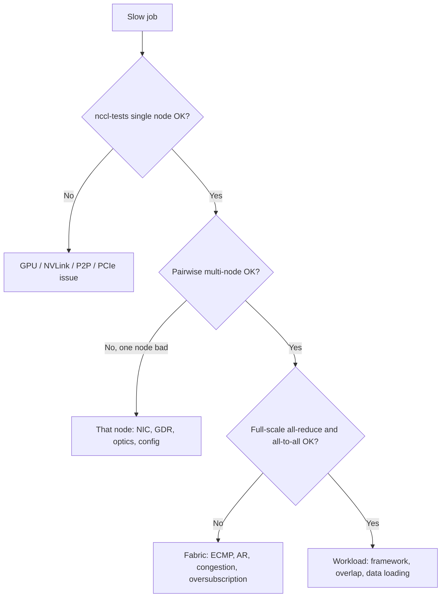

## Why this matters

When distributed training goes wrong, the symptom usually surfaces in NCCL: a job that never gets
past initialization, a collective that hangs until a watchdog kills the process after many
minutes, an error mentioning "remote process exited or there was a network error", or simply a step
time that is 40 % slower than last week. The network team is called because NCCL "is the network".
Sometimes it is. Often it is a GPU, a PCIe setting, a container configuration, a crashed rank or a
mismatched software version.

Debugging NCCL well means being fast at two things: getting the **right logs from the right ranks**
and running **controlled experiments** that remove one layer at a time. With a solid method, most
incidents take minutes to localise instead of days of blame-shifting between ML, systems and
network teams.

## Concepts

### Four classes of problem

| Class | Typical symptom | First suspects |
|---|---|---|
| Initialization failure | Error or hang during `init_process_group` / communicator creation | Bootstrap interface, DNS/firewall, RDMA device access, GID, mismatched versions |
| Hang | Training stops; GPUs at 100 % "utilization" spinning in NCCL kernels, watchdog timeout later | A rank crashed or diverged (different collective order), dead link, PFC deadlock |
| Transport error | `NCCL WARN` lines about IB completions, retry exceeded, "remote process exited" | Link flaps, black-holed paths, peer crash, timeouts too low for real congestion |
| Performance regression | Job runs but slower than baseline | Socket fallback, no GDR, wrong NICs, ECMP collisions, congestion, slow node |

### The logging controls

| Variable | Values | Use |
|---|---|---|
| `NCCL_DEBUG` | `VERSION`, `WARN`, `INFO`, `TRACE` | `WARN` in production, `INFO` when investigating; `TRACE` only in builds compiled with tracing |
| `NCCL_DEBUG_SUBSYS` | Comma list such as `INIT`, `NET`, `GRAPH`, `ENV`, `TUNING`, `COLL`, `P2P`, `SHM`, `BOOTSTRAP`, `ALL` | Limit INFO output to the parts you need (prefix `^` to exclude) |
| `NCCL_DEBUG_FILE` | Path with `%h` (hostname) and `%p` (PID) | Write one log file per process instead of interleaving on stdout |

```bash
# Targeted investigation of init and network selection, one file per rank
export NCCL_DEBUG=INFO
export NCCL_DEBUG_SUBSYS=INIT,NET,ENV
export NCCL_DEBUG_FILE=/scratch/nccl-logs/nccl.%h.%p.log
```

> [!ANALOGY]
> Debugging NCCL is like troubleshooting a conference call where one participant has gone silent.
> Everyone else waits politely forever (a hang), and their logs only say "waiting". You find the
> problem by asking who stopped talking and why, not by checking the phone lines of the people still
> waiting. Where it breaks down: in NCCL, the silent participant might be silent because of a
> network fault between two specific ranks, so you must also test the "lines" pairwise.

## How it works

### Reading INFO output

A healthy initialization on a RoCE cluster looks something like this (illustrative; formats change
between versions):

```text
node01:1234:1234 [0] NCCL INFO NCCL version 2.x.y+cuda12.z
node01:1234:1234 [0] NCCL INFO Bootstrap : Using bond0:10.0.0.11<0>
node01:1234:1290 [0] NCCL INFO NET/IB : Using [0]mlx5_0:1/RoCE [1]mlx5_1:1/RoCE ... [7]mlx5_7:1/RoCE [RO]; OOB bond0:10.0.0.11<0>
node01:1234:1290 [0] NCCL INFO Using network IB
node01:1234:1290 [0] NCCL INFO comm 0x5581 rank 0 nRanks 16 nNodes 2 localRanks 8 localRank 0 - Init START
node01:1234:1290 [0] NCCL INFO Channel 00/16 :    0   1   2   3   4   5   6   7   8   9  10  11  12  13  14  15
node01:1234:1290 [0] NCCL INFO Channel 00/0 : 15[7] -> 0[0] [receive] via NET/IB/0/GDRDMA
node01:1234:1290 [0] NCCL INFO Channel 00/0 : 0[0] -> 1[1] via P2P/IPC
node01:1234:1290 [0] NCCL INFO Connected all rings
node01:1234:1290 [0] NCCL INFO comm 0x5581 rank 0 nRanks 16 nNodes 2 localRanks 8 localRank 0 - Init COMPLETE
```

What to check, in order:

1. **Version** is the same on every rank (mixed NCCL versions in one job cause failures or hangs).
2. **Bootstrap interface** is the intended network on every node.
3. **NET/IB device list** contains exactly the expected NICs, and the link layer (IB or RoCE) is
   right.
4. **"Using network IB"** (or your plugin); "Socket" means fallback to TCP.
5. **Transports**: inter-node hops with `GDRDMA` where GDR is expected; intra-node hops via P2P,
   not SHM.
6. **Init COMPLETE** on every rank. A rank that never logs it is your starting point.

### Hangs: find the rank that is different

In a hang, most ranks are waiting inside a collective for data that will never come. Their logs
look identical and useless. The useful questions are:

- **Is every process still alive?** One rank crashing (out-of-memory, a Python exception, a GPU
  Xid error) leaves everyone else waiting. Check the job scheduler, process lists and `dmesg` for
  GPU errors on each node.
- **Did all ranks call the same collectives in the same order?** Divergent control flow (one rank
  skips a step, different tensor sizes, a conditional all-reduce) causes a hang with no network
  fault at all. PyTorch's NCCL watchdog and its debug facilities (for example its flight recorder of
  recent collectives, configured through `TORCH_NCCL_*` variables; see the PyTorch docs for your
  version) help show which collective each rank was in.
- **Is one link dead?** If two specific ranks cannot exchange data, the ring through them stalls.
  NIC port state, switch logs and pairwise nccl-tests reveal it.
- **Is the fabric deadlocked?** A PFC deadlock or pause storm on the RoCE priority freezes traffic;
  look at switch PFC counters and the PFC watchdog.

PyTorch reports collective timeouts from its watchdog thread. An illustrative message:

```text
# Illustrative PyTorch watchdog timeout (wording varies by version)
[Rank 5] Watchdog caught collective operation timeout: WorkNCCL(SeqNum=48213, OpType=ALLREDUCE,
NumelIn=262144000, NumelOut=262144000, Timeout(ms)=600000) ran for 600012 milliseconds before timing out.
```

Compare `SeqNum` and `OpType` across ranks: a rank with a lower sequence number, or a different
operation at the same sequence number, has diverged. Whether the process then aborts or continues
is controlled by `TORCH_NCCL_ASYNC_ERROR_HANDLING` (a PyTorch variable, not an NCCL one).

### Transport errors

On the IB verbs transport, NCCL reports failed work completions with the verbs status. Illustrative
examples:

```text
# Illustrative NCCL WARN lines
NCCL WARN NET/IB : Got completion from peer 10.0.1.23<44122> with status=12 opcode=0 len=0 vendor err 129 (Send) localGid ::ffff:10.0.0.11 remoteGid ::ffff:10.0.1.23 hca mlx5_3
NCCL WARN NET/IB : Got completion from peer 10.0.1.23<44122> with status=5 opcode=0 len=0 vendor err 249 (Recv)
```

| Verbs completion status | Name | Usual meaning in a cluster |
|---|---|---|
| 12 | `IBV_WC_RETRY_EXC_ERR` (transport retry counter exceeded) | Peer unreachable for longer than timeout × retries: link down, black-holed path, crashed peer node, extreme congestion or PFC deadlock |
| 5 | `IBV_WC_WR_FLUSH_ERR` (work request flushed) | QP already in error state; a **consequence** of an earlier error, not the root cause |
| 13 | `IBV_WC_RNR_RETRY_EXC_ERR` (receiver not ready retries exceeded) | Receiver did not post buffers in time; often software or peer-process trouble |
| 10 | `IBV_WC_REM_ACCESS_ERR` (remote access error) | Memory key or permission problem; can indicate a peer that restarted or a software bug |

The first error in time, on the first rank that saw it, is the one to chase. Flush errors on many
ranks are just the cascade. For status 12, look at the specific `hca` and `remoteGid` in the
message: they name the local NIC and the peer, so you can check that exact link pair, its switch
ports and the path between them. Raising `NCCL_IB_TIMEOUT` or `NCCL_IB_RETRY_CNT` only makes sense
after you have confirmed that the fabric is healthy and congestion events are legitimately long.

Switch the explorer to "Symptom → suspect variables" to see which settings to check for each class of symptom before you change anything.

```widget
nccl-env-explorer
```

### Performance regressions: a layer-by-layer method



Controlled experiments with diagnostic-only variables help localize further:

| Experiment | What it tells you |
|---|---|
| `NCCL_P2P_DISABLE=1` on a single node | If the problem disappears, it is in intra-node P2P (NVLink/PCIe peer path, ACS/IOMMU settings) |
| `NCCL_IB_DISABLE=1` across nodes | Forces sockets: if a hang disappears (at much lower speed), the RDMA path is implicated |
| `NCCL_NET_GDR_LEVEL` lowered | If stability improves, GPUDirect RDMA (peer-memory support, PCIe path) is suspect |
| `NCCL_ALGO=Ring` vs `Tree` | If only one algorithm misbehaves, check the links that algorithm uses at that scale |
| `NCCL_PROTO=Simple` | If LL/LL128 issues are suspected (rare, platform-specific) |
| `NCCL_TOPO_DUMP_FILE` | Compare the detected topology across "good" and "bad" nodes |

```widget
pcie-topo
```

A frequent root cause on new servers is a GPU-NIC pair that is further apart than intended (SYS
instead of PIX/PXB), or PCIe ACS enabled on switches so peer traffic is redirected through the CPU
root complex. The widget helps you read the topology matrix you will compare against.

```widget
allreduce-sim
```

When a step time regresses, use the cost model to check whether the regression is latency-like
(small messages, many steps) or bandwidth-like (large messages): it points to different layers.

## In practice

### A first-response checklist

1. **Collect**: job ID, node list, NCCL/CUDA/driver/framework versions, env vars, the first error
   timestamp.
2. **Find the first failure**: earliest WARN or exception across all ranks (central logging helps).
3. **Classify**: init failure, hang, transport error or performance.
4. **Check the obvious**: all processes alive? GPU Xid errors in `dmesg`? NIC ports up
   (`ibstat` / `ibv_devinfo`)? Socket fallback in INFO logs?
5. **Reproduce with nccl-tests** on the same nodes, same container, same env.
6. **Bisect**: single node, pairs, subsets, full scale; remove one variable at a time.
7. **Fix and record**: root cause, evidence, and whether any temporary workaround variable must be
   removed later.

### Useful host checks

```bash
# Illustrative host checks; adjust device names (take them from `rdma link`)
nvidia-smi topo -m                     # GPU-NIC PCIe/NVLink relationships
lsmod | grep -E 'nvidia_peermem'       # peer-memory module, if your stack uses it for GDR
ibv_devinfo -d mlx5_3 | grep -E 'state|active_mtu|link_layer'
cat /sys/class/infiniband/mlx5_3/ports/1/counters/port_rcv_errors
rdma statistic show link mlx5_3/1      # RDMA hw counters: out_of_sequence, local_ack_timeout_err, ...
sudo dmesg -T | grep -iE 'xid|mlx5|nvrm' | tail   # many distros restrict dmesg to root
```

`mlx5_3` is the NVIDIA-stack (MLNX_OFED/DOCA) naming that NCCL logs on most GPU servers; with the
distro's inbox rdma-core the same device is named like `rocep3s0f0`, so copy the name NCCL printed
or read it from `rdma link`. A missing device fails clearly: `ibv_devinfo -d` prints
`IB device 'mlx5_3' wasn't found`.

On recent driver stacks GPUDirect RDMA may use DMA-BUF instead of `nvidia-peermem`; the NCCL INFO
output (GDRDMA on NET hops) is the definitive check of what is in use.

### Reading a regression report

```text
# Illustrative: same job, last week vs today, NCCL INFO excerpts on rank 0
last week:  NCCL INFO Channel 00/0 : 7[7] -> 8[0] [send] via NET/IB/7/GDRDMA
today:      NCCL INFO Channel 00/0 : 7[7] -> 8[0] [send] via NET/IB/7
```

The `GDRDMA` suffix disappeared: data is now staged through host memory. Likely causes include a
driver update that changed the peer-memory mechanism, or the peer-memory module not loading after a
kernel update. The network itself did not change.

> [!WARNING]
> Do not "fix" a hang by setting `NCCL_IB_DISABLE=1` or `NCCL_P2P_DISABLE=1` permanently. You will
> trade a visible failure for a hidden performance loss of several times, and the real fault (a bad
> link, a GDR problem, an ACS setting) will remain.

> [!INTERVIEW]
> "A 512-GPU job hangs every few hours. All ranks show watchdog timeouts. How do you approach it?"
> A strong answer: don't start with the network. Collect per-rank logs and find the first error and
> any rank with a different SeqNum/OpType (divergence or crash). Check process liveness, GPU Xid
> errors, NIC and switch link events around the timestamp. If the first error is an IB status 12 on
> a specific HCA/peer pair, inspect that path's ports, optics, flaps and PFC counters. Reproduce with
> nccl-tests on the suspect nodes, bisect with pairwise tests, and fix the root cause rather than
> raising timeouts or disabling transports.

## Common pitfalls

- **Logging everything everywhere.** Symptom: gigabytes of interleaved logs, nothing findable. Cause:
  `NCCL_DEBUG=INFO` with all subsystems on stdout at scale. Fix: `NCCL_DEBUG_SUBSYS` filters and
  `NCCL_DEBUG_FILE` with `%h.%p`.
- **Chasing flush errors.** Symptom: hunting `status=5` on dozens of ranks. Cause: flushes are
  consequences of an earlier failure. Fix: find the first, non-flush error in time.
- **Blaming the network for divergence.** Symptom: hang with no link or switch events. Cause: ranks
  called different collectives (code path, data-dependent control flow) or one crashed. Fix: compare
  watchdog SeqNum/OpType across ranks, check process exits.
- **Mixed software versions.** Symptom: init failures or hangs after a partial rollout. Cause:
  different NCCL or driver versions across nodes. Fix: check the version line on every rank;
  enforce images.
- **Raising timeouts to hide link problems.** Symptom: fewer errors, but long stalls. Cause: flapping
  link or deadlock masked by longer `NCCL_IB_TIMEOUT`. Fix: fix the link and PFC configuration.
- **Leaving diagnostic variables in place.** Symptom: months-later mystery slowness. Cause: a
  forgotten `NCCL_ALGO`, `NCCL_PROTO` or `NCCL_P2P_DISABLE`. Fix: audit job environments; check
  `NCCL_DEBUG_SUBSYS=ENV` output in baselines.

## Key takeaways

- Use `NCCL_DEBUG=INFO` with `NCCL_DEBUG_SUBSYS` and per-process `NCCL_DEBUG_FILE`; keep `WARN` in
  production.
- Classify first: init failure, hang, transport error or performance regression.
- In hangs, find the rank that is different (crashed, diverged or behind a dead link); waiting ranks'
  logs are not the root cause.
- IB status 12 (retry exceeded) points at a specific local HCA and peer; flush errors (status 5) are
  consequences.
- Bisect with nccl-tests: single node, pairs, then full scale; use disable/force variables only as
  temporary experiments.
- Check the INFO line details (network, GDRDMA, P2P vs SHM) against a known-good baseline.
